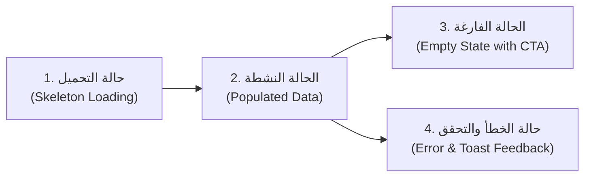

# وثيقة نظام التصميم المعتمد — منصة فيلورا (VELORA)
# VELORA Master Design System Specification

**إصدار الوثيقة:** 1.0.0 (Master Enterprise Specification)  
**الحالة:** معتمدة للتنفيذ الهندسي (Approved for Production & Google Stitch UI Generation)  
**الدور المعماري:** Senior Principal Design System Architect & UI/UX Director  
**العلامة التجارية المعتمدة:** **VELORA (فيلورا)** — The Unified Operating System for Modern Training Centers  
**تاريخ الاعتماد:** نوفمبر 2026  
**المرجعيات الملزمة:** [PRD.md](PRD.md) | [STITCH_MASTER_PROMPT.md](STITCH_MASTER_PROMPT.md) | [UX_BLUEPRINT.md](UX_BLUEPRINT.md) | [SCREEN_INVENTORY.md](SCREEN_INVENTORY.md) | [UI_UX_REQUIREMENTS.md](UI_UX_REQUIREMENTS.md)  

---

## الفهرس العام (Table of Contents)
1. [الرؤية وفلسفة الهوية البصرية (Brand Identity & Vision)](#1-الرؤية-وفلسفة-الهوية-البصرية)
2. [لوحة الألوان ونظام الرموز اللونية (Master Color Tokens)](#2-لوحة-الألوان-ونظام-الرموز-اللونية)
3. [منظومة الخطوط والمقاييس الطباعية (Typography System & Type Scale)](#3-منظومة-الخطوط-والمقاييس-الطباعية)
4. [شبكة التباعد والأبعاد القياسية (Spacing System & 4px Baseline)](#4-شبكة-التباعد-والأبعاد-القياسية)
5. [أنصاف أقطار الحواف (Border Radii)](#5-أنصاف-أقطار-الحواف)
6. [مستويات الظلال والارتفاع (Shadows & Elevation)](#6-مستويات-الظلال-والارتفاع)
7. [هندسة الشبكات وتخطيط الصفحات (Layout Grids & App Shell)](#7-هندسة-الشبكات-وتخطيط-الصفحات)
8. [منظومة الأيقونات وقواعد الانعكاس الاتجاهي (Iconography & RTL Flipping)](#8-منظومة-الأيقونات-وقواعد-الانعكاس-الاتجاهي)
9. [مكتبة الأزرار وعناصر التحكم (Button System)](#9-مكتبة-الأزرار-وعناصر-التحكم)
10. [حقول ونماذج الإدخال (Inputs & Form Controls)](#10-حقول-ونماذج-الإدخال)
11. [البطاقات والحاويات السطحية (Cards & Surface Containers)](#11-البطاقات-والحاويات-السطحية)
12. [جداول البيانات وشبكات المعلومات (Data Tables & Grids)](#12-جداول-البيانات-وشبكات-المعلومات)
13. [النوافذ المنبثقة والألواح المنزلقة (Dialogs, Modals & Slide-over Drawers)](#13-النوافذ-المنبثقة-والألواح-المنزلقة)
14. [هيكل التنقل وتوزيع الصلاحيات (Navigation & Strict RBAC)](#14-هيكل-التنقل-وتوزيع-الصلاحيات)
15. [معمارية الحالات التشغيلية (States Architecture)](#15-معمارية-الحالات-التشغيلية)
16. [نقاط التجاوب والسلوك المحمول (Responsive Breakpoints)](#16-نقاط-التجاوب-والسلوك-المحمول)
17. [إمكانية الوصول والشمولية (WCAG 2.1 AA & Keyboard Rules)](#17-إمكانية-الوصول-والشمولية)
18. [قواعد الاتجاه العربي الأصيل (Native RTL Guidance)](#18-قواعد-الاتجاه-العربي-الأصيل)
19. [دليل التطبيق الاتساقي على شاشات Stitch اللاحقة (Application to Subsequent Screens)](#19-دليل-التطبيق-الاتساقي-على-شاشات-stitch-اللاحقة)

---

## 1. الرؤية وفلسفة الهوية البصرية

### 1.1 جوهر العلامة التجارية
منصة **VELORA (فيلورا)** هي نظام التشغيل الإداري والمالي والأكاديمي الموحد لمراكز التدريب المهني في منطقة الشرق الأوسط وشمال أفريقيا. تم بناء الهوية البصرية للمنصة لتعكس:
- **الموثوقية والرزانة المؤسسية (Enterprise Reliability):** واجهات نظيفة عالية الكثافة البيانية، متوازنة ومستقرة، تخلو تماماً من الزخارف العشوائية أو الرسوم غير الوظيفية.
- **التوجيه بالمهام الفورية (Action-Driven Clarity):** إبراز الأولويات التشغيلية الحرجة (سندات القبض الورقية المعلقة، متابعة المتعثرين مالياً، رصد حضور القاعة بلمسة واحدة، تسليم التكليفات).
- **الدقة المحاسبية والرقابة الصارمة (Financial Integrity):** تصميم واجهات تعكس الرقابة الثنائية وفصل الصلاحيات ومنع الفائض المالي من الضياع.
- **العربية الأصيلة أولاً (Arabic-First Native Experience):** واجهات مصممة أصلاً باللغة العربية والاتجاه من اليمين إلى اليسار وليست واجهات غربية مترجمة شكلياً.

### 1.2 شعار العلامة (Brand Assets)
- **رمز العلامة (Icon Mark):** رمز هندسي صلب بدرجة اللون النيلي الأساسي (`#4F46E5`) مستوحى من الحرف الأول "V" وشبكة مسارات النمو الأكاديمي (`brand/velora-icon.png`).
- **الشعار الكامل (Wordmark Logo):** عبارة عن علامة الرمز متبوعة باسم المنصة بطباعة حادة وحديثة "VELORA" وبالعربية "فيلورا" (`brand/velora-logo.png` للخلفيات الفاتحة و `brand/velora-logo-dark.png` للخلفيات الداكنة).

---

## 2. لوحة الألوان ونظام الرموز اللونية (Master Color Tokens)

تلتزم جميع مكونات المنصة بنظام الرموز اللونية التالي المبني على معايير Tailwind CSS مع تثبيت أكواد HEX الصريحة:

### 2.1 اللون الأساسي للعلامة التجارية (Brand Indigo Tokens)
| الرمز البرمجي | كود اللون (HEX) | فئة Tailwind | الوظيفة والاستخدام |
| :--- | :--- | :--- | :--- |
| `color-brand-50` | `#EEF2FF` | `indigo-50` | خلفية العناصر النشطة في القائمة، خلفية التبويب المحدد، شارات خفيفة |
| `color-brand-100`| `#E0E7FF` | `indigo-100` | أسطح ثانوية خفيفة، حواف الأزرار غير النشطة |
| `color-brand-200`| `#C7D2FE` | `indigo-200` | حدود الحقول عند التحديد الخفيف، شارات الرموز |
| `color-brand-500`| `#6366F1` | `indigo-500` | مؤشرات التركيز المضيئة، أيقونات التمييز |
| **`color-brand-600`**| **`#4F46E5`** | **`indigo-600`** | **اللون الرئيسي للعلامة: الأزرار الرئيسية، حلقة التركيز، الروابط النشطة** |
| `color-brand-700`| `#4338CA` | `indigo-700` | حالة التمرير (Hover) للأزرار الرئيسية |
| `color-brand-800`| `#3730A3` | `indigo-800` | حالة النقر والضغط (Active / Pressed) للأزرار الرئيسية |
| `color-brand-900`| `#312E81` | `indigo-900` | نصوص العلامة عالية التباين، رؤوس البطاقات الداكنة |

### 2.2 لوحة الألوان المحايدة والأسطح (Neutral Slate Tokens)
| الرمز البرمجي | كود اللون (HEX) | فئة Tailwind | الاستخدام المعماري |
| :--- | :--- | :--- | :--- |
| `color-bg-canvas` | `#F8FAFC` | `slate-50` | خلفية الصفحة العامة ومساحة العمل (`Canvas Background`) |
| `color-surface-white` | `#FFFFFF` | `white` | خلفية البطاقات، النوافذ، الألواح المنزلقة، والترويسة |
| `color-surface-subdued`| `#F1F5F9` | `slate-100` | ترويسات الجداول، الصناديق الملخصة، الحقول المعطلة |
| `color-border-subtle` | `#E2E8F0` | `slate-200` | الحدود القياسية والفواصل والخطوط بين الخلايا |
| `color-border-strong` | `#CBD5E1` | `slate-300` | حدود الحقول عند الوقوف عليها، فواصل الأقسام |
| `color-text-muted` | `#64748B` | `slate-500` | النصوص الخافتة، التلميحات، الطوابع الزمنية، الأيقونات الثابتة |
| `color-text-secondary`| `#334155` | `slate-700` | نصوص المتن، بيانات الجداول، تسميات الحقول الإلزامية |
| `color-text-primary` | `#0F172A` | `slate-900` | العناوين الرئيسية، الأرقام الكبرى للـ KPIs، النصوص البارزة |

### 2.3 لوحة الحالات التشغيلية والمحاسبية (Semantic Status Tokens)
تعتمد كل حالة تشغيلية ثلاثية متكاملة (لون صلب، لون خلفية مخفف، ولون نص عالي التباين):

```
+-----------------------------------------------------------------------------------------+
| الحالات التشغيلية المعتمدة (Semantic Triplets)                                            |
|                                                                                         |
| [حالة النجاح والاعتماد — Success]                                                       |
| - اللون الصلب (Solid): #16A34A (green-600)                                              |
| - الخلفية المخففة (Tint Surface): #DCFCE7 (green-100)                                   |
| - النص المركز (Text): #15803D (green-700)                                               |
| - الاستخدام: سند معتمد، دورة نشطة، طالب حاضر، سداد كامل (Fully Paid).                   |
|                                                                                         |
| [حالة التحذير والتعليق — Warning]                                                       |
| - اللون الصلب (Solid): #D97706 (amber-600)                                              |
| - الخلفية المخففة (Tint Surface): #FEF3C7 (amber-100)                                   |
| - النص المركز (Text): #B45309 (amber-700)                                               |
| - الاستخدام: سند معلق للاعتماد، سداد جزئي، قائمة انتظار FIFO، سعة أوشكت على الامتلاء.    |
|                                                                                         |
| [حالة الخطر والرفض والفائض — Danger / Critical]                                         |
| - اللون الصلب (Solid): #DC2626 (red-600)                                                |
| - الخلفية المخففة (Tint Surface): #FEE2E2 (red-100)                                     |
| - النص المركز (Text): #B91C1C (red-700)                                                 |
| - الاستخدام: سند مرفوض، طالب غائب، تنبيه فائض مالي (Overpayment)، موعد تسليم منتهٍ.     |
|                                                                                         |
| [حالة المعلومات والجدولة — Informational]                                               |
| - اللون الصلب (Solid): #2563EB (blue-600)                                               |
| - الخلفية المخففة (Tint Surface): #DBEAFE (blue-100)                                    |
| - النص المركز (Text): #1D4ED8 (blue-700)                                                |
| - الاستخدام: مسودة دورة (Draft)، جلسة مجدولة قادمة، إشعارات نظامية عامة.                 |
+-----------------------------------------------------------------------------------------+
```

---

## 3. منظومة الخطوط والمقاييس الطباعية (Typography System & Type Scale)

### 3.1 عائلة الخطوط المعتمدة (Font Families)
- **الخط الأساسي لواجهة المستخدم:** `IBM Plex Sans Arabic`
  - *البدائل الاحتياطية:* `Cairo`, `sans-serif`
  - *المميزات:* يتميز هذا الخط بمقروئية استثنائية في الأحجام الصغيرة (12px - 14px)، وأوزان متوازنة تدعم المحاذاة الدقيقة في الجداول الإدارية والمحاسبية.
- **الخط التقني والرموز اللاتينية:** `Inter`, `sans-serif` (للأكواد والوسوم البرمجية).

### 3.2 قاعدة الأرقام القياسية الغربية (Western Numerals Rule)
- تُعرض جميع الأرقام المالية، أرقام الهواتف، التواريخ، والنسب المئوية باستخدام **الأرقام القياسية الموحدة (`1, 2, 3, 4, 5...`)**.
- يُلزم استخدام الخاصية `font-variant-numeric: tabular-nums` في الجداول المحاسبية وبطاقات المؤشرات لضمان محاذاة الفواصل العشرية عمودياً ومنع تذبذب العرض عند تحديث الأرقام.

### 3.3 سلم المقاييس الطباعية (Type Scale Table)
| العنصر التصميمي | الفئة (Token) | الحجم (Size) | الوزن (Weight) | ارتفاع السطر (Line-Height) | الاستخدام العملي |
| :--- | :--- | :--- | :--- | :--- | :--- |
| **Hero KPI Value** | `text-kpi` | 32px – 36px | ExtraBold (800) | 40px (`leading-10`) | أرقام المؤشرات الكبرى في بطاقات الـ KPI |
| **Page Header (H1)** | `text-2xl` | 24px | Bold (700) | 32px (`leading-8`) | عناوين الشاشات الرئيسية أسفل الترويسة |
| **Section Title (H2)**| `text-lg` | 18px | SemiBold (600) | 28px (`leading-7`) | عناوين البطاقات، النوافذ المنبثقة، الأقسام |
| **Subheading (H3)** | `text-base` | 16px | Medium (500) | 24px (`leading-6`) | عناوين مجموعات الحقول، التبويبات الرئيسية |
| **Body Standard** | `text-sm` | 14px | Regular (400) | 20px (`leading-5`) | نصوص الجداول، قيم الحقول، الملاحظات التوضيحية |
| **Body Medium** | `text-sm-med` | 14px | Medium (500) | 20px (`leading-5`) | أسماء الطلاب، عناوين الدورات في القوائم |
| **Caption / Badge** | `text-xs` | 12px | Medium (500) | 16px (`leading-4`) | شارات الحالة، البيانات الوصفية، التلميحات |
| **Micro / Subtext** | `text-xxs` | 11px | Regular (400) | 14px | نصوص حقوق النظام، الطوابع الزمنية الدقيقة |

---

## 4. شبكة التباعد والأبعاد القياسية (Spacing System & 4px Baseline)

تعتمد المنصة شبكة خط الأساس **4px Baseline Grid** لتحقيق إيقاع رأسي وأفقي متسق عبر الشاشات:

```
Token:       Value:    Equivalent:  Typical Usage:
---------------------------------------------------------------------------------
space-0.5     2px      0.125rem     فواصل الحواف الدقيقة وشارات النقاط الحية
space-1       4px      0.25rem      فراغات الأيقونات الداخلية داخل الشارات
space-1.5     6px      0.375rem     حواشي الحقول الرقيقة والشارات المضغوطة
space-2       8px      0.5rem       المسافة بين الأيقونة والنص، حواشي القوائم المنسدلة
space-3      12px      0.75rem      الحواشي الداخلية لحقول الإدخال والأزرار الصغيرة
space-4      16px      1.0rem       التباعد القياسي بين عناصر النماذج، حواشي الموبايل
space-5      20px      1.25rem      حواشي البطاقات الداخلية القياسية (Cards Padding)
space-6      24px      1.5rem       الفراغات بين أعمدة الشبكة، حواشي النوافذ المنبثقة
space-8      32px      2.0rem       حواشي مساحة العمل الرئيسية على الديسكتوب (p-8)
space-10     40px      2.5rem       الفراغات الكبرى بين الأقسام الرئيسية
space-12     48px      3.0rem       أبعاد أهداف اللمس على الأجهزة المحمولة
space-16     64px      4.0rem       ارتفاع الترويسة العلوية الثابتة (Fixed Top Bar)
space-64    256px      16.0rem      عرض القائمة الجانبية المفتوحة (Sidebar Width)
---------------------------------------------------------------------------------
```

---

## 5. أنصاف أقطار الحواف (Border Radii)

يتم تطبيق استدارة الحواف بانضباط وظيفي يعكس هوية عصرية دون مبالغة:
- **`rounded-xs` (2px):** مؤشرات التحديد الرأسية على جانب القائمة (`border-s-4`).
- **`rounded-sm` (4px):** شارات التصنيف التقنية الدقيقة.
- **`rounded-md` (6px):** القوائم المنسدلة الخفيفة (Dropdown Menus)، التلميحات العائمة (Tooltips).
- **`rounded-lg` (8px):** حقول الإدخال (Inputs)، الأزرار (Buttons)، مربعات الاختيار (Checkboxes)، أزرار التبديل.
- **`rounded-xl` (12px):** البطاقات السطحية (Surface Cards)، جداول البيانات (Tables)، حاويات المؤشرات، الألواح المنزلقة (Drawers).
- **`rounded-2xl` (16px):** النوافذ المنبثقة التفاعلية (Modal Dialogs)، بطاقات تسجيل الدخول المركزية.
- **`rounded-full` (9999px):** شارات الحالة (Status Pills)، الصور الرمزية (Avatars)، مفاتيح التبديل الثنائية (Toggles).

---

## 6. مستويات الظلال والارتفاع (Shadows & Elevation)

تعتمد المنصة أربعة مستويات للارتفاع البصري تمنح الواجهة عمقاً مريحاً للعين:

```css
/* Level 0: الأسطح المستوية المندمجة */
--shadow-0: none;

/* Level 1: البطاقات القياسية وحاويات المؤشرات (Subtle Elevation) */
--shadow-card: 0 1px 3px 0 rgb(15 23 42 / 0.06), 0 1px 2px -1px rgb(15 23 42 / 0.04);

/* Level 2: بطاقات الوقوف واللوائح العائمة (Hover & Dropdowns) */
--shadow-dropdown: 0 4px 6px -1px rgb(15 23 42 / 0.08), 0 2px 4px -2px rgb(15 23 42 / 0.06);

/* Level 3: أشرطة الإجراءات المثبتة والقوائم المنسدلة الكبرى */
--shadow-floating: 0 10px 15px -3px rgb(15 23 42 / 0.08), 0 4px 6px -4px rgb(15 23 42 / 0.04);

/* Level 4: النوافذ المنبثقة والألواح المنزلقة (Modals & Drawers) */
--shadow-modal: 0 20px 25px -5px rgb(15 23 42 / 0.12), 0 8px 10px -6px rgb(15 23 42 / 0.08);

/* طبقة حجب الخلفية (Backdrop Overlay) */
--backdrop-scrim: rgba(15, 23, 42, 0.5) with backdrop-filter: blur(2px);
```

---

## 7. هندسة الشبكات وتخطيط الصفحات (Layout Grids & App Shell)

### 7.1 هيكل الغلاف العام للواجهة (Application Shell)
```
+-----------------------------------------------------------------------------------------------+
| الترويسة العلوية الثابتة (Fixed Top Header: h-16, w-full, bg-white, border-b border-slate-200) |
| [علامة فيلورا] [شارة المركز النشط]     [بحث سريع Ctrl+K]   [جرس التنبيهات 5] [حساب المستخدم]  |
+-----------------------------------------------+-----------------------------------------------+
| مساحة المحتوى الرئيسية القابلة للتمرير          | القائمة الجانبية اليمنى الثابتة (RTL Sidebar) |
| (Scrollable Canvas: bg-slate-50, p-6 to p-8)  | (w-64, bg-white, border-l border-slate-200)    |
| - شريط العنوان وفتات الخبز والإجراءات الرئيسية  | - روابط مصرح بها فقط وفق الـ RBAC            |
| - شبكة بطاقات المؤشرات (4-Col Grid)           | - مؤشر الحالة النشطة (Indigo-50 + Indigo Line)|
| - مساحة العمل المقسمة (60% مهام / 40% تنبيهات)| - عدادات التنبيهات (5 سندات معلقة)            |
| - الجداول التفاعلية أو التبويبات الأكاديمية   | - مؤشر سعة تخزين المركز والنسخة v1.0.0         |
+-----------------------------------------------+-----------------------------------------------+
```

### 7.2 شبكات تخطيط مساحة العمل (Content Canvas Grids)
- **أقصى عرض للحاوية (Max-Width Constraint):** يُثبت المحتوى عند `max-w-[1600px] mx-auto` في شاشات الـ 4K والشاشات فائقة العرض لمنع تشتت مسار العين.
- **شبكة المؤشرات (KPI Metric Grid):**
  - شاشات الحواسيب (`>=1024px`): 4 أعمدة متساوية (`grid-cols-4 gap-5`).
  - الأجهزة اللوحية (`640px - 1023px`): عمودان (`grid-cols-2 gap-4`).
  - الهواتف الذكية (`360px - 639px`): عمود واحد رأسي مكدس (`grid-cols-1 gap-3`).
- **شبكة مساحة العمل المقسمة (Two-Column Working Canvas):**
  - العمود الرئيسي (60% – 65%): جدول سندات الاعتماد أو جدول المحاضرات والطلاب.
  - العمود الجانبي (35% – 40%): مركز تنبيهات السعة، قوائم الانتظار، والمحاضرات الميدانية.

---

## 8. منظومة الأيقونات وقواعد الانعكاس الاتجاهي (Iconography & RTL Flipping)

### 8.1 المكتبة المعتمدة
- **المكتبة الأساسية:** `Lucide Icons` (أو Phosphor Icons بوزن منتظم).
- **سمك الخط (Stroke Width):** ثابت عند `1.75px` لكافة الأيقونات لضمان نقاء الخطوط على كافة الشاشات.
- **الأحجام القياسية:**
  - `w-4 h-4` (16px): داخل الأزرار، الشارات الصغيرة، وخلايا الجداول.
  - `w-5 h-5` (20px): في القائمة الجانبية، حقول الإدخال، وأشرطة التبويب.
  - `w-6 h-6` (24px): في رؤوس النوافذ المنبثقة، وبطاقات الـ KPI.
  - `w-12 h-12` (48px): في الحالات الفارغة (Empty States).

### 8.2 القواعد الصارمة للانعكاس الاتجاهي (RTL Icon Flipping Rules)
- **الأيقونات التي يجب عكسها اتجاهياً في النمط العربي:**
  1. أيقونات التنقل والتقدم والرجوع:
     - السهم لليمين (`ChevronRight` / `ArrowRight`): يعبر عن **الرجوع للخلف** في الواجهة العربية.
     - السهم لليسار (`ChevronLeft` / `ArrowLeft`): يعبر عن **التقدم للأمام / استعراض التفاصيل** في الواجهة العربية.
  2. أيقونات القوائم الهرمية والدرج: تنعكس لتبدأ من اليمين.
- **الأيقونات الثابتة التي لا يجوز عكسها نهائياً:**
  - أيقونات البحث (`Search`)، الأقفال (`Lock`)، التقويم (`Calendar`)، جرس التنبيهات (`Bell`)، المستخدمين (`User`)، علامة الحذف (`Trash`)، علامة الطباعة (`Printer`)، وأيقونات العملات.

---

## 9. مكتبة الأزرار وعناصر التحكم (Button System)

### 9.1 أنماط وتصنيفات الأزرار (Button Variants)

```
+-----------------------------------------------------------------------------------------+
| أنماط الأزرار المعتمدة في منصة فيلورا                                                    |
|                                                                                         |
| 1. الزر الأساسي (Primary Action):                                                        |
|    bg-indigo-600 hover:bg-indigo-700 text-white rounded-lg shadow-sm                    |
|    الاستخدام: إجراءات الإنشاء ("إنشاء دورة")، حفظ البيانات الرئيسية، تأكيد العمليات.    |
|                                                                                         |
| 2. الزر الثانوي المحايد (Secondary / Outline):                                            |
|    bg-white hover:bg-slate-50 text-slate-700 border border-slate-200 rounded-lg         |
|    الاستخدام: "تصدير التقرير"، "إلغاء الأمر"، "طباعة السند"، إغلاق النوافذ.             |
|                                                                                         |
| 3. زر الاعتماد المالي (Financial Success Button):                                        |
|    bg-green-600 hover:bg-green-700 text-white rounded-lg shadow-sm                     |
|    الاستخدام: "اعتماد سند القبض وترحيله"، "تثبيت كشف حضور اليوم".                       |
|                                                                                         |
| 4. زر الرفض / الخطر (Destructive Action):                                               |
|    bg-white hover:bg-red-50 text-red-600 border border-red-200 rounded-lg                |
|    الاستخدام: "رفض سند القبض"، "إلغاء التسجيل"، "تجميد الحساب".                         |
|                                                                                         |
| 5. الزر الشفاف الخفيف (Ghost Button):                                                    |
|    bg-transparent hover:bg-slate-100 text-slate-600 rounded-lg                          |
|    الاستخدام: أزرار طي القائمة، أيقونات إجراءات الجداول، أزرار إغلاق التبويبات.         |
+-----------------------------------------------------------------------------------------+
```

### 9.2 مقاييس الأزرار (Button Sizes)
| القياس | الارتفاع (Height) | الحواشي (Padding) | حجم النص (Text) | مساحة النقر باللمس |
| :--- | :--- | :--- | :--- | :--- |
| **صغير (sm)** | 32px (`h-8`) | `px-2.5` | 12px (`text-xs`) | 36px |
| **قياسي (md)**| 40px (`h-10`) | `px-4` | 14px (`text-sm`) | 44px (مع هوامش غير مرئية) |
| **كبير (lg)** | 48px (`h-12`) | `px-6` | 16px (`text-base`)| 48px كاملة (مثالي للموبايل) |

### 9.3 حالات الأزرار التفاعلية (Button States)
- **الحالة النشطة (Default):** مظهر متناسق بحدود وظلال رقيقة.
- **الوقوف (Hover):** انتقال ناعم في درجة اللون (`transition-colors duration-150`).
- **الضغط (Active/Pressed):** انكماش لمسي طفيف (`active:scale-[0.98]`).
- **التركيز (Focus Visible):** حلقة تركيز بارزة عالية التباين (`focus:ring-2 focus:ring-indigo-500 focus:ring-offset-2`).
- **التعطيل (Disabled):** عتامة 50% (`opacity-50 cursor-not-allowed pointer-events-none`).
- **التحميل (Loading State):** مؤشر دوران (`Spinner SVG`) يستبدل الأيقونة، مع تعطيل النقر تماماً لمنع إرسال السندات مرتين (`Prevent Double Submission`).

---

## 10. حقول ونماذج الإدخال (Inputs & Form Controls)

### 10.1 الحقول النصية والرقمية (Text & Numeric Inputs)
- **الهيكل البصري:** ارتفاع `40px`، حواشي `px-3.5`، خلفية بيضاء `bg-white`، حدود `border-slate-200`، زوايا `rounded-lg`.
- **حالة التركيز:** `focus:border-indigo-500 focus:ring-2 focus:ring-indigo-500/20 outline-none`.
- **حالة الخطأ:** `border-red-500 focus:border-red-500 focus:ring-2 focus:ring-red-500/20`.
- **حقول العملات والمبالغ المالية:**
  - تدعم وسم العملة الصريح (`₪` أو `ر.س`) مثبت في بداية الحقل في النمط العربي.
  - تدعم لوحة الأرقام العشرية الصريحة على الهواتف عبر `inputmode="decimal"`.

### 10.2 القوائم المنسدلة (Custom Select Inputs)
- تظهر خلفية بيضاء مع سهم منسدل موجه لأسفل جهة اليسار (في النمط العربي `ps-3.5 pe-10`).
- تدعم البحث السريع الداخلي عند تجاوز الخيارات 7 عناصر (مثل اختيار الطالب أو الدورة).

### 10.3 مفتاح التبديل الثنائي المحمول (Touch-Friendly Toggle)
- قياس مريح لليد `44px × 24px` مع كرة متحركة بقطر `20px`.
- **مفعل (Checked):** خلفية خضراء زمردية `bg-green-600` (حاضر).
- **معطل (Unchecked):** خلفية رمادية `bg-slate-300` (غائب أو غير مفعل).

---

## 11. البطاقات والحاويات السطحية (Cards & Surface Containers)

### 11.1 بطاقة المحتوى العامة (Standard Content Card)
- خلفية بيضاء `bg-white`، حدود رمادية `border-slate-200`، زوايا `rounded-xl`، حواشي داخلية `p-6`، وظل خفيف `shadow-xs`.
- تحتوي ترويسة البطاقة على عنوان H2 عريض، ووصف خافت، ومساحة مخصصة للإجراء السريع أقصى اليسار.

### 11.2 بطاقة المؤشرات الحيوية (KPI Metric Card)
```
+-----------------------------------------------------------+
| بطاقة مؤشر الأداء المالي (KPI Metric Card Blueprint)        |
|                                                           |
| [العنوان الخافت: الإيرادات المحصلة]          [أيقونة العملة] |
|                                                           |
| ₪ 138,200                                                 |
| (قيمة المؤشر: 32px ExtraBold, Slate-900, Tabular Numbers)  |
|                                                           |
| [شارة نسبة التحصيل: 74.9%]   [مؤشر النمو: +12.4% صعوداً]  |
+-----------------------------------------------------------+
```

### 11.3 الشريط المالي الملخص المثبت (Sticky Financial Summary Box)
- يُستخدم داخل معالج إلحاق الطلاب (`SCR-S-03`) ونوافذ تسجيل السندات.
- يظهر كصندوق مميز بخلفية `bg-slate-50` أو `bg-indigo-50/50` بحدود `border-indigo-100`.
- يعرض بوضوح قطعي:
  - `السعر الأساسي - الخصم المعتمد = الصافي المطلوب`.
  - `المدفوع سابقاً + الدفعة الحالية = إجمالي المسدد`.
  - `الرصيد المتبقي`، وشارة `فائض مالي مسترد` إن تجاوزت الدفعة المتبقي.

---

## 12. جداول البيانات وشبكات المعلومات (Data Tables & Grids)

### 12.1 هيكل الجدول المكتبي (Desktop Table Architecture)
- **ترويسة الجدول (Table Header):** ارتفاع `44px`، خلفية `bg-slate-50`، حدود سفلية `border-b border-slate-200`، خط نصي `text-xs font-semibold uppercase text-slate-500`، محاذاة النص لليمين (`text-start`).
- **خلايا البيانات (Table Body Rows):**
  - ارتفاع الصف: `56px` للقراءة المريحة.
  - خط المتن: `text-sm text-slate-700`.
  - تأثير التمرير: `hover:bg-slate-50/75 transition-colors`.
  - حدود فاصلة: `border-b border-slate-100`.
- **محاذاة الأعمدة المحاسبية:**
  - الأعمدة النصية (اسم الطالب، الدورة، المدرب): محاذاة لليمين (`text-start`).
  - الأعمدة الرقمية (المبالغ، الساعات، النسب): محاذاة لليسار (`text-end`) لضمان محاذاة الفواصل العشرية.
  - عمود الإجراءات (Actions): مثبت في أقصى يسار الجدول (`sticky end-0`).

### 12.2 سلوك التجاوب مع الهواتف الذكية (Mobile Stacked Cards Fallback)
- على الشاشات التي يقل عرضها عن `640px`، يُلغى التمرير الأفقي العشوائي، وتتحول صفوف الجدول برمجياً إلى **بطاقات معلومات مكدسة رأسياً (Stacked Cards)**.
- تحتوي كل بطاقة على اسم الكيان الأساسي، وشارة حالته في الأعلى، وشبكة ثنائية للقيم المالية، وأزرار إجراءات عريضة تغطي عرض البطاقة بالكامل لسهولة الضغط بالإبهام.

---

## 13. النوافذ المنبثقة والألواح المنزلقة (Dialogs, Modals & Slide-over Drawers)

### 13.1 النوافذ المنبثقة التفاعلية (Modal Dialogs)
- **الأبعاد:** ممركزة في وسط الشاشة، بعرض أقصى `max-w-lg` (512px) أو `max-w-xl` (576px)، زوايا `rounded-2xl`، ظل مرتفع `shadow-2xl`.
- **طبقة الحجب:** `bg-slate-900/50 backdrop-blur-xs`.
- **الهيكل:**
  - ترويسة النافذة: أيقونة درع وظيفي، عنوان الإجراء، وزر إغلاق (X) جهة اليسار.
  - جسم النافذة: محتوى مركّز لا يتجاوز `70vh` مع تمرير داخلي ناعم.
  - التذييل: زر الإلغاء الثانوي جهة اليمين، وزر التأكيد الرئيسي جهة اليسار (في مسار التقدم).

### 13.2 اللوح المنزلق الجانبي (Slide-Over Drawer)
- **جهة الانبثاق:** ينزلق بسلاسة من **جهة اليمين** في الواجهة العربية (`slide-in-from-right duration-300`).
- **العرض:** `580px` على شاشات الديسكتوب، و `100%` ملء الشاشة على الهواتف الذكية (<640px).
- **الاستخدام الحصري:** معالج إلحاق الطلاب الجديد (`SCR-S-03`)، ضبط عقود المحاضرين، وإنشاء مسودة دورة جديدة.
- **شريط الإجراءات المثبت:** شريط سفلي بارتفاع `64px` مثبت بأسفل اللوح يحتوي أزرار "التالي"، "السابق"، و"إنهاء وحفظ".

---

## 14. هيكل التنقل وتوزيع الصلاحيات (Navigation & Strict RBAC)

### 14.1 الترويسة العلوية الثابتة (Global Top Bar)
- **الارتفاع والتثبيت:** ارتفاع `64px`، مثبتة أعلى الشاشة (`fixed top-0 z-40`)، خلفية بيضاء، حدود سفلية `border-b border-slate-200`.
- **العناصر من اليمين لليسار (RTL Order):**
  1. شعار فيلورا النصي والهندسي.
  2. شارة المركز النشط (`CTR-001 - مركز بيكون للتدريب`) مع نقطة خضراء تدل على تفعيل الترخيص.
  3. حقل البحث العالمي التفاعلي (`⌘K / Ctrl+K`).
  4. جرس التنبيهات مع شارة حمراء توضح عدد المهام العاجلة غير المقروءة.
  5. بطاقة المستخدم الحالية مع صورته ودوره الإداري وقائمة منسدلة لتسجيل الخروج.

### 14.2 القائمة الجانبية المفلترة (Role-Filtered Right Sidebar)
- **العرض والموضع:** بعرض `256px` (`w-64`)، مثبتة على الحافة اليمنى للشاشة، حدود يسارية `border-l border-slate-200`.
- **قاعدة إخفاء الصلاحيات غير المصرح بها (No Disabled Links Rule):**
  - الروابط غير المصرح بها للدور الحالي تُحذف نهائياً من DOM ولا تظهر كعناصر معطلة.
- **حالات عناصر القائمة:**
  - **العنصر النشط (Active):** `bg-indigo-50 text-indigo-700 font-semibold border-s-4 border-indigo-600`.
  - **العنصر غير النشط (Inactive):** `text-slate-600 hover:bg-slate-50 hover:text-slate-900`.
  - **الشارات المدمجة (Counter Badges):** شارة تحذيرية صفراء أمام "اعتماد سندات القبض" توضح عدد السندات المنتظرة.

---

## 15. معمارية الحالات التشغيلية (States Architecture)

تلتزم المنصة بالمصفوفة الرباعية الصارمة للحالات في كل شاشة:



1. **حالة التحميل الهيكلي (Skeleton Loading):**
   - استخدام مستطيلات رمادية نابضة (`bg-slate-200 animate-pulse rounded`) تطابق الأبعاد الحقيقية للخلايا والبطاقات قبل وصول البيانات.
   - يمنع استخدام شاشات التجميد الشاملة أو مؤشرات الدوران التي تعطل الشاشة بأكملها.
2. **الحالة النشطة (Populated Active State):**
   - عرض البيانات بكثافة منظمة مع معالجة النصوص الطويلة عبر التقطيع الآمن والتلميحات (`truncate` + `tooltip`).
3. **الحالة الفارغة (Empty State):**
   - تتضمن دائماً: أيقونة خطية بحجم 48px بلون `slate-400`، عنوان H3 مباشر باللغة العربية، سطرين توضيحيين، وزر إجراء رئيسي واضح (مثال: زر "إضافة أول محاضر").
4. **حالة الخطأ والتحقق (Error & Validation State):**
   - أخطاء الحقول تظهر أسفل الحقل مباشرة بنص أحمر `text-xs text-red-600` مع أيقونة تحذير.
   - أخطاء العمليات والتعارض (HTTP 409 / 500) تظهر عبر إشعار Toast منبثق أعلى يسار الشاشة باللغة العربية الواضحة وتختفي تلقائياً.

---

## 16. نقاط التجاوب والسلوك المحمول (Responsive Breakpoints)

| نقطة التجاوب | الأبعاد | التكيف المعماري للمنصة |
| :--- | :--- | :--- |
| **الهواتف الذكية (Mobile)** | `360px` – `639px` | - القائمة الجانبية تتحول لدرج منزلق يفتح بزر همبرغر.<br>- شبكة المؤشرات تتحول لعمود واحد مكدس.<br>- تحويل الجداول لبطاقات مكدسة رأسياً.<br>- تثبيت أزرار الإجراءات في شريط سفلي يسهل الوصول إليه بالإبهام.<br>- تمدد النوافذ المنبثقة لتشغل الشاشة بالكامل (100% width). |
| **الأجهزة اللوحية (Tablet)** | `640px` – `1023px` | - القائمة الجانبية مصغرة للأيقونات فقط أو قابلة للطي.<br>- بطاقات المؤشرات في شبكة ثنائية (2-Column Grid).<br>- إمكانية تصفح الجداول عبر التمرير الأفقي المحصور. |
| **شاشات الحواسيب (Desktop)**| `1024px` – `1439px`| - العرض الكامل للواجهة: القائمة الجانبية 256px مفتوحة دائماً جهة اليمين.<br>- شبكة رباعية كاملة لبطاقات الـ KPI.<br>- الجداول تظهر بكامل أعمدتها وخياراتها. |
| **الشاشات الكبرى (4K / Ultrawide)**| `1440px` فما فوق | - تثبيت عرض الحاوية الأقصى عند `1600px` مع توسيط الصفحة لمنع إجهاد العين. |

---

## 17. إمكانية الوصول والشمولية (WCAG 2.1 AA & Keyboard Rules)

- **نسبة التباين اللوني (Contrast Ratio):**
  - لا تقل نسبة التباين عن **`4.5:1`** لكافة النصوص العادية وجداول البيانات.
  - لا تقل نسبة التباين عن **`3:1`** للعناصر التفاعلية، الأزرار، وشارات الحالة.
- **أهداف اللمس (Touch Target Size):**
  - لا يقل حجم النقر الفعلي لأي عنصر تفاعلي أو زر في الهاتف عن **`44 × 44 بكسل`**.
- **التنقل عبر لوحة المفاتيح (Keyboard Traversal):**
  - إمكانية الوصول لكافة الحقول والأزرار باستخدام مفتاح `Tab` والتنقل العكسي بـ `Shift + Tab`.
  - حلقة تركيز بارزة ومضيئة حول العنصر النشط: `focus:ring-2 focus:ring-indigo-500 focus:outline-none focus:ring-offset-2`.
  - حصر التركيز داخل النوافذ المنبثقة (Focus Trap) مع إمكانية إغلاقها فورياً بمفتاح `Escape`.
- **دعم قارئات الشاشة (Screen Readers):**
  - توفير سمات `aria-label` و `aria-expanded` و `aria-haspopup` لعناصر القوائم.
  - استخدام `aria-live="polite"` للمنطقة التي تُعرض فيها تحديثات المبالغ والفائض المالي والإشعارات.

---

## 18. قواعد الاتجاه العربي الأصيل (Native RTL Guidance)

لضمان سلامة الهيكل البرمجي وتفادي أخطاء التوجيه عند توليد الواجهات، يجب الالتزام بالقواعد التالية:
1. **استخدام الخصائص المنطقية (CSS Logical Properties) حصراً:**
   - استخدام `ms-` (Margin Start) بدلاً من `mr-`.
   - استخدام `me-` (Margin End) بدلاً من `ml-`.
   - استخدام `ps-` (Padding Start) بدلاً من `pr-`.
   - استخدام `pe-` (Padding End) بدلاً من `pl-`.
   - استخدام `text-start` للمحاذاة لليمين و `text-end` للمحاذاة لليسار.
   - استخدام `border-s` و `border-e` لحدود البداية والنهاية.
2. **عزل النصوص والأكواد اللاتينية:**
   - عند عرض أكواد مرجعية إنجليزية (مثل `#RCP-4891` أو `CTR-001`)، تُحاط بوسم `dir="ltr"` و `inline-block` لمنع تشوه ترتيب الحروف والأرقام.
3. **الموقع الهيكلي للقائمة الجانبية:**
   - القائمة الجانبية تكون دائماً جهة **اليمين** (`right-0 border-l`), ومساحة المحتوى الرئيسية جهة **اليسار**.

---

## 19. دليل التطبيق الاتساقي على شاشات Stitch اللاحقة (Application to Subsequent Screens)

عند التقدم لتوليد أي شاشة من الشاشات الـ 35 المعتمدة في [SCREEN_INVENTORY.md](SCREEN_INVENTORY.md) عبر **Google Stitch**، يلتزم المهندس بالبروتوكول المعماري التالي:

```
بروتوكول وراثة نظام التصميم في ملقنات Google Stitch اللاحقة
│
├── 1. استيراد الغلاف الموحد (Inherit App Shell)
│   ├── ترويسة ثابتة (h-16, Logo, Center Badge, Search, Notifications, User)
│   └── قائمة جانبية يمنى (w-64) مفلترة بالدور المستهدف حصراً
│
├── 2. توريث رموز الألوان والخطوط (Inherit Tokens)
│   ├── خط IBM Plex Sans Arabic للأبجدية، والأرقام القياسية (1, 2, 3...)
│   └── النيلي #4F46E5 للإجراءات، مع ثلاثيات الأخضر والأصفر والأحمر للحالات
│
├── 3. تطبيق النمط الهيكلي حسب الدور (Apply Role Mental Model)
│   ├── شاشات المدير (M): كثافة بيانية، شبكة 4-Col KPIs، أزرار اعتماد ثنائية
│   ├── شاشات المبيعات (S): لوح منزلق بعرض 580px، شريط مالي ملخص حي، فحص الفائض
│   ├── شاشات المحاضر (I): مساحة عمل تبويبية، مفاتيح رصد الحضور اللمسية (44px)
│   └── شاشات الطالب (ST): بطاقات التعلم المتجاوبة، عداد زمني للتكليفات، مساحة رفع Drag-Drop
│
└── 4. توفير الحالات الأربع إجبارياً (Provide 4 Operational States)
    └── (النشطة، الهيكل العظمي، الحالة الفارغة بأيقونة 48px وزر إجراء، ورسائل الخطأ الحقلية)
```

---
**اعتماد الوثيقة:** تم توثيق ونشر مواصفات نظام التصميم المعتمد لمنصة **VELORA (فيلورا)** لتكون المرجع الملزم للمهندسين وفرق تصميم وتطوير واجهات المستخدم.
