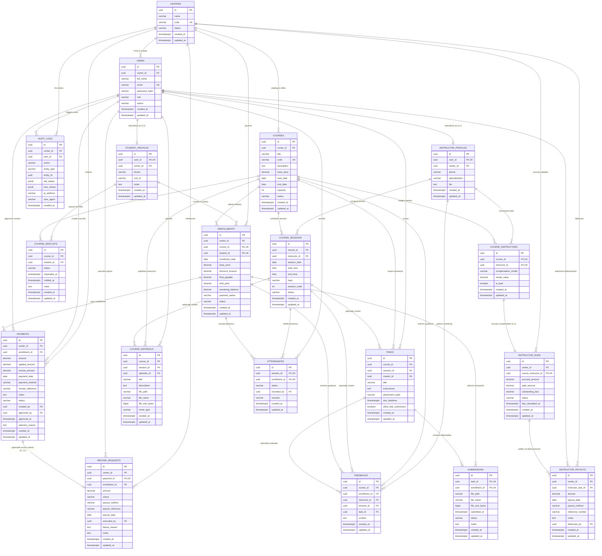

# Entity-Relationship Diagram (ERD) & Technical Schema Specification

# VELORA (فيلورا) — Training Center Management Platform

- **Document Version:** 1.0.0  
- **Document Type:** Physical & Relational Database Architecture Specification  
- **Target DBMS:** PostgreSQL 15+ (Single Shared Database, Logical Multi-Tenancy)  
- **Primary Sources of Truth:** [PRD.md](file:///D:/docs/docs/PRD.md), [user-flow.md](file:///D:/docs/docs/user-flow.md), and [domain-model.md](file:///D:/docs/docs/diagrams/domain-model.md)  
- **Status:** Approved for Implementation (MVP)  
- **Complementary Artifacts:** [database.dbml](file:///D:/docs/docs/database.dbml) (for [dbdiagram.io](https://dbdiagram.io)) and [database-review.md](file:///D:/docs/docs/database-review.md)  

---

## 1. Architectural Foundations & Tenancy Design

### 1.1 Multi-Tenant Isolation Strategy
VELORA employs a **Logical Multi-Tenancy Architecture** utilizing a single shared PostgreSQL database instance.
- **Tenant Anchor (`CenterID`):** Every operational, pedagogical, and financial entity is strictly partitioned by `center_id` referencing `centers(id)`.
- **Server-Side Enforcement:** Application middleware and database queries inject `WHERE center_id = :tenant_id` on all read, write, update, and delete statements. Client-supplied tenant parameters are rejected.
- **Row-Level Security (RLS) Ready:** All tenant-scoped tables feature composite indexes beginning with `center_id`, allowing seamless activation of PostgreSQL Row-Level Security policies (`ENABLE ROW LEVEL SECURITY`) as an added defense-in-depth measure.

### 1.2 Data Integrity & Precision Standards
- **Primary Keys:** Standardized on RFC 4122 **UUIDv4** (`gen_random_uuid()`) to prevent enumeration attacks, simplify distributed ID generation, and guarantee global uniqueness across all tenant partitions.
- **Monetary Precision:** Standardized on `DECIMAL(10, 2)` (or `NUMERIC(10, 2)`) to eliminate binary floating-point rounding errors in all pricing, discounts, payments, refunds, and instructor dues.
- **Temporal Integrity:** Standardized on `TIMESTAMPTZ` (UTC with timezone preservation) for all timestamps and explicit `DATE` / `TIME` types for calendar schedules.
- **Financial Immutability:** Posted payment vouchers and executed refund transactions are protected by `ON DELETE RESTRICT` foreign keys and application authorization gates, enforcing an append-only accounting audit trail.

---

## 2. Mermaid Entity-Relationship Diagram (erDiagram)

The diagram below is fully validated and compatible with [mermaid.live](https://mermaid.live). It depicts all 19 confirmed entities, their attributes, keys, and cardinalities.



---

## 3. Comprehensive Entity Dictionary & Technical Schema

### 3.1 Module: Identity & Tenancy Management

#### Table: `centers`
- **Purpose:** Top-level tenant container representing an independent training center business.
- **Constraints & Indexes:**
  - `id`: UUID, PRIMARY KEY (`gen_random_uuid()`).
  - `name`: VARCHAR(255), NOT NULL.
  - `code`: VARCHAR(50), NOT NULL, UNIQUE (`idx_centers_code_unique`).
  - `status`: VARCHAR(20), NOT NULL, DEFAULT `'Active'`, CHECK (`status IN ('Active', 'Suspended')`).
  - `created_at`, `updated_at`: TIMESTAMPTZ, NOT NULL, DEFAULT `now()`.

#### Table: `users`
- **Purpose:** Authenticated physical identities scoped to a specific training center.
- **Constraints & Indexes:**
  - `id`: UUID, PRIMARY KEY (`gen_random_uuid()`).
  - `center_id`: UUID, NOT NULL, FK -> `centers(id)` ON DELETE RESTRICT.
  - `full_name`: VARCHAR(255), NOT NULL.
  - `email`: VARCHAR(255), NOT NULL.
  - `password_hash`: VARCHAR(255), NOT NULL (Argon2id or bcrypt).
  - `role`: VARCHAR(20), NOT NULL, CHECK (`role IN ('Manager', 'Sales', 'Instructor', 'Student')`).
  - `status`: VARCHAR(20), NOT NULL, DEFAULT `'Active'`, CHECK (`status IN ('Active', 'Suspended', 'Archived')`).
  - `created_at`, `updated_at`: TIMESTAMPTZ, NOT NULL, DEFAULT `now()`.
  - **Indexes:**
    - UNIQUE `(center_id, email)` — Enforces email uniqueness strictly within tenant scope.
    - INDEX `(center_id, role)` — Accelerates role-based directory listings.

#### Table: `student_profiles`
- **Purpose:** Trainee demographic and directory profile extending `users` (Role = `Student`).
- **Constraints & Indexes:**
  - `id`: UUID, PRIMARY KEY (`gen_random_uuid()`).
  - `user_id`: UUID, NOT NULL, UNIQUE, FK -> `users(id)` ON DELETE CASCADE (1:1 specialization).
  - `center_id`: UUID, NOT NULL, FK -> `centers(id)` ON DELETE RESTRICT.
  - `phone`: VARCHAR(50), NULLABLE.
  - `civil_id`: VARCHAR(50), NULLABLE.
  - `notes`: TEXT, NULLABLE.
  - `created_at`, `updated_at`: TIMESTAMPTZ, NOT NULL, DEFAULT `now()`.
  - **Indexes:**
    - INDEX `(center_id, phone)` — Fast student search by telephone number.
    - INDEX `(center_id, civil_id)` — Identity lookup by national civil ID.

#### Table: `instructor_profiles`
- **Purpose:** Academic trainer profile extending `users` (Role = `Instructor`).
- **Constraints & Indexes:**
  - `id`: UUID, PRIMARY KEY (`gen_random_uuid()`).
  - `user_id`: UUID, NOT NULL, UNIQUE, FK -> `users(id)` ON DELETE CASCADE (1:1 specialization).
  - `center_id`: UUID, NOT NULL, FK -> `centers(id)` ON DELETE RESTRICT.
  - `phone`: VARCHAR(50), NULLABLE.
  - `specialization`: VARCHAR(255), NULLABLE.
  - `bio`: TEXT, NULLABLE.
  - `created_at`, `updated_at`: TIMESTAMPTZ, NOT NULL, DEFAULT `now()`.
  - **Indexes:**
    - INDEX `(center_id, specialization)` — Filters trainers by domain expertise.

---

### 3.2 Module: Academic Programs & Course Cohorts

#### Table: `courses`
- **Purpose:** Educational course cohort offering. Enforces start/end timeline and maximum seat capacity (finite seat inventory).
- **Constraints & Indexes:**
  - `id`: UUID, PRIMARY KEY (`gen_random_uuid()`).
  - `center_id`: UUID, NOT NULL, FK -> `centers(id)` ON DELETE RESTRICT.
  - `title`: VARCHAR(255), NOT NULL.
  - `code`: VARCHAR(50), NOT NULL.
  - `description`: TEXT, NULLABLE.
  - `base_price`: DECIMAL(10, 2), NOT NULL, CHECK (`base_price >= 0.00`).
  - `start_date`: DATE, NOT NULL.
  - `end_date`: DATE, NOT NULL, CHECK (`end_date >= start_date`).
  - `capacity`: INT, NULLABLE, CHECK (`capacity IS NULL OR capacity > 0`).
  - `status`: VARCHAR(20), NOT NULL, DEFAULT `'Draft'`, CHECK (`status IN ('Draft', 'Active', 'Completed', 'Archived')`).
  - `created_at`, `updated_at`: TIMESTAMPTZ, NOT NULL, DEFAULT `now()`.
  - **Indexes:**
    - UNIQUE `(center_id, code)` — Prevents duplicate course codes within the same center.
    - INDEX `(center_id, status)` — Accelerates active vs archived course queries.
    - INDEX `(start_date, end_date)` — Timetable queries.

#### Table: `course_instructors`
- **Purpose:** Contractual junction entity binding instructors to courses with designated compensation terms.
- **Constraints & Indexes:**
  - `id`: UUID, PRIMARY KEY (`gen_random_uuid()`).
  - `course_id`: UUID, NOT NULL, FK -> `courses(id)` ON DELETE RESTRICT.
  - `instructor_id`: UUID, NOT NULL, FK -> `instructor_profiles(id)` ON DELETE RESTRICT.
  - `compensation_model`: VARCHAR(35), NOT NULL, CHECK (`compensation_model IN ('FixedAmount', 'PercentageOfCollectedRevenue', 'PerSession')`).
  - `model_value`: DECIMAL(10, 2), NOT NULL, CHECK (`model_value >= 0.00`).
  - `is_lead`: BOOLEAN, NOT NULL, DEFAULT `false`.
  - `created_at`, `updated_at`: TIMESTAMPTZ, NOT NULL, DEFAULT `now()`.
  - **Indexes:**
    - UNIQUE `(course_id, instructor_id)` — Prevents assigning the same instructor multiple times to one course.
    - INDEX `(instructor_id)` — Accelerates "My Assigned Courses" instructor portal queries.

#### Table: `course_sessions`
- **Purpose:** Discrete scheduled instructional lecture unit.
- **Constraints & Indexes:**
  - `id`: UUID, PRIMARY KEY (`gen_random_uuid()`).
  - `course_id`: UUID, NOT NULL, FK -> `courses(id)` ON DELETE CASCADE.
  - `instructor_id`: UUID, NULLABLE, FK -> `instructor_profiles(id)` ON DELETE SET NULL.
  - `session_date`: DATE, NOT NULL.
  - `start_time`: TIME, NOT NULL.
  - `end_time`: TIME, NOT NULL, CHECK (`end_time > start_time`).
  - `topic`: VARCHAR(255), NOT NULL.
  - `session_order`: INT, NOT NULL, DEFAULT `1`, CHECK (`session_order >= 1`).
  - `status`: VARCHAR(20), NOT NULL, DEFAULT `'Scheduled'`, CHECK (`status IN ('Scheduled', 'Completed', 'Cancelled')`).
  - `created_at`, `updated_at`: TIMESTAMPTZ, NOT NULL, DEFAULT `now()`.
  - **Indexes:**
    - INDEX `(course_id, session_order)` — Chronological lecture sorting.
    - INDEX `(course_id, session_date)` — Daily/weekly timetable rendering.

#### Table: `course_waitlists`
- **Purpose:** Ordered First-In-First-Out (FIFO) queue for filled courses (Approved Decision OQ-06 / BR-CRS-WAITLIST-FIFO).
- **Constraints & Indexes:**
  - `id`: UUID, PRIMARY KEY (`gen_random_uuid()`).
  - `course_id`: UUID, NOT NULL, FK -> `courses(id)` ON DELETE CASCADE.
  - `student_id`: UUID, NOT NULL, FK -> `student_profiles(id)` ON DELETE CASCADE.
  - `status`: VARCHAR(20), NOT NULL, DEFAULT `'Waiting'`, CHECK (`status IN ('Waiting', 'Notified', 'Enrolled', 'Cancelled')`).
  - `requested_at`: TIMESTAMPTZ, NOT NULL, DEFAULT `now()` (Preserves chronological FIFO ordering).
  - `notified_at`: TIMESTAMPTZ, NULLABLE.
  - `notes`: TEXT, NULLABLE.
  - `created_at`, `updated_at`: TIMESTAMPTZ, NOT NULL, DEFAULT `now()`.
  - **Indexes:**
    - INDEX `(course_id, requested_at)` — Guarantees strict FIFO priority retrieval upon vacancy.
    - INDEX `(course_id, student_id, status)` — Fast lookup of student's active queue status.

---

### 3.3 Module: Student Enrollment & Financial Collection

#### Table: `enrollments`
- **Purpose:** Binding student intake contract and running financial balance header.
- **Constraints & Indexes:**
  - `id`: UUID, PRIMARY KEY (`gen_random_uuid()`).
  - `center_id`: UUID, NOT NULL, FK -> `centers(id)` ON DELETE RESTRICT.
  - `course_id`: UUID, NOT NULL, FK -> `courses(id)` ON DELETE RESTRICT.
  - `student_id`: UUID, NOT NULL, FK -> `student_profiles(id)` ON DELETE RESTRICT.
  - `enrollment_date`: DATE, NOT NULL, DEFAULT `CURRENT_DATE`.
  - `base_price`: DECIMAL(10, 2), NOT NULL, CHECK (`base_price >= 0.00`).
  - `discount_amount`: DECIMAL(10, 2), NOT NULL, DEFAULT `0.00`, CHECK (`discount_amount >= 0.00 AND discount_amount <= base_price`).
  - `final_payable`: DECIMAL(10, 2), NOT NULL, CHECK (`final_payable >= 0.00`).
  - `total_paid`: DECIMAL(10, 2), NOT NULL, DEFAULT `0.00`, CHECK (`total_paid >= 0.00`).
  - `remaining_balance`: DECIMAL(10, 2), NOT NULL, CHECK (`remaining_balance >= 0.00`).
  - `payment_status`: VARCHAR(20), NOT NULL, DEFAULT `'Unpaid'`, CHECK (`payment_status IN ('Unpaid', 'PartiallyPaid', 'FullyPaid')`).
  - `status`: VARCHAR(20), NOT NULL, DEFAULT `'Active'`, CHECK (`status IN ('Active', 'Completed', 'Withdrawn')`).
  - `created_at`, `updated_at`: TIMESTAMPTZ, NOT NULL, DEFAULT `now()`.
  - **Indexes:**
    - UNIQUE `(course_id, student_id)` WHERE (`status = 'Active'`) — Prevents duplicate active enrollment in the same course.
    - INDEX `(center_id, payment_status)` — Powers the Sales overdue installment follow-up queue.
    - INDEX `(center_id, student_id)` — Trainee's multi-course dashboard.

#### Table: `payments`
- **Purpose:** Student installment vouchers undergoing 2-phase administrative approval (Approved Decision OQ-02).
- **Constraints & Indexes:**
  - `id`: UUID, PRIMARY KEY (`gen_random_uuid()`).
  - `center_id`: UUID, NOT NULL, FK -> `centers(id)` ON DELETE RESTRICT.
  - `enrollment_id`: UUID, NOT NULL, FK -> `enrollments(id)` ON DELETE RESTRICT.
  - `amount`: DECIMAL(10, 2), NOT NULL, CHECK (`amount > 0.00`).
  - `applied_amount`: DECIMAL(10, 2), NOT NULL, DEFAULT `0.00`, CHECK (`applied_amount >= 0.00`).
  - `excess_amount`: DECIMAL(10, 2), NOT NULL, DEFAULT `0.00`, CHECK (`excess_amount >= 0.00`).
  - `payment_date`: DATE, NOT NULL.
  - `payment_method`: VARCHAR(20), NOT NULL, CHECK (`payment_method IN ('Cash', 'BankTransfer', 'POS_Card', 'Cheque')`).
  - `receipt_reference`: VARCHAR(100), NULLABLE.
  - `notes`: TEXT, NULLABLE.
  - `status`: VARCHAR(25), NOT NULL, DEFAULT `'Pending_Approval'`, CHECK (`status IN ('Pending_Approval', 'Completed', 'Rejected', 'Adjusted')`).
  - `created_by`: UUID, NOT NULL, FK -> `users(id)` ON DELETE RESTRICT.
  - `approved_by`: UUID, NULLABLE, FK -> `users(id)` ON DELETE SET NULL.
  - `approved_at`: TIMESTAMPTZ, NULLABLE.
  - `rejection_reason`: TEXT, NULLABLE.
  - `created_at`, `updated_at`: TIMESTAMPTZ, NOT NULL, DEFAULT `now()`.
  - **Indexes:**
    - INDEX `(enrollment_id, status)` — Evaluates verified completed payments vs pending vouchers.
    - INDEX `(center_id, status)` — Powers Manager / Accountant payment approval queue.
    - INDEX `(receipt_reference)` — Prevents duplicate receipt voucher entry.

#### Table: `refund_requests`
- **Purpose:** Mandatory excess reimbursement claim generated upon overpayment (Approved Decision OQ-05 / BR-FIN-OVERPAY-REFUND).
- **Constraints & Indexes:**
  - `id`: UUID, PRIMARY KEY (`gen_random_uuid()`).
  - `center_id`: UUID, NOT NULL, FK -> `centers(id)` ON DELETE RESTRICT.
  - `payment_id`: UUID, NOT NULL, UNIQUE, FK -> `payments(id)` ON DELETE RESTRICT (1:1 with overpayment voucher).
  - `enrollment_id`: UUID, NOT NULL, FK -> `enrollments(id)` ON DELETE RESTRICT.
  - `amount`: DECIMAL(10, 2), NOT NULL, CHECK (`amount > 0.00`).
  - `status`: VARCHAR(20), NOT NULL, DEFAULT `'Pending_Refund'`, CHECK (`status IN ('Pending_Refund', 'Refunded', 'Refund_Failed')`).
  - `payout_method`: VARCHAR(20), NULLABLE, CHECK (`payout_method IS NULL OR payout_method IN ('Cash', 'BankTransfer')`).
  - `payout_reference`: VARCHAR(100), NULLABLE.
  - `payout_date`: DATE, NULLABLE.
  - `executed_by`: UUID, NULLABLE, FK -> `users(id)` ON DELETE SET NULL.
  - `failure_reason`: TEXT, NULLABLE.
  - `notes`: TEXT, NULLABLE.
  - `created_at`, `updated_at`: TIMESTAMPTZ, NOT NULL, DEFAULT `now()`.
  - **Indexes:**
    - INDEX `(center_id, status)` — Powers Center Manager / Finance refund execution queue.

---

### 3.4 Module: Teaching, Accountability & Academic Delivery

#### Table: `course_materials`
- **Purpose:** Digital educational assets distributed exclusively to enrolled trainees.
- **Constraints & Indexes:**
  - `id`: UUID, PRIMARY KEY (`gen_random_uuid()`).
  - `course_id`: UUID, NOT NULL, FK -> `courses(id)` ON DELETE CASCADE.
  - `session_id`: UUID, NULLABLE, FK -> `course_sessions(id)` ON DELETE SET NULL.
  - `uploader_id`: UUID, NOT NULL, FK -> `users(id)` ON DELETE SET NULL.
  - `title`: VARCHAR(255), NOT NULL.
  - `description`: TEXT, NULLABLE.
  - `file_path`: VARCHAR(500), NOT NULL.
  - `file_name`: VARCHAR(255), NOT NULL.
  - `file_size_bytes`: BIGINT, NOT NULL, CHECK (`file_size_bytes > 0 AND file_size_bytes <= 26214400`).
  - `mime_type`: VARCHAR(100), NOT NULL.
  - `created_at`, `updated_at`: TIMESTAMPTZ, NOT NULL, DEFAULT `now()`.
  - **Indexes:**
    - INDEX `(course_id, session_id)` — Renders materials grouped by lecture session.

#### Table: `tasks`
- **Purpose:** Homework assignments and project milestones.
- **Constraints & Indexes:**
  - `id`: UUID, PRIMARY KEY (`gen_random_uuid()`).
  - `course_id`: UUID, NOT NULL, FK -> `courses(id)` ON DELETE CASCADE.
  - `session_id`: UUID, NULLABLE, FK -> `course_sessions(id)` ON DELETE SET NULL.
  - `creator_id`: UUID, NOT NULL, FK -> `users(id)` ON DELETE SET NULL.
  - `title`: VARCHAR(255), NOT NULL.
  - `instructions`: TEXT, NOT NULL.
  - `attachment_path`: VARCHAR(500), NULLABLE.
  - `due_datetime`: TIMESTAMPTZ, NULLABLE.
  - `allow_late_submission`: BOOLEAN, NOT NULL, DEFAULT `false` (OQ-03 late override toggle).
  - `created_at`, `updated_at`: TIMESTAMPTZ, NOT NULL, DEFAULT `now()`.
  - **Indexes:**
    - INDEX `(course_id, due_datetime)` — Trainee deadline countdown query.

#### Table: `submissions`
- **Purpose:** Trainee deliverables in fulfillment of issued homework tasks.
- **Constraints & Indexes:**
  - `id`: UUID, PRIMARY KEY (`gen_random_uuid()`).
  - `task_id`: UUID, NOT NULL, FK -> `tasks(id)` ON DELETE CASCADE.
  - `enrollment_id`: UUID, NOT NULL, FK -> `enrollments(id)` ON DELETE RESTRICT.
  - `file_path`: VARCHAR(500), NOT NULL.
  - `file_name`: VARCHAR(255), NOT NULL.
  - `file_size_bytes`: BIGINT, NOT NULL, CHECK (`file_size_bytes > 0 AND file_size_bytes <= 26214400`).
  - `submitted_at`: TIMESTAMPTZ, NOT NULL, DEFAULT `now()`.
  - `status`: VARCHAR(20), NOT NULL, CHECK (`status IN ('On_Time', 'Late')`).
  - `notes`: TEXT, NULLABLE.
  - `created_at`, `updated_at`: TIMESTAMPTZ, NOT NULL, DEFAULT `now()`.
  - **Indexes:**
    - UNIQUE `(task_id, enrollment_id)` — Exactly one recorded deliverable per task per student (pre-deadline replacements overwrite this record).
    - INDEX `(task_id, status)` — Review queue filtering for instructor.

#### Table: `attendances`
- **Purpose:** Session attendance sheet recording binary presence (FR-ATT-04 / BR-ATT-03).
- **Constraints & Indexes:**
  - `id`: UUID, PRIMARY KEY (`gen_random_uuid()`).
  - `session_id`: UUID, NOT NULL, FK -> `course_sessions(id)` ON DELETE CASCADE.
  - `enrollment_id`: UUID, NOT NULL, FK -> `enrollments(id)` ON DELETE RESTRICT.
  - `status`: VARCHAR(20), NOT NULL, CHECK (`status IN ('Present', 'Absent')`).
  - `recorded_by`: UUID, NOT NULL, FK -> `users(id)` ON DELETE SET NULL.
  - `remarks`: VARCHAR(255), NULLABLE.
  - `created_at`, `updated_at`: TIMESTAMPTZ, NOT NULL, DEFAULT `now()`.
  - **Indexes:**
    - UNIQUE `(session_id, enrollment_id)` — Eliminates duplicate attendance records.
    - INDEX `(enrollment_id, status)` — Computes student attendance rate percentage.

#### Table: `feedbacks`
- **Purpose:** 1-to-1 private mentoring evaluations between instructor and student.
- **Constraints & Indexes:**
  - `id`: UUID, PRIMARY KEY (`gen_random_uuid()`).
  - `course_id`: UUID, NOT NULL, FK -> `courses(id)` ON DELETE CASCADE.
  - `enrollment_id`: UUID, NOT NULL, FK -> `enrollments(id)` ON DELETE RESTRICT.
  - `instructor_id`: UUID, NOT NULL, FK -> `instructor_profiles(id)` ON DELETE RESTRICT.
  - `session_id`: UUID, NULLABLE, FK -> `course_sessions(id)` ON DELETE SET NULL.
  - `task_id`: UUID, NULLABLE, FK -> `tasks(id)` ON DELETE SET NULL.
  - `content`: TEXT, NOT NULL.
  - `created_at`, `updated_at`: TIMESTAMPTZ, NOT NULL, DEFAULT `now()`.
  - **Indexes:**
    - INDEX `(enrollment_id, created_at)` — Powers private student feedback feed.

---

### 3.5 Module: Instructor Settlements & Governance

#### Table: `instructor_dues`
- **Purpose:** Running liability ledger tracking earned compensation per course assignment.
- **Constraints & Indexes:**
  - `id`: UUID, PRIMARY KEY (`gen_random_uuid()`).
  - `center_id`: UUID, NOT NULL, FK -> `centers(id)` ON DELETE RESTRICT.
  - `course_instructor_id`: UUID, NOT NULL, UNIQUE, FK -> `course_instructors(id)` ON DELETE RESTRICT (1:1 agreement link).
  - `accrued_amount`: DECIMAL(10, 2), NOT NULL, DEFAULT `0.00`, CHECK (`accrued_amount >= 0.00`).
  - `paid_amount`: DECIMAL(10, 2), NOT NULL, DEFAULT `0.00`, CHECK (`paid_amount >= 0.00`).
  - `outstanding_due`: DECIMAL(10, 2), NOT NULL, DEFAULT `0.00`.
  - `status`: VARCHAR(20), NOT NULL, DEFAULT `'Pending'`, CHECK (`status IN ('Pending', 'PartiallyPaid', 'Paid', 'Adjusted')`).
  - `last_calculated_at`: TIMESTAMPTZ, NOT NULL, DEFAULT `now()`.
  - `created_at`, `updated_at`: TIMESTAMPTZ, NOT NULL, DEFAULT `now()`.
  - **Indexes:**
    - INDEX `(center_id, status)` — Center Manager liabilities summary.

#### Table: `instructor_payouts`
- **Purpose:** Cash or bank wire disbursement transactions settling instructor dues.
- **Constraints & Indexes:**
  - `id`: UUID, PRIMARY KEY (`gen_random_uuid()`).
  - `center_id`: UUID, NOT NULL, FK -> `centers(id)` ON DELETE RESTRICT.
  - `instructor_due_id`: UUID, NOT NULL, FK -> `instructor_dues(id)` ON DELETE RESTRICT.
  - `amount`: DECIMAL(10, 2), NOT NULL, CHECK (`amount > 0.00`).
  - `payout_date`: DATE, NOT NULL.
  - `payout_method`: VARCHAR(20), NOT NULL, CHECK (`payout_method IN ('Cash', 'BankTransfer', 'Cheque')`).
  - `reference_number`: VARCHAR(100), NULLABLE.
  - `notes`: TEXT, NULLABLE.
  - `disbursed_by`: UUID, NOT NULL, FK -> `users(id)` ON DELETE RESTRICT.
  - `created_at`, `updated_at`: TIMESTAMPTZ, NOT NULL, DEFAULT `now()`.
  - **Indexes:**
    - INDEX `(instructor_due_id, payout_date)` — Instructor settlement history.
    - INDEX `(center_id, payout_date)` — Cash flow audit reports.

#### Table: `audit_logs`
- **Purpose:** Append-only system audit trail capturing sensitive business and financial changes.
- **Constraints & Indexes:**
  - `id`: UUID, PRIMARY KEY (`gen_random_uuid()`).
  - `center_id`: UUID, NOT NULL, FK -> `centers(id)` ON DELETE RESTRICT.
  - `user_id`: UUID, NULLABLE, FK -> `users(id)` ON DELETE SET NULL.
  - `action`: VARCHAR(100), NOT NULL.
  - `entity_type`: VARCHAR(100), NOT NULL.
  - `entity_id`: UUID, NOT NULL.
  - `old_values`: JSONB, NULLABLE.
  - `new_values`: JSONB, NULLABLE.
  - `ip_address`: VARCHAR(45), NULLABLE.
  - `user_agent`: VARCHAR(255), NULLABLE.
  - `created_at`: TIMESTAMPTZ, NOT NULL, DEFAULT `now()`.
  - **Indexes:**
    - INDEX `(center_id, created_at DESC)` — Chronological audit stream.
    - INDEX `(entity_type, entity_id)` — Targeted historical investigation.

---

## 4. Relational Cardinalities & Business Semantics

| Source Entity | Target Entity | Cardinality | Business Semantics & Justification |
| :--- | :--- | :---: | :--- |
| `centers` | `users` | **1 : N** | A center employs multiple staff and enrolls multiple trainees; every user identity belongs strictly to one center in MVP (`BR-TEN-01`). |
| `users` | `student_profiles` | **1 : 1** | A user identity assigned the `Student` role links to exactly one specialized trainee profile (`BR-AUTH-03`). |
| `users` | `instructor_profiles` | **1 : 1** | A user identity assigned the `Instructor` role links to exactly one specialized trainer profile (`BR-AUTH-03`). |
| `courses` | `course_instructors` | **1 : N** | A course cohort contracts one or more instructors with designated compensation terms (`FR-INS-01`). |
| `instructor_profiles` | `course_instructors`| **1 : N** | An instructor can be assigned to multiple course cohorts across the center (`FR-INS-01`). |
| `course_instructors` | `instructor_dues` | **1 : 1** | Each contractual assignment agreement maintains exactly one running compensation ledger (`FR-INSFIN-01`). |
| `instructor_dues` | `instructor_payouts` | **1 : N** | An instructor's accrued dues may be settled across multiple installment disbursement payments (`Flow 13.5`). |
| `courses` | `course_sessions` | **1 : N** | A course is broken down into multiple discrete lectures (`FR-CRS-04`). |
| `courses` | `course_waitlists` | **0..1 : N** | Filled courses enforce capacity hard-lock and queue applicants in strict FIFO order (`OQ-06`). |
| `courses` | `enrollments` | **1 : N** | A course admits multiple enrolled students up to configured capacity (`FR-STU-02`). |
| `student_profiles` | `enrollments` | **1 : N** | A trainee can enroll concurrently in multiple distinct courses within the center (`BR-STU-02`). |
| `enrollments` | `payments` | **1 : N** | A student settles their payable course fees through one or multiple offline installment vouchers (`FR-FIN-03`). |
| `payments` | `refund_requests` | **0..1 : 1** | Generated exclusively when an approved voucher's payment amount exceeds the remaining balance (`OQ-05`). |
| `course_sessions` | `attendances` | **1 : N** | A lecture session verifies presence for all enrolled students on the roster (`FR-ATT-01`). |
| `enrollments` | `attendances` | **1 : N** | An enrollment accumulates exactly one binary attendance entry per session conducted (`BR-ATT-03`). |
| `tasks` | `submissions` | **1 : N** | A task collects deliverables from enrolled students (`FR-TSK-03`). |
| `enrollments` | `submissions` | **1 : N** | An enrollment delivers at most one active deliverable per assigned task (`BR-TSK-03`). |
| `enrollments` | `feedbacks` | **1 : N** | An enrolled trainee receives multiple private qualitative mentoring evaluations (`FR-FDB-01`). |

---

## 5. Database-Level Enforcement of Business Invariants

```
┌─────────────────────────────────────────────────────────────────────────────┐
│                       VELORA DATABASE INVARIANTS                            │
├────────────────────────────────┬────────────────────────────────────────────┤
│ Business Invariant             │ Database Enforcement Mechanism             │
├────────────────────────────────┼────────────────────────────────────────────┤
│ 1. Tenant Scoping Isolation    │ NOT NULL FKs to centers(id), composite     │
│                                │ indexes (center_id, ...), PostgreSQL RLS.  │
├────────────────────────────────┼────────────────────────────────────────────┤
│ 2. Seat Capacity (Inventory)   │ Stored capacity INT; transactional query   │
│                                │ with SELECT ... FOR UPDATE before INSERT.  │
├────────────────────────────────┼────────────────────────────────────────────┤
│ 3. FIFO Waitlist Ordering      │ requested_at TIMESTAMPTZ default now();    │
│                                │ B-Tree index on (course_id, requested_at). │
├────────────────────────────────┼────────────────────────────────────────────┤
│ 4. Single Active Enrollment    │ Partial Unique Index:                      │
│                                │ (course_id, student_id) WHERE status='Active'
├────────────────────────────────┼────────────────────────────────────────────┤
│ 5. Discount Boundary           │ CHECK (discount_amount >= 0.00 AND         │
│                                │        discount_amount <= base_price).     │
├────────────────────────────────┼────────────────────────────────────────────┤
│ 6. Positive Payment Amounts    │ CHECK (amount > 0.00).                     │
├────────────────────────────────┼────────────────────────────────────────────┤
│ 7. Two-Phase Payment Approval  │ status ENUM with 'Pending_Approval';       │
│                                │ approved_by FK and approved_at timestamp.  │
├────────────────────────────────┼────────────────────────────────────────────┤
│ 8. Mandatory Excess Refund     │ 1:1 FK payments(id) -> refund_requests.    │
│                                │ Tracks status 'Pending_Refund'->'Refunded'.│
├────────────────────────────────┼────────────────────────────────────────────┤
│ 9. Financial Immutability      │ ON DELETE RESTRICT on payments, enrollments│
│                                │ and refunds; corrections via audit logs.   │
├────────────────────────────────┼────────────────────────────────────────────┤
│ 10. Attendance Uniqueness      │ UNIQUE (session_id, enrollment_id);        │
│                                │ CHECK (status IN ('Present', 'Absent')).   │
├────────────────────────────────┼────────────────────────────────────────────┤
│ 11. File Size Hard Limit       │ CHECK (file_size_bytes <= 26214400) [25MB].│
└────────────────────────────────┴────────────────────────────────────────────┘
```

---

## 6. Complete DBML Specification Source Code

Below is the complete, valid DBML code compatible with [dbdiagram.io](https://dbdiagram.io), matching this logical ERD exactly. It is also persisted in [database.dbml](file:///D:/docs/docs/database.dbml).

```dbml
// ============================================================================
// VELORA (فيلورا) — Training Center Management Platform
// Database Schema Specification (DBML) — MVP Release v1.0.0
// Compatible with: https://dbdiagram.io
// Target DBMS: PostgreSQL 15+ (Logical Multi-Tenancy Architecture)
// ============================================================================

Enum user_role {
  Manager     [note: 'Full administrative authority over center operations and finances']
  Sales       [note: 'Front-desk trainee intake, enrollment, and payment receipt logging']
  Instructor  [note: 'Course delivery, attendance, materials, tasks, and qualitative feedback']
  Student     [note: 'Enrolled trainee accessing materials, tasks, feedback, and personal ledger']
}

Enum account_status {
  Active      [note: 'Account is operational and authenticated sessions are allowed']
  Suspended   [note: 'Account is temporarily locked; login is blocked']
  Archived    [note: 'Soft-archived profile retaining full historical audit references']
}

Enum center_status {
  Active      [note: 'Center tenant subscription is healthy and operational']
  Suspended   [note: 'Center tenant is deactivated due to billing or policy hold']
}

Enum course_status {
  Draft       [note: 'Course cohort is being planned; not visible for student enrollments']
  Active      [note: 'Course is officially published, open for enrollments, and teaching']
  Completed   [note: 'All lecture sessions delivered; financial reconciliations in progress']
  Archived    [note: 'Locked historical cohort preserved for administrative auditing']
}

Enum compensation_model_type {
  FixedAmount                   [note: 'Set currency lump-sum for teaching the entire course cohort']
  PercentageOfCollectedRevenue  [note: 'Contracted percentage calculated strictly from verified cash collected']
  PerSession                    [note: 'Set currency fee paid per completed, verified lecture session conducted']
}

Enum session_status {
  Scheduled   [note: 'Lecture session planned on schedule']
  Completed   [note: 'Session conducted and attendance verified']
  Cancelled   [note: 'Session cancelled; excluded from PerSession instructor accruals']
}

Enum waitlist_status {
  Waiting     [note: 'Student is queued in FIFO order; zero monetary fees assessed']
  Notified    [note: 'Seat vacancy opened; student notified with time window to register']
  Enrolled    [note: 'Student confirmed seat and successfully transitioned to official enrollment']
  Cancelled   [note: 'Waitlist request cancelled by student or expired without confirmation']
}

Enum enrollment_status {
  Active      [note: 'Student is actively participating in the course cohort']
  Completed   [note: 'Student finished course cohort successfully']
  Withdrawn   [note: 'Student formally dropped out; historical payments and attendance preserved']
}

Enum payment_status_type {
  Unpaid          [note: 'Zero payments verified against enrollment fee (TotalPaid = 0.00)']
  PartiallyPaid   [note: 'Partial installments paid; remaining balance > 0.00']
  FullyPaid       [note: 'Net fee balance completely settled (RemainingBalance = 0.00)']
}

Enum payment_method_type {
  Cash            [note: 'Physical cash received at center reception desk']
  BankTransfer    [note: 'Direct wire or electronic banking deposit with transaction receipt']
  POS_Card        [note: 'Physical point-of-sale card payment at reception terminal']
  Cheque          [note: 'Physical bank cheque logged with serial reference']
}

Enum payment_voucher_status {
  Pending_Approval  [note: 'Entered by Sales; awaiting mandatory review by Manager or Accountant']
  Completed         [note: 'Approved and atomically posted to student enrollment balance']
  Rejected          [note: 'Rejected by management; zero change to student financial balance']
  Adjusted          [note: 'Corrected or reversed via authorized administrative audit entry']
}

Enum refund_status_type {
  Pending_Refund    [note: 'Overpayment excess identified; queued for mandatory payout execution']
  Refunded          [note: 'Physical cash or wire refund confirmed and disbursed to trainee']
  Refund_Failed     [note: 'Disbursement failed or rejected; requeued for financial investigation']
}

Enum instructor_due_status {
  Pending           [note: 'Accrued dues awaiting settlement disbursement']
  PartiallyPaid     [note: 'Partial payout disbursed; outstanding due balance remains']
  Paid              [note: 'All accrued dues fully settled with instructor']
  Adjusted          [note: 'Balance reconciled or modified via audit settlement adjustment']
}

Enum task_submission_status {
  On_Time           [note: 'Submitted prior to official task deadline']
  Late              [note: 'Submitted after deadline under authorized instructor/manager override']
}

Enum attendance_status_type {
  Present           [note: 'Student attended the scheduled lecture session']
  Absent            [note: 'Student was absent from the scheduled lecture session']
}

Table centers {
  id uuid [pk, default: `gen_random_uuid()`]
  name varchar(255) [not null]
  code varchar(50) [not null, unique]
  status center_status [not null, default: 'Active']
  created_at timestamptz [not null, default: `now()`]
  updated_at timestamptz [not null, default: `now()`]
}

Table users {
  id uuid [pk, default: `gen_random_uuid()`]
  center_id uuid [not null]
  full_name varchar(255) [not null]
  email varchar(255) [not null]
  password_hash varchar(255) [not null]
  role user_role [not null]
  status account_status [not null, default: 'Active']
  created_at timestamptz [not null, default: `now()`]
  updated_at timestamptz [not null, default: `now()`]

  indexes {
    (center_id, email) [unique]
    (center_id, role)
  }
}

Table student_profiles {
  id uuid [pk, default: `gen_random_uuid()`]
  user_id uuid [not null, unique]
  center_id uuid [not null]
  phone varchar(50) [null]
  civil_id varchar(50) [null]
  notes text [null]
  created_at timestamptz [not null, default: `now()`]
  updated_at timestamptz [not null, default: `now()`]

  indexes {
    (center_id, phone)
    (center_id, civil_id)
  }
}

Table instructor_profiles {
  id uuid [pk, default: `gen_random_uuid()`]
  user_id uuid [not null, unique]
  center_id uuid [not null]
  phone varchar(50) [null]
  specialization varchar(255) [null]
  bio text [null]
  created_at timestamptz [not null, default: `now()`]
  updated_at timestamptz [not null, default: `now()`]

  indexes {
    (center_id, specialization)
  }
}

Table courses {
  id uuid [pk, default: `gen_random_uuid()`]
  center_id uuid [not null]
  title varchar(255) [not null]
  code varchar(50) [not null]
  description text [null]
  base_price decimal(10,2) [not null]
  start_date date [not null]
  end_date date [not null]
  capacity int [null]
  status course_status [not null, default: 'Draft']
  created_at timestamptz [not null, default: `now()`]
  updated_at timestamptz [not null, default: `now()`]

  indexes {
    (center_id, code) [unique]
    (center_id, status)
    (start_date, end_date)
  }
}

Table course_instructors {
  id uuid [pk, default: `gen_random_uuid()`]
  course_id uuid [not null]
  instructor_id uuid [not null]
  compensation_model compensation_model_type [not null]
  model_value decimal(10,2) [not null]
  is_lead boolean [not null, default: false]
  created_at timestamptz [not null, default: `now()`]
  updated_at timestamptz [not null, default: `now()`]

  indexes {
    (course_id, instructor_id) [unique]
    instructor_id
  }
}

Table course_sessions {
  id uuid [pk, default: `gen_random_uuid()`]
  course_id uuid [not null]
  instructor_id uuid [null]
  session_date date [not null]
  start_time time [not null]
  end_time time [not null]
  topic varchar(255) [not null]
  session_order int [not null, default: 1]
  status session_status [not null, default: 'Scheduled']
  created_at timestamptz [not null, default: `now()`]
  updated_at timestamptz [not null, default: `now()`]

  indexes {
    (course_id, session_order)
    (course_id, session_date)
    instructor_id
  }
}

Table course_waitlists {
  id uuid [pk, default: `gen_random_uuid()`]
  course_id uuid [not null]
  student_id uuid [not null]
  status waitlist_status [not null, default: 'Waiting']
  requested_at timestamptz [not null, default: `now()`]
  notified_at timestamptz [null]
  notes text [null]
  created_at timestamptz [not null, default: `now()`]
  updated_at timestamptz [not null, default: `now()`]

  indexes {
    (course_id, requested_at)
    (course_id, student_id, status)
  }
}

Table enrollments {
  id uuid [pk, default: `gen_random_uuid()`]
  center_id uuid [not null]
  course_id uuid [not null]
  student_id uuid [not null]
  enrollment_date date [not null, default: `CURRENT_DATE`]
  base_price decimal(10,2) [not null]
  discount_amount decimal(10,2) [not null, default: 0.00]
  final_payable decimal(10,2) [not null]
  total_paid decimal(10,2) [not null, default: 0.00]
  remaining_balance decimal(10,2) [not null]
  payment_status payment_status_type [not null, default: 'Unpaid']
  status enrollment_status [not null, default: 'Active']
  created_at timestamptz [not null, default: `now()`]
  updated_at timestamptz [not null, default: `now()`]

  indexes {
    (course_id, student_id)
    (center_id, student_id)
    (center_id, payment_status)
    (center_id, status)
  }
}

Table payments {
  id uuid [pk, default: `gen_random_uuid()`]
  center_id uuid [not null]
  enrollment_id uuid [not null]
  amount decimal(10,2) [not null]
  applied_amount decimal(10,2) [not null, default: 0.00]
  excess_amount decimal(10,2) [not null, default: 0.00]
  payment_date date [not null]
  payment_method payment_method_type [not null]
  receipt_reference varchar(100) [null]
  notes text [null]
  status payment_voucher_status [not null, default: 'Pending_Approval']
  created_by uuid [not null]
  approved_by uuid [null]
  approved_at timestamptz [null]
  rejection_reason text [null]
  created_at timestamptz [not null, default: `now()`]
  updated_at timestamptz [not null, default: `now()`]

  indexes {
    (enrollment_id, status)
    (center_id, payment_date)
    (center_id, status)
    receipt_reference
  }
}

Table refund_requests {
  id uuid [pk, default: `gen_random_uuid()`]
  center_id uuid [not null]
  payment_id uuid [not null, unique]
  enrollment_id uuid [not null]
  amount decimal(10,2) [not null]
  status refund_status_type [not null, default: 'Pending_Refund']
  payout_method payment_method_type [null]
  payout_reference varchar(100) [null]
  payout_date date [null]
  executed_by uuid [null]
  failure_reason text [null]
  notes text [null]
  created_at timestamptz [not null, default: `now()`]
  updated_at timestamptz [not null, default: `now()`]

  indexes {
    (center_id, status)
    enrollment_id
  }
}

Table course_materials {
  id uuid [pk, default: `gen_random_uuid()`]
  course_id uuid [not null]
  session_id uuid [null]
  uploader_id uuid [not null]
  title varchar(255) [not null]
  description text [null]
  file_path varchar(500) [not null]
  file_name varchar(255) [not null]
  file_size_bytes bigint [not null]
  mime_type varchar(100) [not null]
  created_at timestamptz [not null, default: `now()`]
  updated_at timestamptz [not null, default: `now()`]

  indexes {
    (course_id, session_id)
    uploader_id
  }
}

Table tasks {
  id uuid [pk, default: `gen_random_uuid()`]
  course_id uuid [not null]
  session_id uuid [null]
  creator_id uuid [not null]
  title varchar(255) [not null]
  instructions text [not null]
  attachment_path varchar(500) [null]
  due_datetime timestamptz [null]
  allow_late_submission boolean [not null, default: false]
  created_at timestamptz [not null, default: `now()`]
  updated_at timestamptz [not null, default: `now()`]

  indexes {
    (course_id, due_datetime)
    creator_id
  }
}

Table submissions {
  id uuid [pk, default: `gen_random_uuid()`]
  task_id uuid [not null]
  enrollment_id uuid [not null]
  file_path varchar(500) [not null]
  file_name varchar(255) [not null]
  file_size_bytes bigint [not null]
  submitted_at timestamptz [not null, default: `now()`]
  status task_submission_status [not null]
  notes text [null]
  created_at timestamptz [not null, default: `now()`]
  updated_at timestamptz [not null, default: `now()`]

  indexes {
    (task_id, enrollment_id) [unique]
    (task_id, status)
    enrollment_id
  }
}

Table attendances {
  id uuid [pk, default: `gen_random_uuid()`]
  session_id uuid [not null]
  enrollment_id uuid [not null]
  status attendance_status_type [not null]
  recorded_by uuid [not null]
  remarks varchar(255) [null]
  created_at timestamptz [not null, default: `now()`]
  updated_at timestamptz [not null, default: `now()`]

  indexes {
    (session_id, enrollment_id) [unique]
    (enrollment_id, status)
    recorded_by
  }
}

Table feedbacks {
  id uuid [pk, default: `gen_random_uuid()`]
  course_id uuid [not null]
  enrollment_id uuid [not null]
  instructor_id uuid [not null]
  session_id uuid [null]
  task_id uuid [null]
  content text [not null]
  created_at timestamptz [not null, default: `now()`]
  updated_at timestamptz [not null, default: `now()`]

  indexes {
    (enrollment_id, created_at)
    (course_id, instructor_id)
  }
}

Table instructor_dues {
  id uuid [pk, default: `gen_random_uuid()`]
  center_id uuid [not null]
  course_instructor_id uuid [not null, unique]
  accrued_amount decimal(10,2) [not null, default: 0.00]
  paid_amount decimal(10,2) [not null, default: 0.00]
  outstanding_due decimal(10,2) [not null, default: 0.00]
  status instructor_due_status [not null, default: 'Pending']
  last_calculated_at timestamptz [not null, default: `now()`]
  created_at timestamptz [not null, default: `now()`]
  updated_at timestamptz [not null, default: `now()`]

  indexes {
    (center_id, status)
    course_instructor_id
  }
}

Table instructor_payouts {
  id uuid [pk, default: `gen_random_uuid()`]
  center_id uuid [not null]
  instructor_due_id uuid [not null]
  amount decimal(10,2) [not null]
  payout_date date [not null]
  payout_method payment_method_type [not null]
  reference_number varchar(100) [null]
  notes text [null]
  disbursed_by uuid [not null]
  created_at timestamptz [not null, default: `now()`]
  updated_at timestamptz [not null, default: `now()`]

  indexes {
    (instructor_due_id, payout_date)
    (center_id, payout_date)
    disbursed_by
  }
}

Table audit_logs {
  id uuid [pk, default: `gen_random_uuid()`]
  center_id uuid [not null]
  user_id uuid [null]
  action varchar(100) [not null]
  entity_type varchar(100) [not null]
  entity_id uuid [not null]
  old_values jsonb [null]
  new_values jsonb [null]
  ip_address varchar(45) [null]
  user_agent varchar(255) [null]
  created_at timestamptz [not null, default: `now()`]

  indexes {
    (center_id, created_at)
    (entity_type, entity_id)
    (center_id, user_id)
    action
  }
}

Ref: users.center_id > centers.id [delete: restrict]
Ref: student_profiles.user_id - users.id [delete: cascade]
Ref: student_profiles.center_id > centers.id [delete: restrict]
Ref: instructor_profiles.user_id - users.id [delete: cascade]
Ref: instructor_profiles.center_id > centers.id [delete: restrict]

Ref: courses.center_id > centers.id [delete: restrict]
Ref: course_instructors.course_id > courses.id [delete: restrict]
Ref: course_instructors.instructor_id > instructor_profiles.id [delete: restrict]
Ref: course_sessions.course_id > courses.id [delete: cascade]
Ref: course_sessions.instructor_id > instructor_profiles.id [delete: set null]
Ref: course_waitlists.course_id > courses.id [delete: cascade]
Ref: course_waitlists.student_id > student_profiles.id [delete: cascade]

Ref: enrollments.center_id > centers.id [delete: restrict]
Ref: enrollments.course_id > courses.id [delete: restrict]
Ref: enrollments.student_id > student_profiles.id [delete: restrict]
Ref: payments.center_id > centers.id [delete: restrict]
Ref: payments.enrollment_id > enrollments.id [delete: restrict]
Ref: payments.created_by > users.id [delete: restrict]
Ref: payments.approved_by > users.id [delete: set null]
Ref: refund_requests.center_id > centers.id [delete: restrict]
Ref: refund_requests.payment_id - payments.id [delete: restrict]
Ref: refund_requests.enrollment_id > enrollments.id [delete: restrict]
Ref: refund_requests.executed_by > users.id [delete: set null]

Ref: course_materials.course_id > courses.id [delete: cascade]
Ref: course_materials.session_id > course_sessions.id [delete: set null]
Ref: course_materials.uploader_id > users.id [delete: set null]
Ref: tasks.course_id > courses.id [delete: cascade]
Ref: tasks.session_id > course_sessions.id [delete: set null]
Ref: tasks.creator_id > users.id [delete: set null]
Ref: submissions.task_id > tasks.id [delete: cascade]
Ref: submissions.enrollment_id > enrollments.id [delete: restrict]
Ref: attendances.session_id > course_sessions.id [delete: cascade]
Ref: attendances.enrollment_id > enrollments.id [delete: restrict]
Ref: attendances.recorded_by > users.id [delete: set null]
Ref: feedbacks.course_id > courses.id [delete: cascade]
Ref: feedbacks.enrollment_id > enrollments.id [delete: restrict]
Ref: feedbacks.instructor_id > instructor_profiles.id [delete: restrict]
Ref: feedbacks.session_id > course_sessions.id [delete: set null]
Ref: feedbacks.task_id > tasks.id [delete: set null]

Ref: instructor_dues.center_id > centers.id [delete: restrict]
Ref: instructor_dues.course_instructor_id - course_instructors.id [delete: restrict]
Ref: instructor_payouts.center_id > centers.id [delete: restrict]
Ref: instructor_payouts.instructor_due_id > instructor_dues.id [delete: restrict]
Ref: instructor_payouts.disbursed_by > users.id [delete: restrict]

Ref: audit_logs.center_id > centers.id [delete: restrict]
Ref: audit_logs.user_id > users.id [delete: set null]

TableGroup Identity_and_Tenancy {
  centers
  users
  student_profiles
  instructor_profiles
}

TableGroup Academic_and_Curriculum {
  courses
  course_instructors
  course_sessions
  course_waitlists
  course_materials
}

TableGroup Enrollment_and_Student_Finance {
  enrollments
  payments
  refund_requests
}

TableGroup Academic_Accountability_and_Delivery {
  tasks
  submissions
  attendances
  feedbacks
}

TableGroup Instructor_Settlements {
  instructor_dues
  instructor_payouts
}

TableGroup Governance_and_Audit {
  audit_logs
}
```

---
*End of Relational ERD & Technical Schema Specification.*
