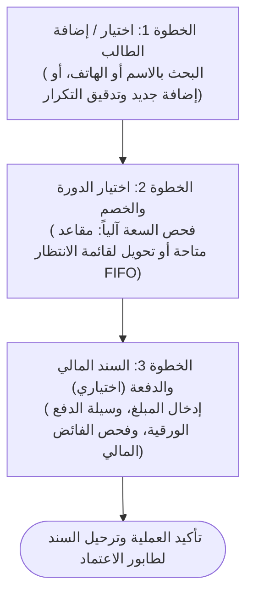

# وثيقة متطلبات تجربة وواجهة المستخدم — VELORA (فيلورا)
## UI/UX Requirements Specification

**إصدار الوثيقة:** 1.0.0  
**الحالة:** معتمدة للتنفيذ (Approved for MVP)  
**تاريخ الاعتماد:** نوفمبر 2026  
**اللغة الأساسية والاتجاه:** العربية (Arabic — RTL)  
**المنصة المستهدفة:** تطبيق ويب متجاوب بالكامل (Responsive Web: 360px Mobile إلى 4K Desktop)  
**المرجعيات الأساسية:** [PRD.md](PRD.md) | [user-flow.md](docs/user-flow.md) | [UX_BLUEPRINT.md](docs/UX_BLUEPRINT.md) | [STITCH_SCREEN_PROMPTS.md](STITCH_SCREEN_PROMPTS.md)

---

## الفهرس العام (Table of Contents)
1. [الرؤية وفلسفة التصميم (Design Philosophy & Vision)](#1-الرؤية-وفلسفة-التصميم)
2. [الهوية البصرية ونظام الرموز التصميمية (Design Tokens & Brand Identity)](#2-الهوية-البصرية-ونظام-الرموز-التصميمية)
3. [هندسة المعلومات وهيكل التنقل العام (Information Architecture & Navigation)](#3-هندسة-المعلومات-وهيكل-التنقل-العام)
4. [فهرس وتوزيع الشاشات حسب الأدوار (Role-Based Screen Inventory)](#4-فهرس-وتوزيع-الشاشات-حسب-الأدوار)
5. [مساحات عمل الدورات التبويبية (Course-Centric Workspaces)](#5-مساحات-عمل-الدورات-التبويبية)
6. [معمارية النماذج والعمليات الحرجة (Forms & Critical Interactions)](#6-معمارية-النماذج-والعمليات-الحرجة)
7. [هندسة الحالات التشغيلية (States Architecture)](#7-هندسة-الحالات-التشغيلية)
8. [السلوك التفاعلي والتجاوب مع الشاشات (Responsive Behavior)](#8-السلوك-التفاعلي-والتجاوب-مع-الشاشات)
9. [إمكانية الوصول والشمولية (Accessibility & a11y)](#9-إمكانية-الوصول-والشمولية)
10. [مصفوفة فحص الجودة التصميمية (UX Acceptance Criteria)](#10-مصفوفة-فحص-الجودة-التصميمية)

---

## 1. الرؤية وفلسفة التصميم

### 1.1 فلسفة المنصة (Design Philosophy)
تُعد منصة **VELORA (فيلورا)** نظام التشغيل الإداري والمالي الموحد لمراكز التدريب المهني والأكاديمي. ترتكز فلسفة التصميم على:
- **الوضوح والكفاءة التشغيلية (Clarity & High Utility):** الابتعاد عن الزخارف غير الوظيفية، والتركيز على الكثافة البيانية المنظمة، وسرعة إنجاز المعاملات الورقية والمالية بدون أخطاء.
- **التوجيه بالمهام الفورية (Action-Driven Hierarchy):** لوحات التحكم ليست شاشات إحصاءات خاملة، بل مراكز عمل تعرض الأولويات التشغيلية الملحة (اعتماد سندات القبض، متابعة المتعثرين، رصد الحضور اللحظي، تسليم التكليفات).
- **منع الأخطاء المحاسبية في المنبع (Error Prevention by Design):** توظيف عناصر إدخال مقيدة، وحسابات فورية شفافة، وفصل صارم بين تسجيل سندات القبض (بواسطة المبيعات) واعتمادها المالي (بواسطة المدير).

### 1.2 تجربة المستخدم بحسب النموذج الذهني (User Mental Models)
| الدور | الكود | النموذج الذهني وسياق الاستخدام | النمط التصميمي المناسب |
| :--- | :--- | :--- | :--- |
| **مدير المركز** | `MANAGER` | إدارة عليا، رقابة مالية، تدقيق، اعتماد سندات القبض، إدارة الصلاحيات | لوحة تحكم مكتبية عالية الكثافة، جداول مدعومة بالفلاتر والتصدير |
| **مسؤول المبيعات** | `SALES` | سرعة إدخال بيانات الطلاب، تحصيل نقد/شبكة، متابعة أقساط عبر الهاتف | تدفقات جانبية سريعة (Slide-overs)، بطاقات ملخص مالي حي |
| **المحاضر** | `INSTRUCTOR` | تشغيل يومي داخل القاعة عبر الهاتف/التابلت، رصد حضور سريع، تقييم خاص | واجهة متمحورة حول مساحة عمل الدورة، أزرار تفاعلية بلمسة واحدة |
| **الطالب / المتدرب** | `STUDENT` | استعراض المحاضرات والملفات، رفع الواجبات، متابعة الحضور والأقساط | واجهة تعليمية مريحة تركز على البطاقات، عد تنازلي لمواعيد التسليم |

---

## 2. الهوية البصرية ونظام الرموز التصميمية (Design Tokens & Brand Identity)

### 2.1 اللغة والاتجاه (Language & RTL)
- **اللغة المعتمدة:** اللغة العربية الفصحى المعاصرة الموجهة للأنظمة الإدارية.
- **اتجاه الواجهة:** من اليمين إلى اليسار (`dir="rtl"`).
- **القواعد الاتجاهية (Logical Properties):**
  - استخدام الخصائص المنطقية حصراً في CSS/Tailwind (`ms-`, `me-`, `ps-`, `pe-`, `text-start`, `text-end`).
  - عكس اتجاهات الأسهم والأيقونات الإرشادية (`ChevronLeft` يشير للأمام في سياق التقدم، و `ChevronRight` يشير للرجوع للخلف).
- **صيغة الأرقام:** الأرقام القياسية الموحدة (`1, 2, 3...`) لضمان محاذاة الجداول المحاسبية وقراءة أرقام الهواتف والأكواد دون تشوه.

### 2.2 منظومة الخطوط الطباعية (Typography System)
- **الخط الأساسي:** `IBM Plex Sans Arabic` (مع بدائل احتياطية: `Cairo`, `sans-serif`).
- **المقاييس والأوزان:**
  | العنصر | الحجم (Font Size) | الوزن (Weight) | ارتفاع السطر (Line Height) | الاستخدام |
  | :--- | :--- | :--- | :--- | :--- |
  | **H1 - عناوين الصفحات** | 24px (`text-2xl`) | Bold (700) | 32px | رؤوس الشاشات الرئيسية |
  | **H2 - عناوين الأقسام والنوافذ** | 18px (`text-lg`) | Semibold (600) | 28px | رؤوس البطاقات والجداول والنوافذ |
  | **H3 - العناوين الفرعية** | 16px (`text-base`) | Medium (500) | 24px | عناوين مجموعات الحقول والتبويبات |
  | **Body - النصوص العامة** | 14px (`text-sm`) | Regular (400) | 20px | محتوى الجداول، حقول النماذج، الملاحظات |
  | **Caption - البطاقات والنصوص الثانوية**| 12px (`text-xs`) | Medium (500) | 16px | شارات الحالة، البيانات الوصفية، التلميحات |
  | **KPI Metrics - الأرقام الكبرى** | 30px - 36px (`text-3xl`) | ExtraBold (800) | 40px | القيم الإحصائية الكبرى في بطاقات المؤشرات |

### 2.3 لوحة الألوان المعتمدة (Color Palette)
```
+-----------------------------------------------------------------------------------------+
| الرموز اللونية الأساسية (Master Color Tokens)                                              |
|                                                                                         |
| [الخلفية العامة: #F8FAFC (Slate-50)]          [الأسطح والبطاقات: #FFFFFF (White)]         |
| [الحدود والفواصل: #E2E8F0 (Slate-200)]        [النصوص الأساسية: #0F172A (Slate-900)]     |
| [النصوص الثانوية: #334155 (Slate-700)]        [النصوص الخافتة: #64748B (Slate-500)]       |
|                                                                                         |
| اللون الأساسي للعلامة (Indigo):                                                         |
| [الرئيسي: #4F46E5 (Indigo-600)]  [التمرير: #4338CA (Indigo-700)]  [الخفيف: #EEF2FF (50)]|
|                                                                                         |
| ألوان الحالات التشغيلية (Semantic Statuses):                                            |
| [النجاح والاعتماد: #16A34A / #DCFCE7]       [التحذير والتعليق: #D97706 / #FEF3C7]       |
| [الخطر والرفض والفائض: #DC2626 / #FEE2E2]  [المعلومات والمجدول: #2563EB / #DBEAFE]     |
+-----------------------------------------------------------------------------------------+
```

---

## 3. هندسة المعلومات وهيكل التنقل العام (Information Architecture & Navigation)

### 3.1 الهيكل الهيكلي للواجهة (App Shell Blueprint)
```
+-----------------------------------------------------------------------------------+
| الترويسة العلوية الثابتة (Fixed Header: 64px, bg-white, border-b slate-200)       |
| [شعار فيلورا VELORA] [شارة اسم المركز]  | [مساحة العمل] [جرس التنبيهات] [قائمة المستخدم] |
+-----------------------------------+-----------------------------------------------+
| مساحة المحتوى الرئيسية المتجاوبة    | القائمة الجانبية المفلترة حسب الدور          |
| (Scrollable Canvas, bg-slate-50)  | (Right Sidebar: w-64, bg-white, border-l)     |
| - شريط العنوان والإجراءات السريعة | - روابط مصرح بها فقط وفق الـ RBAC            |
| - شريط بطاقات المؤشرات (KPIs)     | - حالة نشطة واضحة (Active State: Indigo-50)   |
| - مساحة الجداول أو مساحة العمل     | - زر طي القائمة (Collapse) على الديسكتوب      |
| - الألواح المنزلقة والنوافذ       | - درج منزلق جانبي (Off-canvas) على الهواتف   |
+-----------------------------------+-----------------------------------------------+
```

### 3.2 قواعد التنقل الصارمة (Navigation Rules)
1. **عزل الصلاحيات ومنع التشويش (Strict RBAC):** لا تظهر العناصر غير المصرح بها بحالة معطلة (Disabled)، بل تُخفى نهائياً من القائمة الجانبية.
2. **عزل بيانات المركز (Tenant Isolation Display):** يظهر اسم المركز الحالي دائماً بجوار الشعار لترسيخ الوعي بنطاق البيانات النشط.
3. **التنقل الهيكلي الموحد:** الضغط على الشعار ينقل المستخدم مباشرة إلى لوحة التحكم الخاصة بدوره الحالي.
4. **الوصول المتعمق (Deep Linking):** تدعم لوحات التحكم روابط مباشرة لنقل المستخدم للتبويب المطلوب مباشرة داخل مساحة عمل الدورة (مثل: `/courses/12#attendance`).

---

## 4. فهرس وتوزيع الشاشات حسب الأدوار (Role-Based Screen Inventory)

يتضمن نطاق الـ MVP المعتمد 35 شاشة موزعة وظيفياً لمنع التداخل وسد الثغرات التشغيلية:

```
VELORA MVP Screens Architecture
├── شاشات الهوية المشتركة (Shared Auth)
│   ├── SCR-AUTH-01: تسجيل الدخول ومصادقة الجلسة (Login Page)
│   └── SCR-AUTH-02: الملف الشخصي وإعدادات الحساب (User Profile)
│
├── شاشات مدير المركز (Center Manager — 11 شاشة)
│   ├── SCR-M-01: لوحة التحكم التنفيذية لمدير المركز (Executive Dashboard)
│   ├── SCR-M-02: دليل وفهرس الدورات التدريبية (Courses Catalog)
│   ├── SCR-M-03: مساحة عمل الدورة وإدارتها التفصيلية (Course Workspace & Tabs)
│   ├── SCR-M-04: سجل المحاضرين وعقود الاستحقاق (Instructors & Compensation)
│   ├── SCR-M-05: سجل الطلاب الشامل بالمركز (Center Students Directory)
│   ├── SCR-M-06: إدارة تسجيلات الدورات وقوائم الانتظار (Enrollments & Waitlist)
│   ├── SCR-M-07: طابور اعتماد سندات القبض وطلبات الاسترداد (Payment Approvals & Refunds)
│   ├── SCR-M-08: سجل مستحقات المحاضرين وجدولة التسويات (Instructor Dues & Payouts)
│   ├── SCR-M-09: التقارير المالية والتشغيلية المجمعة (Center Reports)
│   ├── SCR-M-10: إدارة موظفي المركز والمستخدمين (Staff & Users Management)
│   └── SCR-M-11: سجل التدقيق الرقابي غير القابل للتعديل (Audit Trail Log)
│
├── شاشات مسؤول المبيعات والمتابعة (Sales Specialist — 4 شاشات)
│   ├── SCR-S-01: لوحة عمليات المبيعات والتحصيل اليومي (Sales Operations Dashboard)
│   ├── SCR-S-02: دليل استكشاف الطلاب وإدخالهم (Student Intake & Directory)
│   ├── SCR-S-03: معالج إلحاق الطلاب والخصومات والانتظار (Course Enrollment Drawer)
│   └── SCR-S-04: قيد سندات القبض وفحص الفائض المالي (Offline Payment Entry)
│
├── شاشات المحاضر (Course Instructor — 4 شاشات)
│   ├── SCR-I-01: لوحة تحكم المحاضر والمهام العاجلة (Instructor Dashboard)
│   ├── SCR-I-02: قائمة الدورات المسندة للمحاضر (My Assigned Courses)
│   ├── SCR-I-03: مساحة عمل المحاضر التبويبية (Instructor Course Workspace)
│   └── SCR-I-04: سجل المستحقات المالية والتسويات الشخصية (My Financial Earnings)
│
└── شاشات المتدرب / الطالب (Enrolled Student — 4 شاشات)
    ├── SCR-ST-01: لوحة تعلم الطالب ومتابعة المهام (Student Learning Dashboard)
    ├── SCR-ST-02: قائمة الدورات المسجل بها الطالب (My Enrolled Courses)
    ├── SCR-ST-03: مساحة عمل الطالب التبويبية (Student Course Workspace)
    └── SCR-ST-04: سجل الفواتير وسندات السداد الشخصية (My Payments & Ledger)
```

---

## 5. مساحات عمل الدورات التبويبية (Course-Centric Workspaces)

بناءً على التوجه المعتمد لمنع التشتت وعزل السياق الأكاديمي، تُنظم شاشات الدورات للمدير والمحاضر والطالب وفق **نظام التبويبات المتكاملة (Tabbed Workspaces)**:

### 5.1 مساحة عمل المدير (`SCR-M-03`)
تضم 6 تبويبات مركزية:
1. **نظرة عامة (Overview):** بيانات الدورة، تاريخ البدء والانتهاء، السعر الأساسي، شريط السعة الاستيعابية.
2. **المحاضرون (Instructors):** المحاضرون المسندون، المحاضر الرئيسي (`Lead`)، ونموذج الاستحقاق المالي المعتمد لكل منهم.
3. **الجلسات والجدول (Sessions):** جدول المحاضرات، تواريخها، القاعات، ورابط فوري لفتح سجل الحضور.
4. **الطلاب الملتحقون (Enrolled Students):** قائمة المتدربين، حالة السداد لكل طالب، رصيده المتبقي، وشارة قائمة الانتظار.
5. **المواد التعليمية (Materials):** الملفات المرفوعة للطلاب، إحصاءات التنزيل، وزر رفع ملف جديد.
6. **التكليفات والواجبات (Tasks):** الواجبات الصادرة، مواعيد التسليم، نسبة الإنجاز والتسليم.

### 5.2 مساحة عمل المحاضر (`SCR-I-03`)
تضم 4 تبويبات تنفيذية:
1. **الجلسات ورصد الحضور (Sessions & Attendance):** قائمة المحاضرات؛ يتيح النقر على أي محاضرة فتح كشف رصد سريع بنمط التبديل الفوري (حاضر / غائب) وزر "تأكيد ورصد الحضور".
2. **المواد العلمية (Materials):** مساحة رفع ملفات المحاضرات والعروض التقديمية مع تحديد وصف الملف.
3. **التكليفات والتسليمات (Tasks & Submissions):** إنشاء تكليف جديد، استعراض قائمة الطلاب المسلمين، تنزيل الملفات، وإتاحة استثناء التسليم المتأخر (`Late Override Toggle`).
4. **التغذية الراجعة الفردية (1:1 Feedback):** إرسال ملاحظات تقييمية خاصة ومباشرة لكل طالب (سرية تماماً بين المحاضر والطالب).

### 5.3 مساحة عمل الطالب (`SCR-ST-03`)
تضم 4 تبويبات ميسرة:
1. **المحاضرات والمواد (Lectures & Materials):** قائمة مرتبة زمنياً بكل المحاضرات مع أزرار تنزيل مباشرة للملفات والشروحات.
2. **الواجبات والتكليفات (Tasks & Homework):** بطاقات التكليفات مع عد تنازلي، وزر رفع ملف الحل، وشارة واضحة لحالة التسليم (`تم التسليم بالموعد`، `مسلم متأخر`، `لم يُسلم بعد`).
3. **سجل حضوري (My Attendance):** جدول يوضح حضور وغياب الطالب في كل جلسة مع النسبة المئوية الإجمالية.
4. **ملاحظات المحاضر (Instructor Feedback):** صندوق الملاحظات الخاصة المستلمة من المحاضر.

---

## 6. معمارية النماذج والعمليات الحرجة (Forms & Critical Interactions)

### 6.1 معالج إلحاق الطلاب وسندات القبض (Enrollment & Intake Stepper Drawer)
لتفادي الأخطاء وفقدان البيانات، يُنفذ تدفق التسجيل عبر **لوح جانبي منزلق (Slide-over Drawer)** من يمين الشاشة بعرض 580px مقسم إلى ثلاث خطوات متسلسلة، مع **شريط مالي ملخص حي (Sticky Financial Summary)**:



- **قواعد الإدخال المالي التلقائي:**
  - `السعر الأساسي - قيمة الخصم = الإجمالي المستحق`.
  - إذا كان `المبلغ المدفوع > الإجمالي المستحق`: يُفعل النظام فورياً تنبيهاً بصرياً باللون البرتقالي/الأحمر، ويولد تلقائياً طلباً مرتبطاً لاسترداد الفائض (`Refund Request`) بحالة `Pending Refund`.
  - لا يمكن لموظف المبيعات اعتماد السند مباشرة؛ يتحول السند إلى حالة `Pending Approval`.

### 6.2 اعتماد سندات القبض المحاسبية (Admin Payment Approval Flow)
في شاشة المدير (`SCR-M-07`):
- يظهر كل سند معلق كبطاقة فحص تحتوي: اسم الطالب، اسم الدورة، المبلغ، وسيلة الدفع (نقدي، شبكة POS، تحويل، شيك)، ورقم الإيصال الورقي.
- إذا وجد فائض مالي، تظهر شارة تحذيرية عريضة توضح مبلغ الاسترداد الواجب اعتماده وإرجاعه للطالب.
- خيارات الإجراء:
  - **اعتماد (Approve):** بنقرة واحدة تؤدي لتحديث الحسابات ذرياً (Atomic Transaction)، وتحويل حالة السداد (`PartiallyPaid` أو `FullyPaid`).
  - **رفض (Reject):** يفتح نافذة تطلب كتابة **سبب الرفض الإلزامي**، وتظل مديونية الطالب كما هي دون تعديل.

### 6.3 رصد الحضور داخل القاعة (Session Attendance Matrix)
- جدول سريع يضم أسماء المتدربين وصورهم.
- مفتاح تبديل ثنائي كبير الحجم ومتوافق مع اللمس (Touch-Friendly Toggle):
  - **حاضر (أخضر)** / **غائب (أحمر)**.
  - زر علوي جماعي: "تحديد الجميع كحاضرين" لتسريع العملية.
  - زر تثبيت الحضور يعرض نافذة تأكيد سريعة تذكر المحاضر بأن التثبيت سيولد استحقاق الجلسة المالي آلياً إذا كان عقده بنظام الجلسة (`PerSession`).

### 6.4 تسليم التكليفات وسياسة التأخير (Task Submission & Late Policy)
- مساحة رفع ملفات تفاعلية (Drag & Drop) تدعم السحب والإفلات وتحدد بوضوح الامتدادات المسموحة (`.pdf`, `.zip`, `.docx`, `.png`, `.jpg`) والحد الأقصى للحجم (25 ميجابايت).
- **منطق انتهاء الموعد:**
  - إذا حان الموعد النهائي ولم يفعل المحاضر استثناء التأخير: تُغلق مساحة الرفع فورياً وتظهر شارة `انتهى موعد التسليم` باللون الرمادي/الأحمر مع تعطيل زر الإرسال.
  - إذا كان استثناء التأخير مفعلاً: يُسمح برفع الملف مع وسمه بشارة بارزة `مسلم متأخر (Submitted Late)` باللون البرتقالي الداكن.

---

## 7. هندسة الحالات التشغيلية (States Architecture)

تلتزم جميع شاشات المنصة ومكوناتها بالمصفوفة الرباعية للحالات التشغيلية:

### 7.1 الحالات الفارغة (Empty States)
- يمنع منعاً باتاً ترك الشاشة بيضاء أو فارغة عند غياب البيانات.
- تحتوي كل شاشة فارغة على:
  1. أيقونة خطية معبرة بحجم 48px بلون هادئ (`slate-400`).
  2. عنوان واضح ومباشر باللغة العربية (مثال: "لا توجد دورات تدريبية نشطة حالياً").
  3. نص تفسيري مقتضب (مثال: "ابدأ بإعداد أول دورة تدريبية وتعيين المحاضرين لتمكين الطلاب من التسجيل").
  4. زر إجراء رئيسي بارز (Call to Action) لنقل المستخدم مباشرة إلى شاشة الإنشاء (مثل: زر "إنشاء دورة تدريبية جديدة").

### 7.2 حالات التحميل (Loading States)
- تجنب استخدام المؤشرات الدائرية الشاملة التي تجمد كامل الشاشة.
- اعتماد **الهياكل العظمية الرمادية المتحركة (Skeleton Loaders)** المطابقة تماماً لهيكل البطاقات والجداول المرتقبة لإعطاء إحساس بالسرعة والاستقرار البصري.
- أثناء إرسال النماذج والعمليات المالية، يتحول زر الإجراء نفسه إلى حالة التحميل (`Button Spinner`) مع تعطيله لمنع النقر المزدوج المتكرر (`Prevent Double Submission`).

### 7.3 حالات الخطأ والتحقق (Error States)
- **الأخطاء الحقلية (Field Validation):** تظهر رسالة الخطأ باللغة العربية أسفل الحقل مباشرة باللون الأحمر (`text-red-600 text-xs`) مع تحديد إطار الحقل بالأحمر، وتفعيل الرسالة عند فقدان التركيز (`onBlur`) وأثناء الإرسال.
- **الأخطاء العامة والتعارض (HTTP 409 / 403 / 500):** تظهر عبر إشعار منبثق أعلى يسار/يمين الشاشة (Toast Notification) يوضح الخطأ بلغة تشغيلية واضحة (مثال: "هذا الطالب مسجل بالفعل في هذه الدورة التدريبية" بدلاً من "Conflict Error").

### 7.4 حالات النجاح والتأكيد (Success Feedback)
- تظهر إشعارات خضراء مقتضبة تدوم من 3 إلى 5 ثوانٍ ثم تختفي تلقائياً، تؤكد نجاح العملية (مثال: "تم اعتماد سند القبض وترحيله للرصيد بنجاح").
- في العمليات المالية الكبرى، يظهر إيصال استلام منبثق قابل للطباعة الفورية (`Print Receipt`).

---

## 8. السلوك التفاعلي والتجاوب مع الشاشات (Responsive Behavior)

تدعم المنصة أربعة نطاقات رئيسية للشاشات لضمان التوافق مع الهواتف الذكية داخل القاعات وشاشات المكاتب العريضة:

| نقطة التجاوب (Breakpoint) | أبعاد الشاشة | التكيف الهيكلي وسلوك المكونات |
| :--- | :--- | :--- |
| **الهواتف الذكية (Mobile)** | `360px` – `639px` | - إخفاء القائمة الجانبية وتحويلها لدرج منزلق يفتح عبر أيقونة الهمبرغر.<br>- تحويل الجداول العريضة إلى **بطاقات معلومات رأسية مكدسة (Stacked Cards)**.<br>- تثبيت شريط الإجراءات الرئيسي أسفل الشاشة (Sticky Bottom Bar) للوصول السهل بالإبهام.<br>- عرض شاشات مساحة العمل في تبويب أفقي قابل للسحب بالتمرير الأفقي. |
| **الأجهزة اللوحية (Tablet)** | `640px` – `1023px` | - القائمة الجانبية مصغرة للأيقونات فقط (Icon-only) أو قابلة للطي.<br>- بطاقات المؤشرات تظهر في شبكة ثنائية (2-Column Grid).<br>- إمكانية تصفح الجداول عبر التمرير الأفقي المحصور داخل الحاوية. |
| **شاشات الحواسيب (Desktop)**| `1024px` – `1439px`| - القائمة الجانبية مفتوحة بعرض ثابت (256px) جهة اليمين.<br>- شبكة رباعية كاملة لبطاقات المؤشرات (4-Column Grid).<br>- الجداول تظهر بكامل أعمدتها مع تثبيت الترويسة أثناء التمرير الرأسي. |
| **الشاشات الكبرى (4K / Ultrawide)**| `1440px` فما فوق | - تثبيت أقصى عرض لمحتوى الصفحة عند `1600px` مع توسيط المحتوى لتفادي تشتت مسار حركة العين. |

---

## 9. إمكانية الوصول والشمولية (Accessibility & a11y)

تلتزم المنصة بمعايير **WCAG 2.1 Level AA** لضمان سهولة الاستخدام لكافة فئات المستخدمين:
1. **التباين اللوني (Color Contrast):** تباين لا يقل عن `4.5:1` لجميع النصوص العادية أمام خلفياتها، و `3:1` للعناصر التفاعلية والأزرار وشارات الحالة.
2. **أهداف اللمس (Touch Targets):** لا تقل مساحة النقر لأي زر أو أيقونة أو حقل تفاعلي عن `44 × 44 بكسل` على شاشات اللمس والهواتف.
3. **التنقل عبر لوحة المفاتيح (Keyboard Navigation):**
   - حلقة تركيز مرئية بوضوح (`focus:ring-2 focus:ring-indigo-500 focus:outline-none`) حول العنصر النشط.
   - إمكانية التنقل بين التبويبات والحقول باستخدام أزرار `Tab` و `Shift+Tab` والأسهم.
   - حصر التركيز داخل النوافذ المنبثقة والألواح المنزلقة (Focus Trap) وإغلاقها تلقائياً عند الضغط على زر `Escape`.
4. **دعم قارئات الشاشة (Screen Readers):**
   - توفير وسوم ARIA لكافة العناصر التفاعلية (`aria-expanded`, `aria-haspopup`, `aria-selected`).
   - الإعلان اللحظي عن الإشعارات والأخطاء عبر `aria-live="polite"`.

---

## 10. مصفوفة فحص الجودة التصميمية (UX Acceptance Criteria)

تعد هذه المصفوفة معيار الفحص المعتمد لاستلام الواجهات قبل البرمجة:

- [x] **AC-UX-01 (RBAC Cleanliness):** لا يرى أي دور أي رابط في شريطه الجانبي لا يمتلك صلاحية الوصول الفعلي إليه.
- [x] **AC-UX-02 (RTL Consistency):** المحاذاة والرموز والأرقام والاتجاهات متسقة بنسبة 100% مع النمط العربي المعتمد.
- [x] **AC-UX-03 (Financial Transparency):** كل شاشة أو نموذج مالي يعرض بوضوح (الإجمالي، الخصم، المدفوع، المتبقي، وحالة الفائض إن وجدت) دون غموض.
- [x] **AC-UX-04 (Course-Centric Isolation):** يدير المحاضر والطالب شؤونهما عبر مساحة العمل التبويبية للدورة المحددة لمنع تداخل الحضور أو المهام بين الدورات.
- [x] **AC-UX-05 (Mobile Usability):** يمكن للمحاضر رصد الحضور وللطالب رفع التكليف ولموظف المبيعات إدخال السند كاملاً عبر هاتف ذكي بعرض 360px بدون تشوه أو أزرار خارج الشاشة.
- [x] **AC-UX-06 (Action-Driven Dashboards):** تحتوي لوحة تحكم كل دور على مركز إجراءات للمهام العاجلة وليس مجرد رسوم إحصائية.
- [x] **AC-UX-07 (Complete State Coverage):** توفر تصاميم معتمدة للحالات الأربع (البيانات النشطة، الحالة الفارغة، حالة التحميل، وحالات الخطأ والنجاح) لكل شاشة.

---
**اعتماد التصميم:** تم توثيق واعتماد هذه المتطلبات كمرجع إلزامي لهندسة واجهات وتجربة مستخدم منصة **VELORA (فيلورا)**.
