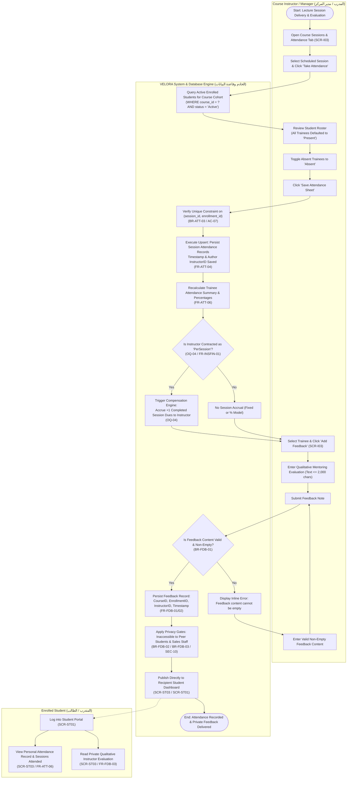
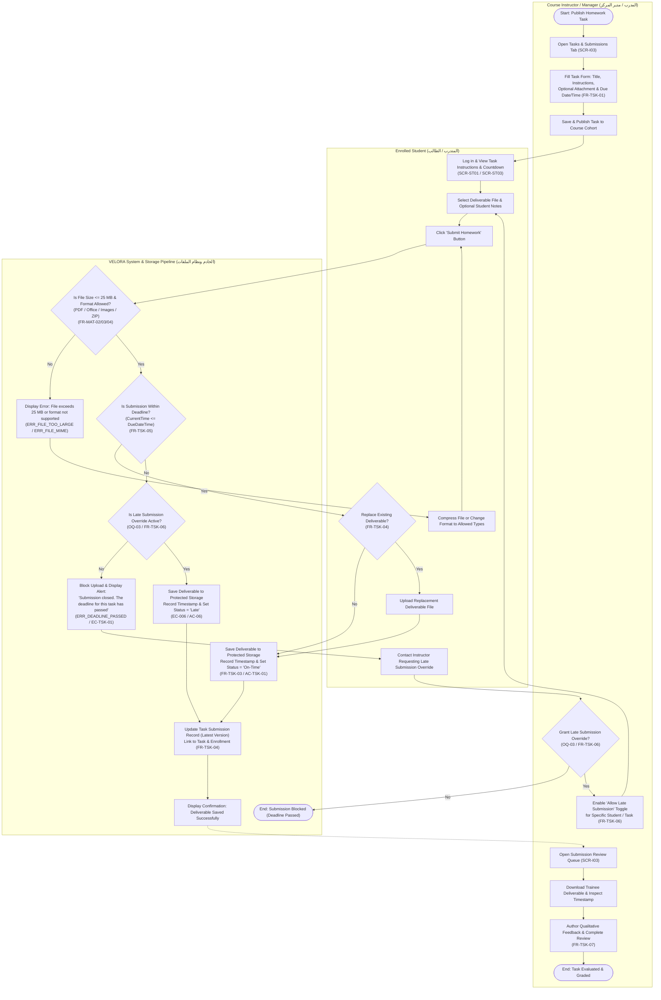

```mermaid
flowchart TD
    %% ==========================================
    %% PROC-01: COURSE LIFECYCLE & SCHEDULING
    %% ==========================================
    
    subgraph Swimlane_Manager ["Center Manager (مدير المركز)"]
        C_Start(["Start: Initiate Course Creation"])
        C_OpenForm["Open 'Create Course' Form (SCR-M02)"]
        C_FillForm["Enter Title, Code, Base Price, Dates, Capacity"]
        C_FixForm["Correct Highlighted Form Errors"]
        C_OpenAssignModal["Open 'Assign Instructor' Modal (SCR-M03)"]
        C_SelectTerms["Select Instructor, Compensation Model\n(Fixed / % / PerSession) & Lead Status"]
        C_AddSession["Navigate to Sessions Tab & Add Lecture Session\n(Date, Time, Topic, Instructor)"]
        C_ClickPublish["Click 'Publish Course' Button"]
        C_AssignMissing["Assign At Least One Instructor"]
        C_CompleteCourse["Mark Course as 'Completed'"]
        C_RequestArchive["Select 'Archive Course'"]
        C_AttemptDelete["Attempt Direct Course Deletion"]
    end

    subgraph Swimlane_System ["VELORA System & Database Engine (الخادم وقاعدة البيانات)"]
        C_ValidateData{"Are Dates & Base Price Valid?\n(EndDate >= StartDate & Price >= 0.00)\n(BR-CRS-02 / BR-CRS-04)"}
        C_ShowFormError["Display Inline Form Error\n(EC-CRS-02)"]
        C_SaveDraft["Create Course in Center Database\nStatus = 'Draft'\n(FR-CRS-01/02)"]
        C_CheckDupInstructor{"Is Instructor Already Assigned?\n(FR-INS-05)"}
        C_DupInstructorError["Display Error: Instructor already assigned\n(HTTP 409 Conflict)"]
        C_SaveInstructor["Persist CourseInstructor Record\nSet Lead Flag & Compensation Model\n(FR-INS-01/02)"]
        C_SaveSession["Persist CourseSession Record\nLink to Course & Center\n(FR-CRS-04)"]
        C_CheckInstructorsAssigned{"Is at least 1 Instructor Assigned?\n(BR-CRS-03 / EC-003)"}
        C_HaltActivation["Halt Activation & Display Alert:\n'Course must have at least one assigned instructor'\n(EC-003)"]
        C_TransitionActive["Update Course Status = 'Active'\nCreate AuditLog Entry\n(FR-CRS-02 / FR-AUD-01)"]
        C_CourseActiveReady(["End: Course Active & Open for Enrollment"])
        C_TransitionCompleted["Update Course Status = 'Completed'\nLock New Enrollments"]
        C_CheckHistoricalRecords{"Has Historical Enrollments or Payments?\n(FR-CRS-06 / EC-002)"}
        C_BlockDelete["Block Hard Delete (ERR_DELETE_BLOCKED)\nDisplay Alert: Course with history can only be archived\n(EC-002)"]
        C_SoftArchive["Set Course Status = 'Archived'\nPreserve All Relational Data\nSet Read-Only Locks\n(FR-CRS-05)"]
        C_CourseArchivedEnd(["End: Course Archived (Audit-Preserved)"])
    end

    %% Flow Connections
    C_Start --> C_OpenForm
    C_OpenForm --> C_FillForm
    C_FillForm --> C_ValidateData
    C_ValidateData -->|No| C_ShowFormError
    C_ShowFormError --> C_FixForm
    C_FixForm --> C_ValidateData
    C_ValidateData -->|Yes| C_SaveDraft
    
    C_SaveDraft --> C_OpenAssignModal
    C_OpenAssignModal --> C_SelectTerms
    C_SelectTerms --> C_CheckDupInstructor
    C_CheckDupInstructor -->|Yes| C_DupInstructorError
    C_DupInstructorError --> C_OpenAssignModal
    C_CheckDupInstructor -->|No| C_SaveInstructor
    
    C_SaveInstructor --> C_AddSession
    C_AddSession --> C_SaveSession
    C_SaveSession --> C_ClickPublish
    
    C_ClickPublish --> C_CheckInstructorsAssigned
    C_CheckInstructorsAssigned -->|No| C_HaltActivation
    C_HaltActivation --> C_AssignMissing
    C_AssignMissing --> C_OpenAssignModal
    
    C_CheckInstructorsAssigned -->|Yes| C_TransitionActive
    C_TransitionActive --> C_CourseActiveReady
    
    C_CourseActiveReady -.-> C_CompleteCourse
    C_CompleteCourse --> C_TransitionCompleted
    C_TransitionCompleted --> C_RequestArchive
    C_RequestArchive --> C_SoftArchive
    C_SoftArchive --> C_CourseArchivedEnd

    C_CourseActiveReady -.-> C_AttemptDelete
    C_AttemptDelete --> C_CheckHistoricalRecords
    C_CheckHistoricalRecords -->|Yes| C_BlockDelete
    C_BlockDelete --> C_RequestArchive
```

```mermaid
flowchart TD
    %% ==========================================
    %% PROC-02: INTAKE, ENROLLMENT & WAITLIST
    %% ==========================================

    subgraph Swimlane_Sales ["Sales Specialist / Manager (مسؤول المبيعات / المدير)"]
        E_Start(["Start: Trainee Intake & Enrollment"])
        E_Search["Search Student Directory by Name/Phone/Email\n(SCR-S02)"]
        E_OpenNewModal["Open 'New Student' Form & Enter Contact Details\n(SCR-S03)"]
        E_FixStudentForm["Correct Form Validation Errors"]
        E_SelectStudent["Select Student Profile for Enrollment"]
        E_SelectCourse["Select Target Course Cohort"]
        E_PromptWaitlist{"Trainee Accepts Waitlist Placement?\n(OQ-06 / BR-CRS-WAITLIST-FIFO)"}
        E_DecideDiscount{"Apply Authorized Discount?\n(FR-STU-02)"}
        E_EnterDiscount["Enter Discount Value (Fixed Amount or %)"]
        E_FixDiscount["Correct Discount (Must be <= Base Price)"]
        E_SubmitEnrollment["Confirm & Submit Course Enrollment"]
    end

    subgraph Swimlane_System ["VELORA System & Database Engine (الخادم وقاعدة البيانات)"]
        E_CheckStudentFound{"Does Student Profile Exist in Center?\n(FR-STU-01)"}
        E_ValidateStudentForm{"Form Valid & Email/Phone Unique?\n(FR-STU-01)"}
        E_ShowStudentFormError["Display Inline Form Errors"]
        E_PersistStudent["Save Student Profile to Center Directory\n(FR-009)"]
        E_CheckCourseActive{"Is Course Status 'Active'?\n(FR-CRS-02 / BR-CRS-03)"}
        E_CourseNotActiveError["Display Error: Enrollments restricted to Active courses"]
        E_CheckCapacity{"Is Course Capacity Reached?\n(EnrolledCount >= Capacity)\n(BR-CRS-CAPACITY-HARDLOCK)"}
        E_HaltCapacity["Halt Direct Enrollment\nDisplay Alert: Course Cohort is Full"]
        E_AbortWaitlist(["End: Enrollment Cancelled (Capacity Reached)"])
        E_AddToWaitlist["Create CourseWaitlist Entry:\nStatus = 'Waiting', Timestamp for FIFO Priority\n(Zero Fees Charged / No Financial Ledger)\n(BR-CRS-WAITLIST-FIFO)"]
        E_WaitlistQueuedEnd(["End: Student Queued on Waitlist (Waiting Status)"])
        E_CheckDuplicate{"Is Student Actively Enrolled in this Course?\n(FR-011 / EC-001)"}
        E_DuplicateError["Display HTTP 409 Conflict Error:\n'Student already actively enrolled in this course'\n(EC-STU-01)"]
        E_AbortDuplicate(["End: Enrollment Blocked (Duplicate)"])
        E_DisplayBasePrice["Fetch & Display Catalog Base Price\n(FR-STU-03)"]
        E_ValidateDiscount{"Is Discount <= Base Price?\n(BR-STU-01 / EC-STU-02)"}
        E_DiscountError["Display Error: Discount cannot exceed Base Price\n(EC-STU-02)"]
        E_ComputeDiscountPayable["Compute: FinalPayable = BasePrice - DiscountAmount\n(FR-STU-03)"]
        E_SetStandardPayable["Set: FinalPayable = BasePrice\nDiscountAmount = 0.00"]
        E_BeginTx["Begin Atomic Database Transaction (ACID)\n(NFR-REL-01)"]
        E_InitializeLedger["Initialize Student Financial Ledger:\nBasePrice, DiscountAmount, FinalPayable,\nTotalPaid = 0.00, RemainingBalance = FinalPayable,\nPaymentStatus = 'Unpaid'\n(FR-FIN-01)"]
        E_PersistEnrollment["Persist Enrollment Record (Status = 'Active')\nIncrement Course Enrolled Seat Count\n(BR-CRS-CAPACITY-SYNC)"]
        E_CommitTx["Commit Transaction & Log Audit Entry\n(FR-AUD-01)"]
        E_EnrollmentSuccessEnd(["End: Enrollment Active (Unpaid / Seat Confirmed)"])
    end

    %% Flow Connections
    E_Start --> E_Search
    E_Search --> E_CheckStudentFound
    E_CheckStudentFound -->|No| E_OpenNewModal
    E_OpenNewModal --> E_ValidateStudentForm
    E_ValidateStudentForm -->|No| E_ShowStudentFormError
    E_ShowStudentFormError --> E_FixStudentForm
    E_FixStudentForm --> E_ValidateStudentForm
    E_ValidateStudentForm -->|Yes| E_PersistStudent
    E_PersistStudent --> E_SelectStudent
    E_CheckStudentFound -->|Yes| E_SelectStudent

    E_SelectStudent --> E_SelectCourse
    E_SelectCourse --> E_CheckCourseActive
    E_CheckCourseActive -->|No| E_CourseNotActiveError
    E_CourseNotActiveError --> E_SelectCourse
    E_CheckCourseActive -->|Yes| E_CheckCapacity

    E_CheckCapacity -->|Yes| E_HaltCapacity
    E_HaltCapacity --> E_PromptWaitlist
    E_PromptWaitlist -->|No| E_AbortWaitlist
    E_PromptWaitlist -->|Yes| E_AddToWaitlist
    E_AddToWaitlist --> E_WaitlistQueuedEnd

    E_CheckCapacity -->|No| E_CheckDuplicate
    E_CheckDuplicate -->|Yes| E_DuplicateError
    E_DuplicateError --> E_AbortDuplicate
    E_CheckDuplicate -->|No| E_DisplayBasePrice

    E_DisplayBasePrice --> E_DecideDiscount
    E_DecideDiscount -->|Yes| E_EnterDiscount
    E_EnterDiscount --> E_ValidateDiscount
    E_ValidateDiscount -->|No| E_DiscountError
    E_DiscountError --> E_FixDiscount
    E_FixDiscount --> E_ValidateDiscount
    E_ValidateDiscount -->|Yes| E_ComputeDiscountPayable
    E_ComputeDiscountPayable --> E_SubmitEnrollment

    E_DecideDiscount -->|No| E_SetStandardPayable
    E_SetStandardPayable --> E_SubmitEnrollment

    E_SubmitEnrollment --> E_BeginTx
    E_BeginTx --> E_InitializeLedger
    E_InitializeLedger --> E_PersistEnrollment
    E_PersistEnrollment --> E_CommitTx
    E_CommitTx --> E_EnrollmentSuccessEnd
```

```mermaid
flowchart TD
    %% ==========================================
    %% PROC-03: PAYMENT APPROVAL & EXCESS REFUND
    %% ==========================================

    subgraph Swimlane_Sales ["Sales Specialist / Staff (مسؤول المبيعات)"]
        P_Start(["Start: Receive Offline Fee Installment"])
        P_OpenModal["Open 'Record Payment' Modal (SCR-S04 / SCR-M05)"]
        P_EnterDetails["Enter Amount, Payment Date, Method\n(Cash / POS / Transfer / Cheque), Receipt Ref & Notes"]
        P_FixAmount["Correct Amount (Must be > 0.00)"]
    end

    subgraph Swimlane_System ["VELORA System & Validation Engine (الخادم وقاعدة البيانات)"]
        P_ValidatePositive{"Is Payment Amount > 0.00?\n(BR-FIN-01 / EC-008)"}
        P_AmountError["Display Error: Payment amount must be greater than 0.00\n(EC-FIN-02)"]
        P_CheckOverpay{"Is Amount > RemainingBalance?\n(Auto-detect Excess Amount)\n(OQ-05 / BR-FIN-OVERPAY-REFUND)"}
        P_DetectExcess["Detect Excess: ExcessAmount = Amount - RemainingBalance\nDisplay Alert: Overpayment Detected"]
        P_AutoCreateRefund["Auto-create Linked Refund Request:\nAmount = ExcessAmount, Status = 'Pending Refund'\n(BR-FIN-OVERPAY-REFUND)"]
        P_QueueOverpayPayment["Submit Voucher with Linked Refund to Approval Queue\nStatus = 'Pending Approval'\n(BR-FIN-APPROVAL)"]
        P_QueueStdPayment["Submit Standard Voucher to Approval Queue\nStatus = 'Pending Approval'\n(BR-FIN-APPROVAL)"]
        P_BeginTx["Begin Atomic Database Transaction (ACID)\n(NFR-REL-01)"]
        P_PersistPayment["Update Payment Status = 'Completed'\nPersist Immutable Financial Record\n(FR-FIN-05 / BR-FIN-03)"]
        P_UpdateLedger["Recalculate Student Balance:\nNetCourseApplied = Amount - ExcessAmount\nTotalPaid = TotalPaid + NetCourseApplied\nRemainingBalance = FinalPayable - TotalPaid"]
        P_EvalBalance{"Is Balance Fully Settled?\n(Remaining == 0.00)"}
        P_SetFullyPaid["Update Enrollment Status = 'FullyPaid'"]
        P_SetPartiallyPaid["Update Enrollment Status = 'PartiallyPaid'\n(RemainingBalance > 0.00)"]
        P_CheckHasRefund{"Is Refund Request Attached?\n(ExcessAmount > 0.00)"}
        P_QueueRefundQueue["Queue Refund Request in Finance Disbursement Roster\nStatus = 'Pending Refund'"]
        P_WriteAudit["Write Immutable AuditLog Entry:\nUserID, CenterID, Old/New Balance, IP, Timestamp\n(FR-AUD-01/02)"]
        P_CommitTx["Commit Atomic Transaction\n(NFR-REL-01)"]
        P_IssueReceipt["Issue Official Approved Receipt (REC-XXXX)\nUpdate Sales & Student Dashboards (SCR-ST04)"]
        P_PaymentApprovedEnd(["End: Payment Approved & Ledger Synchronized"])
    end

    subgraph Swimlane_Manager ["Center Manager / Accountant (المدير / المحاسب)"]
        P_ReviewQueue["Review Approval Queue (SCR-M07)\nInspect Payment Details, Attached Receipts & Excess Warnings"]
        P_DecideApprove{"Approve Payment Voucher?\n(BR-FIN-APPROVAL / OQ-02)"}
        P_RejectVoucher["Reject Voucher with Mandatory Audit Reason\nPayment Status = 'Rejected'\nStudent Balance Remains Unchanged"]
        P_RejectEnd(["End: Payment Rejected (Balance Untouched)"])
    end

    subgraph Swimlane_Finance ["Finance Officer / Cashier (أمين الصندوق / الإدارة المالية)"]
        P_ExecuteRefundPayout["Execute Physical Payout to Student\n(Cash Disbursement or Bank Wire)\nDocument Date, Method & Payout Reference"]
        P_VerifyPayout{"Was Refund Payout Confirmed Executed?\n(BR-FIN-REFUND-VERIFY)"}
        P_SetRefundFailed["Update Status = 'Refund Failed'\nLog Exception & Re-queue for Finance Follow-up"]
        P_RefundFailedEnd(["End: Refund Failed (Action Required)"])
        P_SetRefunded["Update Status = 'Refunded'\nTimestamp Execution Confirmation"]
        P_LogRefundAudit["Write Immutable AuditLog for Refund Execution\nPreserve All Records (No Deletions)"]
        P_IssueRefundVoucher["Issue Official Refund Voucher to Student\nUpdate Center Financial Ledger"]
        P_RefundSuccessEnd(["End: Excess Refund Executed & Closed"])
    end

    %% Flow Connections
    P_Start --> P_OpenModal
    P_OpenModal --> P_EnterDetails
    P_EnterDetails --> P_ValidatePositive
    P_ValidatePositive -->|No| P_AmountError
    P_AmountError --> P_FixAmount
    P_FixAmount --> P_ValidatePositive

    P_ValidatePositive -->|Yes| P_CheckOverpay
    P_CheckOverpay -->|Yes| P_DetectExcess
    P_DetectExcess --> P_AutoCreateRefund
    P_AutoCreateRefund --> P_QueueOverpayPayment
    P_QueueOverpayPayment --> P_ReviewQueue

    P_CheckOverpay -->|No| P_QueueStdPayment
    P_QueueStdPayment --> P_ReviewQueue

    P_ReviewQueue --> P_DecideApprove
    P_DecideApprove -->|No| P_RejectVoucher
    P_RejectVoucher --> P_RejectEnd

    P_DecideApprove -->|Yes| P_BeginTx
    P_BeginTx --> P_PersistPayment
    P_PersistPayment --> P_UpdateLedger
    P_UpdateLedger --> P_EvalBalance

    P_EvalBalance -->|Yes| P_SetFullyPaid
    P_EvalBalance -->|No| P_SetPartiallyPaid

    P_SetFullyPaid --> P_CheckHasRefund
    P_SetPartiallyPaid --> P_CheckHasRefund

    P_CheckHasRefund -->|No| P_WriteAudit
    P_CheckHasRefund -->|Yes| P_QueueRefundQueue
    P_QueueRefundQueue --> P_WriteAudit

    P_WriteAudit --> P_CommitTx
    P_CommitTx --> P_IssueReceipt
    P_IssueReceipt --> P_PaymentApprovedEnd

    %% Refund Execution Connections
    P_QueueRefundQueue -.-> P_ExecuteRefundPayout
    P_ExecuteRefundPayout --> P_VerifyPayout
    P_VerifyPayout -->|No| P_SetRefundFailed
    P_SetRefundFailed --> P_RefundFailedEnd
    P_VerifyPayout -->|Yes| P_SetRefunded
    P_SetRefunded --> P_LogRefundAudit
    P_LogRefundAudit --> P_IssueRefundVoucher
    P_IssueRefundVoucher --> P_RefundSuccessEnd
```

```mermaid
flowchart TD
    %% ==========================================
    %% PROC-06: INSTRUCTOR COMPENSATION & PAYOUT
    %% ==========================================

    subgraph Swimlane_Triggers ["Operational Event Triggers (الأحداث المحفزة للاستحقاق)"]
        F_TrigStart(["Start: Operational Event Occurs"])
        F_CourseActive["Event A: Course Cohort Activated\n(Fixed Amount Contract)"]
        F_StudentPaid["Event B: Student Payment Voucher Approved\n(Percentage of Revenue Contract)"]
        F_SessionDelivered["Event C: Session Attendance Sheet Saved\n(Per-Session Contract / OQ-04)"]
    end

    subgraph Swimlane_CalculationEngine ["VELORA Calculation Engine (محرك الاحتساب المالي الآلي)"]
        F_IdentifyModel{"Identify Instructor Compensation Model\n(FR-INS-02)"}
        F_AccrueFixed["Accrue Full Agreed Sum:\nAccruedAmount = FixedValue\n(FR-INSFIN-01)"]
        F_AccruePercentage["Recalculate Dynamic Revenue Share:\nAccruedAmount = (Percentage / 100) * SUM(Verified Payments)\n(BR-INS-03)"]
        F_AccruePerSession["Compute Delivered Session Dues:\nAccruedAmount = RatePerSession * Count(Completed Sessions)\n(OQ-04)"]
        F_UpdateDueRecord["Update InstructorDue Ledger Record:\nRecalculate OutstandingDue = AccruedAmount - PaidAmount\nEvaluate Status: Pending or PartiallyPaid\n(FR-INSFIN-01/02)"]
    end

    subgraph Swimlane_Manager ["Center Manager (مدير المركز)"]
        F_ReviewLiabilities["Open Instructor Liabilities Ledger (SCR-M08)\nInspect Accrued Dues, Past Payouts & Outstanding Balance"]
        F_InitiatePayout["Click 'Record Settlement Payout'"]
        F_EnterPayoutForm["Enter Payout Amount, Payout Date, Method\n(Bank Transfer / Cash / Cheque), Reference & Notes\n(FR-INSFIN-03)"]
        F_FixPayoutAmount["Correct Payout Amount (Must be > 0.00)"]
    end

    subgraph Swimlane_SystemLedger ["VELORA Settlement & Audit Engine (الخادم وسجل التدقيق)"]
        F_ValidatePayoutAmount{"Is Payout Amount > 0.00 & Valid?\n(BR-INS-02)"}
        F_PayoutAmountError["Display Error: Payout amount must be greater than 0.00"]
        F_BeginTx["Begin Atomic Database Transaction (ACID)\n(NFR-REL-01)"]
        F_PersistPayoutRecord["Persist Payout Disbursement Record\n(Voucher TRX-XXXX Linked to InstructorDue)"]
        F_IncrementPaidAmount["Update Balances:\nPaidAmount = PaidAmount + PayoutAmount\nOutstandingDue = AccruedAmount - PaidAmount"]
        F_EvalDueStatus{"Is Outstanding Due Fully Settled?\n(OutstandingDue == 0.00)"}
        F_SetDuePaid["Update InstructorDue Status = 'Paid'"]
        F_SetDuePartial["Update InstructorDue Status = 'PartiallyPaid'\n(OutstandingDue > 0.00)"]
        F_WriteAudit["Write Immutable AuditLog Entry:\nUserID, CenterID, Old/New Dues, Reference, Timestamp\n(FR-AUD-01/02)"]
        F_CommitTx["Commit Transaction & Refresh Financial Reports\n(FR-INSFIN-05)"]
        F_PayoutCompleteEnd(["End: Settlement Payout Recorded & Dues Synchronized"])
    end

    subgraph Swimlane_Instructor ["Course Instructor (المدرب الأكاديمي)"]
        F_InstructorPortal["Log into Instructor Portal (SCR-I01)"]
        F_ViewPersonalDues["Access 'My Financial Dues' Workspace (SCR-I04)\nView Accrued Earnings, Payout History & Net Due\n(FR-INSFIN-04)"]
    end

    %% Flow Connections
    F_TrigStart --> F_CourseActive
    F_TrigStart --> F_StudentPaid
    F_TrigStart --> F_SessionDelivered

    F_CourseActive --> F_IdentifyModel
    F_StudentPaid --> F_IdentifyModel
    F_SessionDelivered --> F_IdentifyModel

    F_IdentifyModel -->|FixedAmount| F_AccrueFixed
    F_IdentifyModel -->|PercentageOfRevenue| F_AccruePercentage
    F_IdentifyModel -->|PerSession| F_AccruePerSession

    F_AccrueFixed --> F_UpdateDueRecord
    F_AccruePercentage --> F_UpdateDueRecord
    F_AccruePerSession --> F_UpdateDueRecord

    F_UpdateDueRecord --> F_ReviewLiabilities
    F_ReviewLiabilities --> F_InitiatePayout
    F_InitiatePayout --> F_EnterPayoutForm
    F_EnterPayoutForm --> F_ValidatePayoutAmount

    F_ValidatePayoutAmount -->|No| F_PayoutAmountError
    F_PayoutAmountError --> F_FixPayoutAmount
    F_FixPayoutAmount --> F_ValidatePayoutAmount

    F_ValidatePayoutAmount -->|Yes| F_BeginTx
    F_BeginTx --> F_PersistPayoutRecord
    F_PersistPayoutRecord --> F_IncrementPaidAmount
    F_IncrementPaidAmount --> F_EvalDueStatus

    F_EvalDueStatus -->|Yes| F_SetDuePaid
    F_EvalDueStatus -->|No| F_SetDuePartial

    F_SetDuePaid --> F_WriteAudit
    F_SetDuePartial --> F_WriteAudit

    F_WriteAudit --> F_CommitTx
    F_CommitTx --> F_PayoutCompleteEnd

    F_PayoutCompleteEnd -.-> F_InstructorPortal
    F_InstructorPortal --> F_ViewPersonalDues
```

```mermaid
flowchart TD
    %% ==========================================
    %% PROC-07: IMMUTABLE ADJUSTMENT & AUDIT
    %% ==========================================

    subgraph Swimlane_Manager ["Center Manager (مدير المركز)"]
        J_Start(["Start: Financial Correction / Payment Adjustment"])
        J_OpenLedger["Open Student Payments Register (SCR-M07 / SCR-M05)"]
        J_LocatePayment["Locate Posted Payment Voucher (Status = 'Completed')"]
        J_InitiateAdjustment["Click 'Post Adjustment / Reversal'"]
        J_FillAdjustmentForm["Enter Adjustment Type (Reversal / Correction),\nAdjustment Amount, Corrected Ref & Mandatory Rationale\n(FR-FIN-05 / BR-FIN-03)"]
        J_FixForm["Provide Valid Amount & Detailed Audit Rationale"]
    end

    subgraph Swimlane_SystemLedger ["VELORA Financial & Audit Engine (الخادم ومحرك التدقيق)"]
        J_EnforceNoDelete{"Attempting Direct Record Deletion?\n(FR-FIN-05 / AC-05)"}
        J_BlockDelete["Block Action with Error: 'Hard deletion of financial records is prohibited.\nUse adjustment workflow instead'\n(ERR_DELETE_BLOCKED)"]
        J_ValidateAdjustmentData{"Is Adjustment Form Valid & Rationale Provided?\n(BR-FIN-03)"}
        J_ShowAdjustmentError["Display Error: Mandatory audit rationale required"]
        J_BeginTx["Begin Atomic Database Transaction (ACID)\n(NFR-REL-01)"]
        J_MarkOriginalAdjusted["Update Original Payment Voucher Status = 'Adjusted'\n(FR-FIN-05)"]
        J_CreateAdjustmentRecord["Create Linked PaymentAdjustment Record:\nOriginalPaymentID, AdjustedAmount, Method, Reference\n(BR-FIN-03)"]
        J_RecalculateStudentBalance["Recalculate Student Enrollment Ledger:\nTotalPaidAmount = TotalPaidAmount - AdjustedAmount\nRemainingBalance = FinalPayable - TotalPaidAmount\nRe-evaluate PaymentStatus (PartiallyPaid / Unpaid)\n(FR-FIN-01)"]
        J_CheckPercentageInstructors{"Are Course Instructors Contracted on % Revenue?\n(BR-INSFIN-02)"}
        J_RecomputeInstructorDues["Trigger Dynamic Instructor Dues Recalculation:\nRecompute Accrued Dues with New Net Collected Revenue\nUpdate InstructorDue Record (BR-INSFIN-02)"]
        J_SkipInstructorRecompute["No Percentage Contracts Affected"]
        J_WriteImmutableAudit["Write Immutable AuditLog Entry:\nUserID, CenterID, Action='PAYMENT_ADJUSTED',\nEntityName='Payment', EntityID=PaymentID,\nOldValues(JSON), NewValues(JSON), Reason, IP, Timestamp\n(FR-AUD-01/02)"]
        J_CommitTx["Commit Atomic Transaction\n(NFR-REL-01)"]
        J_AdjustmentSuccessEnd(["End: Payment Adjusted & Audit Log Immutably Sealed"])
    end

    %% Flow Connections
    J_Start --> J_OpenLedger
    J_OpenLedger --> J_LocatePayment
    J_LocatePayment --> J_EnforceNoDelete

    J_EnforceNoDelete -->|Yes| J_BlockDelete
    J_BlockDelete --> J_InitiateAdjustment

    J_EnforceNoDelete -->|No| J_InitiateAdjustment
    J_InitiateAdjustment --> J_FillAdjustmentForm
    J_FillAdjustmentForm --> J_ValidateAdjustmentData

    J_ValidateAdjustmentData -->|No| J_ShowAdjustmentError
    J_ShowAdjustmentError --> J_FixForm
    J_FixForm --> J_ValidateAdjustmentData

    J_ValidateAdjustmentData -->|Yes| J_BeginTx
    J_BeginTx --> J_MarkOriginalAdjusted
    J_MarkOriginalAdjusted --> J_CreateAdjustmentRecord
    J_CreateAdjustmentRecord --> J_RecalculateStudentBalance
    J_RecalculateStudentBalance --> J_CheckPercentageInstructors

    J_CheckPercentageInstructors -->|Yes| J_RecomputeInstructorDues
    J_CheckPercentageInstructors -->|No| J_SkipInstructorRecompute

    J_RecomputeInstructorDues --> J_WriteImmutableAudit
    J_SkipInstructorRecompute --> J_WriteImmutableAudit

    J_WriteImmutableAudit --> J_CommitTx
    J_CommitTx --> J_AdjustmentSuccessEnd
```

# UML Activity Diagram Specification (مخططات سير العمليات والأنشطة)
## VELORA (فيلورا) — Training Center Management Platform

- **Document Version:** 1.0.0  
- **Document Type:** UML 2.5 Activity-Style Process Diagrams & Behavioral Workflow Specification  
- **Target Release:** Confirmed MVP (Minimum Viable Product)  
- **Primary Source of Truth:** [PRD.md](file:///D:/docs/PRD.md)  
- **Supporting Specifications:** [user-flow.md](file:///D:/docs/docs/user-flow.md), [use-case.md](file:///D:/docs/diagrams/use-case.md), & [domain-model.md](file:///D:/docs/diagrams/domain-model.md)  
- **Status:** Approved Baseline  

---

## 1. Executive Summary & Process Architecture

### 1.1 Objective
This document defines the formal **Activity-Style Process Diagrams** for the core operational, academic, and financial workflows of the **VELORA** Training Center Management Platform MVP. It models the precise step-by-step execution dynamics, swimlane-partitioned actor responsibilities, conditional branching decisions, business rule validations, transactional boundaries, and state transitions across the platform.

### 1.2 Modeling Standards & UML Activity Semantics
In strict compliance with **UML 2.5 Activity Modeling Standards** and the project requirements:
1. **Flowchart Orientation:** All diagrams are rendered using standard Mermaid `flowchart TD` (Top-to-Bottom).
2. **Standard Node Representations:**
   - **Initial Nodes:** Represented as rounded pill nodes (`([Start: ...])`).
   - **Activity / Action Nodes:** Represented as standard rectangular action blocks (`[Action Name]`).
   - **Decision / Merge Points:** Represented as rhombuses/diamonds (`{Decision Question?}`) with explicit `|Yes|` and `|No|` branch guards.
   - **Activity Final Nodes:** Represented as rounded pill termination nodes (`([End: ...])`).
3. **Actor Partitioning (Swimlanes / Subgraphs):** Actions are grouped into subgraphs representing the responsible actors (`Center Manager`, `Sales Specialist`, `Course Instructor`, `Enrolled Student`) and the `VELORA System / Backend Engine`.
4. **Exhaustive Path Modeling:** Every process illustrates complete, closed paths from initial stimulation to all final states, including both the "Happy Path" (success) and all alternative and error-handling branches.
5. **Zero Speculative Feature Creep:** Models reflect only documented MVP features. Post-MVP elements (such as online payment gateways, automated video meetings, or grading rubrics) are strictly excluded.

---

### 1.3 Core Business Process Map (MVP Scope)

```
┌────────────────────────────────────────────────────────────────────────────────────────┐
│                          VELORA CORE BUSINESS WORKFLOW MAP                             │
├────────────┬──────────────────────────────────────────┬────────────────────────────────┤
│ Process ID │ Workflow Title                           │ Primary Responsible Actors     │
├────────────┼──────────────────────────────────────────┼────────────────────────────────┤
│ PROC-01    │ Course Lifecycle, Multi-Instructor       │ Center Manager,                │
│            │ Assignment & Session Scheduling          │ Course Instructor, System      │
├────────────┼──────────────────────────────────────────┼────────────────────────────────┤
│ PROC-02    │ Student Intake, Course Enrollment,       │ Sales Specialist,              │
│            │ Capacity Checking & Waitlist Management  │ Center Manager, System         │
├────────────┼──────────────────────────────────────────┼────────────────────────────────┤
│ PROC-03    │ Offline Payment Voucher Processing,      │ Sales Specialist, Center       │
│            │ Admin Approval & Excess Refund Lifecycle │ Manager, Accountant, System    │
├────────────┼──────────────────────────────────────────┼────────────────────────────────┤
│ PROC-04    │ Lecture Attendance Recording &           │ Course Instructor, Center      │
│            │ Qualitative 1-to-1 Feedback              │ Manager, Student, System       │
├────────────┼──────────────────────────────────────────┼────────────────────────────────┤
│ PROC-05    │ Homework Task Assignment, Student        │ Course Instructor, Enrolled    │
│            │ Submission & Late Override Lifecycle     │ Student, System                │
├────────────┼──────────────────────────────────────────┼────────────────────────────────┤
│ PROC-06    │ Automated Instructor Compensation        │ System Engine, Center          │
│            │ Accrual, Liabilities & Settlement Payout │ Manager, Course Instructor     │
├────────────┼──────────────────────────────────────────┼────────────────────────────────┤
│ PROC-07    │ Immutable Payment Adjustment, Financial  │ Center Manager,                │
│            │ Correction & Audit Trail Logging         │ System Engine, Audit Ledger    │
└────────────┴──────────────────────────────────────────┴────────────────────────────────┘
```

---

## 2. Process Specifications & Activity Diagrams

---

### 2.1 Process 1 (PROC-01): Course Lifecycle, Multi-Instructor Assignment & Session Scheduling
*(دورة حياة الدورة التدريبية، تكليف المدربين، وجدولة المحاضرات)*

#### 1. Process Objective
Enable the Center Manager to initialize a training course cohort, configure its pricing and schedule, contract one or more instructors with defined compensation models, schedule lecture sessions, validate readiness, transition the course from `Draft` to `Active`, and eventually transition it to `Archived` without data destruction.

#### 2. Preconditions
- Center Manager has an active authenticated session within their designated `CenterID`.
- Instructor profiles exist in the center's staff directory.

#### 3. Main Process Flow (Happy Path)
1. Manager navigates to Course Directory (`SCR-M02`) and opens the "Create Course" form.
2. Manager inputs Course Title, Identifier Code, Description, Catalog Base Price, Start Date, End Date, and optional Seat Capacity.
3. System validates date logic (`EndDate >= StartDate`) and price validity (`BasePrice >= 0.00`).
4. System creates the course entity with initial status `Draft`.
5. Manager accesses the Course Details workspace (`SCR-M03`) and opens the "Assign Instructor" modal.
6. Manager selects an instructor from the directory, specifies compensation terms (`FixedAmount`, `PercentageOfCollectedRevenue`, or `PerSession`), enters the compensation rate, and marks Lead Instructor status.
7. System validates that the instructor is not already assigned to this course (`FR-INS-05`) and persists the `CourseInstructor` record.
8. Manager or assigned Instructor schedules lecture sessions by providing Session Date, Start/End Time, Topic Title, and Assigned Instructor (`CourseSession`).
9. Manager clicks "Publish Course".
10. System verifies activation guard: Is at least one instructor assigned to the course? (`BR-CRS-03`, `EC-003`).
11. System transitions course status to `Active`. The course is now open for enrollment and student delivery.
12. Upon cohort completion and fulfillment of all academic requirements, Manager changes status to `Completed` and subsequently selects "Archive Course".
13. System verifies archive guard (`EC-002`, `FR-CRS-06`) and sets status to `Archived`, locking modifications while preserving historical relational records for auditing.

#### 4. Alternative Paths & Failure Handlers
- **A1: Invalid Date Range or Negative Price:** System halts submission, displays inline error messages adjacent to the input fields, and returns control to the Manager.
- **A2: Duplicate Instructor Assignment:** If Manager attempts to assign the same instructor twice, system rejects the request with HTTP `409 Conflict`.
- **A3: Activation Blocked (No Instructors Assigned):** If Manager attempts to publish a course with zero assigned instructors, system displays `ERR_ACTIVATION_BLOCKED`: *"Course must have at least one assigned instructor before activation"*. Course remains in `Draft`.
- **A4: Hard Deletion Attempt Blocked:** If Manager attempts to delete an active or archived course with existing enrollments or payments, system blocks the delete operation with `ERR_DELETE_BLOCKED`, advising the user to archive instead.

#### 5. Relevant State Changes
- `Course.status`: `[Non-Existent]` $\rightarrow$ `Draft` $\rightarrow$ `Active` $\rightarrow$ `Completed` $\rightarrow$ `Archived`.
- `CourseInstructor`: `[Created]` $\rightarrow$ `[Persisted]`.
- `CourseSession`: `[Scheduled]`.

#### 6. Mermaid Activity Diagram (flowchart TD)



#### 7. Arabic Operational Explanation (الشرح التفصيلي باللغة العربية)
تبدأ العملية عندما يقوم مدير المركز بإنشاء دورة تدريبية جديدة عبر إدخال بياناتها الأساسية (المسمى، الرمز، السعر الأساسي، وتواريخ البداية والنهاية، والسعة الاستيعابية). يتحقق النظام آلياً من منطقية التواريخ وعدم سلبية السعر قبل الحفظ الأولي بحالة مسودة (`Draft`). تالياً، يُلزم النظام المدير بتكليف مدرب واحد على الأقل مع تحديد نموذج التعويض المالي (`FixedAmount`، `PercentageOfCollectedRevenue`، أو `PerSession`)؛ وفي حال محاولة نشر الدورة دون تعيين أي مدرب، يمنع النظام العملية تلقائياً عملاً بالقاعدة (`BR-CRS-03`). بعد استيفاء الشروط وجدولة المحاضرات، تتحول الدورة إلى نشطة (`Active`). وعند انتهاء الدفعة، تُنقل إلى مكتملة ثم تُؤرشف (`Archived`) كحفظ تاريخي محمي ضد الحذف المادي.

#### 8. Open Questions & Missing Business Rules Flagged
- **حسم مسبق (OQ-01):** تم التأكيد على أن الدورات والمدربين معزولون تماماً لكل مركز تدريبي في الـ MVP (`CenterID`).
- **قاعدة مدققة (BR-CRS-06):** لا توجد إمكانية للحذف المادي (`Hard Delete`) لأي دورة ارتبطت بها سجلات تسجيل أو مدفوعات؛ خيار الأرشفة هو المسار النظامي الوحيد المعتمد.

---

### 2.2 Process 2 (PROC-02): Student Intake, Course Enrollment, Capacity & Waitlist Management
*(تسجيل المتدرب، فحص السعة، إدارة قائمة الانتظار، وإنشاء السجل المالي)*

#### 1. Process Objective
Enable Sales Specialists and Managers to search for or register student profiles, verify course availability, enforce strict seat capacity with automated FIFO waitlist management, apply validated discounts, prevent duplicate active enrollments, and initialize the student's financial ledger.

#### 2. Preconditions
- User is authenticated with `Sales` or `Manager` role.
- Target Course exists and is in `Active` status.

#### 3. Main Process Flow (Happy Path)
1. Staff searches student directory by Name, Phone, or Email (`SCR-S02`).
2. If student is not found, staff creates a new student profile; system validates uniqueness of email/phone within the center and persists the profile (`FR-STU-01`).
3. Staff selects the student and clicks "Enroll in Course" (`SCR-S03`).
4. Staff selects the active target course cohort.
5. System evaluates course status: confirms course is `Active` (`BR-CRS-03`).
6. System checks seat capacity: evaluates if defined capacity has been reached (`BR-CRS-CAPACITY-HARDLOCK`).
7. System checks duplicate active enrollment: verifies student is not already active in this course (`FR-011`, `BR-STU-01`, `EC-001`).
8. System displays catalog base price (`BasePrice`).
9. Staff inputs an authorized discount (or proceeds with zero discount).
10. System validates discount guard: verifies `DiscountAmount <= BasePrice` (`BR-STU-01`, `EC-STU-02`).
11. System computes net payable: $\text{FinalPayable} = \text{BasePrice} - \text{DiscountAmount}$.
12. Staff submits enrollment confirmation.
13. System executes an atomic transaction initializing the student financial ledger:
    - `BasePrice`, `DiscountAmount`, `FinalPayable`.
    - `TotalPaidAmount = 0.00`.
    - `RemainingBalance = FinalPayable`.
    - `PaymentStatus = Unpaid`.
14. System persists `Enrollment` record and increments course `EnrolledCount` (`BR-CRS-CAPACITY-SYNC`).

#### 4. Alternative Paths & Failure Handlers
- **A1: Course Capacity Reached (Waitlist Branch):**
  - If `EnrolledCount >= Capacity`, system halts direct enrollment (`BR-CRS-CAPACITY-HARDLOCK`).
  - System prompts: *"Add student to Course Waitlist?"* (`BR-CRS-WAITLIST-FIFO`, `OQ-06`).
  - If student declines, enrollment terminates.
  - If student accepts, system creates a `CourseWaitlist` entry with status `Waiting` and records the exact submission timestamp. **No fees are charged and no financial ledger is initialized.**
  - **Waitlist Promotion Sub-routine:** When a seat is vacated by a withdrawal, the system notifies the top FIFO candidate (`Waiting` $\rightarrow$ `Notified`). Upon confirmation, student transitions to `Enrolled`.
- **A2: Duplicate Active Enrollment:** System blocks action with HTTP `409 Conflict` (`EC-STU-01`), informing staff that the trainee is already actively attending.
- **A3: Discount Exceeds Base Price:** System rejects discount input inline (`EC-STU-02`), forcing correction.

#### 5. Relevant State Changes
- `StudentProfile`: `[Created]` $\rightarrow$ `Active`.
- `CourseWaitlist.status`: `[Created]` $\rightarrow$ `Waiting` $\rightarrow$ `Notified` $\rightarrow$ `Enrolled` / `Cancelled`.
- `Enrollment.status`: `[Created]` $\rightarrow$ `Active`.
- `Enrollment.payment_status`: `Unpaid`.
- `Course.enrolled_count`: Incremented by 1.

#### 6. Mermaid Activity Diagram (flowchart TD)



#### 7. Arabic Operational Explanation (الشرح التفصيلي باللغة العربية)
تبدأ العملية بقيام موظف المبيعات بالبحث عن المتدرب؛ فإن لم يكن مسجلاً، يُنشأ له ملف جديد بالتحقق من عدم تكرار البريد أو الهاتف. عند تسجيل الطالب في دورة نشطة، يُجري النظام فحصين حاسمين: أولهما فحص السعة القصوى (`CheckCapacity`)، حيث يمنع النظام تجاوز السعة المحددة قطعياً (`BR-CRS-CAPACITY-HARDLOCK`)، ويتيح خيار الإدراج في قائمة الانتظار المجانية بنظام الأسبقية الزمنية (`FIFO`) دون فرض أي رسوم على المتدرب قبل توفر مقعد شاغر وتأكيد التسجيل (`OQ-06`). وثانيهما فحص عدم تكرار التسجيل النشط (`CheckDuplicate`) لمنع الازدواجية (`EC-001`). تالياً، يُطبق الخصم النظامي بشرط ألا يتجاوز السعر الأساسي، وتُنشأ المعاملة المحاسبية ذرية بحالة سداد أولية غير مدفوع (`Unpaid`) ورصيد متبقٍ مساوٍ لصافي الرسوم.

#### 8. Open Questions & Missing Business Rules Flagged
- **حسم مسبق (OQ-06):** تم تأكيد تطبيق الإغلاق الصارم للسعة (`Hardlock`) مع قائمة انتظار مجانية تعتمد الأسبقية الزمنية المطلقة (FIFO) بدون أي التزام مالي على الطالب قبل الترقية إلى مسجل رسمي.

---

### 2.3 Process 3 (PROC-03): Offline Payment Voucher Processing, Administrative Approval & Excess Refund Lifecycle
*(تسجيل سند القبض، الاعتماد الإداري الإلزامي، وترحيل الفائض المالي للاسترداد)*

#### 1. Process Objective
Govern the collection of manual offline student fee installments, enforce mandatory administrative voucher approval before ledger mutation, automatically detect overpayments, mandate excess refund disbursement without credit carryover, and maintain immutable financial audit logs.

#### 2. Preconditions
- Student has an active enrollment record with a defined `FinalPayable` amount.
- Sales Specialist or Manager has physical or verified proof of an offline transaction (Cash, POS Card, Bank Transfer, Cheque).

#### 3. Main Process Flow (Happy Path)
1. Sales opens the "Record Payment" modal for the student's enrollment (`SCR-S04`).
2. Sales enters Payment Amount, Date, Payment Method, Receipt Reference, and Notes.
3. System validates that Payment Amount is strictly positive (`Amount > 0.00`) (`BR-FIN-01`, `EC-008`).
4. System checks for overpayment: evaluates whether `Amount > RemainingBalance` (`BR-FIN-OVERPAY-REFUND`, `OQ-05`).
5. In standard payment ($\text{Amount} \le \text{RemainingBalance}$), system queues voucher with status `Pending Approval`.
6. Manager or Accountant reviews the approval queue (`SCR-M07`).
7. Manager evaluates the payment voucher and attachments.
8. Manager confirms administrative approval (`BR-FIN-APPROVAL`, `OQ-02`).
9. System initiates an atomic database transaction (`ACID` / `NFR-REL-01`):
   - Voucher status updated to `Completed` (immutable record).
   - Recalculates student balance:
     $$\text{TotalPaidAmount} = \text{TotalPaidAmount} + \text{Amount}$$
     $$\text{RemainingBalance} = \text{FinalPayable} - \text{TotalPaidAmount}$$
   - Evaluates payment status: sets `FullyPaid` if `RemainingBalance == 0.00`, or `PartiallyPaid` if `RemainingBalance > 0.00`.
   - Writes immutable `AuditLog` entry documenting UserID, CenterID, Old/New Balance, IP, and timestamp.
10. System commits the transaction, issues official receipt `REC-XXXX`, and updates the student and sales dashboards.

#### 4. Alternative Paths & Failure Handlers
- **A1: Zero or Negative Amount:** System halts entry with validation error: *"Payment amount must be greater than 0.00"* (`EC-FIN-02`).
- **A2: Overpayment Detected (Excess Refund Sub-Workflow - OQ-05):**
  - If `Amount > RemainingBalance`, system detects excess:
    $$\text{ExcessAmount} = \text{Amount} - \text{RemainingBalance}$$
  - System presents an excess alert to the user.
  - System automatically creates a linked `Refund Request` for $\text{ExcessAmount}$ with status `Pending Refund`.
  - System submits payment voucher to the queue as `Pending Approval (Linked Refund)`.
  - Upon Manager approval, the net course fee ($\text{RemainingBalance}$) is credited to the course, setting it to `FullyPaid`.
  - **Refund Execution Phase:** The linked refund request enters the finance queue. The finance officer executes a cash or bank refund payout to the student.
  - When verified, status transitions to `Refunded` (`BR-FIN-REFUND-VERIFY`). If payout fails, status transitions to `Refund Failed` for intervention.
- **A3: Administrative Rejection:** Manager rejects the voucher with mandatory audit justification. Voucher status becomes `Rejected`. Student balance remains completely unchanged.
- **A4: Transaction Rollback (EC-012):** If database or network error occurs during ledger update, transaction rolls back completely with zero partial records.

#### 5. Relevant State Changes
- `Payment.status`: `[Created]` $\rightarrow$ `Pending Approval` $\rightarrow$ `Completed` / `Rejected`.
- `Enrollment.payment_status`: `Unpaid` $\rightarrow$ `PartiallyPaid` $\rightarrow$ `FullyPaid`.
- `Enrollment.total_paid`: Incremented by net course applied.
- `Enrollment.remaining_balance`: Decremented accordingly.
- `RefundRequest.status`: `[Created]` $\rightarrow$ `Pending Refund` $\rightarrow$ `Refunded` / `Refund Failed`.

#### 6. Mermaid Activity Diagram (flowchart TD)



#### 7. Arabic Operational Explanation (الشرح التفصيلي باللغة العربية)
تُعد هذه العملية العمود الفقري للانضباط المالي بالمركز؛ حيث يُدخل موظف المبيعات بيانات سند القبض الورقي/النكي، ويتحقق النظام فوراً من إيجابية المبلغ. **قاعدة الاعتماد الإداري (OQ-02):** لا يُرحّل السند ولا يتأثر رصيد الطالب بمجرد الإدخال، بل يدخل طابور الاعتماد بحالة `Pending Approval` بانتظار موافقة المدير أو المحاسب. **معالجة الفائض المالي (OQ-05):** إذا دفع الطالب مبلغاً يتجاوز رصيده المتبقي (مثال: دفع 120 والرصيد 100)، يكتشف النظام الفائض آلياً (20 شيكل) ويُنشئ فوراً طلب استرداد مالي (`Refund Request`) بحالة `Pending Refund`. عند اعتماد السند إدارياً، تُنفذ معاملة ذرية ترحل المستحق الفعلي للدورة لتصبح `FullyPaid`، ويُحال طلب الاسترداد للإدارة المالية لصرفه للطالب نقداً أو تحويلاً مع حظر تحويله لرصيد دائن.

#### 8. Open Questions & Missing Business Rules Flagged
- **حسم مسبق (OQ-02):** اعتماد مدفوعات المبيعات إلزامي إدارياً قبل ترحيل السند وتحديث الرصيد المعتمد للمتدرب.
- **حسم مسبق (OQ-05):** إلزامية استرداد الفائض المالي فوراً ومنع تحويله تلقائياً لرصيد دائن للدورات القادمة.
- **قيد مالي صارم (BR-FIN-REFUND-VERIFY):** لا يُعتبر الاسترداد مكتملاً إلا بعد تأكيد التنفيذ الفعلي والصرف للطالب.

---

### 2.4 Process 4 (PROC-04): Lecture Attendance Recording & Qualitative 1-to-1 Feedback
*(تسجيل حضور الجلسات التدريبية وتوجيه التقييمات الفردية الخاصة)*

#### 1. Process Objective
Enable assigned Instructors and Managers to record binary lecture session attendance (`Present` / `Absent`) with database uniqueness constraints, and submit private, 1-to-1 qualitative mentoring evaluations strictly isolated from peer students and sales staff.

#### 2. Preconditions
- Course is `Active` and Lecture Session (`CourseSession`) is scheduled.
- Instructor is actively assigned to the course.
- Students have active enrollments in the course cohort.

#### 3. Main Process Flow (Happy Path)
1. Instructor navigates to Course Workspace $\rightarrow$ Sessions & Attendance tab (`SCR-I03`).
2. Instructor selects the scheduled lecture session and clicks "Take Attendance".
3. System fetches the roster of all active enrolled students and defaults statuses to `Present` for efficiency (`FR-ATT-02/03`).
4. Instructor toggles absent students to `Absent`.
5. Instructor clicks "Save Attendance Sheet".
6. System enforces database uniqueness constraint on `(session_id, enrollment_id)` (`BR-ATT-03`, `FR-ATT-04`, `AC-07`).
7. System persists/upserts attendance records and recalculates student cohort attendance percentages.
8. If the instructor is contracted under the `PerSession` model, this completed session attendance record serves as the verified trigger for session compensation accrual (`OQ-04`).
9. Qualitative Feedback Sub-flow:
   - Instructor selects an enrolled student and clicks "Add Feedback".
   - Instructor authors qualitative evaluation text (up to 2,000 characters).
   - System validates that feedback is non-empty (`BR-FDB-01`).
   - System persists the `Feedback` record linked to the Course, Student Enrollment, and Instructor.
   - System publishes feedback to the student's private portal (`SCR-ST03` / `SCR-ST01`).
   - System enforces strict privacy: feedback is inaccessible to peers or sales staff (`BR-FDB-02/03`).

#### 4. Alternative Paths & Failure Handlers
- **A1: Attendance Resubmission / Correction:** If an instructor re-opens a past session sheet to correct an error, system executes an upsert update rather than creating duplicate rows (`EC-009`).
- **A2: Empty Feedback Note:** If feedback content is blank or whitespace, system displays an inline error: *"Feedback note cannot be empty"*.
- **A3: Unauthorized Sales/Peer Access Attempt:** If a Sales employee or peer student queries feedback or full attendance via direct API request, backend returns HTTP `403 Forbidden` (`SEC-04`).

#### 5. Relevant State Changes
- `Attendance`: `[Persisted]` with status `Present` or `Absent`.
- `CourseSession`: Marked as completed with verified attendance roster.
- `Feedback`: `[Created]` $\rightarrow$ `[Published to Student Portal]`.
- `StudentProfile.attendance_percentage`: Recalculated.

#### 6. Mermaid Activity Diagram (flowchart TD)



#### 7. Arabic Operational Explanation (الشرح التفصيلي باللغة العربية)
تتيح هذه العملية للمدرب استعراض قائمة المتدربين المسجلين في الجلسة المحددة مع ضبط افتراضي لكافة الطلاب كـ "حاضر" لتسريع الإدخال، ثم تحويل الغائبين إلى "غائب". يفرض النظام قيداً فريداً صارماً على مستوى قاعدة البيانات `(session_id, enrollment_id)` لمنع تكرار تسجيل حضور الجلسة الواحدة (`BR-ATT-03`). **ربط الحضور بالمستحقات (OQ-04):** للمدربين بنظام الحصة (`PerSession`)، تُعد الجلسة المنعقدة والمثبت حضورها رسمياً هي المعيار المحاسبي الوحيد لاحتساب أجر الجلسة. كما يتيح النظام كتابة ملاحظات تقييمية فردية نوعية تُحفظ مباشرة في حساب المتدرب مع حجبها التام عن بقية الزملاء وعن موظفي المبيعات (`BR-FDB-02`).

#### 8. Open Questions & Missing Business Rules Flagged
- **حسم مسبق (OQ-04):** استحقاق أجر الجلسات بنظام `PerSession` مشروط حتماً بكون الجلسة نُفذت فعلياً ووُثّق حضورها في النظام، ولا تُصرف أي مبالغ عن الجلسات الملغاة.
- **قاعدة الخصوصية (BR-FDB-03):** ملاحظات التقييم الأكاديمي محجوبة تماماً عن مسؤولي المبيعات لحماية خصوصية التحصيل الدراسي للطلاب.

---

### 2.5 Process 5 (PROC-05): Homework Task Assignment, Student Submission & Late Override Lifecycle
*(نشر الواجبات، تسليم الحلول، واستثناءات التسليم المتأخر)*

#### 1. Process Objective
Manage the end-to-end lifecycle of academic assignments: task creation with instructions and deadlines, student deliverable submission, strict deadline enforcement, authorized late submission overrides, and instructor evaluation.

#### 2. Preconditions
- Course is `Active`.
- Student has an active enrollment in the course.

#### 3. Main Process Flow (Happy Path)
1. Instructor accesses the Tasks & Submissions tab in Course Workspace (`SCR-I03`) and clicks "Create Task".
2. Instructor specifies Task Title, Instructions, Optional Reference Attachment (up to 25 MB), Optional Due Date/Time (`DueDateTime`), and leaves `AllowLateSubmission = false` by default.
3. System saves the task and publishes it to the course cohort.
4. Enrolled student logs into their dashboard (`SCR-ST01` / `SCR-ST03`) and views task instructions and deadline countdown.
5. Student uploads their homework deliverable before the deadline cutoff.
6. System validates deliverable constraints:
   - File size $\le$ 25 MB (`FR-MAT-02`, `EC-MAT-01`).
   - Allowed MIME type (PDF, Office, Images, ZIP) (`FR-MAT-03/04`).
7. System evaluates deadline: verifies submission timestamp $\le$ `DueDateTime`.
8. System stores deliverable file, records submission timestamp, and marks status as `On-Time`.
9. If before the deadline, the student may re-upload/replace the deliverable file freely (`FR-TSK-04`, `UC-TSK-02b`).
10. Instructor accesses the Submission Review queue (`SCR-I03`), downloads student files, inspects timestamps, and authors qualitative feedback.

#### 4. Alternative Paths & Failure Handlers
- **A1: Oversized or Disallowed File Format:** System rejects upload before processing with `ERR_FILE_TOO_LARGE` (> 25 MB) or `ERR_FILE_MIME`, prompting the student to correct the file.
- **A2: Submission After Deadline (Default Strict Blocking):**
  - If current time > `DueDateTime` and late override is disabled, system blocks the upload with `ERR_DEADLINE_PASSED`: *"Task submission deadline has passed. Submissions are closed"* (`EC-TSK-01`, `OQ-03`).
- **A3: Authorized Late Submission Override (OQ-03):**
  - If the student requests an exception and Instructor or Manager toggles "Allow Late Submission" for that task/student, the submission form unlocks.
  - When submitted, system accepts the file, records the timestamp, and flags the submission status explicitly as `Late` (`FR-TSK-06`, `EC-006`, `AC-06`).

#### 5. Relevant State Changes
- `Task.status`: `[Published]`.
- `Submission.status`: `On-Time` / `Late`.
- `Submission.file_path`: Updated to latest deliverable.

#### 6. Mermaid Activity Diagram (flowchart TD)



#### 7. Arabic Operational Explanation (الشرح التفصيلي باللغة العربية)
تحدد هذه العملية الدورة الأكاديمية لإدارة المهام والواجبات؛ حيث ينشر المدرب الواجب بتعليماته ومرفقاته وتاريخ التسليم النهائي. يتحقق النظام عند رفع الطالب للحل من سعة الملف (بحد أقصى 25 ميجابايت) ونوعه المسموح (`PDF`، مستندات الأوفيس، الصور، وملفات `ZIP`). **سياسة التسليم المتأخر (OQ-03):** يُغلق التسليم تلقائياً بمجرد انقضاء الموعد النهائي ويُمنع رفع الملفات. ولا يُفتح التسليم إلا باستثناء إداري صريح يمنحه المدرب أو مدير المركز؛ وعند رفع الحل بعد تفعيل الاستثناء، يقبله النظام ويوثق حالته رسمياً كـ "متأخر" (`Late`) تمهيداً لفحصه وتقييمه من المدرب.

#### 8. Open Questions & Missing Business Rules Flagged
- **حسم مسبق (OQ-03):** الإغلاق التلقائي الصارم هو السلوك الأساسي عند انتهاء المهلة؛ التسليم المتأخر لا يُتاح إلا بتدخل واستثناء يدوي مع توثيق حالة `Late`.
- **قيد إصدارات الملفات (FR-TSK-04):** يُسمح للطالب باستبدال ملف الحل بحرية طالما كان ذلك قبل انقضاء الموعد النهائي، ويحتفظ النظام بالنسخة الأخيرة المرفوعة.

---

### 2.6 Process 6 (PROC-06): Automated Instructor Compensation Accrual & Settlement Payout
*(احتساب مستحقات المدربين آلياً، مراجعة الالتزامات، وصرف المخالصات المالية)*

#### 1. Process Objective
Calculate accrued instructor compensation dues dynamically based on pre-configured contract terms (`FixedAmount`, `PercentageOfCollectedRevenue`, or `PerSession`), maintain a transparent liability ledger, and log official settlement payout disbursements without calculation disputes.

#### 2. Preconditions
- Instructor is assigned to course with a valid compensation model.
- Sessions have been delivered or student payments collected.

#### 3. Main Process Flow (Happy Path)
1. Operational trigger occurs:
   - *Fixed Model:* Course transitions to `Active`. System accrues full agreed fixed fee (`FixedAmount`).
   - *Percentage Model:* Student payment voucher is approved (`Completed`). System dynamically computes:
     $$\text{AccruedAmount} = \left(\frac{\text{Percentage}}{100}\right) \times \sum \text{Verified Student Payments}$$
   - *Per-Session Model:* Lecture session attendance is saved. System dynamically computes:
     $$\text{AccruedAmount} = \text{RatePerSession} \times \text{Count}(\text{Completed Sessions Taught})$$
2. System updates `InstructorDue` ledger entry:
   $$\text{OutstandingDue} = \text{AccruedAmount} - \text{PaidAmount}$$
   Status evaluated as `Pending` or `PartiallyPaid`.
3. Center Manager reviews consolidated Instructor Liabilities Report (`SCR-M08` / `SCR-M09`).
4. Manager issues a verified settlement payout disbursement (Bank Transfer, Cash, or Cheque).
5. Manager clicks "Record Settlement Payout" in the ledger.
6. Manager enters Payout Amount, Payment Date, Method, Transaction Reference `TRX-XXXX`, and Notes.
7. System validates: $\text{PayoutAmount} > 0.00$ and $\text{PayoutAmount} \le \text{OutstandingDue}$.
8. System executes an atomic transaction:
   - Increments $\text{PaidAmount} = \text{PaidAmount} + \text{PayoutAmount}$.
   - Recalculates $\text{OutstandingDue} = \text{AccruedAmount} - \text{PaidAmount}$.
   - Updates status: sets `Paid` if $\text{OutstandingDue} == 0.00$, or `PartiallyPaid` if $\text{OutstandingDue} > 0.00$.
   - Writes immutable `AuditLog` entry.
9. System commits transaction and updates instructor's personal dues view (`SCR-I04`).

#### 4. Alternative Paths & Failure Handlers
- **A1: Payout Exceeds Outstanding Due:** System halts submission and prompts confirmation warning if payout exceeds current calculated dues.
- **A2: Student Payment Refund or Adjustment Impact (BR-INSFIN-02):** If a student payment is subsequently adjusted or reversed, the percentage-based accrual engine automatically re-calculates the instructor's accrued dues within an atomic transaction.

#### 5. Relevant State Changes
- `InstructorDue.accrued_amount`: Recalculated dynamically.
- `InstructorDue.paid_amount`: Incremented upon payout.
- `InstructorDue.outstanding_due`: Decremented.
- `InstructorDue.status`: `Pending` $\rightarrow$ `PartiallyPaid` $\rightarrow$ `Paid`.

#### 6. Mermaid Activity Diagram (flowchart TD)



#### 7. Arabic Operational Explanation (الشرح التفصيلي باللغة العربية)
يقضي هذا المسار على النزاعات المالية المتكررة مع المدربين عبر حساب المستحقات آلياً وذرياً وفق شروط العقد المعتمدة: المبلغ المقطوع عند تفعيل الدورة، نسبة الإيراد المحصل عند اعتماد دفعات الطلاب الفعلية (`BR-INS-03`)، أو الأجر مقابل الجلسات المنعقدة والمثبت حضورها رسمياً (`OQ-04`). يراجع مدير المركز تقرير التزامات المدربين المجمع (`SCR-M08`) وعند تنفيذ التحويل البنكي أو الصرف النقدي، يُسجل سند الصرف بالمبلغ ورقم الحوالة. يُحدّث النظام رصيد المستحقات (`OutstandingDue`) وحالة السداد إلى مدفوع جزئياً أو مسدد بالكامل (`Paid`)، مع توثيق قيد تدقيق غير قابل للحذف وتحديث لوحة المدرب فوراً (`SCR-I04`).

#### 8. Open Questions & Missing Business Rules Flagged
- **حسم مسبق (OQ-04):** ربط احتساب مستحقات الجلسات بحضورها الفعلي؛ الجلسات المجدولة غير المنعقدة لا تولد أي استحقاق مالي.
- **قاعدة الأمان والسرية (SEC-11):** بيانات مستحقات المدربين وشروط عقودهم سرية تماماً ومتاحة حصرياً للمدير وللمدرب المعني، ومحجوبة قطعياً عن بقية المدربين وموظفي المبيعات.

---

### 2.7 Process 7 (PROC-07): Immutable Payment Adjustment, Financial Correction & Audit Trail Logging
*(التسوية المالية لسندات القبض المعتمدة والحوكمة عبر سجل التدقيق غير القابل للتعديل)*

#### 1. Process Objective
Enable Center Managers to perform financial corrections or reversals against previously approved payment vouchers without violating the immutable transaction policy (strictly prohibiting hard `DELETE`), automatically re-evaluating student balances and percentage-based instructor dues with complete audit traceability.

#### 2. Preconditions
- User is authenticated with `Center Manager` role.
- A posted payment voucher exists with status `Completed`.

#### 3. Main Process Flow (Happy Path)
1. Manager accesses the Student Payments Ledger (`SCR-M07`) or Student Financial Profile (`SCR-M05`).
2. Manager locates the targeted payment voucher.
3. System enforces system policy: direct hard delete (`DELETE` action) is strictly prohibited (`FR-FIN-05`, `AC-05`, `BR-FIN-03`).
4. Manager clicks "Post Adjustment / Reversal".
5. Manager enters Adjustment Type (`Reversal` or `Partial Correction`), Adjustment Amount, Corrected Reference, and Mandatory Audit Justification.
6. System validates that the justification note is non-empty and the amount is valid.
7. System initiates an atomic database transaction (`ACID` / `NFR-REL-01`):
   - Sets original payment voucher status to `Adjusted`.
   - Creates a new linked `PaymentAdjustment` record referencing the original voucher ID.
   - Recalculates student financial ledger: updates `TotalPaidAmount`, increments `RemainingBalance`, and re-evaluates payment status (`PartiallyPaid` or `Unpaid`).
   - If course instructors have percentage-of-revenue contracts, the system triggers dynamic re-evaluation of accrued dues (`BR-INSFIN-02`).
   - Generates an immutable `AuditLog` entry documenting UserID, CenterID, Old Values (JSON), New Values (JSON), IP, timestamp, and mandatory rationale (`FR-AUD-01/02`).
8. System commits the transaction and refreshes all operational and financial reports.

#### 4. Alternative Paths & Failure Handlers
- **A1: Missing Justification Rationale:** System halts submission and highlights the rationale field: *"Mandatory audit rationale is required for financial adjustments"*.
- **A2: Database Transaction Error:** If an integrity or locking failure occurs, system executes a complete `ROLLBACK`, leaving student balances and dues completely intact.

#### 5. Relevant State Changes
- `Payment.status`: `Completed` $\rightarrow$ `Adjusted`.
- `Enrollment.total_paid`: Adjusted downward.
- `Enrollment.remaining_balance`: Adjusted upward.
- `Enrollment.payment_status`: Re-evaluated (`FullyPaid` $\rightarrow$ `PartiallyPaid` / `Unpaid`).
- `InstructorDue.accrued_amount`: Re-evaluated if percentage-based.
- `AuditLog`: New immutable log entry persisted.

#### 6. Mermaid Activity Diagram (flowchart TD)



#### 7. Arabic Operational Explanation (الشرح التفصيلي باللغة العربية)
تُرسخ هذه العملية سياسة عدم الحذف المادي للحركات المالية المعتمدة (`Immutable Financial Policy`)؛ حيث يُحظر حذف أي سند سداد نُفذ واعتُمد سابقاً منعاً للتلاعب المالي (`FR-FIN-05`). وتتم التسوية حصراً بإنشاء سند تعديل/عكس تسوية معتمد مع إلزامية تدوين السبب والمبرر الإداري. يُجري النظام معاملة ذرية متكاملة تحدث رصيد الطالب وتعيد حساب مستحقات المدربين المرتبطة بنسبة التحصيل تلقائياً (`BR-INSFIN-02`)، وتُثبت قيد تدقيق غير قابل للتعديل (`AuditLog`) يرصد القيم قبل وبعد، وهوية المستخدم، والتوقيت الزمني الدقيق.

#### 8. Open Questions & Missing Business Rules Flagged
- **قاعدة التدقيق الصارم (FR-AUD-03):** سجل التدقيق المالي والعملياتي مخصص حصرياً للمدير العام للمركز كأداة حوكمة رقابية وغير قابل للتعديل أو الحذف من أي طرف.

---

## 3. Business Rules & Operational Decision Traceability Matrix

| كود القاعدة | مسمى القاعدة والضابط النظامي | العملية المرتبطة | التوافق مع الوثائق المرجعية |
| :--- | :--- | :--- | :--- |
| **BR-TEN-01** | عزل المستأجر الصارم بالخادم وعدم الوثوق بمعرّف العميل. | كافة العمليات (PROC 01 - 07) | PRD §10.2 / user-flow §4 |
| **BR-CRS-03** | اشتراط تعيين مدرب واحد على الأقل قبل تفعيل الدورة من مسودة إلى نشطة. | PROC-01 (إدارة الدورات) | PRD §10.3 / EC-003 |
| **BR-CRS-CAPACITY-HARDLOCK** | الإغلاق الصارم للتسجيل المباشر عند اكتمال السعة الاستيعابية المحددة. | PROC-02 (التسجيل والانتظار) | user-flow §4 / OQ-06 |
| **BR-CRS-WAITLIST-FIFO** | إدارة قائمة الانتظار بأسبقية التسجيل الزمني المجرد (FIFO) وبدون أي رسوم. | PROC-02 (التسجيل والانتظار) | user-flow §4 / OQ-06 |
| **BR-CRS-CAPACITY-SYNC** | المزامنة الفورية لعداد المقاعد المشغولة لمنع تجاوز السعة تحت أي ظرف. | PROC-02 (التسجيل والانتظار) | user-flow §4 / PRD §10.5 |
| **BR-STU-01** | عدم تجاوز قيمة الخصم للسعر الأساسي (`Discount <= BasePrice`). | PROC-02 (التسجيل والانتظار) | PRD §10.5 / EC-STU-02 |
| **FR-011 / EC-001** | حظر ازدواجية التسجيل النشط لنفس المتدرب في نفس الدورة التدريبية. | PROC-02 (التسجيل والانتظار) | PRD §11.1 / EC-001 |
| **BR-FIN-01** | إلزامية كون المبالغ المالية لسندات القبض موجبة تماماً (`Amount > 0.00`). | PROC-03 (التحصيل المالي) | PRD §10.10 / EC-FIN-02 |
| **BR-FIN-APPROVAL** | خضوع سندات القبض لاعتماد إداري صريح قبل التأثير على رصيد المتدرب. | PROC-03 (التحصيل المالي) | user-flow §4 / OQ-02 |
| **BR-FIN-OVERPAY-REFUND** | إلزامية استرداد الفائض المالي فوراً ومنع تحويله لرصيد دائن مستقبلي. | PROC-03 (التحصيل المالي) | user-flow §4 / OQ-05 |
| **BR-FIN-REFUND-VERIFY** | اشتراط التحقق من الصرف الفعلي للفائض لاعتباره عملية مكتملة (`Refunded`). | PROC-03 (التحصيل المالي) | user-flow §4 / OQ-05 |
| **BR-ATT-03** | القيد الفريد الثنائي لسجل حضور الجلسة `(session_id, enrollment_id)`. | PROC-04 (الحضور والتقييم) | PRD §10.8 / AC-07 |
| **BR-FDB-02/03** | السرية التامة لملاحظات التقييم الفردية وحجبها عن الزملاء والمبيعات. | PROC-04 (الحضور والتقييم) | PRD §10.9 / SEC-10 |
| **BR-TSK-06 / OQ-03** | الإغلاق التلقائي الصارم للمهام؛ التسليم المتأخر مقتصر على استثناء يدوي. | PROC-05 (الواجبات والتسليم) | PRD §10.7 / OQ-03 |
| **BR-INS-03 / OQ-04** | استحقاق أجر الجلسات مشروط بحضورها الفعلي؛ ونسبة الإيراد من المقبوض فعلياً. | PROC-06 (مستحقات المدربين) | PRD §10.4 / OQ-04 |
| **FR-FIN-05 / BR-FIN-03**| حظر الحذف المادي للحركات المالية المعتمدة واعتماد التسويات المبررة. | PROC-07 (التسويات والتدقيق) | PRD §10.10 / AC-05 |
| **NFR-REL-01** | تنفيذ العمليات المالية ومتعددة الجداول داخل معاملات ذرية موحدة (`ACID`). | PROC 02, 03, 06, 07 | PRD §12.3 / NFR-REL-01 |

---

## 4. Verification & Consistency Audit Report

تمت مراجعة وتدقيق هذا المستند ومخططاته هندسياً للتأكد من استيفاء كافة المعايير:
1. **تطابق بنسبة 100% مع وثيقة PRD ووثيقة User Flow:** تم استيعاب كافة حالات الاستخدام والقرارات الإدارية المعتمدة (بما فيها اعتماد سندات المبيعات، استرداد الفائض المالي، والسعة القصوى وقوائم الانتظار).
2. **سلامة البناء في Mermaid:** صيغة `flowchart TD` مستخدمة حصراً، العقد الإجرائية مستطيلة، ونقاط القرار معينات بمسارات `Yes/No` واضحة ومغلقة وبدون أي عقد منفصلة أو معلقة.
3. **توزيع المسؤوليات في مسارات مخصصة (Swimlanes):** تم عزل صلاحيات ومسؤوليات المدير، موظف المبيعات، المدرب، الطالب، والنظام البرمجي بوضوح لمنع أي تداخل وظيفي.
4. **خلو المستند من أي مخططات أو أكواد برمجية خارج نطاق Activity Diagrams:** لا يحتوي الملف على أي مخططات UML أخرى أو أكواد برمجية، وتقتصر كافة الرسوم التوضيحية على مخططات سير العمليات والأنشطة المعتمدة للنسخة الأولية (MVP).

---
*نهاية وثيقة مواصفات مخططات سير العمليات والأنشطة (Activity Diagrams).*
