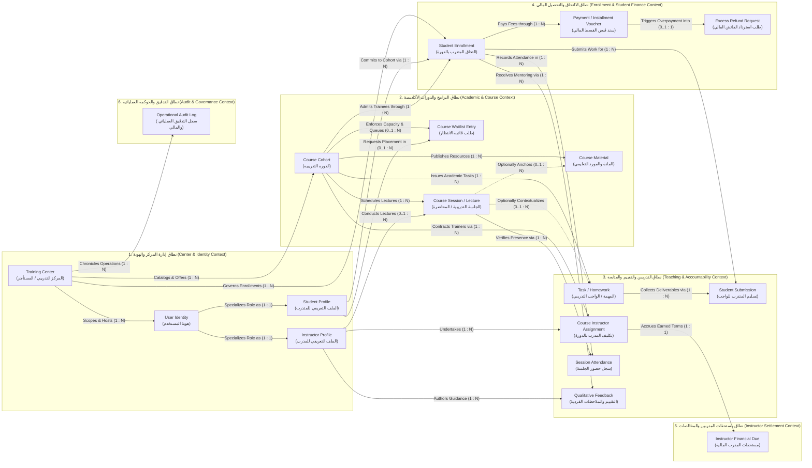

# Conceptual Domain Model (النموذج المفاهيمي لنطاق العمل)
## VELORA (فيلورا) — Training Center Management Platform

- **Document Version:** 1.0.0  
- **Document Type:** Conceptual Domain Model (DDD Strategic Analysis)  
- **Target Release:** MVP (Minimum Viable Product)  
- **Primary Sources of Truth:** [PRD.md](file:///D:/docs/docs/PRD.md) & [user-flow.md](file:///D:/docs/docs/user-flow.md)  
- **Status:** Approved for Implementation  

---

## 1. Executive Summary & Core Business Domain

### 1.1 Core Business Domain Definition
The core business domain of **VELORA** is **Training Center Operations, Academic Delivery, Trainee Performance Tracking, and Offline Financial Reconciliation** (*منظومة إدارة وتشغيل المراكز التدريبية: العمليات الأكاديمية، متابعة المتدربين، والدورة المحاسبية غير المتصلة بالإنترنت*).

Unlike generic Learning Management Systems (LMS) that concentrate on virtual meeting hosting or automated quiz grading, VELORA is engineered as the **operational operating system** for physical, hybrid, and professional training centers. Its primary domain purpose is to replace fragmented spreadsheets, loose paper attendance rosters, unorganized instant messaging threads, and disputed manual compensation notebooks with an integrated, auditable operational lifecycle.

### 1.2 Strategic Subdomains (Bounded Contexts)
In accordance with Domain-Driven Design (DDD) principles, the VELORA domain is organized into six cohesive **Bounded Contexts (Subdomains)**:

1. **Center & Identity Context (سياق إدارة المركز والهوية):**  
   Governs multi-tenant organizational isolation and user identities, defining distinct operational responsibilities for Center Managers, Sales Specialists, Instructors, and Trainees.
2. **Academic Program & Course Context (سياق البرامج والدورات الأكاديمية):**  
   Encapsulates educational catalog offerings, cohort scheduling, cohort lifecycle transitions (`Draft` → `Active` → `Completed` → `Archived`), strict seat capacity constraints, and waitlist queuing.
3. **Teaching & Student Accountability Context (سياق التدريس والتقييم والمتابعة):**  
   Encompasses instructor assignments, lecture session delivery, session-bound attendance verification, task distribution, student deliverables submission, and 1-to-1 private pedagogical feedback.
4. **Student Enrollment & Financial Collection Context (سياق التحاق المتدربين والتحصيل المالي):**  
   Governs the formal contractual commitment of students to courses, discount pricing structures, installment fee collection, administrative approval workflows, immutable ledger tracking, and automatic overpayment excess refunding.
5. **Instructor Compensation & Settlement Context (سياق مستحقات المدربين والمخالصات المالية):**  
   Manages instructor compensation contracts (`FixedAmount`, `PercentageOfCollectedRevenue`, `PerSession`), accrues liabilities dynamically, and tracks settlement payout disbursements.
6. **Audit & Operational Governance Context (سياق التدقيق والحوكمة العملياتية):**  
   Provides system-wide historical accountability, chronicling non-destructive status modifications and financial events in an immutable audit trail.

---

## 2. Conceptual Domain Model Diagram

The raw Mermaid diagram source is also available in [domain-model.mmd](file:///D:/docs/docs/diagrams/domain-model.mmd).

---

## 3. Core Domain Concepts & Business Responsibilities

| Domain Concept | Arabic Name | Bounded Context | Business Role & Primary Responsibilities |
| :--- | :--- | :--- | :--- |
| **Training Center** | المركز التدريبي | Center & Identity | • Top-level organizational root and multi-tenant isolation boundary. • Owns all courses, user profiles, enrollments, financial ledgers, and operational policies. • Strictly confines data visibility; prevents cross-center leakage. |
| **User Identity** | هوية المستخدم | Center & Identity | • Authenticated human participant within a specific center. • Enforces single primary operational role (`Manager`, `Sales`, `Instructor`, `Student`). • Establishes baseline security and access control boundaries. |
| **Student Profile** | الملف التعريفي للمتدرب | Center & Identity | • Trainee persona registered within the training center. • Maintains personal contact details and directory profile. • Anchors cumulative educational participation, waitlist placements, and enrollment history. |
| **Instructor Profile** | الملف التعريفي للمدرب | Center & Identity | • Academic trainer / subject matter expert contracted by the center. • Maintains professional profile and instructional specialization. • Anchors assigned courses, lectures delivered, feedback authored, and personal compensation. |
| **Course Cohort** | الدورة التدريبية | Academic & Course | • Core educational offering and cohort lifecycle entity (`Draft`, `Active`, `Completed`, `Archived`). • Defines syllabus metadata, scheduled duration, catalog base price, and maximum seat capacity. • Enforces capacity hard-lock preventing over-enrollment. |
| **Course Waitlist Entry** | طلب قائمة الانتظار | Academic & Course | • Sequential entry in a First-In-First-Out (FIFO) queue for a filled course cohort. • Tracks applicant queue status (`Waiting`, `Notified`, `Enrolled`, `Cancelled`). • Assesses zero monetary fees until seat vacancy is confirmed and student is officially enrolled. |
| **Course Session / Lecture** | الجلسة التدريبية / المحاضرة | Academic & Course | • Discrete scheduled instructional unit (date, time, instructional topic). • Conducted by an assigned instructor. • Serves as the operational anchor for lecture attendance and per-session compensation. |
| **Course Material** | المادة والمورد التعليمي | Academic & Course | • Educational digital asset (slides, handouts, reference files up to 25 MB). • Distributed exclusively to actively enrolled trainees of that course. • Optionally linked to a specific lecture session for pedagogical context. |
| **Course Instructor Assignment** | تكليف المدرب بالدورة | Teaching & Accountability | • Contractual and operational junction linking an instructor to a specific course. • Designates lead instructor vs. co-instructor status. • Configures binding compensation model (`FixedAmount`, `PercentageOfCollectedRevenue`, `PerSession`). |
| **Task / Homework** | المهمة / الواجب التدريبي | Teaching & Accountability | • Academic assessment or project assignment issued to enrolled students. • Details instructions, criteria, reference materials, and optional due dates. • Dictates deadline cut-offs and enables late submission override permissions. |
| **Student Submission** | تسليم المتدرب للواجب | Teaching & Accountability | • Student deliverable submitted in fulfillment of an assigned task. • Captures delivery timestamp and compliance status (`On-Time` vs. `Late`). • Permits file replacement before the deadline; forms the subject of instructor review. |
| **Session Attendance** | سجل حضور الجلسة | Teaching & Accountability | • Verified participation record for an enrolled student during a specific session. • Enforces binary presence state (`Present` or `Absent`). • Guarantees exactly one record per student per session to eliminate double-counting. |
| **Qualitative Feedback** | التقييم والملاحظات الفردية | Teaching & Accountability | • Private, 1-to-1 mentoring note from an instructor to an enrolled student. • Communicates academic evaluation, strengths, and actionable improvement areas. • Strictly confidential between the authoring instructor, student, and manager. |
| **Student Enrollment** | التحاق المتدرب بالدورة | Enrollment & Student Finance | • Binding operational commitment linking an active student to an active course. • Establishes financial net balance (`FinalPayable = BasePrice - Discount`). • Maintains running installment ledger (`TotalPaid`, `RemainingBalance`, `PaymentStatus`). • Controls access authorization to course materials, sessions, tasks, and attendance. |
| **Payment / Installment Voucher** | سند قبض القسط المالي | Enrollment & Student Finance | • Verified record of an offline monetary installment (`Cash`, `BankTransfer`, `POS_Card`, `Cheque`). • Undergoes mandatory administrative verification (`Pending Approval` → `Completed` / `Rejected`). • Governed by immutable financial ledger rules (no hard deletion; corrections via audit adjustments). |
| **Excess Refund Request** | طلب استرداد الفائض المالي | Enrollment & Student Finance | • Automatic financial claim generated when a payment exceeds the remaining fee balance. • Enforces mandatory payout reimbursement (prohibits auto-crediting to future courses). • Tracks refund execution lifecycle (`Pending Refund` → `Refunded` / `Refund Failed`). |
| **Instructor Financial Due** | مستحقات المدرب المالية | Instructor Settlement | • Center liability ledger tracking earned instructor compensation per course assignment. • Calculates accrued dues dynamically from the assigned compensation formula. • Tracks settlement disbursements and payout lifecycle (`Pending`, `PartiallyPaid`, `Paid`, `Adjusted`). |
| **Operational Audit Log** | سجل التدقيق العملياتي والمالي | Audit & Governance | • Read-only historical ledger capturing critical status transitions and financial events. • Documents actor identity, timestamp, entity affected, and prior vs. new values. • Guarantees institutional compliance and eliminates untracked back-office modifications. |

---

## 4. Domain Relationships & Documented Cardinality

The following matrix documents the conceptual business relationships connecting domain concepts, expressed strictly in business terminology with documented cardinalities:

| Source Concept | Relationship Business Label | Target Concept | Cardinality | Business Justification & Documented Rules |
| :--- | :--- | :--- | :---: | :--- |
| **Training Center** | Scopes & Hosts | **User Identity** | **1 : N** | A center employs multiple staff and serves multiple students; every user belongs to exactly one center in MVP (`BR-TEN-01`). |
| **Training Center** | Catalogs & Offers | **Course Cohort** | **1 : N** | A center administers multiple educational programs and cohorts; each course belongs strictly to one center (`BR-CRS-01`). |
| **Training Center** | Governs Enrollments | **Student Enrollment** | **1 : N** | All student admissions and financial accounts are owned and partitioned by the center (`FR-TEN-01`). |
| **Training Center** | Chronicles Operations | **Operational Audit Log** | **1 : N** | The center maintains a comprehensive, centralized audit trail for compliance and dispute prevention (`FR-AUD-01`). |
| **User Identity** | Specializes Role as | **Student Profile** | **1 : 1** | A user identity assigned the `Student` role links 1-to-1 with their trainee profile record (`BR-AUTH-03`). |
| **User Identity** | Specializes Role as | **Instructor Profile** | **1 : 1** | A user identity assigned the `Instructor` role links 1-to-1 with their academic trainer profile (`BR-AUTH-03`). |
| **Course Cohort** | Contracts Trainers via | **Course Instructor Assignment** | **1 : N** | A course can have one or more instructors assigned, with one designated as lead (`FR-INS-01`, `FR-INS-03`). |
| **Course Cohort** | Schedules Lectures | **Course Session** | **1 : N** | A course is broken down into multiple discrete lectures/sessions (`FR-CRS-04`). |
| **Course Cohort** | Publishes Resources | **Course Material** | **1 : N** | Instructors and managers publish multiple files/resources within a course cohort (`FR-MAT-01`). |
| **Course Cohort** | Issues Academic Tasks | **Task / Homework** | **1 : N** | A course issues multiple homework tasks and projects across its duration (`FR-TSK-01`). |
| **Course Cohort** | Enforces Capacity & Queues | **Course Waitlist Entry** | **0..1 : N** | If capacity is configured and filled, applicants are queued in an ordered waitlist (`BR-CRS-WAITLIST-FIFO`). |
| **Course Cohort** | Admits Trainees through | **Student Enrollment** | **1 : N** | Multiple students register and participate in a course cohort up to defined capacity (`FR-STU-02`). |
| **Instructor Profile** | Undertakes | **Course Instructor Assignment** | **1 : N** | An instructor can be contracted across multiple courses within the center (`FR-INS-01`). |
| **Instructor Profile** | Conducts Lectures | **Course Session** | **0..1 : N** | An instructor is assigned to deliver specific sessions; a session may be unassigned during initial draft (`FR-CRS-04`). |
| **Instructor Profile** | Authors Guidance | **Qualitative Feedback** | **1 : N** | An instructor writes private mentoring feedback notes for their students (`FR-FDB-01`). |
| **Course Instructor Assignment** | Accrues Earned Terms | **Instructor Financial Due** | **1 : 1** | Each course assignment agreement maintains exactly one running compensation ledger (`FR-INSFIN-01`). |
| **Student Profile** | Requests Placement in | **Course Waitlist Entry** | **0..1 : N** | A prospective student can waitlist for multiple courses that have reached full capacity (`BR-CRS-WAITLIST-FIFO`). |
| **Student Profile** | Commits to Cohort via | **Student Enrollment** | **1 : N** | A student may enroll concurrently in multiple distinct courses within the center (`BR-STU-02`). |
| **Course Session** | Verifies Presence via | **Session Attendance** | **1 : N** | A session records attendance for all actively enrolled students in the course roster (`FR-ATT-01`). |
| **Course Session** | Optionally Anchors | **Course Material** | **0..1 : N** | A published file may optionally be anchored to a specific session or remain general to the course (`FR-MAT-01`). |
| **Course Session** | Optionally Contextualizes | **Task / Homework** | **0..1 : N** | A task may optionally be issued in relation to a specific lecture session (`BR-TSK-01`). |
| **Task / Homework** | Collects Deliverables via | **Student Submission** | **1 : N** | A task receives homework submissions from enrolled trainees (`FR-TSK-03`). |
| **Student Enrollment** | Submits Work for | **Student Submission** | **1 : N** | An enrollment delivers at most one active submission per task (with pre-deadline replacements allowed) (`BR-TSK-03`). |
| **Student Enrollment** | Records Attendance in | **Session Attendance** | **1 : N** | An enrollment generates exactly one binary attendance entry per session held (`FR-ATT-04`, `BR-ATT-03`). |
| **Student Enrollment** | Receives Mentoring via | **Qualitative Feedback** | **1 : N** | An enrolled student receives multiple private feedback evaluations throughout the cohort (`FR-FDB-01`). |
| **Student Enrollment** | Pays Fees through | **Payment / Installment Voucher** | **1 : N** | An enrollment may be settled through multiple offline installment payments (`FR-FIN-03`). |
| **Payment / Installment Voucher** | Triggers Overpayment into | **Excess Refund Request** | **0..1 : 1** | Triggered only if the voucher payment amount exceeds the remaining balance (`BR-FIN-OVERPAY-REFUND`). |

---

## 5. Arabic Domain Explanation & Operational Rationale (الشرح المفاهيمي لنطاق العمل)

يمثل هذا النموذج المفاهيمي البنية الجوهرية لمنظومة **VELORA (فيلورا)**، وقد صُمم وفق منهجية **التصميم الموجه بالنطاق (Domain-Driven Design)** ليعكس بدقة متناهية الواقع التشغيلي والمحاسبي والأكاديمي للمراكز التدريبية دون الخوض في تفاصيل التكنولوجيا وقواعد البيانات.

### 5.1 سياق المركز والهوية المؤسسية (Center & Identity Context)
- **المركز التدريبي (Training Center):** هو الكيان الجذري والحاوية السيادية لجميع العمليات. في نموذج المستأجر المنطقي متعدد المراكز، يمثل المركز حدود الأمان التامة؛ فلا يمكن لبيانات مركز أن تتداخل مع مركز آخر، وتُعزل كافة الكيانات التشغيلية والمالية وفق هذا النطاق.
- **هوية المستخدم (User Identity) والأدوار المتخصصة:** يمتلك كل فرد يدخل النظام حساباً مركزياً بهوية موحدة ودور تشغيلي محدد بدقة (`Manager`, `Sales`, `Instructor`, `Student`). تتفرع هذه الهوية وظيفياً إلى **ملف المتدرب (Student Profile)** الذي يختص بمتابعة مسار التعلم والسجل المالي، و**ملف المدرب (Instructor Profile)** الذي يختص بالخبرات الأكاديمية والتكليفات التدريسية والمستحقات المالية.

### 5.2 سياق البرامج والدورات الأكاديمية (Academic & Course Context)
- **الدورة التدريبية (Course Cohort):** تمثل المنتج التعليمي والوعاء الزمني الذي يجمع المحاضرات والطلاب والمدربين. تخضع الدورة لدورة حياة واضحة (`Draft` مسودة ← `Active` نشطة ومتاحة للتسجيل ← `Completed` مكتملة التدريس ← `Archived` مؤرشفة لحفظ السجلات التاريخية).
- **إلزامية السعة القصوى (Capacity Hard-Lock) وقائمة الانتظار (Waitlist):**
  - تضع إدارة المركز سعة قصوى لعدد المقاعد في كل دورة.
  - عند امتلاء المقاعد، يمنع النظام آلياً وبصورة صارمة أي تسجيل مباشر إضافي (`BR-CRS-CAPACITY-HARDLOCK`).
  - يُتاح للمتدربين الراغبين الانضمام إلى **قائمة انتظار الدورة (Course Waitlist)**، حيث يُسجل الطالب بحالة `Waiting` وتُحفظ أسبقيته الزمنية بدقة وفق قاعدة الوارد أولاً يُخدم أولاً (`FIFO Priority`).
  - **قيد جوهري:** لا يترتب على التسجيل في قائمة الانتظار أي التزام مالي أو قيد رسوم؛ وتظل مجانية تماماً حتى شواغر مقعد وقيام الطالب بتأكيد التسجيل رسمياً.

### 5.3 سياق التدريس والتقييم والمتابعة الأكاديمية (Teaching & Accountability Context)
- **تكليف المدرب (Course Instructor Assignment):** يتيح النظام إسناد أكثر من مدرب للدورة الواحدة مع تحديد المدرب الرئيسي، وتحديد نموذج التعويض المالي لكل مدرب بدقة (مبلغ مقطوع، أو نسبة مئوية من الإيرادات المحصلة، أو أجر عن كل جلسة).
- **الجلسات التدريبية (Course Sessions) والمواد التعليمية (Materials):** تقسم الدورة إلى جلسات محددة بالموعد والموضوع والمدرب المنفذ. ويتاح رفع المواد التعليمية (حتى 25 ميجابايت) لتكون متاحة حصرياً للملتحقين بالدورة مع إمكانية ربطها بمحاضرة معينة.
- **حضور الجلسات (Session Attendance):** يُرصد الحضور لكل محاضرة على حدة بصورة ثنائية صارمة (`Present` حاضر أو `Absent` غائب). ولا يقبل النظام أي ازدواجية في السجل للدرس الواحد لنفس الطالب.
- **المهام والواجبات (Tasks & Submissions):** يُصدر المدرب الواجبات بمواعيد تسليم محددة. يمنع النظام التسليم بعد الموعد تلقائياً، ما لم يُفعّل المدرب أو المدير استثناءً صريحاً للسماح بالتسليم المتأخر ليُسجل بحالة `Late`.
- **التقييم والملاحظات الفردية (Qualitative Feedback):** قناة توجيه أكاديمي خاصة وسرية بالكامل بين المدرب والطالب، تضمن الخصوصية وتمنع اطلاع الزملاء أو موظفي المبيعات عليها.

### 5.4 سياق التحاق المتدربين والتحصيل المالي (Enrollment & Student Finance Context)
- **التحاق المتدرب (Student Enrollment):** هو الرابط التعاقدي بين المتدرب والدورة. يحدد هذا الكيان الرسوم الصافية الواجبة السداد بعد احتساب الخصومات المعتمدة:  
  $$\text{Final Payable} = \text{Base Price} - \text{Discount Amount}$$
  كما يتتبع رصيد الطالب التراكمي وحالة السداد (`Unpaid`, `PartiallyPaid`, `FullyPaid`).
- **سند قبض القسط المالي (Payment Voucher) والاعتماد الإداري:**  
  - يسجل موظف المبيعات سندات القبض للأقساط غير المتصلة بالإنترنت (نقداً، تحويل بنكي، بطاقة دفع، شيك).
  - **القرار الإداري المحسوم (BR-FIN-APPROVAL):** لا يُرحل السند إلى رصيد الطالب فور إدخاله، بل يدخل طابور الاعتماد بحالة `Pending Approval` ليخضع لمراجعة واعتماد إداري صريح من المدير أو المحاسب. وفور اعتماده يتحول إلى `Completed` ويُحدّث الرصيد المتبقي ذرياً.
  - **قيد عدم الحذف المادي (Immutable Ledger):** السندات المالية المعتمدة لا تُحذف نهائياً من النظام، وأي تصحيح يتم عبر قيود تسوية معتمدة مع توثيق السبب في سجل التدقيق.

### 5.5 دورة معالجة الفائض المالي والاسترداد الإلزامي (Excess Refund Lifecycle)
- **القرار الإداري المحسوم (BR-FIN-OVERPAY-REFUND):**
  - يكتشف النظام آلياً أي دفعة تتجاوز الرصيد المستحق على المتدرب:  
    $$\text{Excess Amount} = \text{Payment Amount} - \text{Remaining Balance}$$
  - **إلزامية الاسترداد ومنع الرصيد الدائن:** يمنع النظام تحويل الفائض إلى رصيد دائن للدورات القادمة؛ بل يُنشئ تلقائياً **طلب استرداد مالي (Refund Request)** مرتبطاً بالسند بقيمة الفائض.
  - يدخل الطلب بحالة `Pending Refund` حتى يقوم القسم المالي بصرف المبلغ نقداً أو عبر تحويل مصرفي وإثبات الصرف.
  - **قيد مالي صارم:** لا يُغلق طلب الاسترداد وتتحول حالته إلى `Refunded` إلا بعد تأكيد تنفيذ الصرف الفعلي للطالب.

### 5.6 سياق مستحقات المدربين والمخالصات (Instructor Settlement Context)
- **مستحقات المدرب المالية (Instructor Financial Due):** سجل مالي مستقل لكل تكليف تدريبي، يحتسب مستحقات المدرب آلياً وبدقة تامة وفق المعادلة التعاقدية المعتمدة:
  1. *المبلغ المقطوع (FixedAmount):* يستحق كامل المبلغ عند تفعيل الدورة أو استكمالها.
  2. *نسبة من الإيرادات المحصلة (PercentageOfCollectedRevenue):* يُحسب كنسبة من مجموع المدفوعات النقدية المحصلة فعلياً والمعتمدة، وليس من الرسوم المفترضة أو الآجلة.
  3. *الأجر عن كل جلسة (PerSession):* يُحسب بضرب أجر الجلسة في عدد الجلسات المنجزة فعلياً والمثبت حضورها.
- يتتبع النظام دفعات الصرف وحالة المخالصة (`Pending`, `PartiallyPaid`, `Paid`, `Adjusted`) مع تقارير التزامات تفصيلية للإدارة.

### 5.7 سياق الرقابة والحوكمة والتدقيق (Operational Audit Context)
- **سجل التدقيق العملياتي (Operational Audit Log):** سجل تاريخي غير قابل للتعديل يوثق كافة التحولات الحساسة في الحالات (حالة الدورة، حالة الالتحاق، اعتماد المدفوعات، صرف المستحقات، وتنفيذ الاسترداد المالي) مع حفظ هوية المنفذ والوقت والقيم السابقة والجديدة.

---

## 6. Business Constraints & Invariants (قواعد وقيود العمل)

تحدد هذه القواعد النطاقية الشروط والقيود التي يجب أن يحافظ عليها النظام في جميع الأوقات لضمان سلامة العمليات:

1. **قيد العزل المؤسسي التام (Multi-Tenant Isolation - BC-01):**  
   كل كيان تشغيلي أو مالي ينتمي وجوباً وحصراً إلى مركز تدريبي واحد (`Training Center`). يمنع منعاً باتاً ربط متدرب أو دورة أو مدرب بين مراكز مختلفة.
2. **قيد دورة حياة الدورة الأكاديمية (Course Activation Invariant - BC-02):**  
   لا يمكن نقل الدورة من حالة مسودة `Draft` إلى حالة نشطة `Active` إلا بعد إسناد مدرب واحد على الأقل وتحديد شروط تعويضه المالي (`BR-CRS-03`).
3. **قيد الإغلاق الصارم للسعة القصوى (Capacity Hard-Lock - BC-03):**  
   إذا كانت الدورة محددة بسعة قصوى وبلغ عدد المسجلين الفعليين هذه السعة (`EnrolledCount >= Capacity`)، يُقفل التسجيل المباشر فوراً ويمنع تجاوز السعة حتماً (`BR-CRS-CAPACITY-HARDLOCK`).
4. **قيد أسبقية قائمة الانتظار وعدم فرض رسوم (FIFO Waitlist Invariant - BC-04):**  
   تُرتب قائمة الانتظار بدقة وفق أسبقية طلب الانضمام (FIFO). لا يُعد متدرب قائمة الانتظار ملتحقاً بالدورة ولا تُفرض عليه أي رسوم مالية على الإطلاق قبل توفر المقعد وتأكيد التسجيل رسمياً (`BR-CRS-WAITLIST-FIFO`).
5. **قيد منع تكرار التسجيل النشط (Duplicate Enrollment Prevention - BC-05):**  
   يُمنع تسجيل الطالب في نفس الدورة التدريبية أكثر من مرة واحدة في نفس الوقت بحالة نشطة (`Active`) داخل نفس المركز (`EC-001`).
6. **قيد حدود الخصم المالي (Pricing & Discount Boundary - BC-06):**  
   يجب ألا تتجاوز قيمة الخصم الممنوح السعر الأساسي للدورة (`Discount <= BasePrice`)، مما يضمن أن المبلغ النهائي المستحق لا يقل عن الصفر (`BR-STU-01`).
7. **قيد إيجابية المبالغ المالية المسجلة (Positive Financial Values - BC-07):**  
   جميع مبالغ سندات القبض يجب أن تكون أكبر قطعياً من الصفر (`Amount > 0.00`)؛ ويمنع تسجيل مبالغ صفرية أو سالبة (`BR-FIN-01`).
8. **قيد إلزامية الاعتماد الإداري للسندات (Mandatory Administrative Approval - BC-08):**  
   لا يُحدث سند السداد رصيد الطالب فور إدخاله من موظف المبيعات، بل يخضع لاعتماد صريح من مدير المركز أو المحاسب قبل ترحيله محاسبياً (`BR-FIN-APPROVAL`).
9. **قيد إلزامية استرداد الفائض المالي (Mandatory Excess Refund - BC-09):**  
   في حال سداد مبالغ تزيد عن الرصيد المتبقي المستحق، يلتزم المركز باسترداد المبلغ الزائد للمتدرب نقداً أو مصرفياً، ويمنع تحويله تلقائياً كرصيد دائن لدورات قادمة (`BR-FIN-OVERPAY-REFUND`).
10. **قيد التحقق من صرف الاسترداد (Verified Refund Execution - BC-10):**  
    لا يُعتبر الاسترداد المالي مكتملاً (`Refunded`) إلا بعد تأكيد توثيق الصرف الفعلي ومطابقته محاسبياً (`BR-FIN-REFUND-VERIFY`).
11. **قيد عدم قابلية الحذف المالي (Financial Immutability - BC-11):**  
    يمنع النظام الحذف المادي النهائي لأي سند قبض أو قيد مالي معتمد. وتُجرى التعديلات حصراً عبر قيود تسوية مبررة وموثقة رقابياً (`FR-FIN-05`).
12. **قيد أحادية تسجيل حضور الجلسة (Session Attendance Uniqueness - BC-12):**  
    يُسجل الحضور حصراً على مستوى الجلسة التدريبية، وبقيد فريد يمنع تكرار تسجيل حضور الطالب في نفس الجلسة أكثر من مرة واحدة، بحالة ثنائية حصراً (`Present` أو `Absent`) (`BR-ATT-01/03`).
13. **قيد إغلاق تسليم المهام والاستثناء الإداري (Deadline Enforcement & Late Override - BC-13):**  
    تُغلق إمكانية رفع الواجبات فور انقضاء الموعد النهائي المحدد، ولا يُسمح بالتسليم المتأخر إلا بعد تفعيل الاستثناء اليدوي من قبل المدرب أو مدير المركز، مع وسم التسليم بصورة صريحة كـ `Late` (`FR-TSK-05/06`).
14. **قيد حساب مستحقات نسبة الإيراد (Percentage Dues Calculation Invariant - BC-14):**  
    إذا كان تعويض المدرب مبنياً على نسبة مئوية من الإيراد، فإن الحساب يتم حصراً على مجموع المبالغ المحصلة فعلياً والمعتمدة (`SUM(Payment.Amount)`) وليس على إجمالي الرسوم المقيدة أو المطالبات الآجلة (`BR-INS-03`).
15. **قيد حدود سرية البيانات والصلاحيات (Privacy & Role Boundaries - BC-15):**  
    - لا يتاح للمدربين الاطلاع على أرصدة الطلاب المالية أو تعويضات زملائهم المدربين.
    - يُمنع موظفو المبيعات منعاً باتاً من الاطلاع على تسليمات الواجبات أو التقييمات الأكاديمية أو مستحقات المدربين.
    - لا يتاح للمتدربين الاطلاع على سجلات أو درجات أو ملاحظات زملائهم الآخرين.

---

## 7. Status of Decisions & Open Questions (تحليل القرارات والأسئلة المفتوحة)

استناداً إلى وثيقة متطلبات المنتج (PRD) ووثيقة تدفق المستخدم (User Flow)، تم حسم واعتماد جميع القرارات التشغيلية والأسئلة المفتوحة بنسبة 100%، وتم دمجها كركائز أساسية في هذا النموذج المفاهيمي:

| الرمز | التساؤل التشغيلي | نص القرار الإداري المعتمد في النموذج المفاهيمي | الأثر على النموذج المفاهيمي وسير العمل | الحالة التشغيلية |
| :--- | :--- | :--- | :--- | :---: |
| **OQ-01** | **حسابات المستخدمين والمدربين** | **يدعم النظام عدة مراكز تدريبية، مع فصل حسابات المستخدمين وبياناتهم وصلاحياتهم لكل مركز في النسخة الأولية (MVP). ويُؤجَّل استخدام حساب موحّد عبر عدة مراكز إلى مراحل لاحقة.** | يتبع كيان `User Identity` وكيانات `Student Profile` و `Instructor Profile` مركزاً تدريبياً واحداً حصراً (`CenterID`). تُعزل الصلاحيات والبيانات عزلاً كاملاً، وتمنع المشاركة المباشرة للحسابات بين المراكز في الـ MVP. | **محسوم ومعتمد 100% (RESOLVED)** |
| **OQ-02** | **اعتماد سندات القبض** | **تُسجَّل الدفعات بواسطة موظف المبيعات، وتبقى بحالة Pending Approval حتى يعتمدها المدير أو المحاسب. بعد الاعتماد تتحول إلى Completed ويُحدَّث رصيد الطالب.** | يخضع كيان `Payment / Installment Voucher` لدورة اعتماد إدارية صريحة. لا يؤثر السند على `TotalPaid` أو `RemainingBalance` في `Student Enrollment` أثناء كونه `Pending Approval`، ويُرحل محاسبياً فقط عند تحوله إلى `Completed`. | **محسوم ومعتمد 100% (RESOLVED)** |
| **OQ-03** | **التسليم المتأخر للواجبات** | **يُغلق تسليم الواجب تلقائياً عند انتهاء الموعد النهائي، ولا يُسمح بالتسليم بعده إلا إذا فتح المدرب أو الإدارة التسليم يدوياً، مع تسجيل حالة التسليم Late.** | يفرض كيان `Task / Homework` إغلاقاً تلقائياً فور انقضاء `DueDateTime`. وعند تفعيل خاصية الاستثناء اليدوي، يُقبل كيان `Student Submission` ويُوسم بحالة امتثال صريحة `Late`. | **محسوم ومعتمد 100% (RESOLVED)** |
| **OQ-04** | **مستحقات المدرب** | **في نظام الدفع مقابل الجلسة (PerSession)، يستحق المدرب أجر الجلسة التي نُفذت فعلياً ووُثّقت رسمياً فقط، ولا يستحق أجراً عن الجلسات الملغاة التي لم تُنفذ.** | في نموذج `PerSession` ضمن `Instructor Financial Due`، يرتبط احتساب المستحقات طردياً بعدد كيانات `Course Session` التي تم إنجازها وتوثيق الحضور فيها فعلياً عبر `Session Attendance`. وتُستبعد الجلسات الملغاة تماماً من حساب المستحقات. | **محسوم ومعتمد 100% (RESOLVED)** |
| **OQ-05** | **فائض السداد** | **إذا دفع الطالب مبلغاً أكبر من الرسوم المستحقة، يلتزم المركز بإعادة المبلغ الزائد للطالب، ويُمنع تحويله إلى رصيد للدورات القادمة. يجب إنشاء طلب استرداد (Refund Request) وتوثيق عملية الصرف.** | يؤدي وجود أي فائض مالي (`Amount > RemainingBalance`) إلى إنشاء تلقائي وإلزامي لكيان `Excess Refund Request` بحالة `Pending Refund`. يُمنع تحويل المبلغ لرصيد دائن مستقبلي، ويظل معلقاً حتى توثيق الصرف الفعلي نقداً أو تحويلاً ليتحول إلى `Refunded`. | **محسوم ومعتمد 100% (RESOLVED)** |
| **OQ-06** | **السعة القصوى وقائمة الانتظار** | **يُغلق التسجيل المباشر تلقائياً عند اكتمال سعة الدورة، ويُسمح للطلاب بالتسجيل في قائمة انتظار مجانية، وفق أسبقية التسجيل الزمني (FIFO)، بحيث يحصل الأسبق تسجيلاً على الأولوية عند توفر مقعد.** | يفرض كيان `Course Cohort` قيد الإغلاق الصارم (`BR-CRS-CAPACITY-HARDLOCK`). وتتولى `Course Waitlist Entry` إدارة طابور الانتظار المجاني بترتيب الأسبقية الزمني الصارم (`FIFO`) دون إنشاء أي التزام مالي حتى شغور مقعد وتأكيد التسجيل رسمياً. | **محسوم ومعتمد 100% (RESOLVED)** |

---

## 8. Conceptual Integrity & Boundary Verification

لضمان الالتزام الصارم بتعليمات النموذج المفاهيمي وتجنب الانحراف إلى مخططات الكيانات العلائقية التقنية (ERD) أو مخططات الأصناف (UML Class Diagrams)، تم التحقق من الآتي:

- [x] **خلو النموذج تماماً من مصطلحات قواعد البيانات:** لا توجد أسماء جداول، مفاتيح أساسية (Primary Keys)، مفاتيح أجنبية (Foreign Keys)، أو أنواع بيانات برمجية (UUID, VARCHAR, DECIMAL).
- [x] **خلو النموذج من مواصفات البرمجة كائنية التوجه:** لا توجد أصناف برمجية (Classes)، دوال تنفيذية (Methods)، أو معاملات استدعاء.
- [x] **خلو النموذج من المعمارية التقنية ونقاط الاتصال:** لا توجد مسارات لواجهات برمجة التطبيقات (API Endpoints)، بروتوكولات HTTP، أو أدوات تقنية (Laravel, Next.js, PostgreSQL).
- [x] **التركيز المطلق على مصطلحات النطاق التجاري (Ubiquitous Language):** تم التعبير عن كافة المفاهيم والعلاقات بمفردات بيئة العمل الحقيقية للمراكز التدريبية.
- [x] **تطابق كامل 100% مع وثيقة متطلبات المنتج (PRD) ومسار تدفق المستخدم (User Flow).**

---
*تم إعداد هذا النموذج المفاهيمي ليكون المرجع الأساسي المعتمد للمحللين ومصممي البرمجيات وفرق التطوير التقني لمنظومة VELORA.*
