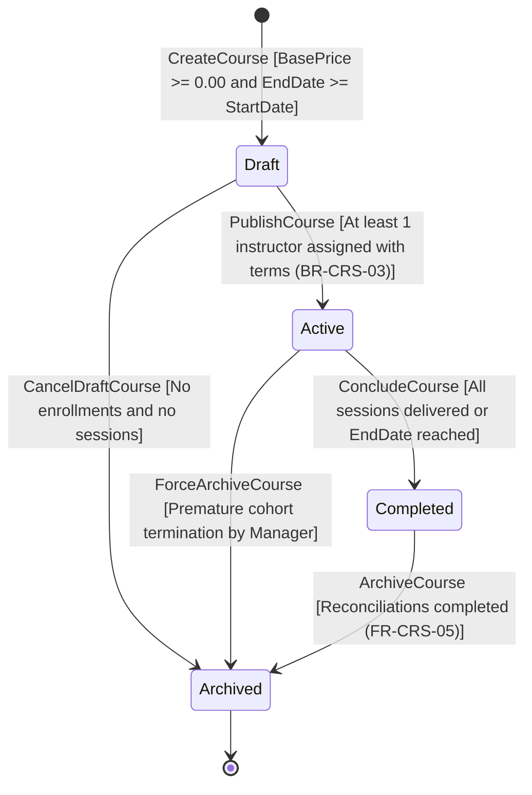
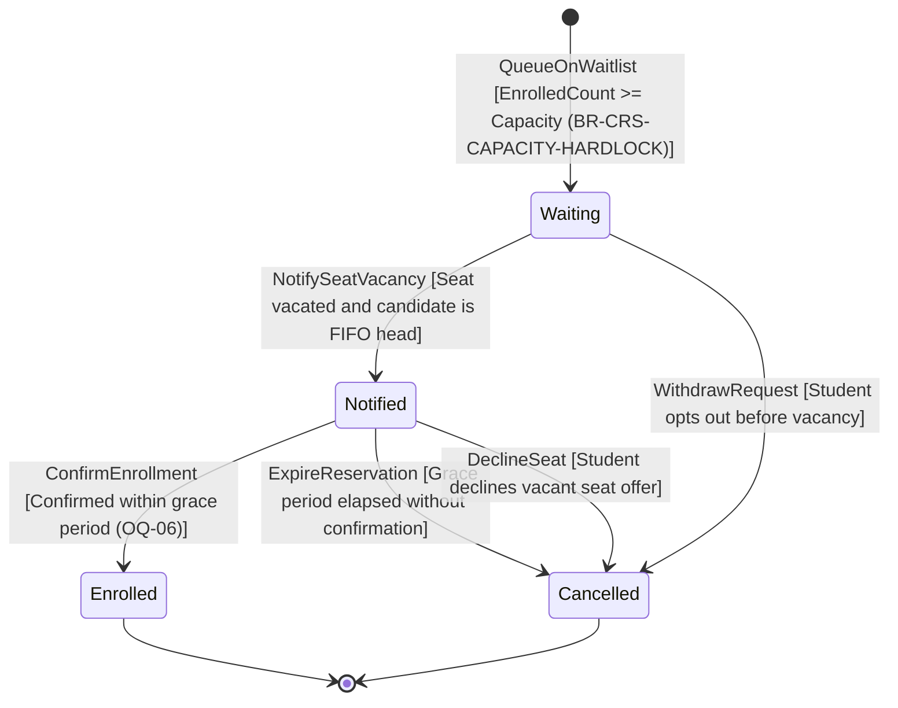
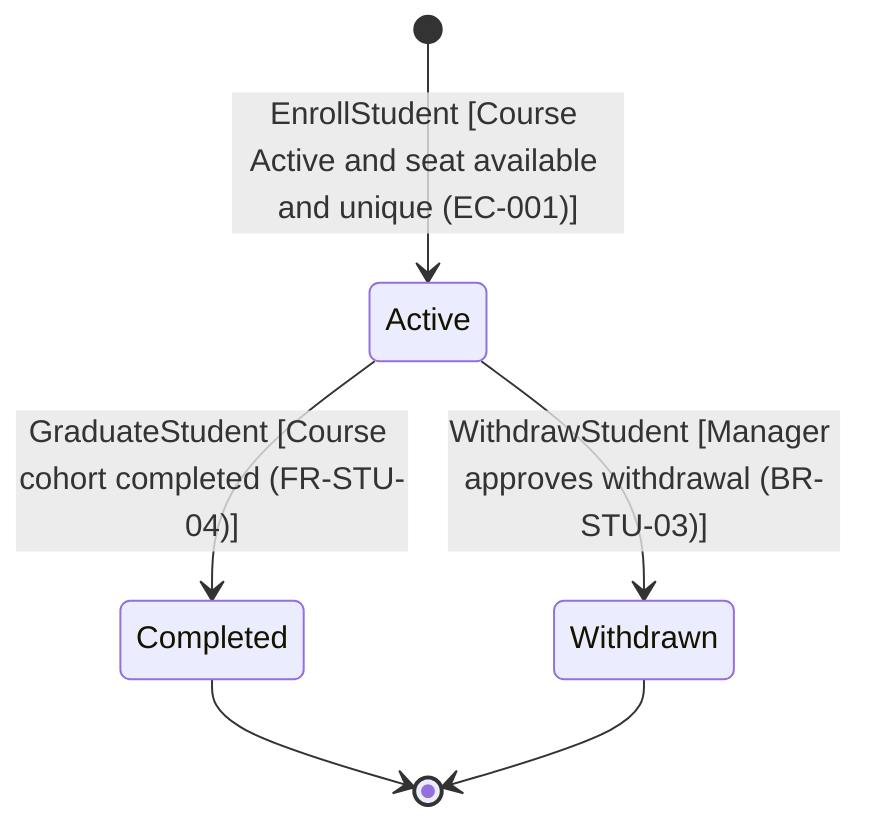
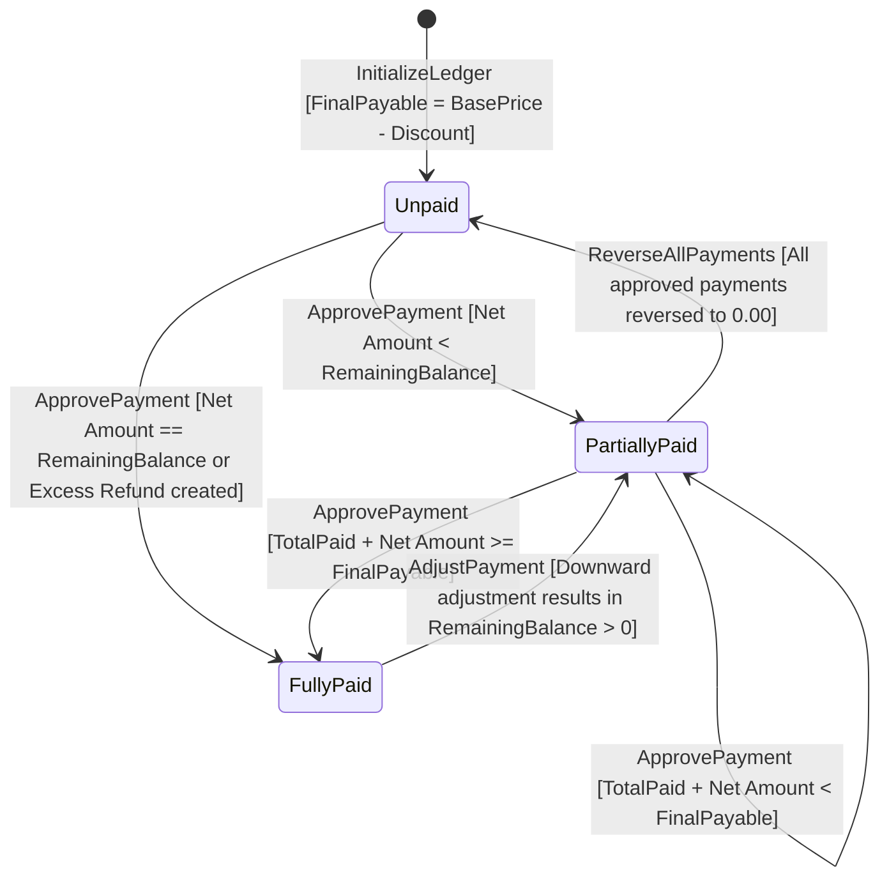
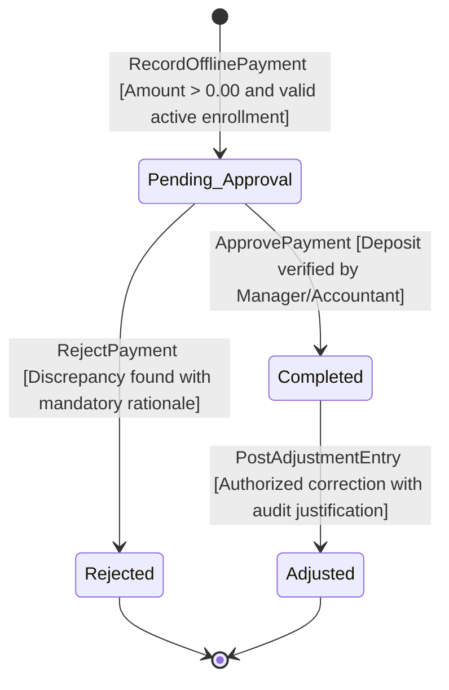
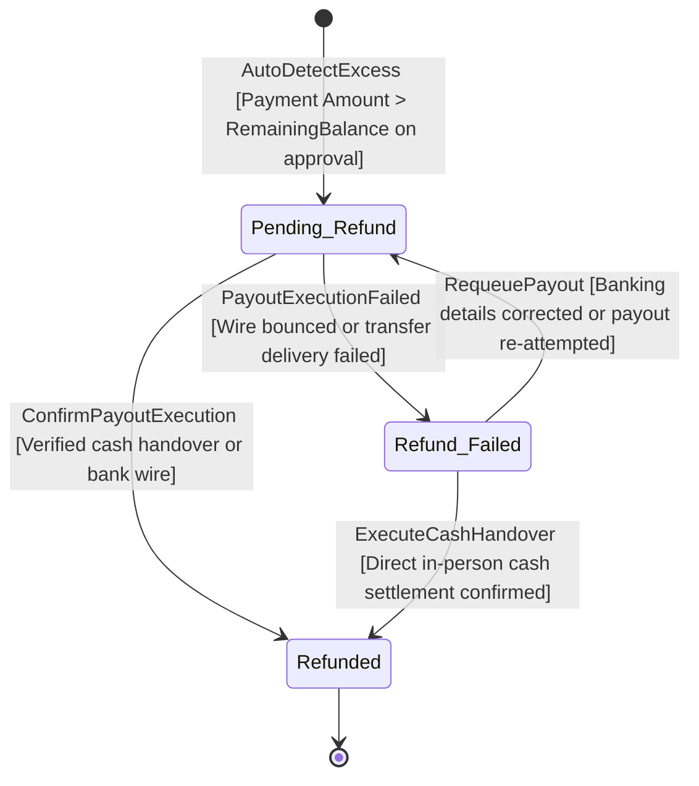
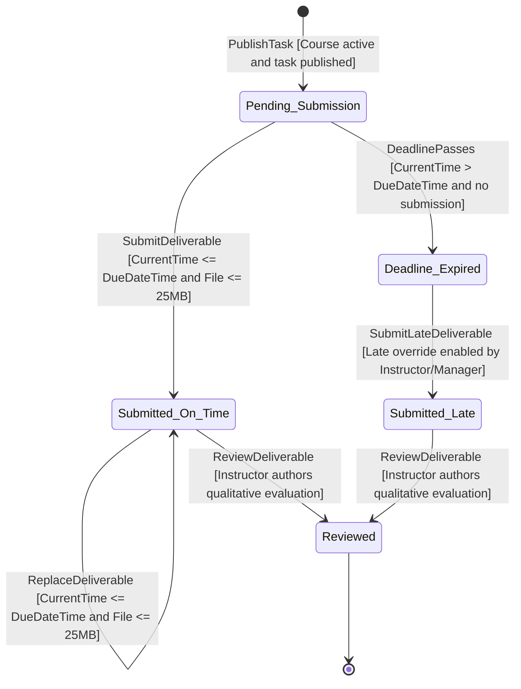
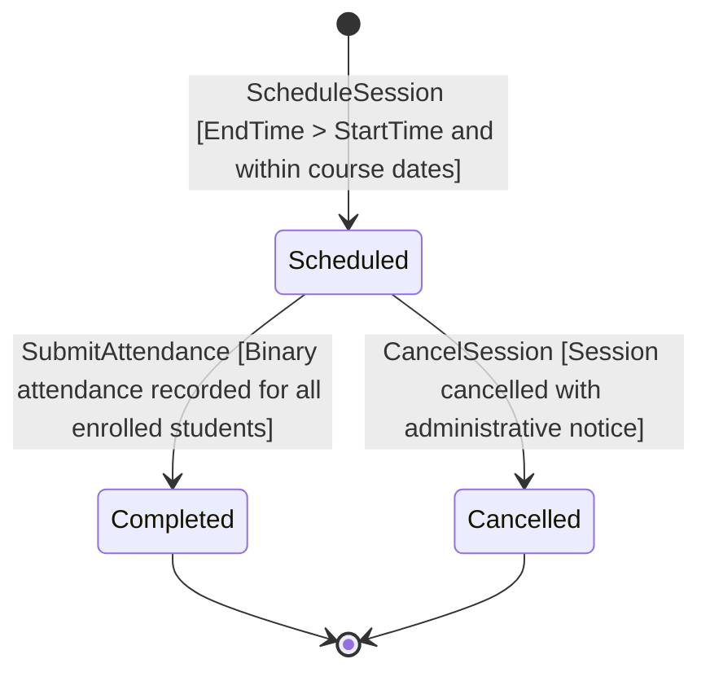
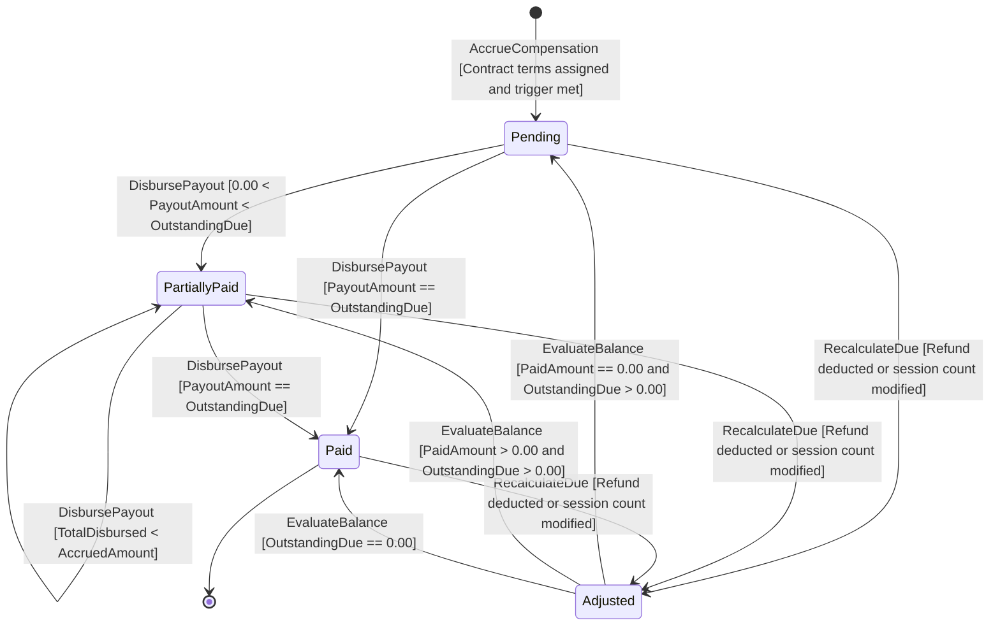
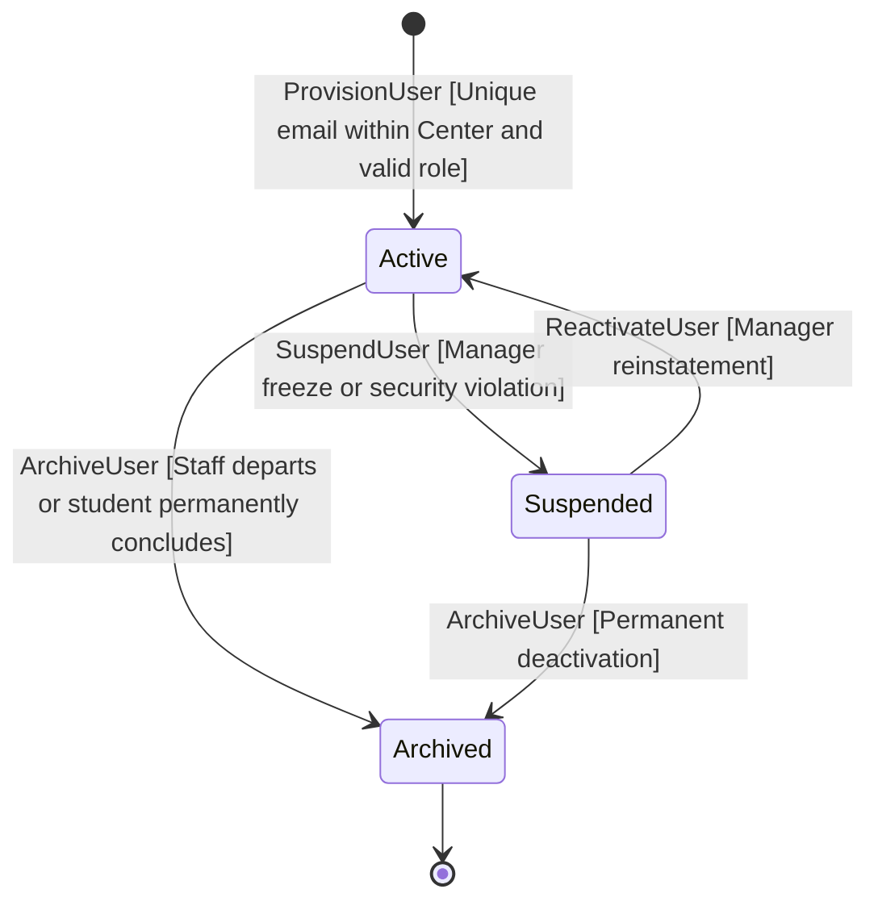

# UML State Machine Specification (مواصفات ومخططات آلة الحالة للمنظومة)
## VELORA (فيلورا) — Training Center Management Platform

- **Document Version:** 1.0.0  
- **Document Type:** UML 2.5 State Machine Specification & Domain Lifecycle Analysis  
- **Target Release:** Confirmed MVP (Minimum Viable Product)  
- **Primary Sources of Truth:** [PRD.md](file:///D:/docs/PRD.md), [user-flow.md](file:///D:/docs/docs/user-flow.md), [domain-model.md](file:///D:/docs/diagrams/domain-model.md), and [use-case.md](file:///D:/docs/diagrams/use-case.md)  
- **Complementary Architectural Artifacts:** [ERD.md](file:///D:/docs/docs/ERD.md) and [database.dbml](file:///D:/docs/docs/database.dbml)  
- **Status:** Approved Baseline  

---

## 1. Executive Summary & Modeling Methodology

### 1.1 Objective & Scope
This specification provides the formal **UML 2.5 State Machine Models** for all core domain entities within the **VELORA Training Center Management Platform** that possess dynamic, business-critical lifecycles. 

In complex educational and offline financial systems, state machines prevent invalid operations, protect data integrity, enforce regulatory and accounting invariants, and guarantee that entities transition only under authorized business events and verified guard conditions.

### 1.2 UML 2.5 Standards & Modeling Rules
In strict compliance with software engineering best practices and the project requirements:
1. **Separation of Concerns (States vs. Events):** States represent stable, identifiable conditions of an entity during which it satisfies certain business invariants (e.g., `Active`, `Completed`, `Pending_Approval`). Events represent instantaneous triggers causing transitions between states (e.g., `ApprovePayment`, `PublishCourse`).
2. **Documented Status Integrity:** Every state modeled in this specification maps directly to the confirmed product requirements ([PRD.md](file:///D:/docs/PRD.md)), approved user flows ([user-flow.md](file:///D:/docs/docs/user-flow.md)), and physical relational schema ([ERD.md](file:///D:/docs/docs/ERD.md)). No undocumented or phantom statuses have been introduced.
3. **Formal Guard Syntax:** All transitional business rules, prerequisites, and assertions are explicitly captured as bracketed guards: `Event [GuardCondition]`.
4. **Failure & Exceptional Paths:** Success and failure branches (such as payment rejection, refund transfer failure, and deadline expirations) are modeled to guarantee deterministic behavior under all edge cases.
5. **No Unreachable or Deadlocked States:** Every modeled state has a legitimate entry path from an initial pseudo-state `[*]` and, where applicable, a deterministic exit path to a terminal pseudo-state `[*]`.

---

## 2. Domain Lifecycle Matrix (نظرة عامة على دورات حياة الكيانات)

The following matrix summarizes the 10 domain entities possessing meaningful lifecycles in the VELORA MVP, their documented states, initial entry points, and terminal conditions:

| Entity Name | Arabic Name | Bounded Context | Initial State | Documented States | Terminal State(s) | Primary Controlling Role |
| :--- | :--- | :--- | :---: | :--- | :---: | :--- |
| **Course Cohort** | الدورة التدريبية | Academic & Course | `Draft` | `Draft`, `Active`, `Completed`, `Archived` | `Archived` | Center Manager |
| **Course Waitlist Entry** | طلب قائمة الانتظار | Academic & Course | `Waiting` | `Waiting`, `Notified`, `Enrolled`, `Cancelled` | `Enrolled`, `Cancelled` | System / Sales Specialist |
| **Student Enrollment** | التحاق المتدرب | Enrollment & Finance | `Active` | `Active`, `Completed`, `Withdrawn` | `Completed`, `Withdrawn` | Center Manager |
| **Enrollment Financial Standing** | السجل المالي للالتحاق | Enrollment & Finance | `Unpaid` | `Unpaid`, `PartiallyPaid`, `FullyPaid` | `FullyPaid` *(Settled)* | System / Center Manager |
| **Payment Voucher** | سند قبض القسط | Enrollment & Finance | `Pending_Approval` | `Pending_Approval`, `Completed`, `Rejected`, `Adjusted` | `Rejected`, `Adjusted` | Manager / Accountant |
| **Excess Refund Request** | طلب استرداد الفائض | Enrollment & Finance | `Pending_Refund` | `Pending_Refund`, `Refunded`, `Refund_Failed` | `Refunded` | Finance Staff / Manager |
| **Task Deliverable Submission** | تسليم الواجب التدريبي | Teaching & Evaluation | `Pending_Submission` | `Pending_Submission`, `Submitted_On_Time`, `Submitted_Late`, `Deadline_Expired`, `Reviewed` | `Reviewed` | Instructor / Student |
| **Course Session (Lecture)** | الجلسة التدريبية | Academic & Course | `Scheduled` | `Scheduled`, `Completed`, `Cancelled` | `Completed`, `Cancelled` | Instructor / Manager |
| **Instructor Financial Due** | مستحقات المدرب المالية | Instructor Settlement | `Pending` | `Pending`, `PartiallyPaid`, `Paid`, `Adjusted` | `Paid` *(Settled)* | System / Center Manager |
| **User Identity & Account** | هوية المستخدم وحسابه | Center & Identity | `Active` | `Active`, `Suspended`, `Archived` | `Archived` | Center Manager |

---

## 3. Detailed Entity State Machines

```
┌─────────────────────────────────────────────────────────────────────────────────────────────────┐
│                                   VELORA DOMAIN STATE MACHINES                                  │
│                                                                                                 │
│  [Course Cohort]          Draft ─────────► Active ─────────► Completed ─────────► Archived      │
│                                                                                                 │
│  [Course Waitlist]        Waiting ───────► Notified ───────► Enrolled / Cancelled               │
│                                                                                                 │
│  [Student Enrollment]     Active ──────────────────────────► Completed / Withdrawn              │
│                                                                                                 │
│  [Financial Standing]     Unpaid ────────► PartiallyPaid ──► FullyPaid                          │
│                                                                                                 │
│  [Payment Voucher]        Pending_Approval ───────────────► Completed / Rejected ──► Adjusted  │
│                                                                                                 │
│  [Excess Refund]          Pending_Refund ──────────────────► Refunded / Refund_Failed           │
│                                                                                                 │
│  [Task Submission]        Pending ───────► Submitted (On-Time/Late) ────────────► Reviewed      │
│                                                                                                 │
│  [Course Session]         Scheduled ───────────────────────► Completed / Cancelled              │
│                                                                                                 │
│  [Instructor Due]         Pending ───────► PartiallyPaid ──► Paid / Adjusted                   │
│                                                                                                 │
│  [User Account]           Active ────────► Suspended ──────► Archived                           │
└─────────────────────────────────────────────────────────────────────────────────────────────────┘
```

---

### 3.1 Entity: Course Cohort (`Course`)
- **Arabic Name:** الدورة التدريبية
- **Bounded Context:** Academic Program & Course Context
- **Physical Table:** `courses` (Schema §3.2)
- **Primary Controlling Role:** `Center Manager`

#### State Descriptions
- **`Draft` (مسودة):** The course cohort is in preliminary formulation. Syllabus, dates, base price, and capacity are defined, but the course is not open for student enrollment or public scheduling.
- **`Active` (نشطة ومتاحة للتسجيل):** The course is officially launched and operating. At least one instructor with configured compensation terms is assigned. Trainees can be enrolled, lecture sessions scheduled, and course materials published.
- **`Completed` (مكتملة أكاديمياً):** Educational delivery has concluded (all lecture sessions conducted or the scheduled course end date has passed). Academic modifications and student admissions are locked; historical records remain fully visible.
- **`Archived` (مؤرشفة):** The course cohort is permanently closed and archived for auditing, accounting reconciliation, and historical compliance. All records are strictly read-only. Hard deletion is permanently prohibited.

#### State Transition Table

| Current State | Triggering Event | Guard Condition | Target State | Authorized Role | Business Action & Side Effect |
| :--- | :--- | :--- | :--- | :--- | :--- |
| `[*]` | `CreateCourse` | `BasePrice >= 0.00 AND EndDate >= StartDate` | `Draft` | Center Manager | Persists course cohort metadata in tenant database (`FR-CRS-01`). |
| `Draft` | `PublishCourse` | `At Least 1 Instructor Assigned WITH Compensation Model` (`BR-CRS-03`, `EC-003`) | `Active` | Center Manager | Activates course cohort; enables student intake and waitlist monitoring (`AC-CRS-01`). |
| `Draft` | `CancelDraftCourse` | `EnrollmentCount == 0 AND SessionCount == 0` | `Archived` | Center Manager | Soft-archives abandoned draft without impacting operational reports. |
| `Active` | `ConcludeCourse` | `All Scheduled Sessions Conducted OR CurrentDate >= EndDate` | `Completed` | Center Manager | Closes enrollment intake; locks student admissions; initiates financial review. |
| `Active` | `ForceArchiveCourse`| `Emergency / Premature Cancellation Authorized` | `Archived` | Center Manager | Prematurely locks active cohort; preserves all financial and attendance records for audits. |
| `Completed` | `ArchiveCourse` | `All Student Balances & Instructor Dues Reconciled` | `Archived` | Center Manager | Transitions course to permanent read-only status (`FR-CRS-05`, `AC-CRS-01`). |
| `Archived` | `[*]` | — | Terminal | — | Entity reaches final lifecycle state; remains permanently queryable. |

#### Mermaid State Diagram



#### Arabic Operational Explanation (الشرح التشغيلي لدورة حياة الدورة التدريبية)
1. **الإنشاء والمسودة (`Draft`):** تبدأ الدورة كمسودة يحدد فيها مدير المركز البيانات الأساسية (الاسم، الكود، الرسوم الأساسية، السعة وتواريخ البدء والانتهاء). في هذه الحالة، يمنع النظام تماماً تسجيل أي طالب.
2. **التفعيل والنشر (`Active`):** لا يمكن نقل الدورة إلى الحالة النشطة إلا بعد تحقق شرط حتمي (`BR-CRS-03`): **تعيين مدرب واحد على الأقل مع تحديد نموذج تعويضه المالي**. فور التفعيل، تُفتح الدورة لتسجيل الطلاب، وتُفعل ضوابط السعة القصوى وقوائم الانتظار، ويُتاح جدولة المحاضرات ورفع المواد التعليمية.
3. **الاكتمال الأكاديمي (`Completed`):** عند انتهاء المحاضرات أو انقضاء تاريخ نهاية الدورة، تُنقل الدورة إلى مكتملة، مما يُقفل إمكانية تسجيل طلاب جدد، ويُبقي السجلات الأكاديمية والمالية متاحة للمراجعة والمطابقة.
4. **الأرشفة الدائمة (`Archived`):** بعد تسوية مستحقات المدربين ومطابقة أرصدة الطلاب، تُؤرشف الدورة نهائياً. **قيد حتمي:** تُحظر إزالة الدورة ماديّاً من قاعدة البيانات (`EC-002`) حفاظاً على السجلات التاريخية للتدقيق والامتثال المحاسبي.

#### Business Invariants & Forbidden Transitions
- **`Draft` → `Active` دون مدرب:** محظور منعاً باتاً ويعيد النظام خطأ تحققي (`EC-003`).
- **حذف دورة بها سجلات نشطة:** محظور قطعياً عبر قيود التكامل المرجعي (`ON DELETE RESTRICT`) وبوابات الأمان البرمجية (`EC-002`).
- **`Archived` → `Active` / `Draft`:** محظور؛ حالة الأرشفة نهائية وغير قابلة للإلغاء لحماية سجلات التدقيق التاريخية.

---

### 3.2 Entity: Course Waitlist Entry (`CourseWaitlist`)
- **Arabic Name:** طلب قائمة الانتظار للدورة
- **Bounded Context:** Academic Program & Course Context
- **Physical Table:** `course_waitlists` (Schema §3.2)
- **Primary Controlling Role:** `Sales Specialist` / `Center Manager` / `System` (FIFO)

#### State Descriptions
- **`Waiting` (في قائمة الانتظار):** The student is queued chronologically in a First-In-First-Out (FIFO) queue after attempting to enroll in a filled course cohort. Zero financial fees are charged; no financial account or enrollment is generated.
- **`Notified` (تم إخطاره بتوفر مقعد شاغر):** A seat has become available (due to a student withdrawal or administrative capacity expansion). The candidate at the head of the FIFO queue has been officially notified and given a reservation grace period to confirm admission.
- **`Enrolled` (تم تأكيد التسجيل بنجاح):** The candidate accepted the vacant seat, confirmed admission terms, and was officially promoted to an active `Enrollment`. Terminal success state for the waitlist request.
- **`Cancelled` (ملغي):** The reservation expired without confirmation, the candidate explicitly declined the seat, or the candidate withdrew from the queue prior to vacancy. Terminal exit state.

#### State Transition Table

| Current State | Triggering Event | Guard Condition | Target State | Authorized Role | Business Action & Side Effect |
| :--- | :--- | :--- | :--- | :--- | :--- |
| `[*]` | `QueueOnWaitlist` | `Course is Active AND EnrolledCount >= Capacity` (`BR-CRS-CAPACITY-HARDLOCK`) | `Waiting` | Sales / Manager | Records FIFO entry with timestamp; assesses zero monetary fees (`BR-CRS-WAITLIST-FIFO`). |
| `Waiting` | `NotifySeatVacancy` | `Seat Vacated (Withdrawal/Capacity Expansion) AND Entry is Head of FIFO Queue` | `Notified` | System / Manager | Records `notified_at` timestamp; reserves seat temporarily; issues notification. |
| `Waiting` | `WithdrawRequest` | `Student or Staff Cancels Queue Request Before Vacancy` | `Cancelled` | Sales / Student | Releases queue position; no financial liability. |
| `Notified` | `ConfirmEnrollment` | `Accepted Within Grace Period AND Seat Still Reserved` | `Enrolled` | Sales / Manager | Promotes candidate to official `Enrollment`; initializes financial ledger (`UC-ENR-01`). |
| `Notified` | `ExpireReservation`| `Grace Period Elapsed Without Confirmation` | `Cancelled` | System / Manager | Forfeits seat; auto-notifies next sequential FIFO candidate in queue. |
| `Notified` | `DeclineSeat` | `Student Explicitly Declines Offered Seat` | `Cancelled` | Sales Specialist | Forfeits seat; auto-notifies next sequential FIFO candidate in queue. |
| `Enrolled` | `[*]` | — | Terminal | — | Candidate transitions into formal `Enrollment` lifecycle. |
| `Cancelled`| `[*]` | — | Terminal | — | Waitlist ticket closed permanently. |

#### Mermaid State Diagram



#### Arabic Operational Explanation (الشرح التشغيلي لدورة حياة قائمة الانتظار)
1. **الإدراج في الانتظار (`Waiting`):** عند اكتمال مقاعد الدورة، يوقف النظام التسجيل المباشر قطعياً (`BR-CRS-CAPACITY-HARDLOCK`)، ويتيح إدراج الطالب في قائمة الانتظار مجاناً مع توثيق التوقيت الزمني لضمان الأسبقية (`FIFO Priority`). **قيد مالي:** لا يُعد الطالب مسجلاً رسمياً ولا تُفرض عليه أي مبالغ مالية.
2. **الإخطار بتوفر شاغر (`Notified`):** عند انسحاب متدرب مسجل أو زيادة سعة الدورة، يفحص النظام القائمة آلياً ويُخطر صاحب الأسبقية الأولى ويمنحه مهلة محددة لتأكيد الحجز.
3. **تأكيد التسجيل (`Enrolled`):** في حال تأكيد الطالب رغبته خلال المهلة، يُرحل فوراً إلى سجل الالتحاق الرسمي (`Enrollment`)، وتُنشأ مطالبته المالية ويبدأ سداد الرسوم.
4. **الإلغاء وانقضاء المهلة (`Cancelled`):** في حال اعتذار الطالب أو انتهاء المهلة الممنوحة له دون استجابة، تُلغى تذكرته فوراً ويُخطر الطالب التالي في الترتيب تلقائياً.

#### Business Invariants & Forbidden Transitions
- **فرض أي رسوم مالية أثناء حالتي `Waiting` أو `Notified`:** محظور قطعياً وفق قاعدة `BR-CRS-WAITLIST-FIFO`.
- **تخطي الترتيب الزمني (FIFO):** محظور تجاوز أسبقية المسجلين في القائمة لصالح متدرب أحدث تسجيلاً.
- **`Cancelled` → `Enrolled` مباشرة:** محظور؛ في حال رغب الطالب في العودة يُنشأ طلب انتظار جديد لحفظ حقوق بقية المتقدمين.

---

### 3.3 Entity: Student Enrollment Contract (`Enrollment`)
- **Arabic Name:** التحاق المتدرب بالدورة التدريبية
- **Bounded Context:** Student Enrollment & Financial Collection Context
- **Physical Table:** `enrollments` (Schema §3.3)
- **Primary Controlling Role:** `Center Manager` / `Sales Specialist`

#### State Descriptions
- **`Active` (نشط ومقيد بالدورة):** The trainee is officially admitted and actively participating in the course cohort. The student holds an allocated seat, has access to course materials, sessions, tasks, and attendance tracking, and possesses an active financial balance ledger.
- **`Completed` (مكتمل الدورة بنجاح):** The student completed the academic program requirements, attended scheduled sessions, and the cohort has formally concluded. Access transitions to read-only historical review.
- **`Withdrawn` (منسحب):** The student's participation was formally cancelled prior to cohort completion. The assigned seat is immediately released (decrementing active enrolled count and potentially triggering waitlist promotion). All historical attendance, task submissions, and posted payments are permanently preserved for accounting integrity.

#### State Transition Table

| Current State | Triggering Event | Guard Condition | Target State | Authorized Role | Business Action & Side Effect |
| :--- | :--- | :--- | :--- | :--- | :--- |
| `[*]` | `EnrollStudent` | `Course is Active AND (Capacity IS NULL OR EnrolledCount < Capacity) AND NOT DuplicateActiveEnrollment` | `Active` | Sales / Manager | Reserves seat; increments enrolled count; initializes financial ledger (`FR-STU-03`, `FR-FIN-01`). |
| `Active` | `GraduateStudent` | `Course Cohort Status == Completed AND Academic Criteria Satisfied` | `Completed` | Center Manager | Sets final academic standing; locks future session attendance; retains read-only access. |
| `Active` | `WithdrawStudent` | `Withdrawal Formally Authorized by Center Manager` | `Withdrawn` | Center Manager | Frees course seat (`BR-CRS-CAPACITY-SYNC`); retains payment/attendance history (`BR-STU-03`, `UC-ENR-02`). |
| `Completed` | `[*]` | — | Terminal | — | Enrollment record permanently archived. |
| `Withdrawn` | `[*]` | — | Terminal | — | Enrollment record permanently archived; seat released. |

#### Mermaid State Diagram



#### Arabic Operational Explanation (الشرح التشغيلي لدورة حياة التحاق الطالب)
1. **الالتحاق النشط (`Active`):** يُنشأ سجل الالتحاق عندما يختار موظف المبيعات أو المدير طالباً ويُلحقه بدورة نشطة بها شواغر متاحة. يُحجز مقعد فعلي للطالب، ويُنشأ حسابه المالي الأولي، ويُمنح فوراً صلاحيات الدخول للمحاضرات ورفع الواجبات وتحميل المواد.
2. **الازدواجية المحظورة:** يفرض النظام قيداً فريداً يمنع تسجيل الطالب في نفس الدورة مرتين بحالة نشطة في آن واحد (`(center_id, student_id, course_id, status='Active')`) ويعيد خطأ تعارض (`HTTP 409 Conflict`).
3. **الاكتمال الأكاديمي (`Completed`):** عند انتهاء الدورة واستيفاء الطالب لمتطلباتها، يتحول التحاقه إلى مكتمل، ليحتفظ بسجل تاريخي دائم لكافة مواده وتقييماته.
4. **الانسحاب وإخلاء المقعد (`Withdrawn`):** في حال انسحاب الطالب بقرار إداري، يُفرغ مقعده فوراً في الدورة مما يسمح لطلاب قائمة الانتظار بالترشح للمقعد الشاغر (`BR-CRS-CAPACITY-SYNC`). **قيد حتمي:** لا يُحذف سجل الطالب المنسحب، بل تبقى كافة مدفوعاته وسجلات حضوره محفوظة محاسبياً وقانونياً.

#### Business Invariants & Forbidden Transitions
- **تكرار التسجيل النشط لنفس المتدرب في نفس الدورة:** محظور قطعياً بموجب `FR-011` و `EC-001`.
- **الحذف المادي لسجل الالتحاق:** محظور تماماً عند ارتباطه بسندات مالية أو سجلات حضور (`ON DELETE RESTRICT`).
- **`Withdrawn` → `Active` مباشرة:** محظور؛ إعادة التسجيل تتطلب إنشاء قيد التحاق جديد يخضع لفحص السعة من جديد.

---

### 3.4 Entity: Enrollment Financial Standing (`Enrollment.payment_status`)
- **Arabic Name:** السجل والحالة المالية لتحصيل رسوم الالتحاق
- **Bounded Context:** Student Enrollment & Financial Collection Context
- **Physical Column:** `enrollments.payment_status` (Schema §3.3)
- **Primary Controlling Role:** `System` (Automated recalculation on Manager Approval)

#### State Descriptions
- **`Unpaid` (غير مسدد):** Initial financial standing upon enrollment. Total verified payments equal $0.00 (`TotalPaid == 0.00`), and outstanding balance equals the full net payable amount (`RemainingBalance == FinalPayable`).
- **`PartiallyPaid` (مسدد جزئياً):** At least one installment payment voucher has been administratively approved and credited, but an outstanding balance remains (`TotalPaid > 0.00` and `RemainingBalance > 0.00`).
- **`FullyPaid` (مكتمل السداد):** The net payable course fee has been completely collected and credited (`RemainingBalance == 0.00`). If an approved payment exceeded the balance, the net course fee was applied to reach `FullyPaid`, and the excess was strictly directed to a linked `RefundRequest`.

#### State Transition Table

| Current State | Triggering Event | Guard Condition | Target State | Authorized Role | Business Action & Side Effect |
| :--- | :--- | :--- | :--- | :--- | :--- |
| `[*]` | `InitializeLedger` | `FinalPayable = BasePrice - Discount >= 0.00` | `Unpaid` | System | Establishes running student ledger (`TotalPaid = 0.00`, `Remaining = FinalPayable`). |
| `Unpaid` | `ApprovePayment` | `Approved Net Amount < RemainingBalance` | `PartiallyPaid` | Manager / System | Credits payment; updates `TotalPaid`; recalculates `RemainingBalance` (`FR-FIN-01`). |
| `Unpaid` | `ApprovePayment` | `Approved Net Amount == RemainingBalance OR Overpayment Handled via Refund` | `FullyPaid` | Manager / System | Clears balance (`RemainingBalance = 0.00`); issues settled receipt. |
| `PartiallyPaid` | `ApprovePayment` | `Subsequent Installment: TotalPaid + Net Amount < FinalPayable` | `PartiallyPaid` | Manager / System | Increments `TotalPaid`; decrements `RemainingBalance`; updates follow-up queue. |
| `PartiallyPaid` | `ApprovePayment` | `Subsequent Installment: TotalPaid + Net Amount >= FinalPayable` | `FullyPaid` | Manager / System | Clears balance; triggers excess `Refund Request` if amount exceeded remaining. |
| `FullyPaid` | `AdjustPayment` | `Authorized Downward Adjustment results in RemainingBalance > 0.00` | `PartiallyPaid` | Center Manager | Re-opens outstanding balance; logs mandatory explanation in `AuditLog`. |
| `PartiallyPaid` | `ReverseAllPayments`| `All Approved Payments Reversed/Adjusted to 0.00` | `Unpaid` | Center Manager | Restores balance to full `FinalPayable`; logs audit rationale. |

#### Mermaid State Diagram



#### Arabic Operational Explanation (الشرح التشغيلي للحالة المالية للالتحاق)
1. **الرصيد الأولي غير المسدد (`Unpaid`):** عند تسجيل المتدرب، يُحسب المستحق النهائي الصافي (`FinalPayable = BasePrice - Discount`). ويبدأ الحساب برصيد مدفوع $0.00 ورصيد متبقٍ مساوٍ لكامل الرسوم، ويُدرج الطالب تلقائياً في طابور متابعة التحصيل للمبيعات (`SCR-S01`).
2. **السداد الجزئي والأقساط (`PartiallyPaid`):** عندما يُسدد الطالب قسطاً أولياً ويُعتمده المدير، يُحدث النظام الرصيد ذرياً؛ فيزداد إجمالي المدفوعات ويقل الرصيد المتبقي. ويظل الطالب في هذه الحالة طالما بقي عليه أي جزء من الرسوم.
3. **اكتمال السداد الصافي (`FullyPaid`):** يتحول الطالب إلى مكتمل السداد فور وصول الرصيد المتبقي إلى صفر.
4. **حسم ومعالجة الفائض (OQ-05 / BR-FIN-OVERPAY-REFUND):** إذا دفع الطالب مبلغاً يتجاوز المتبقي، يُرحل النظام الصافي المطلوب فقط للدورة لتصبح `FullyPaid` فوراً، ويُنشئ بالمبلغ الفائض طلباً إلزامياً مستقلاً لاسترداده للطالب (`Refund Request`) ويمنع تحويله لرصيد دائن.
5. **التسويات العكسية (`AdjustPayment`):** في حال وجود خطأ في سند سابق واضطرار المدير لإجراء تسوية خصم معتمدة، يُعاد فتح الرصيد وتتحول الحالة من `FullyPaid` إلى `PartiallyPaid` مع توثيق العملية بالكامل في سجل التدقيق غير القابل للتعديل (`AuditLog`).

#### Business Invariants & Forbidden Transitions
- **تحديث الرصيد بمجرد إدخال موظف المبيعات للسند:** محظور قطعياً؛ التحديث لا يتم إلا بعد الاعتماد الإداري الصريح (`BR-FIN-APPROVAL`).
- **تحويل الفائض إلى رصيد دائن للدورات القادمة:** محظور قطعياً وفق القرار الإداري المعتمد `OQ-05`.
- **تسجيل مبالغ سداد صفرية أو سالبة:** محظور برمجياً وعلائقياً (`CHECK amount > 0.00`).

---

### 3.5 Entity: Payment / Installment Voucher (`Payment`)
- **Arabic Name:** سند قبض القسط المالي
- **Bounded Context:** Student Enrollment & Financial Collection Context
- **Physical Table:** `payments` (Schema §3.3)
- **Primary Controlling Role:** `Center Manager` / `Accountant` (Reviewer), `Sales Specialist` (Creator)

#### State Descriptions
- **`Pending_Approval` (قيد الاعتماد الإداري):** The payment voucher has been recorded by sales staff upon receiving offline cash, a card receipt, or bank wire proof. The voucher is held in the management verification queue. It has **NOT** affected the student's ledger balance or course settlement status.
- **`Completed` (معتمد ومرحل محاسبياً):** Center Management or the Center Accountant has verified the physical receipt/bank deposit and approved the voucher. The transaction is committed in an atomic ACID transaction, an official immutable receipt (`REC-XXXX`) is issued, and the student's balance is updated.
- **`Rejected` (مرفوض إدارياً):** The voucher was reviewed and rejected due to a non-matching receipt, invalid reference, or unverified bank deposit. The student's balance remains completely untouched. Rationale is preserved in the audit log. Terminal state.
- **`Adjusted` (معدل بتسوية قيدية):** An approved (`Completed`) payment voucher was subsequently adjusted or reversed by an authorized manager entry to correct an administrative discrepancy. Hard deletion is prevented; full audit trail is preserved. Terminal state.

#### State Transition Table

| Current State | Triggering Event | Guard Condition | Target State | Authorized Role | Business Action & Side Effect |
| :--- | :--- | :--- | :--- | :--- | :--- |
| `[*]` | `RecordOfflinePayment` | `Amount > 0.00 AND Valid Active Enrollment` (`BR-FIN-01`, `EC-FIN-02`) | `Pending_Approval` | Sales / Manager | Persists voucher; attaches receipt reference; student balance untouched (`OQ-02`). |
| `Pending_Approval` | `ApprovePayment` | `Management Verification Succeeded` (`BR-FIN-APPROVAL`) | `Completed` | Manager / Accountant | Executes atomic transaction; updates student balance; generates excess refund if applicable (`NFR-REL-01`). |
| `Pending_Approval` | `RejectPayment` | `Discrepancy Documented WITH Mandatory Rationale` | `Rejected` | Manager / Accountant | Sets status to `Rejected`; balance unaffected; notifies sales staff (`BR-FIN-APPROVAL`). |
| `Completed` | `PostAdjustmentEntry` | `Manager Authorization WITH Justification Reference` (`FR-FIN-05`, `BR-FIN-03`) | `Adjusted` | Center Manager | Adjusts financial ledger; recalculates student balance; generates immutable `AuditLog` (`AC-05`). |
| `Rejected` | `[*]` | — | Terminal | — | Rejected voucher permanently archived; balance unaffected. |
| `Adjusted` | `[*]` | — | Terminal | — | Adjusted voucher preserved permanently for audit history. |

#### Mermaid State Diagram



#### Arabic Operational Explanation (الشرح التشغيلي لدورة حياة سند القبض)
1. **إدخال السند وقيد الاعتماد (`Pending_Approval`):** يُدخل موظف المبيعات بيانات السند (المبلغ، طريقة الدفع، رقم الإيصال الورقي/البنكي). **القرار المعتمد OQ-02:** لا يؤثر هذا السند مطلقاً على رصيد المتدرب عند إدخاله، بل يدخل طابور الرقابة والاعتماد الإداري.
2. **الاعتماد والترحيل الذري (`Completed`):** يُراجع مدير المركز أو المحاسب صحة الإيداع أو استلام النقدية؛ وفور الضغط على "اعتماد":
   - تبدأ معاملة ذرية متكاملة (`ACID Transaction`).
   - يتحول السند إلى `Completed` ويُثبت كسند غير قابل للحذف المادي (`Immutable`).
   - يُرحل المبلغ المعتمد إلى رصيد الطالب فوراً، وتُصدر المنظومة إيصال قبض رسمي معتمد (`REC-XXXX`).
3. **الرفض الإداري (`Rejected`):** في حال وجود خطأ في البيانات أو عدم تطابق الحوالة، يرفض المدير السند مع تدوين السبب إجبارياً؛ وتتحول حالة السند إلى مرفوض دون أي مساس برصيد الطالب.
4. **التسوية والتعديل (`Adjusted`):** يمنع النظام منعاً باتاً حذف السندات المعتمدة (`FR-FIN-05` و `AC-05`)؛ وفي حال وقوع خطأ يتم إجراء حركة تسوية قيدية تبرر التعديل وتوثق هوية المدير والوقت في سجل التدقيق.

#### Business Invariants & Forbidden Transitions
- **الحذف المادي لسندات القبض المعتمدة:** محظور نهائياً ويُمنع عبر واجهة برمجة التطبيقات وقاعدة البيانات (`HTTP 403 / 405`).
- **تحديث رصيد الطالب قبل الاعتماد:** محظور قطعياً بموجب `BR-FIN-APPROVAL`.
- **`Pending_Approval` → `Adjusted` مباشرة:** محظور؛ التعديل والتسوية يختصان بالسندات المعتمدة فقط؛ أما السند المعلق فيتم رفضه.
- **إعادة فتح السند المرفوض (`Rejected` → `Completed`):** محظور؛ عند الرفض يجب تسجيل سند جديد بالبيانات المصححة.

---

### 3.6 Entity: Excess Refund Request (`RefundRequest`)
- **Arabic Name:** طلب استرداد الفائض المالي للمتدرب
- **Bounded Context:** Student Enrollment & Financial Collection Context
- **Physical Table:** `refund_requests` (Schema §3.3)
- **Primary Controlling Role:** `Center Manager` / Finance Officer

#### State Descriptions
- **`Pending_Refund` (معلق بانتظار صرف الاسترداد):** The refund claim was automatically initiated by the system upon the administrative approval of an overpayment voucher ($\text{Excess} = \text{Amount} - \text{RemainingBalance}$). Prohibits converting funds to future course credit. Queued in the financial disbursement register awaiting physical cash payout or bank wire transfer.
- **`Refunded` (تم صرف الاسترداد وتأكيده):** Center finance staff has executed and verified the physical cash handover or bank wire payout to the student. An official refund voucher is issued, and the claim is closed. Terminal success state.
- **`Refund_Failed` (تعثر تنفيذ الاسترداد):** Payout execution failed (e.g., bank wire rejected, incorrect banking details, or failure to deliver cash). The failure reason is logged, and the item remains an active liability requiring corrective action.

#### State Transition Table

| Current State | Triggering Event | Guard Condition | Target State | Authorized Role | Business Action & Side Effect |
| :--- | :--- | :--- | :--- | :--- | :--- |
| `[*]` | `AutoDetectExcess` | `Payment Amount > RemainingBalance on Voucher Approval` (`BR-FIN-OVERPAY-REFUND`, `OQ-05`) | `Pending_Refund` | System (Auto) | Calculates excess; binds claim to voucher; prohibits credit-rollover. |
| `Pending_Refund` | `ConfirmPayoutExecution` | `Cash or Bank Transfer Confirmed Executed WITH Reference` (`BR-FIN-REFUND-VERIFY`) | `Refunded` | Manager / Finance | Updates status to `Refunded`; issues official refund voucher; writes audit log. |
| `Pending_Refund` | `PayoutExecutionFailed` | `Bank Wire Bounced OR Delivery Failed WITH Reason` | `Refund_Failed` | Manager / Finance | Flags failure reason; keeps liability open in financial register. |
| `Refund_Failed` | `RequeuePayout` | `Banking Details Corrected OR Re-attempt Authorized` | `Pending_Refund` | Finance Officer | Re-queues claim for bank wire re-transmission. |
| `Refund_Failed` | `ExecuteCashHandover` | `Direct In-Person Cash Payout Confirmed WITH Signature` | `Refunded` | Manager / Finance | Successfully settles refund via alternative method; writes audit log. |
| `Refunded` | `[*]` | — | Terminal | — | Excess refund lifecycle completed and closed. |

#### Mermaid State Diagram



#### Arabic Operational Explanation (الشرح التشغيلي لدورة استرداد الفائض المالي)
1. **الإنشاء التلقائي للفائض (`Pending_Refund`):** عند اعتماد سند سداد يتجاوز الرصيد المستحق، يرفض النظام آلياً تحويل المبلغ الزائد إلى رصيد دائن مستقبلي للطالب عملاً بالقرار الإداري المحسوم (`OQ-05` و `BR-FIN-OVERPAY-REFUND`)، ويُنشئ فوراً طلب استرداد مالي بقيمة الفرق وبحالة معلقة.
2. **صرف الاسترداد وتأكيده (`Refunded`):** يقوم المحاسب بصرف المبلغ الزائد نقداً أو عبر حوالة بنكية. **قيد مالي صارم (`BR-FIN-REFUND-VERIFY`):** لا يتحول الطلب إلى `Refunded` إلا بعد إثبات الصرف الفعلي ومطابقته محاسبياً، مع إصدار سند استرداد رسمي وتوثيق القيد في سجل التدقيق.
3. **التعثر وإعادة المحاولة (`Refund_Failed`):** في حال رفض الحوالة البنكية أو تعذر تسليم المبلغ، يتحول الطلب إلى متعثر مع تدوين السبب تفصيلياً؛ ويبقى المبلغ التزاماً مالياً قائماً على المركز حتى يتم تصحيح البيانات أو تسليم المبلغ نقداً للمتدرب مباشرة.

#### Business Invariants & Forbidden Transitions
- **تحويل الفائض إلى رصيد دائن للدورات القادمة:** محظور قطعياً بموجب `OQ-05` و `BR-FIN-OVERPAY-REFUND`.
- **الانتقال إلى `Refunded` دون إثبات الصرف الفعلي:** محظور بموجب القيد المالي `BR-FIN-REFUND-VERIFY`.
- **الحذف المادي لسجل الاسترداد:** محظور نهائياً؛ تظل سجلات الاسترداد مثبتة تاريخياً لضمان سلامة المطابقة المالية.

---

### 3.7 Entity: Task Deliverable & Submission (`Submission`)
- **Arabic Name:** تسليم الواجب والمهمة التدريبية
- **Bounded Context:** Teaching & Accountability Context
- **Physical Table:** `submissions` (Schema §3.4)
- **Primary Controlling Role:** `Enrolled Student` (Submission), `Course Instructor` (Evaluation)

#### State Descriptions
- **`Pending_Submission` (بانتظار تسليم الواجب):** The homework task has been published by the instructor with a designated deadline. The enrolled student has not yet submitted their deliverable file.
- **`Submitted_On_Time` (تم التسليم في الموعد المحدد):** The student successfully uploaded their homework deliverable (up to 25 MB) prior to the expiration of the deadline. File replacement is permitted until deadline expiration.
- **`Deadline_Expired` (انقضى الموعد النهائي دون تسليم):** The deadline elapsed with no file uploaded. The task submission form is automatically locked by default. Submissions are blocked unless an authorized late override is granted.
- **`Submitted_Late` (تم التسليم المتأخر باستثناء إداري):** The student submitted their homework deliverable after the deadline, permitted exclusively via an explicit manual late override toggle granted by the instructor or manager. Explicitly flagged as `Late`.
- **`Reviewed` (تمت المراجعة والتقييم):** The assigned instructor reviewed the submitted deliverable, inspected the work, and authored qualitative mentoring feedback in the student's portal. Terminal academic state.

#### State Transition Table

| Current State | Triggering Event | Guard Condition | Target State | Authorized Role | Business Action & Side Effect |
| :--- | :--- | :--- | :--- | :--- | :--- |
| `[*]` | `PublishTask` | `Course is Active AND Instructions Defined` (`FR-TSK-01`) | `Pending_Submission` | Instructor / Manager | Publishes task; displays due date in student dashboard (`SCR-ST03`). |
| `Pending_Submission` | `SubmitDeliverable` | `CurrentTime <= DueDateTime AND FileSize <= 25MB AND ValidMIME` (`AC-TSK-01`) | `Submitted_On_Time` | Enrolled Student | Stores file with randomized UUID path; flags status as `On-Time` (`FR-TSK-03`). |
| `Submitted_On_Time` | `ReplaceDeliverable`| `CurrentTime <= DueDateTime AND FileSize <= 25MB AND ValidMIME` (`FR-TSK-04`) | `Submitted_On_Time` | Enrolled Student | Replaces previous file deliverable; updates submission timestamp (`UC-TSK-02b`). |
| `Pending_Submission` | `DeadlinePasses` | `CurrentTime > DueDateTime AND No Submission Uploaded` | `Deadline_Expired` | System (Temporal) | Locks submission portal by default (`FR-TSK-05`, `EC-005`). |
| `Deadline_Expired` | `SubmitLateDeliverable`| `LateOverrideEnabled == true AND FileSize <= 25MB AND ValidMIME` (`OQ-03`, `FR-TSK-06`) | `Submitted_Late` | Enrolled Student | Accepts upload; permanently flags submission status as `Late` (`EC-006`). |
| `Submitted_On_Time` | `ReviewDeliverable` | `Instructor Authors Qualitative Evaluation` (`FR-FDB-01`) | `Reviewed` | Course Instructor | Attaches private feedback note; updates instructor review queue (`SCR-I03`). |
| `Submitted_Late` | `ReviewDeliverable` | `Instructor Authors Qualitative Evaluation` (`FR-FDB-01`) | `Reviewed` | Course Instructor | Attaches private feedback note; updates instructor review queue (`SCR-I03`). |
| `Reviewed` | `[*]` | — | Terminal | — | Submission evaluated; feedback delivered to trainee. |

#### Mermaid State Diagram



#### Arabic Operational Explanation (الشرح التشغيلي لدورة تسليم الواجب التدريبي)
1. **نشر الواجب وانتظار الحل (`Pending_Submission`):** ينشر المدرب الواجب بتعليمات وموعد تسليم محدد، وتظهر المهمة في لوحة تحكم الطلاب الملتحقين مع عداد تنازلي للموعد.
2. **التسليم في الموعد واستبدال الملف (`Submitted_On_Time`):** يرفع المتدرب ملف الحل (بحد أقصى 25 ميجابايت وبامتداد مسموح). يُسجل النظام حالة التسليم كـ `On-Time`. **ميزة مسموحة:** يُتاح للمتدرب استبدال الملف المرفوع بأي نسخة أحدث ما دامت المهلة لم تنتهِ بعد (`FR-TSK-04`).
3. **إغلاق التسليم بعد انتهاء المهلة (`Deadline_Expired`):** فور انتهاء الموعد، يُقفل النظام إمكانية التسليم آلياً ويمنع رفع أي ملفات ويعيد خطأ (`ERR_DEADLINE_PASSED`).
4. **استثناء التسليم المتأخر (`Submitted_Late`):** عملاً بالقرار الإداري المعتمد `OQ-03`، إذا فتح المدرب أو المدير خيار الاستثناء للتسليم المتأخر (`Allow Late Submission`)، يُقبل الملف ويُوسم وجوباً وحتماً بحالة `Late`.
5. **التقييم والمراجعة الأكاديمية (`Reviewed`):** يفتح المدرب ملف الطالب ويراجعه، ويكتب ملاحظات توجيهية خاصة وسرية بالكامل تظهر للطالب في لوحته الشخصية (`SCR-ST03`).

#### Business Invariants & Forbidden Transitions
- **رفع الواجب بعد انتهاء المهلة دون استثناء مسبق:** محظور قطعياً وفق قاعدة `FR-TSK-05` و `EC-005`.
- **استبدال ملف الواجب بعد انتهاء المهلة:** محظور نهائياً؛ الاستبدال مقتصر فقط على الفترة السابقة للموعد النهائي.
- **رفع ملفات تتجاوز 25 ميجابايت أو ذات امتدادات غير مصرح بها:** محظور برمجياً وعلى مستوى الخادم.
- **اطلاع مسؤولي المبيعات على ملفات الواجبات أو تقييمات الطلاب:** محظور حظراً صارماً وفق مصفوفة الصلاحيات (`PRD §15.1`).

---

### 3.8 Entity: Course Session / Lecture (`CourseSession`)
- **Arabic Name:** الجلسة التدريبية / المحاضرة
- **Bounded Context:** Academic Program & Course Context
- **Physical Table:** `course_sessions` (Schema §3.2)
- **Primary Controlling Role:** `Course Instructor` (Assigned) / `Center Manager`

#### State Descriptions
- **`Scheduled` (مجدولة زمنياً):** The lecture session has been scheduled with a specific date, start time, end time, instructional topic, and assigned instructor. Attendance has not yet been recorded.
- **`Completed` (منجزة ومثبت حضورها):** The lecture session was successfully conducted. The instructor submitted the official attendance sheet with binary presence recorded for all enrolled students. Triggers per-session instructor compensation dues calculation.
- **`Cancelled` (ملغاة):** The lecture session was cancelled due to an emergency, weather conditions, or official holiday. Attendance cannot be recorded. Accrues zero per-session instructor compensation dues. Terminal state.

#### State Transition Table

| Current State | Triggering Event | Guard Condition | Target State | Authorized Role | Business Action & Side Effect |
| :--- | :--- | :--- | :--- | :--- | :--- |
| `[*]` | `ScheduleSession` | `Course is Draft or Active AND EndTime > StartTime` (`FR-CRS-04`) | `Scheduled` | Manager / Instructor | Adds session to course timetable; sets chronological order (`session_order`). |
| `Scheduled` | `SubmitAttendance` | `Binary Presence (Present/Absent) Recorded for All Active Enrolled Trainees` (`FR-ATT-01/04`) | `Completed` | Assigned Instructor / Manager | Saves unique attendance records (`BR-ATT-03`); triggers `PerSession` dues accrual (`OQ-04`). |
| `Scheduled` | `CancelSession` | `Session Cancellation Documented with Reason` | `Cancelled` | Manager / Instructor | Cancels session; blocks attendance logging; prevents `PerSession` dues accrual (`OQ-04`). |
| `Completed` | `[*]` | — | Terminal | — | Completed lecture archived in course academic history. |
| `Cancelled` | `[*]` | — | Terminal | — | Cancelled lecture archived; no financial liabilities accrued. |

#### Mermaid State Diagram



#### Arabic Operational Explanation (الشرح التشغيلي لدورة حياة الجلسة التدريبية)
1. **الجدولة والتخطيط (`Scheduled`):** يحدد المدرب أو مدير المركز موعد المحاضرة وتوقيتها وموضوعها، وتظهر في جدول المحاضرات للطلاب والمدرب.
2. **الإنجاز وتوثيق الحضور (`Completed`):** عند انعقاد الجلسة، يفتح المدرب كشف الحضور الرقمي ويسجل حضور وغياب كافة الطلاب الملتحقين بصورة ثنائية (`Present` أو `Absent`). **الأثر المالي الحاسم (OQ-04):** تحول الجلسة إلى `Completed` وتوثيق حضورها هو الشرط الإلزامي الوحيد لاحتساب أجر الجلسة للمدرب في نموذج التعويض لكل جلسة (`PerSession`).
3. **الإلغاء (`Cancelled`):** في حال تعذر انعقاد الجلسة لأي ظرف، تُلغى رسمياً. **قيد مالي صارم (OQ-04):** لا يستحق المدرب أي أجر مالي عن الجلسات الملغاة التي لم تُنفذ ولم يُوثق حضورها.

#### Business Invariants & Forbidden Transitions
- **رصد الحضور لجلسة ملغاة:** محظور برمجياً وعلائقياً.
- **تكرار تسجيل حضور نفس الطالب في نفس الجلسة:** محظور قطعياً عبر القيد الفريد `(session_id, enrollment_id)`.
- **احتساب مستحقات مالية عن جلسات لم تكتمل:** محظور وفق القرار الإداري المعتمد `OQ-04`.

---

### 3.9 Entity: Instructor Financial Due (`InstructorDue`)
- **Arabic Name:** مستحقات المدرب المالية
- **Bounded Context:** Instructor Compensation & Settlement Context
- **Physical Table:** `instructor_dues` (Schema §3.5)
- **Primary Controlling Role:** `Center Manager` (Settlement Payouts), `System` (Accrual Engine)

#### State Descriptions
- **`Pending` (مستحقات معلقة بانتظار الصرف):** Instructor compensation has been calculated and accrued based on contract terms, but no disbursement payouts have been recorded yet (`PaidAmount == 0.00` and `OutstandingDue == AccruedAmount`).
- **`PartiallyPaid` (مسدد جزئياً):** Center Management has disbursed one or more settlement payouts, but an outstanding liability remains owed to the instructor (`PaidAmount > 0.00` and `OutstandingDue > 0.00`).
- **`Paid` (تمت المخالصة بالكامل):** The center has fully disbursed and settled the instructor's accrued compensation for this course assignment (`OutstandingDue == 0.00`). Terminal settlement state.
- **`Adjusted` (معدلة محاسبياً):** Accrued compensation was dynamically recalculated or adjusted due to a student fee refund on a percentage contract (`PercentageOfCollectedRevenue`), attendance modification on a per-session contract, or a manager compensation agreement modification.

#### State Transition Table

| Current State | Triggering Event | Guard Condition | Target State | Authorized Role | Business Action & Side Effect |
| :--- | :--- | :--- | :--- | :--- | :--- |
| `[*]` | `AccrueCompensation` | `Contract Assigned & Model Trigger Met` (`FR-INSFIN-01`) | `Pending` | System (Auto) | Computes accrued dues based on Fixed, %, or PerSession formula. |
| `Pending` | `DisbursePayout` | `0.00 < PayoutAmount < OutstandingDue` (`FR-INSFIN-03`) | `PartiallyPaid` | Center Manager | Records disbursement transaction (`instructor_payouts`); updates balance. |
| `Pending` | `DisbursePayout` | `PayoutAmount == OutstandingDue` (`FR-INSFIN-03`) | `Paid` | Center Manager | Fully settles liability; updates instructor financial portal (`SCR-I04`). |
| `PartiallyPaid` | `DisbursePayout` | `Subsequent Payout: TotalDisbursed < AccruedAmount` | `PartiallyPaid` | Center Manager | Increments `PaidAmount`; decrements `OutstandingDue`. |
| `PartiallyPaid` | `DisbursePayout` | `Subsequent Payout: PayoutAmount == OutstandingDue` | `Paid` | Center Manager | Clears liability (`OutstandingDue = 0.00`); sets status to `Paid`. |
| `Any State` | `RecalculateDue` | `Student Payment Refunded / Session Count Altered / Model Adjusted` (`BR-INSFIN-02`) | `Adjusted` | System / Manager | Re-evaluates accrued formula; adjusts ledger balance; logs audit rationale. |
| `Adjusted` | `EvaluateBalance`| `OutstandingDue > 0.00 AND PaidAmount == 0.00` | `Pending` | System (Auto) | Re-aligns status based on revised balance. |
| `Adjusted` | `EvaluateBalance`| `OutstandingDue > 0.00 AND PaidAmount > 0.00` | `PartiallyPaid` | System (Auto) | Re-aligns status based on revised balance. |
| `Adjusted` | `EvaluateBalance`| `OutstandingDue == 0.00` | `Paid` | System (Auto) | Re-aligns status to fully settled. |
| `Paid` | `[*]` | — | Terminal | — | Financial dues for this course assignment fully settled. |

#### Mermaid State Diagram



#### Arabic Operational Explanation (الشرح التشغيلي لدورة مستحقات المدربين)
1. **الاستحقاق المعلق (`Pending`):** يُنشأ سجل مستحقات المدرب فور تكليفه بالدورة ويحتسب مستحقاته آلياً وفق النموذج المعتمد:
   - **المبلغ المقطوع (`FixedAmount`):** يُستحق المبلغ المتفق عليه عند تفعيل الدورة أو استكمالها.
   - **نسبة من الإيراد المحصل (`PercentageOfCollectedRevenue`):** يُحسب كنسبة من مجموع المدفوعات المعتمدة فعلياً (`SUM(Payment.Amount)`).
   - **أجر كل جلسة (`PerSession`):** يُحسب بضرب أجر الجلسة في عدد الجلسات المنجزة فعلياً والمثبت حضورها (`OQ-04`).
2. **صرف الدفعات والمخالصات (`PartiallyPaid` و `Paid`):** يُسجل مدير المركز دفعات الصرف النقدية أو البنكية للمدرب؛ وتتحدث الحالة إلى مسدد جزئياً أو مسدد بالكامل فور وصول المتبقي للصفر.
3. **إعادة الاحتساب والتسوية (`Adjusted`):** في حال حدوث استرداد مالي لرسوم طالب في دورة تعتمد النسبة المئوية (`BR-INSFIN-02`)، أو تعديل في كشف حضور جلسة، يُعيد النظام احتساب المستحقات ذرياً ويعدل الرصيد تلقائياً بما يضمن دقة الأرقام ومنع النزاعات.

#### Business Invariants & Forbidden Transitions
- **صرف مبالغ تتجاوز المستحقات القائمة دون تسوية رسمية:** محظور رقابياً.
- **احتساب مستحقات جلسات غير موثقة في نموذج `PerSession`:** محظور قطعياً بموجب `OQ-04`.
- **اطلاع المدرب على مستحقات زملائه:** محظور حظراً تاماً وفق ضوابط السرية (`SEC-11`).

---

### 3.10 Entity: User Identity & Account (`User`)
- **Arabic Name:** هوية المستخدم وحساب الدخول
- **Bounded Context:** Center & Identity Context
- **Physical Table:** `users` (Schema §3.1)
- **Primary Controlling Role:** `Center Manager`

#### State Descriptions
- **`Active` (نشط ومفعل):** The user account is in good standing. The user can authenticate with valid credentials and access their role-tailored dashboard (`Manager`, `Sales`, `Instructor`, or `Student`).
- **`Suspended` (موقوف مؤقتاً):** The user account has been temporarily deactivated by Center Management due to policy infractions, security concerns, or administrative freeze. Authentication is blocked with error `ERR_AUTH_SUSPENDED`.
- **`Archived` (مؤرشف نهائياً):** The user account is permanently soft-deleted upon staff departure or permanent trainee graduation. Retains all relational references and historical audit logs. Terminal state.

#### State Transition Table

| Current State | Triggering Event | Guard Condition | Target State | Authorized Role | Business Action & Side Effect |
| :--- | :--- | :--- | :--- | :--- | :--- |
| `[*]` | `ProvisionUser` | `Unique Email within CenterID AND Strong Password Hash` (`FR-AUTH-01`) | `Active` | Center Manager | Creates identity; assigns specialized role profile (`StudentProfile` or `InstructorProfile`). |
| `Active` | `SuspendUser` | `Administrative Freeze Authorized by Manager` (`FR-AUTH-02`) | `Suspended` | Center Manager | Revokes active session tokens; halts login attempts (`EC-AUTH-01`). |
| `Suspended` | `ReactivateUser` | `Manager Reinstates Account Standing` | `Active` | Center Manager | Restores login access and dashboard permissions. |
| `Active` | `ArchiveUser` | `Permanent Separation or Permanent Departure` (`FR-AUD-04`) | `Archived` | Center Manager | Soft-archives identity; preserves all past operational/financial history. |
| `Suspended` | `ArchiveUser` | `Permanent Separation Authorized While Suspended` | `Archived` | Center Manager | Soft-archives identity; permanently disables account. |
| `Archived` | `[*]` | — | Terminal | — | User permanently archived; historical audit integrity preserved. |

#### Mermaid State Diagram



#### Arabic Operational Explanation (الشرح التشغيلي لدورة حياة حساب المستخدم)
1. **الإنشاء والنشاط (`Active`):** يُنشئ مدير المركز حساب المستخدم ويسند إليه دوراً تشغيلياً محدداً (`Manager`, `Sales`, `Instructor`, `Student`) مع تشفير كلمة المرور بخوارزمية متقدمة (Argon2id/bcrypt). في هذه الحالة، يستطيع المستخدم الدخول واستخدام لوحته المصرحة.
2. **الإيقاف الإداري المؤقت (`Suspended`):** في حال وجود مخالفة أو تجميد أمني، يوقف المدير الحساب. يُبطل النظام جلسات المستخدم فوراً، ويمنع تسجيل دخوله مع إظهار رسالة تفيد بإيقاف الحساب ومراجعة الإدارة (`EC-AUTH-01`).
3. **الأرشفة الدائمة (`Archived`):** عند استقالة موظف أو تخرج متدرب، يُؤرشف الحساب برمجياً (`Soft-Archive`). **قيد أمني وحسابي:** يُمنع الحذف المادي للحساب منعاً باتاً لضمان سلامة السجلات المالية وسجلات الحضور والتدقيق التاريخية المرتبطة به.

#### Business Invariants & Forbidden Transitions
- **تسجيل الدخول بحساب موقوف (`Suspended`):** محظور تماماً بموجب `FR-AUTH-02` و `EC-AUTH-01`.
- **الحذف المادي للمستخدم من قاعدة البيانات:** محظور قطعياً عبر قيود التكامل المرجعي (`ON DELETE RESTRICT`) لضمان تتبع سجلات التدقيق.
- **تكرار البريد الإلكتروني داخل المركز الواحد:** محظور عبر القيد الفريد `(center_id, email)`.

---

## 4. Comprehensive Cross-Entity Lifecycle Validation (التحقق والامتثال النطاقي)

### 4.1 Consistency with PRD Status Definitions
All state definitions across the 10 domain entities strictly conform to the approved specifications:
1. **Course Lifecycle:** Exactly matches PRD §10.3 (`Draft`, `Active`, `Completed`, `Archived`).
2. **Waitlist Lifecycle:** Exactly matches approved decision `OQ-06` and [user-flow.md](file:///D:/docs/docs/user-flow.md) (`Waiting`, `Notified`, `Enrolled`, `Cancelled`).
3. **Enrollment Lifecycle:** Exactly matches PRD §16.2 and [ERD.md](file:///D:/docs/docs/ERD.md) (`Active`, `Completed`, `Withdrawn`).
4. **Enrollment Payment Standing:** Exactly matches PRD §10.10 and [ERD.md](file:///D:/docs/docs/ERD.md) (`Unpaid`, `PartiallyPaid`, `FullyPaid`), with overpayments strictly resolved via `RefundRequest` (`OQ-05`).
5. **Payment Voucher Lifecycle:** Exactly matches approved decision `OQ-02` and [user-flow.md](file:///D:/docs/docs/user-flow.md) (`Pending_Approval`, `Completed`, `Rejected`, `Adjusted`).
6. **Excess Refund Lifecycle:** Exactly matches approved decision `OQ-05`, [user-flow.md](file:///D:/docs/docs/user-flow.md), and [ERD.md](file:///D:/docs/docs/ERD.md) (`Pending_Refund`, `Refunded`, `Refund_Failed`).
7. **Task Submission Lifecycle:** Exactly matches PRD §10.7 and approved decision `OQ-03` (`Pending_Submission`, `Submitted_On_Time`, `Submitted_Late`, `Deadline_Expired`, `Reviewed`).
8. **Course Session Lifecycle:** Exactly matches PRD §10.3 and [ERD.md](file:///D:/docs/docs/ERD.md) (`Scheduled`, `Completed`, `Cancelled`).
9. **Instructor Due Lifecycle:** Exactly matches PRD §10.11 and [ERD.md](file:///D:/docs/docs/ERD.md) (`Pending`, `PartiallyPaid`, `Paid`, `Adjusted`).
10. **User Account Lifecycle:** Exactly matches PRD §10.1 and [ERD.md](file:///D:/docs/docs/ERD.md) (`Active`, `Suspended`, `Archived`).

### 4.2 Business Rule & Invariant Compliance Matrix

| Business Rule ID | State Machine Implementation | Verification Outcome |
| :--- | :--- | :---: |
| **BR-CRS-03** | Course cannot transition from `Draft` to `Active` unless at least one instructor with compensation terms is assigned. | **Compliant** |
| **BR-CRS-CAPACITY-HARDLOCK** | Course blocks direct enrollment when capacity is full; transitions applicant to `CourseWaitlist` (`Waiting`). | **Compliant** |
| **BR-CRS-WAITLIST-FIFO** | Waitlist entries maintain strict chronological priority; zero fees charged until promoted to `Enrolled`. | **Compliant** |
| **BR-FIN-APPROVAL (OQ-02)** | Payment vouchers remain `Pending_Approval` until explicitly approved by Manager/Accountant; balance untouched prior to approval. | **Compliant** |
| **BR-FIN-OVERPAY-REFUND (OQ-05)**| Excess payments generate an automatic `RefundRequest` (`Pending_Refund`); prohibits auto-crediting future courses. | **Compliant** |
| **BR-FIN-REFUND-VERIFY** | Refund requests transition to `Refunded` strictly upon verified physical/bank payout execution. | **Compliant** |
| **BR-TSK-05 / OQ-03** | Task submissions close automatically after deadline; late submissions permitted only via explicit manual override. | **Compliant** |
| **BR-INSFIN-01 / OQ-04** | Per-session instructor dues accrue strictly upon verified session completion with attendance; cancelled sessions accrue zero dues. | **Compliant** |
| **FR-FIN-05 / BR-FIN-03** | Posted payments and executed refunds are immutable; hard deletion is prohibited; corrections require adjustment entries. | **Compliant** |

### 4.3 Elimination of Unreachable States & Deadlocks
- **No Unreachable States:** Every state in all 10 diagrams originates from an initial pseudo-state `[*]` via a documented business event.
- **Deterministic Transitions:** Every conditional branch features mutually exclusive, complete guard conditions.
- **Deadlock Prevention:** Failed operations (e.g., payment voucher rejection, refund transfer failure) have explicit exit paths or retry mechanisms, preventing stuck entities.

---

## 5. Architectural Recommendations & Operational Open Questions

### 5.1 Confirmed Decisions Summary
All fundamental business decisions that previously constituted open questions in earlier draft phases have been 100% resolved and embedded into these state machines:
1. **OQ-01 (Multi-Center User Accounts):** Resolved — Credentials and role profiles are strictly partitioned per center in the MVP (`BR-TEN-01/02`).
2. **OQ-02 (Payment Approval Workflow):** Resolved — All payment vouchers undergo mandatory 2-phase administrative approval (`Pending_Approval` → `Completed` / `Rejected`).
3. **OQ-03 (Late Task Submission):** Resolved — Strict deadline enforcement by default; late submission permitted only via manual manager/instructor override (`status = 'Late'`).
4. **OQ-04 (Per-Session Instructor Compensation):** Resolved — Dues accrue strictly for completed sessions with recorded attendance sheets; cancelled sessions yield zero compensation.
5. **OQ-05 (Excess Overpayment Handling):** Resolved — Mandatory refund generation (`RefundRequest`); credit rollover to future cohorts is prohibited.
6. **OQ-06 (Capacity & Waitlists):** Resolved — Hard capacity block (`BR-CRS-CAPACITY-HARDLOCK`) with zero-fee FIFO waitlists (`Waiting` → `Notified` → `Enrolled` / `Cancelled`).

### 5.2 Minor Operational Clarifications for Engineering Teams
The following fine-grained operational parameters should be confirmed by Center Operations prior to frontend implementation:
1. **Waitlist Notification Grace Period:** What is the standard timeout duration for a `Notified` waitlist candidate to confirm enrollment before their seat reservation auto-expires to `Cancelled`? *(Recommended: 24 hours).*
2. **Refund Transfer Re-try Limit:** Should a `Refund_Failed` request automatically trigger a notification to the trainee requesting in-person cash collection after two failed bank transfers? *(Recommended: Yes, fallback to cash after 2 failed transfer attempts).*
3. **Draft Course Deletion Policy:** Should an un-enrolled `Draft` course with zero sessions support hard deletion, or must all courses undergo soft-archiving to maintain unbroken audit sequencing? *(Recommended: Soft-archive exclusively to preserve sequence numbers).*

---
*End of UML State Machine Specification.*
