# UML Use Case Specification (مواصفات ومخطط حالات الاستخدام)
## VELORA (فيلورا) — Training Center Management Platform

- **Document Version:** 1.0.0  
- **Document Type:** UML 2.5 Use Case Diagram & Functional Behavioral Specification  
- **Target Release:** Confirmed MVP (Minimum Viable Product)  
- **Primary Source of Truth:** [PRD.md](file:///D:/docs/docs/PRD.md)  
- **Supporting Specifications:** [user-flow.md](file:///D:/docs/docs/user-flow.md) & [domain-model.md](file:///D:/docs/diagrams/domain-model.md)  
- **Status:** Approved Baseline  

---

## 1. Executive Summary & Modeling Approach

### 1.1 Objective
This document defines the formal **UML Use Case Model** for the **VELORA** Training Center Management Platform MVP. It models the system boundary, primary and secondary actors, actor generalization, and behavioral interactions—categorized into mandatory base behaviors, reusable sub-routines (`<<include>>`), and conditional operational variations (`<<extend>>`).

### 1.2 Modeling Standards & Integrity Rules
In strict compliance with **UML 2.5 Superstructure Standards** and the project requirements:
1. **Action-Oriented Nomenclature:** Every usecase begins with an active verb describing a valuable business goal from the perspective of an actor (e.g., *Enroll Student in Course*, *Approve or Reject Payment Voucher*).
2. **Standard Actor Generalization:** A root abstract actor `Authenticated User` encapsulates common session lifecycle interactions (*Sign In*, *Manage Profile*, *Sign Out*, *View Dashboard*), which are inherited by all specialized operational actors.
3. **Rigorous Relationship Directionality:**
   - **`<<include>>` (Mandatory Delegation):** Points from the Base Use Case to the Included Use Case (`Base ..> Included : <<include>>`), indicating an essential, unconditionally executed sub-goal.
   - **`<<extend>>` (Conditional Variation):** Points from the Extension Use Case to the Extended Base Use Case (`Extension ..> Base : <<extend>>`), specifying an optional behavior triggered only when an explicit business condition is satisfied.
4. **Scope Control (Zero Feature Creep):** Features explicitly designated as Non-Goals in [PRD.md](file:///D:/docs/docs/PRD.md) (Section 4)—such as real-time chat, online payment gateways, video conferencing, automated quiz grading, and SCORM/xAPI packaging—are strictly excluded.

---

## 2. Actor Analysis & Responsibilities

```
                      ┌─────────────────────────────────┐
                      │    Authenticated User (User)    │  <<Abstract>>
                      │  (المستخدم العام المسجل بالمركز) │
                      └────────────────┬────────────────┘
                                       ▲
       ┌───────────────────────────────┼───────────────────────────────┐
       │                               │                               │                               │
┌──────┴──────┐                 ┌──────┴──────┐                 ┌──────┴──────┐                 ┌──────┴──────┐
│   Center    │                 │    Sales    │                 │   Course    │                 │   Enrolled  │
│   Manager   │                 │ Specialist  │                 │ Instructor  │                 │   Student   │
│(مدير المركز) │                 │(مسؤول المبيعات)│                │(المدرب الأكاديمي)│               │(المتدرب المسجل)│
└─────────────┘                 └─────────────┘                 └─────────────┘                 └─────────────┘
```

### 2.1 Actor Dictionary & Permission Matrix

| Actor | Type | Arabic Title | Domain Role & System Responsibilities | Boundary & Permission Limits (PRD §15.1) |
| :--- | :---: | :--- | :--- | :--- |
| **Authenticated User** | Abstract | المستخدم العام المعتمد | • Represents any authenticated user within a specific center.<br/>• Executes shared foundational self-service functions (Authentication, Profile maintenance, Logout, Role Dashboard viewing). | Base template; cannot exist in the database without a concrete operational role assignment (`Manager`, `Sales`, `Instructor`, `Student`). |
| **Center Manager** | Concrete | مدير المركز / المسؤول الإداري | • Executive operator managing academic offerings, staff, and finances.<br/>• Creates and archives courses, assigns instructors and compensation models.<br/>• Conducts administrative approval/rejection of payment vouchers (`BR-FIN-APPROVAL`).<br/>• Executes excess refunds (`BR-FIN-OVERPAY-REFUND`), settles instructor dues, and reviews the system audit trail. | Full administrative authority across all modules within their assigned `CenterID`. Strictly isolated from accessing data belonging to other training centers. |
| **Sales Specialist** | Concrete | مسؤول المبيعات والمتابعة | • Commercial front-office officer managing trainee intake and payment logging.<br/>• Searches student directory, registers student profiles, and enrolls trainees into active courses up to capacity.<br/>• Applies authorized fee discounts.<br/>• Records offline installment payment vouchers and submits them to the administrative approval queue. | **Strictly Blocked:** Cannot view homework submissions, academic feedback, instructor compensation dues, or general audit logs. Payment entries do not modify balances directly until approved. |
| **Course Instructor** | Concrete | المدرب الأكاديمي / المحاضر | • Subject matter expert responsible for pedagogical delivery.<br/>• Schedules lecture sessions and uploads course materials (up to 25 MB).<br/>• Publishes homework tasks and evaluates submitted student deliverables.<br/>• Grants late submission overrides when justified (`BR-TSK-06`).<br/>• Records binary session attendance (`Present`/`Absent`) and authors private 1-to-1 student feedback.<br/>• Tracks personal accrued compensation earnings. | **Strictly Blocked:** Cannot view student financial accounts, fee balances, payment vouchers, or peer instructor compensation terms. Scoped strictly to assigned courses. |
| **Enrolled Student** | Concrete | المتدرب / الطالب الملتحق | • Trainee learner participating in active educational cohorts.<br/>• Downloads authorized educational materials.<br/>• Submits homework files before deadlines (with resubmission allowed prior to cutoff).<br/>• Inspects personal attendance records and reads private instructor evaluations.<br/>• Verifies personal fee ledger, recorded payment receipts, and remaining balance. | **Strictly Blocked:** Scoped strictly to courses with an active/completed enrollment. Cannot view peer students' attendance, submissions, grades, feedback, or payment vouchers. |

---

## 3. PlantUML Use Case Diagram

The complete, compilable PlantUML diagram source code is presented below and persisted in [use-case.puml](file:///D:/docs/diagrams/use-case.puml):

```plantuml
@startuml
left to right direction

' ========================================================
' STYLING & APPEARANCE CONFIGURATION
' ========================================================
skinparam packageStyle rectangle
skinparam shadowing false
skinparam monochrome false
skinparam handwritten false
skinparam roundcorner 10
skinparam actorStyle awesome

skinparam actor {
    BackgroundColor #F8F9FA
    BorderColor #2D3748
    FontName Arial
    FontSize 13
}

skinparam usecase {
    BackgroundColor #FFFFFF
    BorderColor #4A5568
    ArrowColor #2B6CB0
    FontName Arial
    FontSize 12
}

skinparam rectangle {
    BackgroundColor #F7FAFC
    BorderColor #CBD5E0
    FontName Arial
    FontSize 13
    FontStyle bold
}

' ========================================================
' ACTORS DEFINITION & GENERALIZATION HIERARCHY
' ========================================================
actor "Authenticated User\n(المستخدم العام)" as User <<Abstract>>
actor "Center Manager\n(مدير المركز)" as Manager
actor "Sales Specialist\n(مسؤول المبيعات)" as Sales
actor "Course Instructor\n(المدرب / المحاضر)" as Instructor
actor "Enrolled Student\n(المتدرب / الطالب)" as Student

' Actor Generalization (Inheritance)
Manager -up-|> User
Sales -up-|> User
Instructor -up-|> User
Student -up-|> User

' ========================================================
' SYSTEM BOUNDARY: VELORA PLATFORM (MVP)
' ========================================================
rectangle "VELORA Training Center Management Platform (MVP)" {

    ' ----------------------------------------------------
    ' Package 1: Identity & Self-Service
    ' ----------------------------------------------------
    rectangle "1. Identity & Self-Service (إدارة الهوية والخدمات الذاتية)" as PkgAuth {
        usecase "Sign In to Center Portal\n(UC-AUTH-01)" as UC_SignIn
        usecase "Validate Tenant & Credentials\n(UC-AUTH-01a)" as UC_ValidateCreds
        usecase "Manage Personal Profile\n(UC-AUTH-02)" as UC_ManageProfile
        usecase "Sign Out\n(UC-AUTH-03)" as UC_SignOut
        usecase "Manage Staff User Accounts\n(UC-USER-01)" as UC_ManageStaff
        usecase "Register Student Profile\n(UC-STU-01)" as UC_RegisterStudent
    }

    ' ----------------------------------------------------
    ' Package 2: Course & Cohort Administration
    ' ----------------------------------------------------
    rectangle "2. Course & Cohort Administration (إدارة الدورات الأكاديمية)" as PkgCourse {
        usecase "Create Course Cohort\n(UC-CRS-01)" as UC_CreateCourse
        usecase "Manage Course Details & Status\n(UC-CRS-02)" as UC_ManageCourse
        usecase "Assign Instructor & Terms\n(UC-CRS-03)" as UC_AssignInstructor
        usecase "Schedule Lecture Session\n(UC-CRS-04)" as UC_ScheduleSession
        usecase "Archive Course Cohort\n(UC-CRS-05)" as UC_ArchiveCourse
    }

    ' ----------------------------------------------------
    ' Package 3: Student Enrollment & Capacity
    ' ----------------------------------------------------
    rectangle "3. Student Enrollment & Waitlist (التسجيل والسعة والانتظار)" as PkgEnroll {
        usecase "Enroll Student in Course\n(UC-ENR-01)" as UC_EnrollStudent
        usecase "Verify State & Seat Capacity\n(UC-ENR-01a)" as UC_VerifyCapacity
        usecase "Apply Enrollment Discount\n(UC-ENR-01b)" as UC_ApplyDiscount
        usecase "Queue on Course Waitlist\n(UC-ENR-01c)" as UC_QueueWaitlist
        usecase "Manage Waitlist & Promotions\n(UC-WTL-01)" as UC_ManageWaitlist
        usecase "Withdraw Student Enrollment\n(UC-ENR-02)" as UC_WithdrawEnrollment
    }

    ' ----------------------------------------------------
    ' Package 4: Academic Delivery, Tasks & Attendance
    ' ----------------------------------------------------
    rectangle "4. Academic Delivery & Accountability (التدريس والمتابعة الأكاديمية)" as PkgAcademic {
        usecase "Upload Course Material\n(UC-MAT-01)" as UC_UploadMaterial
        usecase "Download Course Material\n(UC-MAT-02)" as UC_DownloadMaterial
        usecase "Publish Homework Task\n(UC-TSK-01)" as UC_PublishTask
        usecase "Submit Task Deliverable\n(UC-TSK-02)" as UC_SubmitTask
        usecase "Allow Late Submission Override\n(UC-TSK-02a)" as UC_LateOverride
        usecase "Replace Task Submission File\n(UC-TSK-02b)" as UC_ReplaceSubmission
        usecase "Review Student Submissions\n(UC-TSK-03)" as UC_ReviewSubmissions
        usecase "Record Session Attendance Sheet\n(UC-ATT-01)" as UC_RecordAttendance
        usecase "View Personal Attendance History\n(UC-ATT-02)" as UC_ViewAttendance
        usecase "Author 1-to-1 Qualitative Feedback\n(UC-FDB-01)" as UC_AuthorFeedback
        usecase "View Personal Academic Feedback\n(UC-FDB-02)" as UC_ViewFeedback
    }

    ' ----------------------------------------------------
    ' Package 5: Offline Student Finance & Reconciliation
    ' ----------------------------------------------------
    rectangle "5. Offline Student Finance (التحصيل المالي وسندات القبض)" as PkgFinance {
        usecase "Record Offline Payment Voucher\n(UC-PAY-01)" as UC_RecordPayment
        usecase "Validate Amount & Enrollment\n(UC-PAY-01a)" as UC_ValidatePayment
        usecase "Detect Overpayment & Create Refund\n(UC-PAY-01b)" as UC_DetectOverpayment
        usecase "Approve or Reject Payment Voucher\n(UC-PAY-02)" as UC_ApprovePayment
        usecase "Update Student Balance Atomically\n(UC-PAY-02a)" as UC_UpdateBalance
        usecase "Execute Excess Refund Payout\n(UC-REF-01)" as UC_ExecuteRefund
        usecase "Adjust / Reverse Posted Payment\n(UC-PAY-03)" as UC_AdjustPayment
        usecase "Log Financial Audit Trail\n(UC-PAY-03a)" as UC_LogAudit
        usecase "View Personal Receipts & Balance\n(UC-PAY-04)" as UC_ViewStudentReceipts
    }

    ' ----------------------------------------------------
    ' Package 6: Instructor Settlement & Operational Audit
    ' ----------------------------------------------------
    rectangle "6. Instructor Settlement & Governance (مستحقات المدربين والحوكمة)" as PkgGov {
        usecase "Review Instructor Liabilities\n(UC-INSFIN-01)" as UC_ReviewLiabilities
        usecase "Disburse Settlement Payout\n(UC-INSFIN-02)" as UC_DisbursePayout
        usecase "View Personal Accrued Earnings\n(UC-INSFIN-03)" as UC_ViewEarnings
        usecase "View Role-Tailored Dashboard\n(UC-REP-01)" as UC_ViewDashboard
        usecase "Inspect Operational Audit Log\n(UC-AUD-01)" as UC_InspectAudit
    }
}

' ========================================================
' RELATIONSHIPS: MANDATORY REUSED BEHAVIOR (<<include>>)
' ========================================================
UC_SignIn ..> UC_ValidateCreds : <<include>>
UC_EnrollStudent ..> UC_VerifyCapacity : <<include>>
UC_RecordPayment ..> UC_ValidatePayment : <<include>>
UC_ApprovePayment ..> UC_UpdateBalance : <<include>>
UC_AdjustPayment ..> UC_LogAudit : <<include>>

' ========================================================
' RELATIONSHIPS: CONDITIONAL BEHAVIOR (<<extend>>)
' (Arrows point from Extension Use Case to Base Use Case)
' ========================================================
UC_ApplyDiscount ..> UC_EnrollStudent : <<extend>>\n[if discount authorized]
UC_QueueWaitlist ..> UC_EnrollStudent : <<extend>>\n[if course capacity reached]
UC_DetectOverpayment ..> UC_RecordPayment : <<extend>>\n[if payment exceeds balance]
UC_ReplaceSubmission ..> UC_SubmitTask : <<extend>>\n[if before deadline]
UC_LateOverride ..> UC_SubmitTask : <<extend>>\n[if deadline passed & authorized]

' ==========================================
' ACTOR ASSOCIATIONS
' ==========================================

' Authenticated User (Common Inherited Roles)
User --> UC_SignIn
User --> UC_ManageProfile
User --> UC_SignOut
User --> UC_ViewDashboard

' Center Manager Associations
Manager --> UC_ManageStaff
Manager --> UC_RegisterStudent
Manager --> UC_CreateCourse
Manager --> UC_ManageCourse
Manager --> UC_AssignInstructor
Manager --> UC_ScheduleSession
Manager --> UC_ArchiveCourse
Manager --> UC_EnrollStudent
Manager --> UC_ManageWaitlist
Manager --> UC_WithdrawEnrollment
Manager --> UC_UploadMaterial
Manager --> UC_DownloadMaterial
Manager --> UC_PublishTask
Manager --> UC_LateOverride
Manager --> UC_ReviewSubmissions
Manager --> UC_RecordAttendance
Manager --> UC_AuthorFeedback
Manager --> UC_RecordPayment
Manager --> UC_ApprovePayment
Manager --> UC_ExecuteRefund
Manager --> UC_AdjustPayment
Manager --> UC_ReviewLiabilities
Manager --> UC_DisbursePayout
Manager --> UC_InspectAudit

' Sales Specialist Associations
Sales --> UC_RegisterStudent
Sales --> UC_EnrollStudent
Sales --> UC_ManageWaitlist
Sales --> UC_RecordPayment

' Course Instructor Associations
Instructor --> UC_ScheduleSession
Instructor --> UC_UploadMaterial
Instructor --> UC_DownloadMaterial
Instructor --> UC_PublishTask
Instructor --> UC_LateOverride
Instructor --> UC_ReviewSubmissions
Instructor --> UC_RecordAttendance
Instructor --> UC_AuthorFeedback
Instructor --> UC_ViewEarnings

' Enrolled Student Associations
Student --> UC_DownloadMaterial
Student --> UC_SubmitTask
Student --> UC_ReplaceSubmission
Student --> UC_ViewAttendance
Student --> UC_ViewFeedback
Student --> UC_ViewStudentReceipts

@enduml
```



---

## 4. Use Case Catalog & Behavioral Specifications

### 4.1 Package 1: Identity & Self-Service (إدارة الهوية والخدمات الذاتية)

#### UC-AUTH-01: Sign In to Center Portal
- **Primary Initiating Actor:** `Authenticated User` (via specialization).
- **Goal:** Authenticate user identity and establish an encrypted session scoped to the user's specific training center.
- **Pre-conditions:** User account exists and status is `Active`.
- **Main Flow:**
  1. User enters Email and Password on the login screen (`SCR-01`).
  2. System executes `Validate Tenant & Credentials` (`<<include>>`).
  3. System creates a secure session token with tenant claims.
  4. System redirects the user to their designated role dashboard (`SCR-M01`, `SCR-S01`, `SCR-I01`, or `SCR-ST01`).
- **Post-conditions:** User is authenticated and granted role-specific workspace access.
- **Included Use Case:** `UC-AUTH-01a: Validate Tenant & Credentials`.

#### UC-AUTH-01a: Validate Tenant & Credentials (Included)
- **Initiating Context:** Invoked unconditionally by `UC-AUTH-01`.
- **Behavior:** Verifies Argon2id/bcrypt password hash against stored credentials and ensures the user account is not `Suspended` or `Archived` (`BR-AUTH-02`). Checks rate-limits (5 failed attempts / 15 mins) (`EC-AUTH-02`).

#### UC-AUTH-02: Manage Personal Profile
- **Primary Initiating Actor:** `Authenticated User`.
- **Goal:** Allow user to update their own contact details and change their account password securely.
- **Pre-conditions:** User has an active authenticated session.

#### UC-AUTH-03: Sign Out
- **Primary Initiating Actor:** `Authenticated User`.
- **Goal:** Invalidate the active session token and redirect the user safely to the login screen.

#### UC-USER-01: Manage Staff User Accounts
- **Primary Initiating Actor:** `Center Manager`.
- **Goal:** Provision and configure staff accounts (`Manager`, `Sales`, `Instructor`) within the manager's training center.
- **Rules:** Cannot create users across different centers (`BR-TEN-02`).

#### UC-STU-01: Register Student Profile
- **Primary Initiating Actor:** `Sales Specialist`, `Center Manager`.
- **Goal:** Register a new trainee profile with unique contact information (Full Name, Phone, Email, Civil ID, Notes) (`FR-STU-01`).
- **Post-conditions:** Student profile is saved under the center directory, ready for course enrollment.

---

### 4.2 Package 2: Course & Cohort Administration (إدارة الدورات الأكاديمية)

#### UC-CRS-01: Create Course Cohort
- **Primary Initiating Actor:** `Center Manager`.
- **Goal:** Set up a new training program cohort by entering Title, Code, Description, Catalog Base Price, Start Date, End Date, and Seat Capacity (`FR-CRS-01`).
- **Post-conditions:** Course is created with initial status `Draft`.

#### UC-CRS-02: Manage Course Details & Status
- **Primary Initiating Actor:** `Center Manager`.
- **Goal:** Modify metadata and transition course lifecycle (`Draft` → `Active` → `Completed`).
- **Business Rule:** Transition to `Active` is strictly prohibited unless at least one instructor has been assigned (`BR-CRS-03`, `EC-003`).

#### UC-CRS-03: Assign Instructor & Terms
- **Primary Initiating Actor:** `Center Manager`.
- **Goal:** Contract one or more instructors to a course, designate a Lead Instructor, and set the binding compensation model (`FixedAmount`, `PercentageOfCollectedRevenue`, or `PerSession`) (`FR-INS-02`).
- **Business Rule:** An instructor cannot be assigned more than once to the same course (`FR-INS-05`).

#### UC-CRS-04: Schedule Lecture Session
- **Primary Initiating Actor:** `Center Manager`, `Course Instructor` (assigned).
- **Goal:** Create a scheduled lecture session within the course timeframe, specifying Date, Start Time, End Time, Topic Title, and Assigned Instructor (`FR-CRS-04`).

#### UC-CRS-05: Archive Course Cohort
- **Primary Initiating Actor:** `Center Manager`.
- **Goal:** Transition completed course to `Archived` status.
- **Business Rule:** Hard deletion of a course with enrollments, sessions, or payments is strictly blocked (`FR-CRS-06`, `EC-002`). Archiving preserves all historical records for auditing.

---

### 4.3 Package 3: Student Enrollment, Capacity & Waitlist (التسجيل والسعة والانتظار)

#### UC-ENR-01: Enroll Student in Course
- **Primary Initiating Actor:** `Sales Specialist`, `Center Manager`.
- **Goal:** Bind an active student to an active course cohort and establish the student's fee ledger.
- **Pre-conditions:** Student profile exists; Course status is `Active`.
- **Main Flow:**
  1. Staff selects student and course cohort.
  2. System executes `Verify State & Seat Capacity` (`<<include>>`).
  3. System displays catalog base price.
  4. Staff may apply an authorized discount via `Apply Enrollment Discount` (`<<extend>>`).
  5. System calculates: $\text{FinalPayable} = \text{BasePrice} - \text{DiscountAmount}$.
  6. System initializes student financial ledger: `TotalPaid = 0.00`, `RemainingBalance = FinalPayable`, `PaymentStatus = Unpaid`.
  7. System reserves seat and increments active enrolled count (`BR-CRS-CAPACITY-SYNC`).
- **Alternative / Extension Flow (Capacity Full):**
  - If course capacity is reached, system halts direct enrollment (`BR-CRS-CAPACITY-HARDLOCK`) and triggers `Queue on Course Waitlist` (`<<extend>>`).

#### UC-ENR-01a: Verify State & Seat Capacity (Included)
- **Initiating Context:** Invoked unconditionally by `UC-ENR-01`.
- **Behavior:** Checks that the course is in `Active` status, verifies that the student is not already actively enrolled (`BR-STU-01`, `EC-001`), and evaluates current enrolled count against defined capacity.

#### UC-ENR-01b: Apply Enrollment Discount (Extending)
- **Extends:** `UC-ENR-01`.
- **Extension Point:** Pricing Determination.
- **Condition:** `[if discount is authorized and entered by staff]`.
- **Behavior:** Validates that discount does not exceed catalog base price (`Discount <= BasePrice`, `FinalPayable >= 0.00`) (`BR-STU-01`, `EC-STU-02`).

#### UC-ENR-01c: Queue on Course Waitlist (Extending)
- **Extends:** `UC-ENR-01`.
- **Extension Point:** Capacity Evaluation.
- **Condition:** `[if course capacity reached and student opts for waitlist]`.
- **Behavior:** Records student on the waitlist with timestamp for FIFO priority (`BR-CRS-WAITLIST-FIFO`). Zero fees are charged; no financial ledger is initialized until official enrollment (`OQ-06`).

#### UC-WTL-01: Manage Waitlist & Promotions
- **Primary Initiating Actor:** `Center Manager`, `Sales Specialist`.
- **Goal:** Monitor waitlist queue, notify top FIFO candidate when a seat becomes vacant, and promote status (`Waiting` → `Notified` → `Enrolled` or `Cancelled`) (`OQ-06`).

#### UC-ENR-02: Withdraw Student Enrollment
- **Primary Initiating Actor:** `Center Manager`.
- **Goal:** Cancel student active participation, changing enrollment status to `Withdrawn`. Preserves all past attendance and payment records; decrements active enrolled count to free a seat.

---

### 4.4 Package 4: Academic Delivery, Tasks & Attendance (التدريس والمتابعة الأكاديمية)

#### UC-MAT-01: Upload Course Material
- **Primary Initiating Actor:** `Course Instructor` (assigned), `Center Manager`.
- **Goal:** Upload educational presentations, PDFs, or code archives (up to 25 MB) with MIME-type validation (`FR-MAT-02/04`).

#### UC-MAT-02: Download Course Material
- **Primary Initiating Actor:** `Enrolled Student`, `Course Instructor`, `Center Manager`.
- **Goal:** Access and download published educational files. Access is gated behind active enrollment verification (`FR-MAT-05`).

#### UC-TSK-01: Publish Homework Task
- **Primary Initiating Actor:** `Course Instructor` (assigned), `Center Manager`.
- **Goal:** Create an assignment with instructions, optional reference attachments, and an optional due date/time (`FR-TSK-01`).

#### UC-TSK-02: Submit Task Deliverable
- **Primary Initiating Actor:** `Enrolled Student`.
- **Goal:** Upload homework deliverable file (up to 25 MB) in fulfillment of an assigned task.
- **Pre-conditions:** Student actively enrolled in course; task is open.
- **Extensions:**
  - Extended by `UC-TSK-02b: Replace Task Submission File` if resubmitted prior to deadline.
  - Extended by `UC-TSK-02a: Allow Late Submission Override` if submitted past deadline with authorization.

#### UC-TSK-02a: Allow Late Submission Override (Extending)
- **Extends:** `UC-TSK-02`.
- **Extension Point:** Post-Deadline Submission.
- **Condition:** `[if deadline passed and instructor/manager enables late override]`.
- **Behavior:** Unlocks submission form for the student; tags submission status explicitly as `Late` (`FR-TSK-06`, `OQ-03`).

#### UC-TSK-02b: Replace Task Submission File (Extending)
- **Extends:** `UC-TSK-02`.
- **Extension Point:** Resubmission.
- **Condition:** `[if before deadline expiration]`.
- **Behavior:** Overwrites previous deliverable with the newly uploaded file version (`FR-TSK-04`).

#### UC-TSK-03: Review Student Submissions
- **Primary Initiating Actor:** `Course Instructor` (assigned), `Center Manager`.
- **Goal:** Download student submissions, inspect delivery timestamp (`On-Time` vs. `Late`), and evaluate completion status.

#### UC-ATT-01: Record Session Attendance Sheet
- **Primary Initiating Actor:** `Course Instructor` (assigned), `Center Manager`.
- **Goal:** Open roster for a scheduled lecture session and record binary participation (`Present` or `Absent`) for all enrolled students (`FR-ATT-01/02`).
- **Business Rule:** Enforces uniqueness: exactly one attendance entry per student/session (`BR-ATT-03`, `AC-07`).

#### UC-ATT-02: View Personal Attendance History
- **Primary Initiating Actor:** `Enrolled Student`.
- **Goal:** View personal presence/absence history and percentage across all sessions in enrolled courses.

#### UC-FDB-01: Author 1-to-1 Qualitative Feedback
- **Primary Initiating Actor:** `Course Instructor` (assigned), `Center Manager`.
- **Goal:** Write private qualitative evaluation notes (up to 2,000 characters) for an individual student (`FR-FDB-01`).
- **Business Rule:** Strictly private between instructor, student, and manager. Inaccessible to peers or sales staff (`BR-FDB-02/03`).

#### UC-FDB-02: View Personal Academic Feedback
- **Primary Initiating Actor:** `Enrolled Student`.
- **Goal:** Read qualitative evaluations and mentoring guidance authored specifically for them.

---

### 4.5 Package 5: Offline Student Finance & Reconciliation (التحصيل المالي وسندات القبض)

#### UC-PAY-01: Record Offline Payment Voucher
- **Primary Initiating Actor:** `Sales Specialist`, `Center Manager`.
- **Goal:** Enter a manual fee collection installment (Cash, POS Card, Bank Transfer, Cheque) with receipt reference.
- **Pre-conditions:** Active student enrollment exists.
- **Main Flow:**
  1. Staff inputs Payment Amount, Date, Method, Receipt Reference, and Internal Notes.
  2. System executes `Validate Amount & Enrollment` (`<<include>>`).
  3. If payment amount exceeds remaining balance, system triggers `Detect Overpayment & Create Refund` (`<<extend>>`).
  4. System persists voucher with status `Pending Approval` (`BR-FIN-APPROVAL`, `OQ-02`).
  5. Student balance remains unchanged until administrative approval.
- **Included Use Case:** `UC-PAY-01a: Validate Amount & Enrollment`.
- **Extending Use Case:** `UC-PAY-01b: Detect Overpayment & Create Refund`.

#### UC-PAY-01a: Validate Amount & Enrollment (Included)
- **Initiating Context:** Invoked unconditionally by `UC-PAY-01`.
- **Behavior:** Verifies that payment amount is strictly positive (`Amount > 0.00`) (`BR-FIN-01`, `EC-FIN-02`) and linked to a valid active enrollment within the center.

#### UC-PAY-01b: Detect Overpayment & Create Refund (Extending)
- **Extends:** `UC-PAY-01`.
- **Extension Point:** Overpayment Detection.
- **Condition:** `[if payment amount exceeds remaining balance]`.
- **Behavior:** Auto-detects excess amount: $\text{Excess} = \text{Amount} - \text{RemainingBalance}$. Flags overpayment warning and automatically generates a linked `Refund Request` (`Pending Refund`) for the difference (`BR-FIN-OVERPAY-REFUND`, `OQ-05`).

#### UC-PAY-02: Approve or Reject Payment Voucher
- **Primary Initiating Actor:** `Center Manager`.
- **Goal:** Administratively review pending payment vouchers submitted by sales and approve or reject them.
- **Pre-conditions:** Payment voucher is in `Pending Approval` status.
- **Flow on Approval:**
  1. Manager approves voucher.
  2. System updates voucher status to `Completed`.
  3. System executes `Update Student Balance Atomically` (`<<include>>`).
- **Flow on Rejection:**
  1. Manager rejects voucher with mandatory rationale.
  2. Status set to `Rejected`; student balance remains unchanged.

#### UC-PAY-02a: Update Student Balance Atomically (Included)
- **Initiating Context:** Invoked upon voucher approval in `UC-PAY-02`.
- **Behavior:** Executes within an atomic database transaction (`ACID`):
  $$\text{TotalPaid} = \text{TotalPaid} + \text{NetCourseApplied}$$
  $$\text{RemainingBalance} = \text{FinalPayable} - \text{TotalPaid}$$
  Updates payment status to `PartiallyPaid` or `FullyPaid` and writes an immutable audit record (`FR-FIN-01`, `NFR-REL-01`).

#### UC-REF-01: Execute Excess Refund Payout
- **Primary Initiating Actor:** `Center Manager`.
- **Goal:** Document the physical or banking disbursement of excess funds to the student.
- **Pre-conditions:** Refund request exists in `Pending Refund` status.
- **Business Rule:** Prohibits auto-converting excess funds to course credit; mandates refunding to student. Transitions status to `Refunded` upon verification, or `Refund Failed` if transfer fails (`BR-FIN-REFUND-VERIFY`, `OQ-05`).

#### UC-PAY-03: Adjust / Reverse Posted Payment
- **Primary Initiating Actor:** `Center Manager`.
- **Goal:** Post an authorized correction or reversal against a posted payment.
- **Business Rule:** Direct hard deletion of posted financial transactions is strictly prohibited (`FR-FIN-05`, `AC-05`). All corrections are executed via adjustment entries.
- **Included Use Case:** `UC-PAY-03a: Log Financial Audit Trail`.

#### UC-PAY-03a: Log Financial Audit Trail (Included)
- **Initiating Context:** Invoked unconditionally by `UC-PAY-03`.
- **Behavior:** Generates an immutable `AuditLog` entry documenting old values, new values, manager ID, timestamp, and justification (`FR-AUD-01/02`).

#### UC-PAY-04: View Personal Receipts & Balance
- **Primary Initiating Actor:** `Enrolled Student`.
- **Goal:** View personal fee summary (Base Price, Discount, Final Payable, Total Paid, Remaining Balance) and list of verified payment receipts.

---

### 4.6 Package 6: Instructor Settlement & Operational Audit (مستحقات المدربين والحوكمة)

#### UC-INSFIN-01: Review Instructor Liabilities
- **Primary Initiating Actor:** `Center Manager`.
- **Goal:** View consolidated dashboard of accrued earnings, settlement disbursements, and net pending liabilities across all instructors (`FR-INSFIN-05`).

#### UC-INSFIN-02: Disburse Settlement Payout
- **Primary Initiating Actor:** `Center Manager`.
- **Goal:** Record an official compensation payout made to an instructor (Amount, Date, Method, Reference, Notes) and update due status (`PartiallyPaid` / `Paid`) (`FR-INSFIN-03`).

#### UC-INSFIN-03: View Personal Accrued Earnings
- **Primary Initiating Actor:** `Course Instructor`.
- **Goal:** View personal compensation ledger broken down by assigned course, completed sessions taught, accrued dues, and disbursement receipts received (`FR-INSFIN-04`).

#### UC-REP-01: View Role-Tailored Dashboard
- **Primary Initiating Actor:** `Authenticated User` (All specialized roles).
- **Goal:** Access role-specific executive and operational metrics immediately upon login:
  - *Manager:* Revenue, cash collected, student receivables, instructor liabilities (`SCR-M01`).
  - *Sales:* Overdue fee follow-up queue, incomplete registrations (`SCR-S01`).
  - *Instructor:* Assigned courses, upcoming sessions, pending task submissions count (`SCR-I01`).
  - *Student:* Enrolled courses, upcoming deadlines, attendance rate, balance card (`SCR-ST01`).

#### UC-AUD-01: Inspect Operational Audit Log
- **Primary Initiating Actor:** `Center Manager`.
- **Goal:** Search and filter immutable system logs of all status transitions, role modifications, and financial transactions (`SCR-M10`, `FR-AUD-03`).

---

## 5. Architectural Relationships: Include & Extend Justification

```
┌────────────────────────────────────────────────────────────────────────────────────────┐
│                              <<include>> RELATIONSHIPS                                 │
├─────────────────────────────────────────┬──────────────────────────────────────────────┤
│ Base Use Case                           │ Included Reused Use Case                     │
├─────────────────────────────────────────┼──────────────────────────────────────────────┤
│ UC-AUTH-01: Sign In to Center Portal    │ UC-AUTH-01a: Validate Tenant & Credentials   │
│ UC-ENR-01: Enroll Student in Course     │ UC-ENR-01a: Verify State & Seat Capacity     │
│ UC-PAY-01: Record Offline Payment       │ UC-PAY-01a: Validate Amount & Enrollment     │
│ UC-PAY-02: Approve Payment Voucher      │ UC-PAY-02a: Update Student Balance Atomically│
│ UC-PAY-03: Adjust Posted Payment        │ UC-PAY-03a: Log Financial Audit Trail        │
└─────────────────────────────────────────┴──────────────────────────────────────────────┘

┌────────────────────────────────────────────────────────────────────────────────────────┐
│                               <<extend>> RELATIONSHIPS                                 │
├─────────────────────────────────────────┬──────────────────────────┬───────────────────┤
│ Extension Use Case                      │ Base Use Case            │ Explicit Condition│
├─────────────────────────────────────────┼──────────────────────────┼───────────────────┤
│ UC-ENR-01b: Apply Enrollment Discount   │ UC-ENR-01: Enroll Student│ [if discount      │
│                                         │                          │  authorized]      │
│ UC-ENR-01c: Queue on Course Waitlist    │ UC-ENR-01: Enroll Student│ [if course        │
│                                         │                          │  capacity reached]│
│ UC-PAY-01b: Detect Overpayment & Create │ UC-PAY-01: Record Payment│ [if payment       │
│             Refund Request              │                          │  exceeds balance] │
│ UC-TSK-02a: Allow Late Submission       │ UC-TSK-02: Submit Task   │ [if deadline      │
│             Override                    │                          │  passed & granted]│
│ UC-TSK-02b: Replace Task Submission     │ UC-TSK-02: Submit Task   │ [if before        │
│             File                        │                          │  deadline cutoff] │
└─────────────────────────────────────────┴──────────────────────────┴───────────────────┘
```

---

## 6. Arabic Operational Explanation (الشرح التشغيلي لحالات الاستخدام)

يوضح هذا القسم دورة عمل النظام من منظور الفاعلين والعمليات التشغيلية المعتمدة في النسخة الأولية (MVP):

### 6.1 حزم حالات الاستخدام ودورات العمل
1. **حزمة إدارة الهوية والخدمات المشتركة:**
   - يمثل الفاعل المجرد `Authenticated User` الجذع المشترك لكافة مستخدمي المنظومة، حيث يرث منه كل فاعل متخصص صلاحيات تسجيل الدخول الآمن، وإدارة الملف الشخصي، واستعراض لوحة المؤشرات المخصصة لدوره (`SCR-M01` إلى `SCR-ST01`).
   - يتولى موظف المبيعات ومدير المركز تسجيل الملفات التعريفية للمتدربين الجدد مع التحقق من عدم تكرار البريد أو الهاتف داخل المركز نفسه.
2. **حزمة إدارة البرامج والدورات الأكاديمية:**
   - يختص مدير المركز بإنشاء الدورات التدريبية وتحديد أسعارها الأساسية وسعتها القصوى.
   - تشترط المنظومة تعيين مدرب واحد على الأقل مع تحديد صيغة التعويض المالي (`FixedAmount`، `PercentageOfCollectedRevenue`، أو `PerSession`) قبل تفعيل الدورة من مسودة إلى نشطة (`BR-CRS-03`).
   - يُتاح للمدير والمدرب جدولة المحاضرات والجلسات التدريبية بمواعيدها وموضوعاتها.
3. **حزمة تسجيل المتدربين، السعة وقوائم الانتظار:**
   - عند تسجيل الطالب في الدورة، يتحقق النظام وجوباً (`<<include>>`) من كون الدورة نشطة ومن عدم تكرار تسجيل الطالب.
   - **فحص السعة وقائمة الانتظار (OQ-06):** في حال وصول المسجلين للسعة القصوى، يوقف النظام التسجيل المباشر قطعياً (`BR-CRS-CAPACITY-HARDLOCK`)، ويتفرع المسار اختيارياً (`<<extend>>`) لإدراج الطالب في قائمة الانتظار المجانية بترتيب الأسبقية الزمني (`FIFO Priority`) دون فرض أي رسوم عليه.
   - **تطبيق الخصم:** يتفرع المسار اختيارياً (`<<extend>>`) في حال إقرار خصم مالي مصرح به مع الالتزام بأن الخصم لا يتجاوز السعر الأساسي.
4. **حزمة التدريس والمتابعة الأكاديمية:**
   - يرفع المدرب المواد التعليمية (حتى 25 ميجابايت) لتكون متاحة حصرياً للملتحقين بالدورة.
   - ينشر المدرب الواجبات التدريبية بمواعيد تسليم محددة؛ ويقوم الطالب برفع ملف الحل قبل الموعد مع إمكانية استبدال الملف قبل انقضاء المهلة (`<<extend>>`).
   - **الاستثناء للتسليم المتأخر (OQ-03):** يُغلق تسليم الواجب تلقائياً عند انتهاء الموعد، ويتفرع مسار التسليم المتأخر (`<<extend>>`) كاستثناء يدوي يمنحه المدرب أو المدير ليُسجل الحل بحالة `Late`.
   - يسجل المدرب حضور المحاضرات بصورة ثنائية (`Present`/`Absent`) وبقيد يمنع تكرار السجل للدرس الواحد، ويقدم ملاحظات تقييم فردية خاصة لا يطلع عليها الزملاء أو المبيعات.
5. **حزمة التحصيل المالي وسندات القبض:**
   - يسجل موظف المبيعات سندات القبض للأقساط النقدية؛ وتتضمن العملية وجوباً (`<<include>>`) التحقق من إيجابية المبلغ.
   - **معالجة الفائض (OQ-05):** إذا تجاوز المبلغ المدفوع الرصيد المتبقي، يتفرع المسار تلقائياً (`<<extend>>`) لإنشاء طلب استرداد مالي (`Refund Request`) للمبلغ الزائد، مع إلزامية صرفه نقداً أو تحويلاً ومنع تحويله لرصيد دائن.
   - **الاعتماد الإداري للمدفوعات (OQ-02):** لا يُحدث السند رصيد الطالب فور إدخاله، بل يدخل طابور الاعتماد (`Pending Approval`) حتى يعتمده المدير؛ وعند الاعتماد تتضمن العملية وجوباً (`<<include>>`) التحديث الذري لرصيد الطالب.
   - **منع الحذف المادي:** السندات المعتمدة لا تُحذف؛ ويتم التصحيح عبر قيود تسوية مبررة تتضمن وجوباً (`<<include>>`) قيد تدقيق غير قابل للتعديل.
6. **حزمة مستحقات المدربين والحوكمة العملياتية:**
   - يراجع المدير التزامات ومستحقات المدربين ويسجل دفعات الصرف والمخالصات.
   - **أجر الجلسات المنجزة (OQ-04):** للمدربين بنظام الجلسة (`PerSession`)، تُحتسب المستحقات حصراً عن الجلسات المنعقدة فعلياً والمثبت حضورها رسمياً.
   - يتاح للمدير فحص سجل التدقيق العام للنظام لضمان الامتثال التام.

---

## 7. Assumptions & Confirmed Operational Decisions

تستند مواصفات حالات الاستخدام إلى القرارات التشغيلية المعتمدة إدارياً بنسبة 100% والموثقة في جدول القرارات التالي:

| رمز القرار | موضوع القرار | نص القرار الإداري المعتمد | انعكاسه على حالات الاستخدام (Use Case Impact) |
| :--- | :--- | :--- | :--- |
| **OQ-01** | حسابات المستخدمين والمدربين | يدعم النظام عدة مراكز تدريبية، مع فصل حسابات المستخدمين وبياناتهم وصلاحياتهم لكل مركز في النسخة الأولية (MVP). ويُؤجَّل استخدام حساب موحّد عبر عدة مراكز إلى مراحل لاحقة. | انعكس في `UC-AUTH-01a` (التحقق من عزل المستأجر) و `UC-USER-01` (إدارة مستخدمي المركز حصراً). |
| **OQ-02** | دورة اعتماد سندات القبض | تُسجَّل الدفعات بواسطة موظف المبيعات، وتبقى بحالة `Pending Approval` حتى يعتمدها المدير أو المحاسب. بعد الاعتماد تتحول إلى `Completed` ويُحدَّث رصيد الطالب. | انعكس في فصل `UC-PAY-01` (تسجيل السند) عن `UC-PAY-02` (اعتماد السند) وتضمين `UC-PAY-02a` (التحديث الذري للرصيد). |
| **OQ-03** | التسليم المتأخر للواجبات | يُغلق تسليم الواجب تلقائياً عند انتهاء الموعد النهائي، ولا يُسمح بالتسليم بعده إلا إذا فتح المدرب أو الإدارة التسليم يدوياً، مع تسجيل حالة التسليم `Late`. | انعكس في علاقة الامتداد الشرطي `UC-TSK-02a` (استثناء التسليم المتأخر) الممتدة من `UC-TSK-02`. |
| **OQ-04** | مستحقات المدربين عن الجلسات | في نظام الدفع مقابل الجلسة (`PerSession`)، يستحق المدرب أجر الجلسة التي نُفذت فعلياً ووُثّقت رسمياً فقط، ولا يستحق أجراً عن الجلسات الملغاة التي لم تُنفذ. | انعكس في ارتباط `UC-ATT-01` (رصد الحضور الفعلي) بحسابات `UC-INSFIN-01` و `UC-INSFIN-03`. |
| **OQ-05** | المعالجة المحاسبية لفائض السداد | إذا دفع الطالب مبلغاً أكبر من الرسوم المستحقة، يلتزم المركز بإعادة المبلغ الزائد للطالب، ويُمنع تحويله إلى رصيد للدورات القادمة. يجب إنشاء طلب استرداد (`Refund Request`) وتوثيق عملية الصرف. | انعكس في علاقة الامتداد الشرطي `UC-PAY-01b` (اكتشاف الفائض وإنشاء الاسترداد) وحالة الاستخدام `UC-REF-01` (تنفيذ الصرف). |
| **OQ-06** | السعة القصوى وقائمة الانتظار | يُغلق التسجيل المباشر تلقائياً عند اكتمال سعة الدورة، ويُسمح للطلاب بالتسجيل في قائمة انتظار مجانية، وفق أسبقية التسجيل الزمني (`FIFO`)، بحيث يحصل الأسبق تسجيلاً على الأولوية عند توفر مقعد. | انعكس في تضمين `UC-ENR-01a` (فحص السعة) والامتداد `UC-ENR-01c` (الإدراج في الانتظار) و `UC-WTL-01` (إدارة القائمة). |

---

## 8. Quality, Integrity & Compliance Verification

تم إجراء تدقيق هندسي شامل للتحقق من مطابقة النموذج لمعايير التحليل التجاري المتقدمة:
- [x] **تطابق الصلاحيات مع وثيقة PRD:** تم التحقق بنسبة 100% من مصفوفة الصلاحيات (Section 15.1)، وتأكيد حجب بيانات الواجبات والملاحظات ومستحقات المدربين عن مسؤولي المبيعات، وحجب البيانات المالية عن المدربين.
- [x] **صحة علاقات التضمين والامتداد:** تم التأكد من أن جميع أسهم `<<include>>` تتجه من الحالة الأساسية إلى الحالة المضمنة، وأن جميع أسهم `<<extend>>` تتجه من حالة الامتداد إلى الحالة الأساسية مع ذكر شرط التفعيل.
- [x] **تسميات موجهة للأفعال:** تبدأ كافة حالات الاستخدام بأفعال إنجازية تصف أهداف الفاعلين بوضوح.
- [x] **خلو النموذج من ميزات ما بعد الإطلاق (Post-MVP Scope):** لا يحتوي المخطط على اختبارات مؤتمتة، مكالمات فيديو، بوابات دفع إلكترونية، أو شهادات تخرج رقمية.

---
*تم إعداد هذا المخطط ومواصفاته ليكون الأساس التشغيلي المعتمد لتصميم واجهات الاستخدام (UI/UX) وهندسة الاختبارات والتطوير البرمجي لمنظومة VELORA.*
