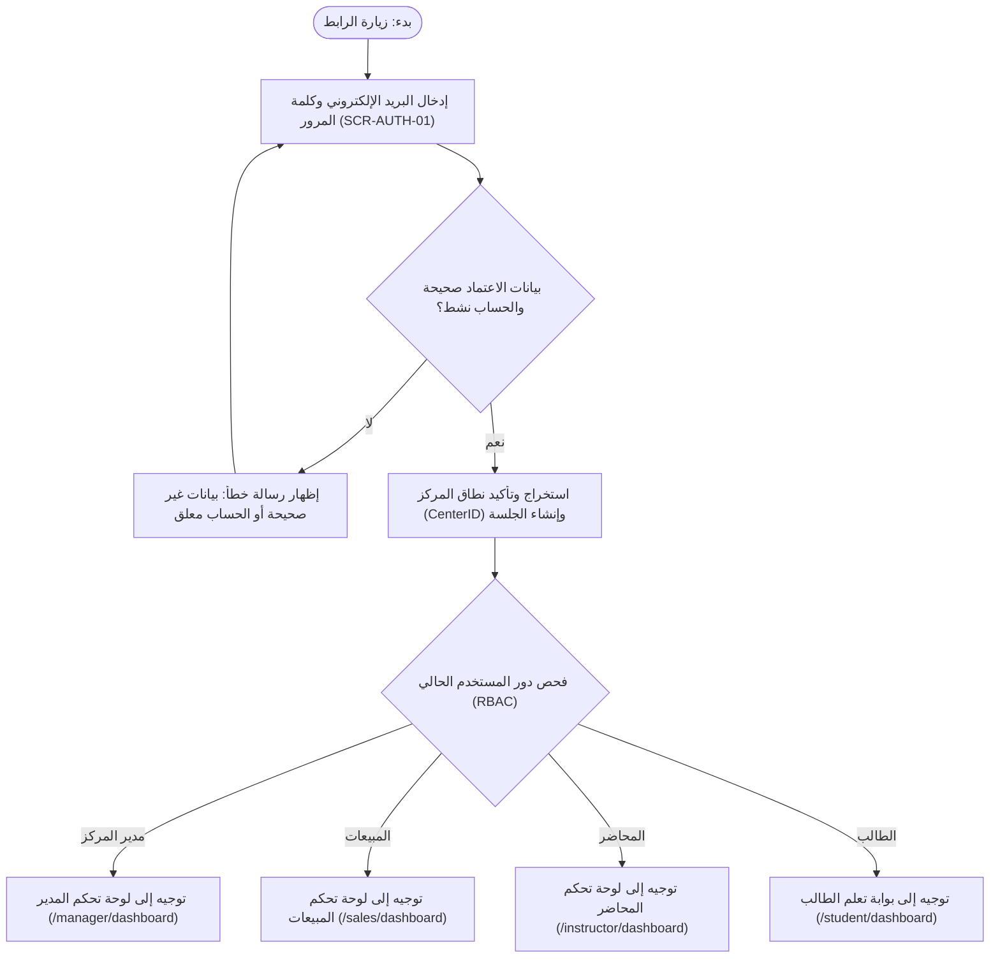
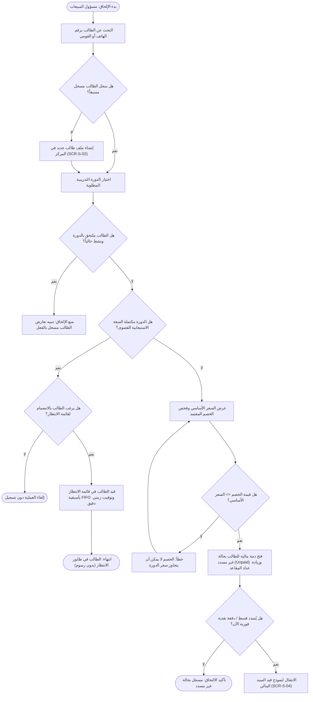
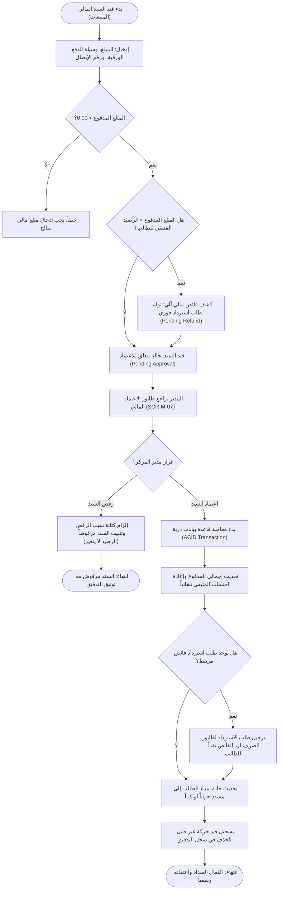
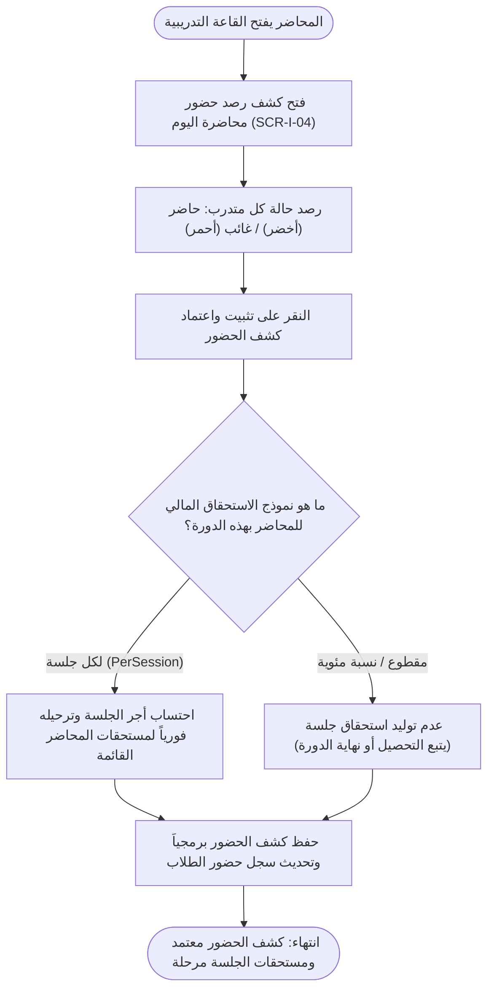
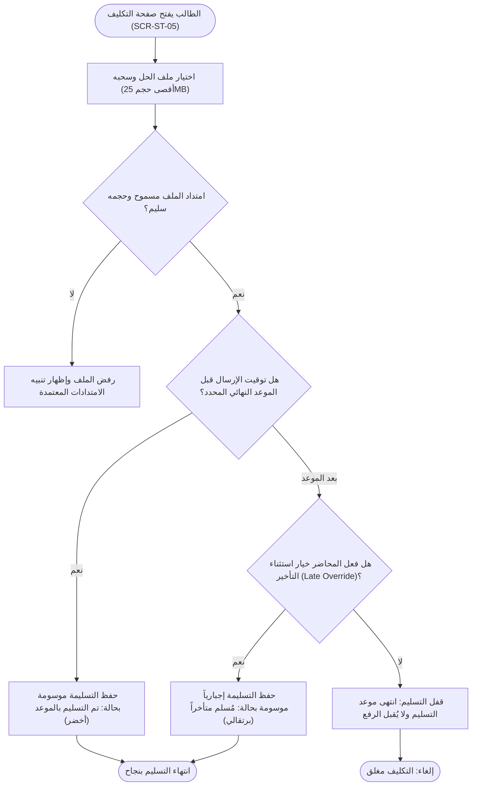

# UX Blueprint — VELORA (فيلورا)
## Comprehensive User Experience Architecture Specification

**وثيقة المخطط الهيكلي لتجربة المستخدم — منصة فيلورا (VELORA)**  
**إصدار الوثيقة:** 2.0.0 (Master UX Blueprint)  
**الحالة:** معتمدة للتنفيذ (Approved for MVP Implementation)  
**تاريخ التحديث:** نوفمبر 2026  
**اللغة والاتجاه:** العربية (Arabic — RTL) مع توثيق تقني ثنائي اللغة  
**النطاق التشغيلي:** نطاق الـ MVP المعتمد حصراً (MVP Scope Only — No Future Features)  
**المرجعيات الملزمة:** [PRD.md](PRD.md) | [UI_UX_REQUIREMENTS.md](UI_UX_REQUIREMENTS.md) | [user-flow.md](user-flow.md) | [SCREEN_INVENTORY.md](SCREEN_INVENTORY.md)

---

## الفهرس العام (Table of Contents)
1. [الرؤية والركائز المعمارية للتجربة (UX Architectural Pillars)](#1-الرؤية-والركائز-المعمارية-للتجربة)
2. [الأدوار والنماذج الذهنية للمستخدمين (User Roles & Mental Models)](#2-الأدوار-والنماذج-الذهنية-للمستخدمين)
3. [رحلات المستخدم التشغيلية الكاملة (Complete MVP User Journeys)](#3-رحلات-المستخدم-التشغيلية-الكاملة)
4. [مخططات سير العمليات البرمجية (Core Mermaid Process Flows)](#4-مخططات-سير-العمليات-البرمجية)
5. [شجرة الموقع وهندسة المسارات (Master Sitemap & Route Hierarchy)](#5-شجرة-الموقع-وهندسة-المسارات)
6. [قواعد التنقل والتحكم بالوصول (Navigation Rules & RBAC Matrix)](#6-قواعد-التنقل-والتحكم-بالوصول)
7. [مصفوفة أولويات النطاق (Scope Prioritization Matrix)](#7-مصفوفة-أولويات-النطاق)

---

## 1. الرؤية والركائز المعمارية للتجربة (UX Architectural Pillars)

تمت هندسة تجربة المستخدم لمنصة **VELORA (فيلورا)** لتكون نظام التشغيل الإداري والمالي والأكاديمي الأكثر كفاءة واستقراراً لمراكز التدريب المهني في منطقة الشرق الأوسط وشمال أفريقيا، مرتكزة على خمسة أسس تصميمية غير قابلة للتفاوض:

1. **الواجهة الموجهة بالإجراءات الفورية (Action-Driven Hierarchy):**
   لوحات التحكم لا تقتصر على عرض رسوم بيانية خاملة، بل تعمل كمراكز عمليات حية تضع المهام الحرجة (اعتماد سندات القبض، متابعة متأخرات الأقساط، رصد حضور القاعة اللحظي، تسليم التكليفات) في بؤرة تركيز المستخدم عند تسجيل الدخول.
2. **العزل التام والتركيز الأكاديمي (Course-Centric Workspace Isolation):**
   تجميع كافة الوظائف الأكاديمية (الحضور، المواد، التكليفات، التغذية الراجعة) داخل مساحة عمل تبويبية مدمجة لكل دورة تدريبية (`Course Workspace`) مع مسارات فرعية قابلة للمشاركة والحفظ، مما يقضي تماماً على خطر خلط البيانات بين الدورات المتزامنة.
3. **الدقة المالية والرقابة في المنبع (Financial Integrity & Strict Dual-Control):**
   تجريد موظفي المبيعات من صلاحية ترحيل السندات المالية مباشرة، وإلزام النظام بتحويل كافة سندات القبض الورقية لحالة "معلق للاعتماد" (`Pending Approval`)، مع كشف آلي وفوري لأي فائض مالي (`Overpayment`) وتوليد طلب استرداد إلزامي (`Refund Request`) دون تحويله لرصيد دائن.
4. **التصميم العربي الأصيل المتجاوب (Native RTL Arabic-First Experience):**
   بناء هيكل الواجهة من اليمين إلى اليسار استناداً إلى الخصائص المنطقية (CSS Logical Properties)، وبخط طباعي متوازن وكثيف للمعلومات (`IBM Plex Sans Arabic`) وأرقام قياسية موحدة (`1, 2, 3...`) لدقة الجداول المحاسبية وأرقام الهواتف.
5. **الامتثال التشغيلي للأجهزة المحمولة من 360px:**
   تمكين المحاضر من رصد الحضور داخل القاعة بلمسة واحدة، والطالب من رفع الواجبات وتنزيل المحاضرات عبر هاتفه الذكي بسلاسة تامة مع أهداف لمس لا تقل عن 44×44px وشريط إجراءات سفلي مثبت للإبهام.

---

## 2. الأدوار والنماذج الذهنية للمستخدمين (User Roles & Mental Models)

```
+--------------------------------------------------------------------------------------------------+
| مصفوفة الأدوار والنماذج الذهنية لمنصة VELORA                                                     |
+-------------------+---------+-----------------------------------------+--------------------------+
| الدور             | الكود   | السياق والنموذج الذهني للمستخدم          | القيمة والهدف الأساسي    |
+-------------------+---------+-----------------------------------------+--------------------------+
| مدير المركز       | MANAGER | إدارة عليا، رقابة مالية، وتدقيق العمليات| اتخاذ قرارات الاعتماد،   |
| (Center Manager)  |         | يجلس أمام شاشة ديسكتوب واسعة، ويحتاج    | ضبط العقود، وتفادي العجز |
|                   |         | نظرة بانورامية وسرعة اعتماد السندات     | المالي بين الإيراد والدين|
+-------------------+---------+-----------------------------------------+--------------------------+
| مسؤول المبيعات    | SALES   | سرعة تسجيل الطلاب وتحصيل الرسوم نقداً   | إتمام تسجيل الطلاب الجدد،|
| (Sales Specialist)|         | يعمل في الاستقبال، يتواصل بالهاتف،      | قفل الأقساط، وتفادي      |
|                   |         | ويحتاج نماذج سريعة تمنع فقدان البيانات  | تسجيل دورات مكتملة العدد |
+-------------------+---------+-----------------------------------------+--------------------------+
| المحاضر           | INSTRUCT| تشغيل ميداني داخل القاعة التدريبية       | رصد حضور سريع، رفع مواد، |
| (Instructor)      | OR      | يستخدم هاتفاً ذكياً أو تابلت أثناء الشرح| استلام الواجبات، ومتابعة |
|                   |         | يريد تسجيل الحضور بلمسة واحدة دون تعقيد | مستحقاته المالية الشخصية |
+-------------------+---------+-----------------------------------------+--------------------------+
| المتدرب / الطالب  | STUDENT | متعلم مستفيد يبحث عن المعرفة وسداد التزامه| الوصول الفوري لملف اليوم،|
| (Enrolled Student)|         | يتصفح المنصة من الموبايل مساءً، يهمه     | رفع الواجب قبل الموعد،   |
|                   |         | تسليم الواجب ومعرفة المتبقي عليه مالياً | ومعرفة إيصالات سداده     |
+-------------------+---------+-----------------------------------------+--------------------------+
```

---

## 3. رحلات المستخدم التشغيلية الكاملة (Complete MVP User Journeys)

### الرحلة 1: تسجيل الدخول والتوجيه الذكي حسب الدور (Authentication & Smart Landing)
- **المستخدم المستهدف:** جميع الأدوار (`All Roles`).
- **الهدف:** التحقق الآمن من الهوية، وتحديد نطاق المركز النشط (`CenterID`)، والتوجيه التلقائي للوحة التحكم المخصصة.
- **الخطوات:**
  1. يدخل المستخدم إلى صفحة الدخول `/login`.
  2. يُدخل البريد الإلكتروني وكلمة المرور.
  3. يتحقق النظام برمجياً من صحة البيانات، وحالة تفعيل الحساب، ونطاق المركز التابع له.
  4. عند النجاح، يتم إنشاء جلسة عمل مشفرة مع وسم الدور والصلاحيات.
  5. يُوجه المستخدم فوراً إلى لوحة التحكم الخاصة به:
     - المدير: `/manager/dashboard`
     - المبيعات: `/sales/dashboard`
     - المحاضر: `/instructor/dashboard`
     - الطالب: `/student/dashboard`
- **معيار النجاح:** لا يرى المستخدم أي واجهة تخص دوراً آخر، مع ظهور اسم المركز وشعار فيلورا في الترويسة العلوية فوراً.

---

### الرحلة 2: إعداد الكادر وتعيين المحاضر بعقود الاستحقاق (Staff Onboarding & Compensation Setup)
- **المستخدم المستهدف:** مدير المركز (`Center Manager`).
- **الهدف:** إضافة موظف أو محاضر وضبط نموذج استحقاقه المالي المعتمد لضمان دقة الحسابات التلقائية.
- **الخطوات:**
  1. ينتقل المدير إلى سجل المحاضرين `/manager/instructors`.
  2. ينقر زر "إضافة محاضر جديد" ليفتح اللوح المنزلق.
  3. يدخل البيانات الأساسية (الاسم، الهاتف، البريد، التخصص).
  4. يحدد نموذج الاستحقاق المالي التعاقدي للمحاضر:
     - **مبلغ مقطوع (Fixed Amount):** قيمة ثابتة للدورة بالكامل تُستحق بنسب التحصيل أو اكتمال الدورة.
     - **نسبة مئوية (Percentage):** نسبة محددة (مثل 20%) تُحسب آلياً من صافي الإيراد المحصل بعد الخصم.
     - **لكل جلسة تدريبية (PerSession):** أجر محدد للجلسة الواحدة لا يُرحل للمستحقات إلا فور رصد الحضور الفعلي للجلسة.
  5. يحفظ السجل؛ يولد النظام حساباً للمحاضر ويُرسل بيانات اعتماده.
- **معيار النجاح:** ظهور المحاضر في السجل مع عقده المالي المعتمد، وجاهزيته للإسناد في الدورات التدريبية.

---

### الرحلة 3: إنشاء الدورة التدريبية، الجدولة، والإطلاق (Course Setup, Scheduling & Activation)
- **المستخدم المستهدف:** مدير المركز (`Center Manager`).
- **الهدف:** بناء دورة تدريبية جديدة، إسناد محاضر رئيسي، جدولة الجلسات، وتفعيل الدورة لفتح باب التسجيل.
- **الخطوات:**
  1. ينتقل إلى قائمة الدورات `/manager/courses` ويختار "إنشاء دورة تدريبية".
  2. يُدخل تفاصيل الدورة: الاسم، الرمز الكودي، السعر الأساسي، السعة الاستيعابية القصوى، وتواريخ البداية والنهاية (تُنشأ بحالة `Draft`).
  3. يفتح مساحة عمل الدورة `/manager/courses/[id]`.
  4. في تبويب "المحاضرون": يُسند المحاضر المعتمد ويحدد علامة المحاضر الرئيسي (`Lead Instructor`).
  5. في تبويب "الجلسات": ينشئ جدول المحاضرات (تاريخ، وقت، قاعة، موضوع الجلسة).
  6. ينقر زر "تفعيل الدورة (Activate)": يفحص النظام وجود محاضر واحد على الأقل وجلسة واحدة مجدولة.
  7. تتحول حالة الدورة إلى "نشطة (Active)" وتصبح جاهزة لاستقبال الطلاب عبر المبيعات.
- **معيار النجاح:** تفعيل الدورة وظهورها في دليل المبيعات المتاح للتسجيل.

---

### الرحلة 4: استكشاف الطالب، فحص السعة، وقوائم الانتظار (Student Intake, Capacity & Waitlist FIFO)
- **المستخدم المستهدف:** مسؤول المبيعات (`Sales Specialist`) / مدير المركز.
- **الهدف:** البحث عن المتدرب أو تسجيله، وفحص السعة الاستيعابية إلكترونياً، والتعامل مع حالات الامتلاء بقائمة الانتظار، وتطبيق الخصومات النظامية.
- **الخطوات:**
  1. يفتح المبيعات دليل الطلاب `/sales/students` ويبحث بالاسم أو رقم الهاتف أو الرقم القومي.
  2. في حال عدم وجوده: ينقر "تسجيل طالب جديد" لفتح معالج الإلحاق المنزلق (`SCR-S-03`).
  3. يختار الدورة التدريبية المطلوبة من قائمة الدورات النشطة:
     - **إذا كانت السعة شاغرة:** يتيح النظام المتابعة المباشرة، مع تحديث فوري لعداد المقاعد.
     - **إذا كانت السعة مكتملة تماماً (`EnrolledCount >= Capacity`):** يقفل النظام مسار التسجيل المباشر (`Hard Lock`) ويعرض خيارين: إما الإلغاء أو "إضافة الطالب إلى قائمة الانتظار (FIFO Waitlist)".
     - عند اختيار قائمة الانتظار: يُسجل الطالب برقم أسبقية زمني، دون فرض أي رسوم مالية، وتنتهي المعاملة.
  4. في حال التوفر: يُدخل الخصم المعتمد (قيمة ثابتة أو نسبة)؛ يفحص النظام فورياً أن `الخصم <= السعر الأساسي`.
  5. يحسب النظام صافي المبلغ المستحق (`FinalPayable = BasePrice - Discount`).
  6. يؤكد التسجيل؛ تُفتح ذمة مالية للطالب بحالة `Unpaid` ويرتفع عداد المسجلين بالدورة.
- **معيار النجاح:** إلحاق الطالب بالدورة بدقة وتحديث السعة، أو تثبيته في طابور الانتظار بنظام الأسبقية دون أخطاء.

---

### الرحلة 5: قيد سند القبض الورقي واكتشاف الفائض المالي (Offline Payment Entry & Excess Overpayment Detection)
- **المستخدم المستهدف:** مسؤول المبيعات (`Sales Specialist`).
- **الهدف:** تسجيل إيصال دفع أوفلاين (كاش، شبكة، تحويل بنكي، شيك) مع التدقيق البرمجي لمنع تجاوز الرصيد المتبقي.
- **الخطوات:**
  1. يفتح مسؤول المبيعات ملف الطالب أو شاشة تسجيل السند `/sales/payments/new`.
  2. يدخل بيانات السند: المبلغ المدفوع، وسيلة الدفع الورقية، رقم الإيصال الدفتري المرجعي، وتاريخ السداد.
  3. يقوم النظام بفحص المبلغ مقارنة بالرصيد المتبقي على الطالب (`RemainingBalance`):
     - **حالة الدفع الطبيعي أو الجزئي (`Amount <= RemainingBalance`):** يُنشأ السند بحالة "معلق للاعتماد (`Pending Approval`)".
     - **حالة الفائض المالي (`Amount > RemainingBalance`):**
       - يكتشف النظام فورياً زيادة المبلغ المدفوع عن مديونية الطالب.
       - يحسب قيمة الفائض: `ExcessAmount = Amount - RemainingBalance`.
       - يطلق تحذيراً بصرياً برتقالياً بارزاً في واجهة السند ينبه الموظف بوجود فائض.
       - يقوم النظام آلياً بإنشاء سجل "طلب استرداد مرتبط (`Linked Refund Request`)" بالمبلغ الزائد بحالة `Pending Refund`.
  4. يرسل الموظف السند؛ يظهر السند في قائمة الانتظار للمدير ولا يتم ترحيله للحسابات بعد.
- **معيار النجاح:** تسجيل السند وربطه بطلب استرداد آلي للفائض المالي دون ضياع مليم واحد.

---

### الرحلة 6: التدقيق المحاسبي واعتماد السندات والترحيل الذري (Admin Approval & ACID Ledger Update)
- **المستخدم المستهدف:** مدير المركز (`Center Manager`).
- **الهدف:** مراجعة سندات القبض المدخلة من المبيعات واعتمادها أو رفضها مع تحديث الأرصدة ذرياً.
- **الخطوات:**
  1. يفتح المدير طابور الاعتماد المالي `/manager/payments/approvals`.
  2. يراجع السندات المعلقة: يطابق المبلغ، واسم الطالب، والدورة، وصورة الإيصال المرجعي، وشارة تنبيه الفائض المالي إن وجدت.
  3. يتخذ المدير أحد القرارين:
     - **القرار (أ) — الرفض (Reject):** ينقر زر الرفض؛ يُلزم النظام المدير بكتابة سبب الرفض الإداري، وتتحول حالة السند إلى `Rejected`، وتظل مديونية الطالب دون أي تغيير مع تسجيل حركة تدقيق في `Audit Log`.
     - **القرار (ب) — الاعتماد (Approve):** ينقر زر الاعتماد؛ يفتح النظام معاملة قاعدة بيانات ذرية (`ACID Transaction`):
       1. تحديث إجمالي المدفوع للطالب: `TotalPaid += NetApplicableAmount`.
       2. إعادة حساب الرصيد المتبقي: `RemainingBalance = FinalPayable - TotalPaid`.
       3. تحديث حالة سداد الطالب تلقائياً إلى (`PartiallyPaid` أو `FullyPaid`).
       4. تحويل حالة السند إلى `Approved`.
       5. إذا تضمن السند طلباً مرتبطاً لاسترداد فائض: يُحول طلب الاسترداد إلى طابور صرف الاسترداد ليرد نقداً للطالب.
       6. توثيق المعاملة الزمنية غير القابلة للتعديل في سجل التدقيق الرقابي (`Audit Trail`).
- **معيار النجاح:** ترحيل السند المالي بنجاح تام، وتصفير أو تخفيض مديونية الطالب، وانعكاس الأثر فوراً في لوحة تحكم الطالب وإيرادات المركز.

---

### الرحلة 7: إدارة القاعة ورصد الحضور اللحظي وتوليد المستحقات (Classroom Attendance & Session Accruals)
- **المستخدم المستهدف:** المحاضر (`Course Instructor`).
- **الهدف:** رصد حضور الطلاب في القاعة بلمسة واحدة من الموبايل وتفعيل استحقاق أجر الجلسة للمحاضر.
- **الخطوات:**
  1. يفتح المحاضر هاتفه ويدخل للوحة تحكمه `/instructor/dashboard`.
  2. في بطاقة "محاضرة اليوم": ينقر الزر المباشر "رصد الحضور الآن" ليفتح `/instructor/courses/[id]/attendance`.
  3. يظهر كشف بأسماء المتدربين المسجلين مصحوباً بمفاتيح تبديل تفاعلية واضحة:
     - الوضع الافتراضي: لم يُرصد بعد، أو استخدام زر "تحديد الكل كحاضرين" لتسريع الرصد.
     - النقر على زر كل طالب يحوله فوراً إلى "حاضر (أخضر)" أو "غائب (أحمر)".
  4. ينقر المحاضر زر "تثبيت واعتماد كشف الحضور".
  5. يقوم النظام بالتحقق: إذا كان عقد المحاضر يعتمد نظام الجلسات (`PerSession`)، يقوم النظام فورياً باحتساب أجر الجلسة التعاقدي وترحيله إلى ذمة مستحقات المحاضر غير المسواة (`Accrued Dues`).
  6. تظهر جلسة اليوم في لوحة الطالب كمحاضرة "حاضر" أو "غائب".
- **معيار النجاح:** رصد حضور القاعة في أقل من 30 ثانية وتوليد الاستحقاق المالي للمحاضر تلقائياً وبأمان تام.

---

### الرحلة 8: نشر المواد العلمية والتحميل المحمي (Course Materials Publishing & Gated Downloads)
- **المستخدم المستهدف:** المحاضر (`Instructor`) والطالب (`Student`).
- **الهدف:** رفع ملفات الدروس والشروحات وتمكين الطلاب المقيدين فقط من تنزيلها عبر بوابات تدقيق آمنة.
- **الخطوات:**
  1. يفتح المحاضر تبويب المواد في مساحة عمل الدورة `/instructor/courses/[id]/materials`.
  2. ينقر "رفع ملف جديد"؛ يسحب الملف (PDF, ZIP, DOCX, حتى 50MB)، ويكتب عنواناً وتفاصيل.
  3. يُخزن الملف في مسار تخزين سحابي معزول وغير عام (`Outside Public Web Root`).
  4. يفتح الطالب مساحة عمل الدورة لديه `/student/courses/[id]/materials`.
  5. يرى قائمة المواد المحدثة وينقر على "تحميل الملف".
  6. يمر طلب التنزيل عبر بوابة فحص أمني (`Authorization Gate`) تفحص: هل الطالب مسجل ونشط بالدورة؟ وهل الجلسة الحالية صالحة؟
  7. يتم دفق الملف مع ترويسات الحماية (`X-Content-Type-Options: nosniff`) ويسجل عداد تنزيل الملف تحديثاً جديداً.
- **معيار النجاح:** حماية حقوق المركز ومواده التدريبية من الوصول الخارجي غير المصرح به.

---

### الرحلة 9: إسناد التكليفات وتسليم الطلاب واستثناء التأخير (Task Assignment, Submissions & Late Policy)
- **المستخدم المستهدف:** المحاضر (`Instructor`) والطالب (`Student`).
- **الهدف:** تكليف الطلاب بواجبات عملية، استلام الملفات قبل الموعد، وتطبيق سياسة انتهاء الموعد واستثناء التأخير بدقة.
- **الخطوات:**
  1. ينشئ المحاضر تكليفاً في `/instructor/courses/[id]/tasks`: عنوان التكليف، الشرح، الموعد النهائي الدقيق باليوم والساعة، والسماح بتجاوز الموعد (`Allow Late Submissions: True/False`).
  2. يظهر التكليف في لوحة الطالب مع مؤشر عد تنازلي حي (`SCR-ST-05`).
  3. يقوم الطالب بسحب ملف الحل الخاص به (حتى 25MB) والنقر على "تسليم الحل":
     - **إذا كان التسليم قبل الموعد:** تُقبل العملية وتوسم بشارة خضراء `تم التسليم بالموعد` مع إمكانية استبدال الملف طالما الموعد لم ينتهِ بعد.
     - **إذا انتهى الموعد النهائي:**
       - إذا كان خيار السماح بالتأخير معطلاً: يقفل حقل الرفع فورياً وتظهر لافتة `انتهى موعد التسليم ولا يُقبل الرفع`.
       - إذا فعل المحاضر استثناء التأخير (`Late Override`): يُتاح للطالب رفع الملف، وتوسم تسليمته إجبارياً بشارة برتقالية داكنة `مسلم متأخراً (Submitted Late)`.
  4. يستعرض المحاضر جدول التسليمات، وينزل ملفات الحل لتقييمها.
- **معيار النجاح:** فرض الانضباط الأكاديمي آلياً وتوثيق توقيت التسليم الفعلي بدون مجال للتلاعب.

---

### الرحلة 10: حلقة التغذية الراجعة الفردية السرية (Private 1:1 Evaluation Loop)
- **المستخدم المستهدف:** المحاضر (`Instructor`) والطالب (`Student`).
- **الهدف:** تقديم توجيه أكاديمي نوعي خاص ومباشر بين المحاضر والطالب دون اطلاع المبيعات أو الزملاء.
- **الخطوات:**
  1. يفتح المحاضر تبويب الملاحظات `/instructor/courses/[id]/feedback` أو يضغط أيقونة التقييم بجوار تسليمة الطالب.
  2. يكتب ملاحظة توجيهية نقدية للطالب (نقاط القوة، جوانب التحسين في الواجب العملي).
  3. يرسل الملاحظة؛ تُحفظ في قاعدة البيانات مشفرة وتُعزل صلاحيات الاطلاع عليها برمجياً (محظورة تماماً على موظفي المبيعات والطلاب الآخرين).
  4. يستلم الطالب إشعاراً في لوحته وينتقل إلى تبويب التقييم `/student/courses/[id]/feedback` لقراءة توجيه أستاذه.
- **معيار النجاح:** دعم المسار التعليمي للمتدرب بخصوصية أكاديمية واحترافية كاملة.

---

### الرحلة 11: تسوية مستحقات المحاضر وصرف الأتعاب (Instructor Dues Settlement & Payout Logging)
- **المستخدم المستهدف:** مدير المركز (`Center Manager`) والمحاضر.
- **الهدف:** حساب مستحقات المحاضر التعاقدية بدقة وقيد سندات الصرف والتسوية وتحديث ذمته المالية.
- **الخطوات:**
  1. يفتح المدير سجل مستحقات المحاضرين `/manager/instructor-dues`.
  2. يستعرض المدير كشف الاستحقاقات التراكمي لكل دورة: إجمالي المبالغ المستحقة، والمسدد منها سابقاً، والصافي القائم.
  3. ينقر "تسجيل دفعة صرف أتعاب (Record Payout)": يحدد المبلغ المسدد نقداً أو بالتحويل، ورقم قيد الصرف، وملاحظات التسوية.
  4. يخصم النظام قيمة السند من رصيد المحاضر المستحق، وتتحول حالة الاستحقاق إلى (`Partially Paid` أو `Settled/Paid`).
  5. يدخل المحاضر إلى شاشته المالية الشخصية `/instructor/earnings` ليرى تاريخ تسويات أتعابه والمبالغ المسددة والمتبقية بشفافية تامة.
- **معيار النجاح:** القضاء على النزاعات المالية بين المركز والمدربين، وتوثيق كافة المسحوبات بمستندات رسمية.

---

### الرحلة 12: التدقيق الرقابي الشامل والتحقيق في العمليات (Audit Trail Inspection & Operational Verification)
- **المستخدم المستهدف:** مدير المركز (`Center Manager`).
- **الهدف:** تتبع ومراجعة كافة الأنشطة الإدارية والمالية والأكاديمية في سجل مركزي غير قابل للحذف أو التعديل.
- **الخطوات:**
  1. يفتح المدير سجل التدقيق `/manager/audit`.
  2. يطبق الفلاتر المتاحة: بنطاق التاريخ، أو بنوع الكيان (دورة، طالب، سند مالي، استرداد فائض)، أو بالموظف القائم بالعملية.
  3. يستعرض السجل: يوضح كل سطر: الطابع الزمني، اسم المستخدم وعنوان بروتوكول الإنترنت، ونوع الإجراء (إنشاء، اعتماد، تعديل، رفض)، مع مقارنة القيم قبل وبعد الإجراء.
- **معيار النجاح:** شفافية رقابية مطلقة تحمي أموال وبيانات المركز من التلاعب الداخلي.

---

## 4. مخططات سير العمليات البرمجية (Core Mermaid Process Flows)

### 4.1 مخطط المصادقة وتحديد النطاق (Auth & Role-Based Smart Routing)


---

### 4.2 مخطط إلحاق الطلاب، فحص السعة، وقائمة الانتظار (Intake, Capacity & Waitlist FIFO)


---

### 4.3 مخطط قيد سند القبض، كشف الفائض، والاعتماد الإداري (Payment Entry, Overpayment & Admin Approval)


---

### 4.4 مخطط رصد الحضور وتفعيل الاستحقاق المالي التلقائي (Attendance & Session Accruals)


---

### 4.5 مخطط تسليم التكليفات وسياسة انتهاء الموعد واستثناء التأخير (Task Submission & Late Policy)


---

## 5. شجرة الموقع وهندسة المسارات (Master Sitemap & Route Hierarchy)

تم تنظيم المسارات البرمجية في مجموعات منطقية تعزل صلاحيات الأدوار وتحافظ على روابط عميقة مستقرة (`Deep-linkable URLs`) لمساحات العمل:

```
VELORA Routing Architecture (35 MVP Screens)
│
├── /login ─── [SCR-AUTH-01: تسجيل الدخول ومصادقة الجلسة]
├── /profile ─── [SCR-SHARED-02: إدارة الملف الشخصي والحساب]
├── /notifications ─── [SCR-SHARED-01: مركز الإشعارات والتنبيهات]
├── /settings ─── [SCR-SHARED-03: إعدادات العرض وتفضيلات الحساب]
│
├── /manager (بوابة مدير المركز)
│   ├── /dashboard ─── [SCR-M-01: لوحة التحكم التنفيذية والمهام المعلقة]
│   ├── /courses ─── [SCR-M-02: دليل الدورات التدريبية والإنشاء]
│   ├── /courses/[id] ─── [SCR-M-03: مساحة عمل الدورة المدمجة بالتبويبات]
│   ├── /instructors ─── [SCR-M-04: سجل المحاضرين ونماذج الاستحقاق]
│   ├── /students ─── [SCR-M-05: سجل طلاب المركز الشامل والملف المالي]
│   ├── /enrollments ─── [SCR-M-06: إدارة تسجيلات الدورات وقوائم الانتظار]
│   ├── /payments/approvals ─── [SCR-M-07: طابور اعتماد سندات القبض ورد الفائض]
│   ├── /instructor-dues ─── [SCR-M-08: سجل مستحقات المحاضرين وجدولة الصرف]
│   ├── /reports ─── [SCR-M-09: التقارير الإجمالية للتحصيل والمديونيات]
│   ├── /staff ─── [SCR-M-10: إدارة موظفي المركز وتعيين الصلاحيات]
│   └── /audit ─── [SCR-M-11: سجل التدقيق الرقابي غير القابل للحذف]
│
├── /sales (بوابة مسؤول المبيعات والمتابعة)
│   ├── /dashboard ─── [SCR-S-01: لوحة عمليات التحصيل والأقساط المتأخرة]
│   ├── /students ─── [SCR-S-02: دليل استكشاف الطلاب وتسجيل الجدد]
│   ├── /enrollments/new ─── [SCR-S-03: معالج إلحاق الطلاب بالدورات والانتظار]
│   └── /payments/new ─── [SCR-S-04: قيد سندات القبض الأوفلاين وفحص الفائض]
│
├── /instructor (بوابة المحاضر ومساحة الأداء)
│   ├── /dashboard ─── [SCR-I-01: لوحة المحاضر والمحاضرة الحالية]
│   ├── /courses ─── [SCR-I-02: قائمة الدورات المسندة للمحاضر]
│   ├── /courses/[id] ─── [SCR-I-03: مساحة عمل الدورة الأكاديمية]
│   │   ├── /attendance ─── [SCR-I-04: كشف رصد حضور الجلسة وتوليد الاستحقاق]
│   │   ├── /materials ─── [SCR-I-05: مكتبة رفع وإدارة المواد العلمية]
│   │   ├── /tasks ─── [SCR-I-06: إدارة الواجبات وفحص التسليمات والتأخير]
│   │   └── /feedback ─── [SCR-I-07: التغذية الراجعة الفردية السرية للطلاب]
│   └── /earnings ─── [SCR-I-08: كشف الأتعاب الشخصية وتاريخ التسويات]
│
└── /student (بوابة المتدرب ومساحة التعلم)
    ├── /dashboard ─── [SCR-ST-01: لوحة التعلم والعد التنازلي للواجبات]
    ├── /courses ─── [SCR-ST-02: قائمة الدورات الملتحق بها الطالب]
    ├── /courses/[id] ─── [SCR-ST-03: مساحة عمل الدورة التعليمية للطالب]
    │   ├── /materials ─── [SCR-ST-04: استعراض وتنزيل المواد والمحاضرات]
    │   ├── /tasks ─── [SCR-ST-05: استعراض التكليفات ورفع الحل والعد التنازلي]
    │   ├── /attendance ─── [SCR-ST-06: سجل الحضور والغياب الشخصي بالدورة]
    │   └── /feedback ─── [SCR-ST-07: صندوق توجيهات وتقييمات أستاذ الدورة]
    └── /payments ─── [SCR-ST-08: سجل الفواتير والأقساط وإيصالات السداد]
```

---

## 6. قواعد التنقل والتحكم بالوصول (Navigation Rules & RBAC Matrix)

```
+-----------------------------------------------------------------------------------------------+
| مصفوفة الصلاحيات الصارمة في القوائم والمسارات (Role-Based Access Control)                       |
+--------------------------+---------------+---------------+---------------+--------------------+
| المسار / الشاشة          | المدير        | المبيعات      | المحاضر       | الطالب             |
| (Route / Feature)        | (MANAGER)     | (SALES)       | (INSTRUCTOR)  | (STUDENT)          |
+--------------------------+---------------+---------------+---------------+--------------------+
| لوحة المدير والأمور      | مسموح بالكامل | محظور تماماً  | محظور تماماً  | محظور تماماً       |
| الإدارية (/manager/*)    | (Full Access) | (HTTP 403)    | (HTTP 403)    | (HTTP 403)         |
+--------------------------+---------------+---------------+---------------+--------------------+
| عمليات المبيعات والتسجيل | مسموح للإشراف | مسموح بالكامل | محظور تماماً  | محظور تماماً       |
| وسندات القبض (/sales/*)  | (Oversight)   | (Full Access) | (HTTP 403)    | (HTTP 403)         |
+--------------------------+---------------+---------------+---------------+--------------------+
| اعتماد سندات القبض ورد   | مسموح حصرياً  | محظور تماماً  | محظور تماماً  | محظور تماماً       |
| الفائض (/payments/approv)| (Exclusive)   | (HTTP 403)    | (HTTP 403)    | (HTTP 403)         |
+--------------------------+---------------+---------------+---------------+--------------------+
| عقود مستحقات المحاضرين   | مسموح بالكامل | محظور تماماً  | محظور تماماً  | محظور تماماً       |
| وتسويات الصرف (/inst-dues| (Full Access) | (Zero Access) | (Zero Access) | (Zero Access)      |
+--------------------------+---------------+---------------+---------------+--------------------+
| رصد حضور القاعة          | مسموح للمطالعة| محظور تماماً  | مسموح لدوراته | محظور رصده         |
| وتوليد استحقاق الجلسة    | (View Roster) | (HTTP 403)    | (Assigned CRS)| (يطلع فقط على سجله)|
+--------------------------+---------------+---------------+---------------+--------------------+
| التغذية الراجعة الفردية  | مسموح للتدقيق | محظور تماماً  | مسموح لطلابه  | مسموح بملاحظاته فقط|
| السرية للطلاب (Feedback) | (Audit Log)   | (Privacy Gate)| (1:1 Author)  | (Personal Only)    |
+--------------------------+---------------+---------------+---------------+--------------------+
| استعراض الأقساط الشخصية  | مسموح بالكامل | مسموح لطلابه  | محظور تماماً  | مسموح بسجلاته فقط  |
| وإيصالات السداد المعتمدة | (All Students)| (Intake Scope)| (No Financial)| (Self Ledger Only) |
+--------------------------+---------------+---------------+---------------+--------------------+
```

### القواعد المعمارية الثابتة لنظام التنقل:
1. **عزل النطاق (Tenant Isolation):** كل طلب يحمل معرف المركز التابع له الحساب؛ يستحيل الوصول لبيانات أي مركز آخر على مستوى الـ API وقاعدة البيانات.
2. **إخفاء الروابط (Strict Concealment):** الروابط غير المصرح بها لا تظهر أبداً معطلة (Disabled) في القائمة الجانبية بل تُحذف من الـ DOM بالكامل.
3. **منع الدخول المباشر (Route Guards):** محاولة كتابة مسار غير مصرح به في المتصفح تؤدي فورياً لإعادة التوجيه إلى لوحة تحكم المستخدم مع إشعار تحذيري.

---

## 7. مصفوفة أولويات النطاق (Scope Prioritization Matrix)

تم فرز وتثبيت وظائف النظام لضمان تركيز فريق الهندسة على نجاح الـ MVP دون أي تسلل للميزات المستقبلية:

### الفئة الأولى: النطاق الجوهري الملزم (P0 — Core MVP Foundation)
- نظام المصادقة وعزل نطاقات المراكز وتحديد الصلاحيات بالأدوار الأربعة.
- لوحات التحكم الأربع الموجهة بالإجراءات والمهام اليومية العاجلة.
- إنشاء وتفعيل الدورات، جدولة الجلسات، وإسناد المحاضرين بنماذج الاستحقاق الثلاثة (مقطوع، نسبة، جلسات).
- دليل الطلاب والبحث الفوري وتدقيق التكرار بالهاتف أو الرقم القومي.
- معالج إلحاق الطلاب وفحص السعة وقوائم الانتظار الأوتوماتيكية (FIFO).
- إدخال سندات القبض الورقية، كشف الفائض المالي الآلي، وطابور الاعتماد الإداري الإلزامي.
- مساحات عمل الدورات التبويبية المدمجة (الحضور، المواد المحمية، الواجبات وتطبيقات التأخير، التقييم السري).
- كشف رصد حضور القاعة بلمسة واحدة وتوليد أجر الجلسات تلقائياً.
- سجل مستحقات المحاضرين وقيد سندات تسوية الأتعاب.
- سجل التدقيق الرقابي غير القابل للتعديل (`Immutable Audit Trail`).

### الفئة الثانية: العناصر المساندة لقابلية الاستخدام (P1 — Supporting Usability)
- مكونات الهياكل العظمية للتحميل (`Skeleton Loaders`) لجميع الجداول والبطاقات.
- مكونات الشاشات الفارغة التوجيهية المصحوبة بأزرار إنشاء مباشرة.
- التكيف الكامل للأجهزة الذكية (360px) عبر تحويل الجداول لبطاقات رأسية مكدسة.
- شريط ملخص الحساب المالي الحي المثبت في ألواح الإدخال الجانبية.
- الإشعارات المنبثقة التفاعلية (Toasts) للأخطاء والتأكيدات اللحظية.

### الفئة الثالثة: الميزات المستقبلية المؤجلة (P2 — Strictly Excluded Future Features)
- **بوابات الدفع الإلكتروني المباشر (Online Gateways):** لا يوجد دفع ببطاقات الائتمان أو Apple Pay أو Stripe في الـ MVP؛ كافة المعاملات أوفلاين.
- **التطبيقات الهاتفية الأصلية (Native Mobile Apps):** لا توجد تطبيقات iOS أو Android مستقلة في الـ MVP؛ المنصة تعمل عبر الويب المتجاوب.
- **المحادثات الفورية والمنتديات (In-App Chat / Community):** التواصل مقصور على التكليفات والتقييم الفردي.
- **إصدار الشهادات الأوتوماتيكية (Automated PDF Certificate Generation).**
- **الذكاء الاصطناعي والتصحيح الآلي (AI Features & Auto-Grading).**
- **الرسائل القصيرة والواتساب التلقائي (SMS / WhatsApp API Automation).**
- **شجرة الحسابات العامة ودفتر الأستاذ المزدوج المحاسبي (General Ledger ERP).**

---
**خلاصة المعمارية:** يُعد هذا المخطط المرجع الإلزامي الذي يوجه بناء وتوثيق جرد كافة الشاشات الـ 35 بالتفصيل الدقيق في وثيقة [SCREEN_INVENTORY.md](SCREEN_INVENTORY.md).


