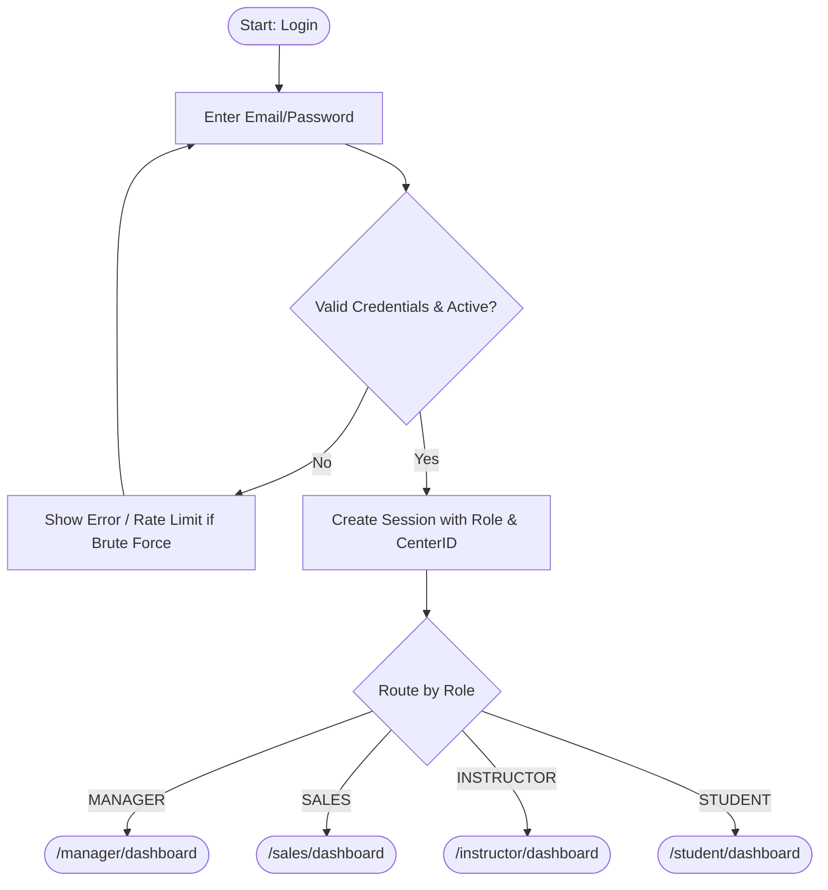
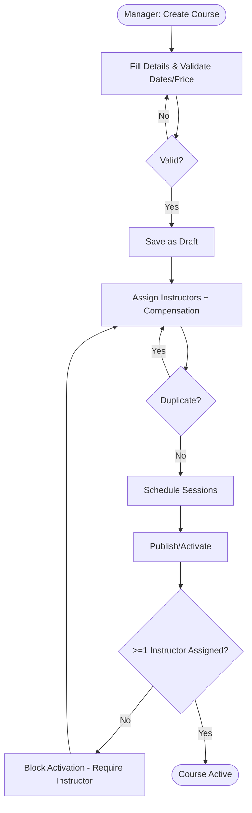
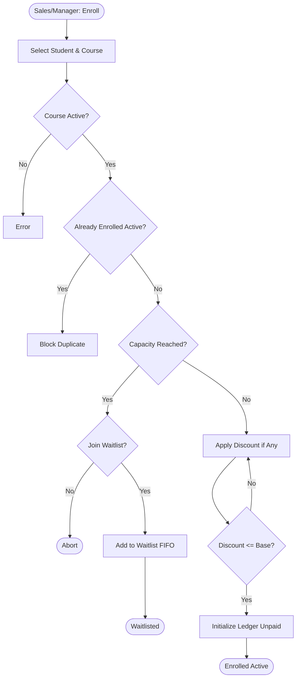
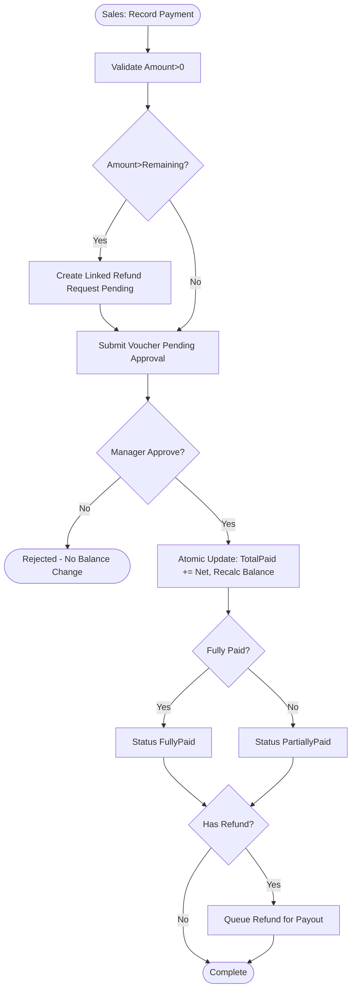
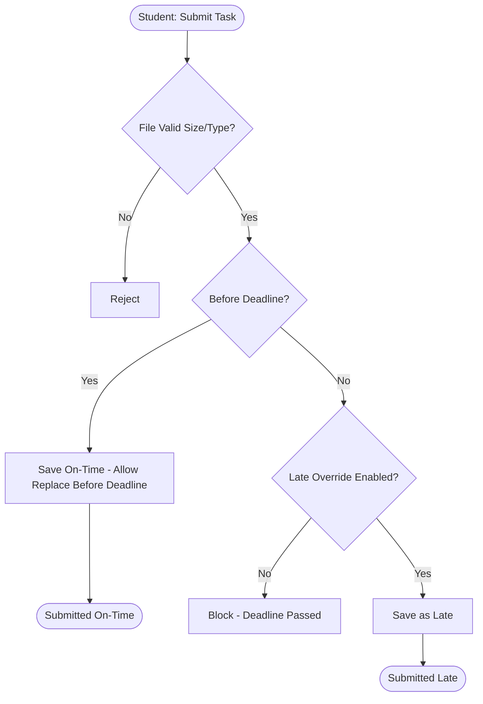
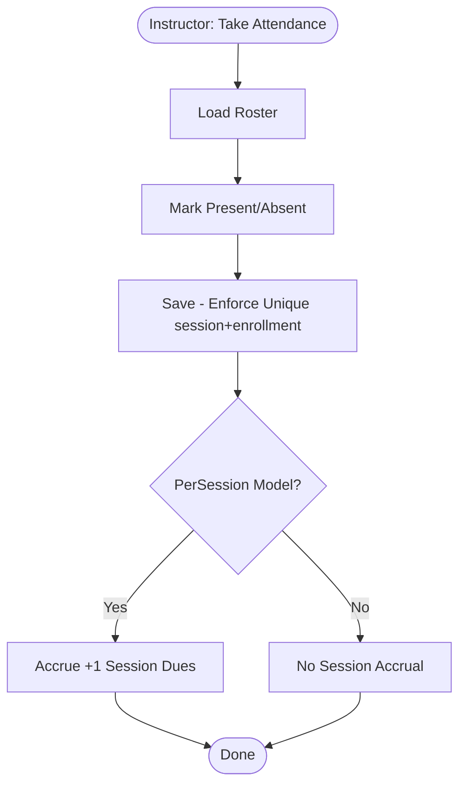

# UX Blueprint - VELORA (فيلورا)

**Document Version:** 1.0.0  
**Status:** Approved for MVP Implementation  
**Date:** October 2026  
**Scope:** MVP Only (No Future Features)  
**References:** [PRD.md](../PRD.md), [UI_UX_REQUIREMENTS.md](UI_UX_REQUIREMENTS.md)

---

## Table of Contents

1. [Overview](#1-overview)
2. [User Roles](#2-user-roles)
3. [MVP User Journeys](#3-mvp-user-journeys)
4. [Core Process Flows (Mermaid)](#4-core-process-flows-mermaid)
5. [Sitemap](#5-sitemap)
6. [Navigation Rules](#6-navigation-rules)
7. [MVP Scope Prioritization](#7-mvp-scope-prioritization)

---

## 1. Overview

This document defines complete MVP user journeys, end-to-end flows, sitemap, and navigation model for VELORA. All flows are derived strictly from the approved PRD and UI/UX requirements. No future/post-MVP features are included.

---

## 2. User Roles

| Role | Code | Description | Primary Goal |
| :--- | :--- | :--- | :--- |
| **Center Manager** | `MANAGER` | Executive/admin with full authority within center scope | Manage courses, staff, finances, and oversight |
| **Sales Specialist** | `SALES` | Front-office for intake and payments | Register students, enroll, collect payments (pending approval) |
| **Course Instructor** | `INSTRUCTOR` | Assigned instructor delivering content | Manage materials, tasks, attendance, feedback, view earnings |
| **Enrolled Student** | `STUDENT` | Active/enrolled trainee | Access materials, submit tasks, view attendance/feedback/balance |

---

## 3. MVP User Journeys

### Journey 1: Authentication & Role-Based Entry (Core)
**Actor:** All users  
**Goal:** Securely login and land on role-specific dashboard

**Steps:**
1. User visits login page
2. Enter email/password
3. System validates credentials, account status, tenant scope
4. On success, create session with role/center
5. Redirect to role dashboard (Manager/Sales/Instructor/Student)

**Success Criteria:** Authenticated user sees only authorized nav items and correct dashboard.

---

### Journey 2: Course Setup & Instructor Assignment (Manager - Core)
**Actor:** Center Manager  
**Goal:** Create course, assign instructors with compensation, schedule sessions, activate course

**Steps:**
1. Go to Courses → Create Course (Draft)
2. Fill course details (name/code, price, dates, capacity)
3. Assign instructors with compensation model (Fixed/Percentage/PerSession) + lead flag
4. Schedule sessions (date/time/topic/instructor)
5. Publish/Activate (requires >=1 instructor)
6. Course becomes Active for enrollment

**Success Criteria:** Course Active with assignments and sessions; enrollments allowed.

---

### Journey 3: Student Intake & Enrollment (Sales/Manager - Core)
**Actor:** Sales Specialist / Center Manager  
**Goal:** Register student, enroll in active course, apply discount if authorized, initialize ledger

**Steps:**
1. Search student or register new profile
2. Select active course
3. Check capacity/duplicates (block if duplicate active enrollment)
4. If full → offer waitlist (FIFO) or abort
5. Apply discount (if <= base price)
6. Confirm enrollment → initialize ledger (Unpaid), increment enrolled count

**Success Criteria:** Enrollment Active with correct balances, or waitlisted if full.

---

### Journey 4: Payment Collection & Approval (Sales/Manager - Core)
**Actor:** Sales Specialist / Center Manager  
**Goal:** Record offline payment, route for approval, update balances, handle overpayment/refund

**Steps:**
1. Sales records payment (amount/method/reference/notes) against enrollment
2. System validates amount>0
3. If amount > remaining → detect excess, create linked refund request (Pending Refund)
4. Voucher enters Pending Approval
5. Manager reviews and approves/rejects (with reason if reject)
6. On approve: atomic update to balances, set status (PartiallyPaid/FullyPaid), log audit
7. If excess exists, route refund to finance for payout tracking

**Success Criteria:** Only approved payments affect balances; all actions audited; excess handled per policy.

---

### Journey 5: Academic Delivery - Materials/Tasks/Attendance/Feedback (Instructor/Student - Core)
**Actor:** Course Instructor / Enrolled Student  
**Goal:** Deliver content, assign/evaluate tasks, track attendance, give private feedback

**Steps (Instructor):**
1. Go to assigned course → Materials: upload (<=25MB, allowed types)
2. Tasks: create with optional deadline/attachment
3. Sessions: open roster, mark Present/Absent (unique per session/enrollment)
4. Submissions: review, provide feedback (private); allow late override if needed
5. Feedback: add private 1:1 feedback to student

**Steps (Student):**
1. View enrolled courses/materials
2. Submit task before deadline (or after override), can replace before deadline
3. View attendance, private feedback, tasks
4. Download materials for enrolled courses only

**Success Criteria:** Access scoped to assigned/enrolled courses; late submissions flagged; feedback private.

---

### Journey 6: Instructor Dues & Settlement (Manager/Instructor - Core)
**Actor:** Center Manager / Course Instructor  
**Goal:** Track accruals by model and settle payouts

**Steps (System/Manager):**
1. Accrue based on model: Fixed (on activation/completion), Percentage of collected verified payments, PerSession (per completed session with attendance)
2. Manager views liabilities, logs settlement payout (amount/date/method/ref/notes)
3. Status updates (Pending/PartiallyPaid/Paid/Adjusted)

**Steps (Instructor):**
1. View My Earnings with breakdown by course, accrued, paid, outstanding

**Success Criteria:** Calculations follow rules; instructors see only own dues.

---

## 4. Core Process Flows (Mermaid)

### Flow 1: Login & Role Routing


### Flow 2: Course Creation → Activation


### Flow 3: Enrollment with Capacity/Waitlist


### Flow 4: Payment Approval & Overpayment


### Flow 5: Task Submission with Deadline/Override


### Flow 6: Attendance & Per-Session Accrual


---

## 5. Sitemap

### Global Structure
```
/
├── /login
├── /logout (action)
└── /(app)
    ├── /manager/*
    ├── /sales/*
    ├── /instructor/*
    └── /student/*
```

### Shared Layout Elements
- **Header (all roles):** Logo → Dashboard (role-based), Notifications, User Menu (Profile, Settings, Logout)
- **Sidebar (shared, filtered):** Role-specific items per UI requirements

### Role-Based Routes (MVP)

#### Manager (`/manager`)
```
/manager/dashboard
/manager/courses
/manager/courses/[id]
/manager/instructors
/manager/students
/manager/enrollments
/manager/payments
/manager/instructor-dues
/manager/reports
/manager/staff
/manager/audit
```

#### Sales (`/sales`)
```
/sales/dashboard
/sales/students
/sales/students/[id]
/sales/enrollments
/sales/payments
```

#### Instructor (`/instructor`)
```
/instructor/dashboard
/instructor/courses
/instructor/courses/[id]
/instructor/attendance
/instructor/materials
/instructor/tasks
/instructor/tasks/[id]/submissions
/instructor/feedback
/instructor/earnings
```

#### Student (`/student`)
```
/student/dashboard
/student/courses
/student/courses/[id]
/student/materials
/student/tasks
/student/tasks/[id]
/student/attendance
/student/feedback
/student/payments
```

#### Shared/User
```
/profile
/settings
/notifications (accessible via header)
```

---

## 6. Navigation Rules

| Rule | Description |
| :--- | :--- |
| **Shared Nav** | Same sidebar structure for all roles; filter by permissions. |
| **Header Always Visible** | Dashboard, Notifications, Profile/Settings/Logout always shown. |
| **Role-Based Dashboard** | Dashboard link routes to role-specific dashboard. |
| **Scope Enforcement** | All routes enforce tenant + role checks server-side; UI hides unauthorized items. |
| **Course Scope** | Instructor/Student only see assigned/enrolled courses. |
| **Financial Scope** | Sales cannot see instructor dues/feedback; Instructors cannot see student financials. |
| **Approval Required** | Sales payment entries create Pending Approval; only Manager can approve. |

---

## 7. MVP Scope Prioritization

| Priority | Category | Items |
| :--- | :--- | :--- |
| **P0 - Core** | Auth/RBAC/Tenant, Dashboards, Courses/Assignments/Sessions, Enrollments, Materials, Tasks+Submissions, Attendance, Feedback, Payments (with approval), Instructor Dues/Settlement, Audit basics | Must have for MVP |
| **P1 - Supporting** | Search/Filter/Pagination, Validation, States (loading/empty/error/success), Responsive layout, Notifications header entry | Required for usability |
| **P2 - Future** | Exports, advanced analytics, email/SMS, multi-center switcher, certificates, AI features | Excluded from MVP per Non-Goals |
