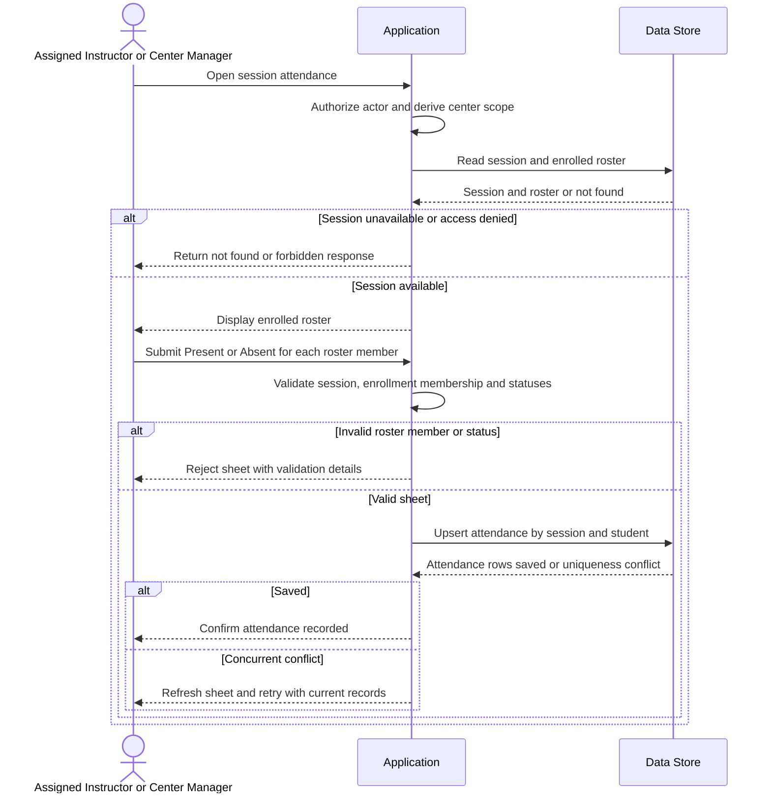

# Record attendance

**Use case:** UC-ATT-01 — Record session attendance sheet.

**Participants:** Assigned Course Instructor or Center Manager (actor), Application, Data Store.

**Preconditions:** Actor is signed in and authorized for the center and course; session exists and belongs to that center.

**Main scenario:** Actor loads the session roster, marks each enrolled student Present or Absent, and submits the sheet. Application validates roster membership and statuses, then inserts or updates one attendance row per session/student.

**Alternative scenarios:** Resubmission updates existing attendance entries rather than creating duplicates.

**Error scenarios:** Unauthorized or cross-center access, nonexistent session, student not enrolled, invalid attendance status, or write failure. A unique session/student constraint protects concurrent submissions.

**Mermaid code:**

**الشرح بالعربية:** يعرض التطبيق قائمة المسجلين في الجلسة بعد التحقق من صلاحية المدرب أو المدير. يرسل المستخدم حالات الحضور، ويتأكد التطبيق من أن كل طالب ضمن القائمة وأن الحالة صحيحة. تحفظ السجلات بالتحديث أو الإدراج وفق مفتاح الجلسة والطالب لمنع التكرار عند الإرسال المتزامن.

**Open questions:** لا تتوفر ERD/DBML لتأكيد مفتاح التفرد الدقيق. يلزم توضيح ما إذا كان يمكن تعديل الحضور بعد إغلاق الجلسة ومن يملك ذلك.
