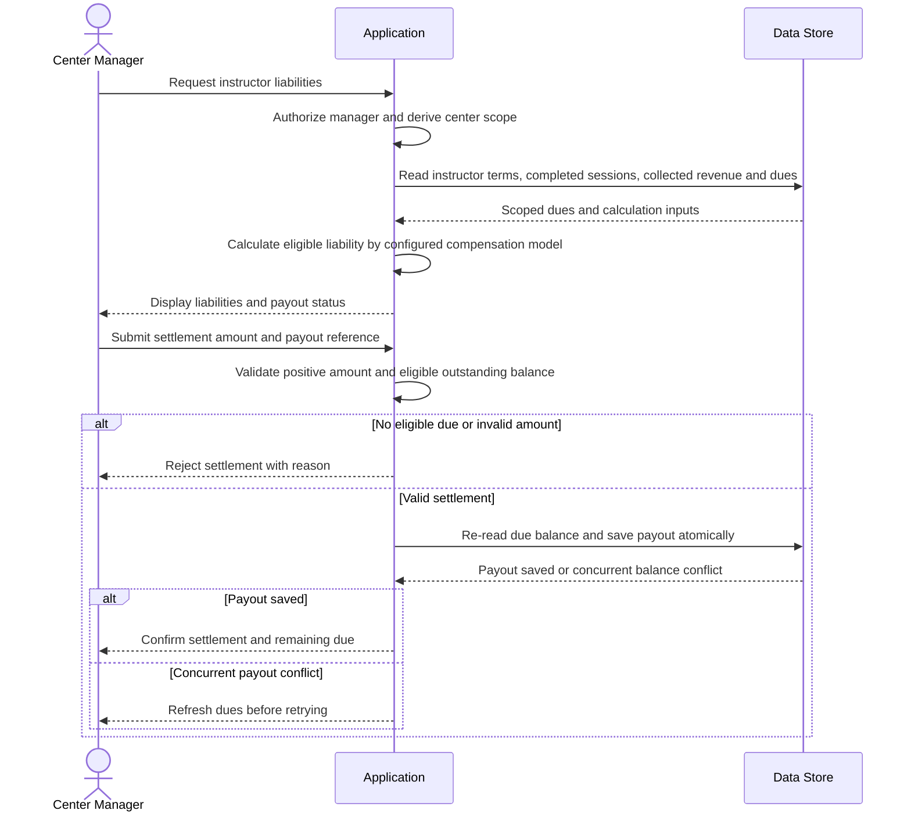

# Review instructor dues and settle payout

**Use case:** UC-INSFIN-01 / UC-INSFIN-02 — Review liabilities and disburse instructor settlement.

**Participants:** Center Manager (actor), Application, Data Store.

**Preconditions:** Manager is authorized; instructor and dues belong to the manager's center. Instructor compensation terms exist.

**Main scenario:** Manager requests liabilities; application reads applicable dues and compensation terms; manager records a payout against eligible outstanding dues; application validates amount and records settlement and audit data.

**Alternative scenarios:** Due calculation follows configured model: fixed amount, percentage of collected revenue, or per completed session. Per-session dues accrue only for sessions actually completed and officially documented with attendance. Partial settlement leaves remainder outstanding.

**Error scenarios:** Unauthorized/cross-center request, no eligible due, invalid/over-remaining payout, or concurrent payout. Recheck current due balance at write time to prevent overpayment.

**Mermaid code:**

**الشرح بالعربية:** يعرض التطبيق مستحقات المدرب للمدير وفق شروط التعويض المسجلة. تُحسب أجرة الجلسة فقط للجلسات المنفذة والمثبتة بالحضور. عند تسجيل دفعة، يتحقق التطبيق من المبلغ والمستحق القائم ويعيد قراءته عند الحفظ لمنع صرف مبلغ يتجاوز الرصيد بسبب عمليات متزامنة.

**Open questions:** لا تتوفر ERD/DBML. لم تحدد الوثائق قواعد توزيع مستحقات النسبة المئوية عند تعدد المدربين أو تفاصيل تعديل/تسوية المستحقات المتنازع عليها.
