# User Flow Specification: VELORA (فيلورا)

## 1. Flow Overview & Metadata

- **Flow Title:** Student Registration, Course Enrollment, Capacity & Waitlist, Admin Payment Approval & Excess Refund Lifecycle  
  *(تسجيل الطلاب والالتحاق بالدورات وإدارة السعة وقوائم الانتظار والاعتماد الإداري للأقساط واسترداد الفائض المالي)*
- **Primary User Role:** `Sales Specialist` (مسؤول المبيعات والمتابعة) / `Center Manager` (مدير المركز) / `Accountant` (المحاسب)
- **Secondary Impacted Role:** `Enrolled Student` (المتدرب / الطالب)
- **Scope:** Core MVP Feature (Features 3, 5 & 10 from [PRD.md](file:///D:/docs/docs/PRD.md) — Sections 10.3, 10.5, 10.10, Flow 13.2 مع كافة القرارات الإدارية المعتمدة)
- **Flow Objective:** 
  تمكين موظفي المركز من تسجيل الطلاب وإلحاقهم بالدورات النشطة مع فحص السعة القصوى وإدارة قوائم الانتظار آلياً بنظام الأسبقية (FIFO)، وضبط الخصومات بدقة، وإدخال سندات القبض المالية لتخضع لاعتماد إداري إلزامي مسبق، مع المعالجة التلقائية الإلزامية لأي فائض مالي عبر إنشاء وتنفيذ طلب استرداد (`Refund Request`) للطالب دون تحويله لرصيد دائن.

---

## 2. Mermaid Flowchart (flowchart TD)

```mermaid
flowchart TD
    %% ==========================================
    %% PHASE 1: AUTHENTICATION & ACCESS CONTROL
    %% ==========================================
    subgraph Phase1 ["1. المصادقة وتحديد النطاق (Authentication & Tenant Scoping)"]
        Start(["Start: Staff Member Accesses VELORA"])
        LoginUser["User enters Email and Password (SCR-01)"]
        CheckAuth{"Valid Credentials & Active Account?\n(FR-AUTH-01/02)"}
        AuthError["Display Error: Invalid credentials or account suspended\n(ERR_AUTH_INVALID / ERR_AUTH_SUSPENDED)"]
        AccessDenied(["End: Access Denied"])
        ExtractTenant["Backend validates session & extracts CenterID\n(BR-TEN-01 / FR-TEN-02)"]
        RouteSales["Redirect to Sales Dashboard\n(SCR-S01 / FR-AUTH-05)"]
    end

    %% ==========================================
    %% PHASE 2: STUDENT DISCOVERY & INTAKE
    %% ==========================================
    subgraph Phase2 ["2. استكشاف بيانات الطالب وتسجيله (Student Discovery & Intake)"]
        SearchDirectory["Search Student Directory by Name, Phone, or Email\n(SCR-S02 / UN-S01)"]
        StudentFound{"Student record exists in current Center?\n(FR-STU-01)"}
        OpenNewStudentModal["Click 'New Student' & fill profile form:\nFull Name, Phone, Email, Civil ID, Notes\n(SCR-S03)"]
        ValidateStudentForm{"Form valid & Email/Phone unique?\n(FR-STU-01)"}
        StudentFormError["Display Inline Form Error:\nFix highlighted fields"]
        PersistStudent["Save Student Profile to Center Database\n(FR-009)"]
        SelectStudent["Select Student Profile for Enrollment"]
    end

    %% ==========================================
    %% PHASE 3: COURSE SELECTION, CAPACITY & WAITLIST
    %% ==========================================
    subgraph Phase3 ["3. اختيار الدورة وفحص السعة والانتظار (Course Selection, Capacity & Waitlist)"]
        ClickEnroll["Click 'Enroll in Course' Button\n(SCR-S03)"]
        SelectCourse["Select Course Cohort from Active Courses List"]
        CheckCourseActive{"Is Course status 'Active'?\n(FR-CRS-02 / BR-CRS-03)"}
        CourseNotActiveError["Display Error: Enrollments only allowed for Active courses"]
        CheckCapacity{"Course Capacity reached?\n(Capacity defined & EnrolledCount >= Capacity)\n(BR-CRS-CAPACITY-HARDLOCK)"}
        CapacityHalt["Halt Direct Enrollment\nDisplay Alert: Course is at full capacity"]
        PromptWaitlist{"Add student to Course Waitlist?\n(BR-CRS-WAITLIST-FIFO)"}
        AbortWaitlist(["End: Enrollment Cancelled (Capacity Full)"])
        AddToWaitlist["Record Student on Course Waitlist:\nStatus = 'Waiting'\nTimestamp for FIFO Priority\n(Zero fees charged / Not official enrollment)"]
        EndWaitlistActive(["End: Student Placed on Waitlist (Waiting Status)"])
        CheckDuplicate{"Student already actively enrolled in this course?\n(FR-011 / BR-STU-01 / EC-001)"}
        DuplicateError["Display HTTP 409 Conflict Error:\n'Student is already actively enrolled in this course'\n(EC-STU-01)"]
        AbortDuplicate(["End: Enrollment Blocked"])
        DisplayBasePrice["Display Catalog Base Price\n(FR-STU-03)"]
        ApplyDiscountPrompt{"Apply Discount to Enrollment?\n(FR-STU-02)"}
        EnterDiscount["Enter Discount Value (Fixed Amount or %)\n(FR-STU-02)"]
        ValidateDiscount{"Discount Amount <= Base Price?\n(BR-STU-01 / EC-STU-02)"}
        DiscountError["Display Error: Discount cannot exceed Base Price\n(EC-STU-02)"]
        CalculatePayableDiscount["Compute: FinalPayable = BasePrice - DiscountAmount\n(FR-STU-03)"]
        CalculatePayableNoDiscount["Set: FinalPayable = BasePrice\n(DiscountAmount = 0.00)"]
        SubmitEnrollment["Confirm & Submit Enrollment Request"]
        InitializeLedger["Initialize Student Financial Ledger:\nBasePrice, DiscountAmount, FinalPayable,\nTotalPaid = 0.00, RemainingBalance = FinalPayable,\nPaymentStatus = 'Unpaid'\n(FR-FIN-01)"]
        PersistEnrollment["Persist Enrollment Record & Increment Enrolled Count\n(Scoped to CenterID, StudentID, CourseID)\n(BR-CRS-CAPACITY-SYNC)"]
    end

    %% ==========================================
    %% PHASE 4: OFFLINE PAYMENT ENTRY & OVERPAYMENT DETECTION
    %% ==========================================
    subgraph Phase4 ["4. إدخال السند واكتشاف الفائض (Payment Entry & Excess Detection)"]
        CollectPaymentPrompt{"Record initial installment / deposit now?\n(FR-FIN-02 / Flow 13.2)"}
        ConfirmUnpaid["Confirm Enrollment without immediate payment.\nStatus remains 'Unpaid'.\nAdded to Sales Overdue Follow-up Queue\n(SCR-S01)"]
        EndUnpaid(["End: Enrollment Active (Unpaid / Scheduled)"])
        OpenPaymentModal["Open 'Record Payment' Modal\n(SCR-S04 / SCR-M05)"]
        EnterPaymentDetails["Enter Payment Amount, Date, Method\n(Cash, POS_Card, BankTransfer, Cheque),\nReceipt Reference & Internal Notes\n(FR-FIN-02)"]
        ValidateAmountPositive{"Payment Amount > 0.00?\n(BR-FIN-01 / EC-FIN-02)"}
        AmountZeroError["Display Error: Payment amount must be greater than 0.00\n(EC-008)"]
        CheckOverpayment{"Payment Amount > RemainingBalance?\n(Auto-detect Excess Amount)"}
        DetectExcess["System detects Overpayment:\nCompute ExcessAmount = Amount - RemainingBalance\nDisplay Alert: Excess amount identified"]
        CreateRefundRequest["Auto-create Linked 'Refund Request':\nAmount = ExcessAmount\nStatus = 'Pending Refund'"]
        SubmitForApprovalWithRefund["Submit Payment to Approval Queue:\nPayment Status = 'Pending Approval'\nLinked with Pending Refund Request"]
        SubmitStandardPayment["Submit Payment to Approval Queue:\nPayment Status = 'Pending Approval'\n(Standard Amount)"]
    end

    %% ==========================================
    %% PHASE 5: ADMINISTRATIVE APPROVAL & ACID LEDGER UPDATE
    %% ==========================================
    subgraph Phase5 ["5. الاعتماد الإداري والترحيل المحاسبي الذري (Admin Approval & Ledger Update)"]
        ManagerReviewsQueue["Manager / Accountant reviews Approval Queue (SCR-M07)\nInspects Payment Details, Receipts & Excess Alerts"]
        ApprovePaymentChoice{"Approve Payment Voucher?\n(Decision 1: Administrative Approval)"}
        RejectPayment["Reject Payment with mandatory audit rationale\nPayment Status = 'Rejected'\nStudent Balance remains Unchanged"]
        EndRejected(["End: Payment Rejected (Balance Unchanged)"])
        BeginTransaction["Begin Atomic Database Transaction (ACID)\n(NFR-REL-01)"]
        ExecuteTransaction{"Transaction executes successfully?\n(EC-012)"}
        RollbackDB["Rollback Transaction completely:\nZero partial records stored\n(NFR-REL-01)"]
        ShowServerError["Display Error: Transaction failed. Please retry\n(ERR_SERVER_ERROR)"]
        EndTxFailed(["End: Operation Rolled Back"])
        PersistApprovedPayment["Update Payment Status = 'Completed'\nPersist Immutable Financial Record\n(BR-FIN-03 / FR-FIN-05)"]
        RecalculateBalance["Recalculate Student Balance:\nNetCourseApplied = Amount - ExcessAmount\nTotalPaid = TotalPaid + NetCourseApplied\nRemainingBalance = FinalPayable - TotalPaid"]
        DeterminePaymentStatus{"Remaining Balance Evaluation"}
        SetFullyPaid["Update Enrollment Status = 'FullyPaid'\n(RemainingBalance == 0.00)"]
        SetPartiallyPaid["Update Enrollment Status = 'PartiallyPaid'\n(RemainingBalance > 0.00)"]
        CheckHasRefund{"Is Refund Request attached?\n(ExcessAmount > 0.00)"}
        CreateAuditLog["Write Immutable AuditLog Entry:\nUserID, CenterID, Old/New Balance, IP, Timestamp\n(FR-AUD-01/02)"]
        CommitTransaction["Commit Atomic Transaction\n(NFR-REL-01)"]
        IssueReceipt["Issue Official Approved Receipt (REC-XXXX)\nUpdate Sales & Student Dashboards (SCR-ST04 / SCR-S01)"]
        EndPaymentSuccess(["End: Enrollment Confirmed & Payment Approved"])
    end

    %% ==========================================
    %% PHASE 6: EXCESS REFUND EXECUTION LIFECYCLE
    %% ==========================================
    subgraph Phase6 ["6. دورة تنفيذ استرداد الفائض المالي (Excess Refund Execution Lifecycle)"]
        QueueRefund["Queue Refund Request for Execution:\nStatus = 'Pending Refund'\n(e.g., 20 NIS excess on 100 NIS fee)"]
        ExecuteRefundPayout["Center Staff executes Refund Payout to Student\nDocument: Amount, Payout Date, Method\n(Cash / Bank Transfer), and Reference"]
        VerifyRefundExecution{"Was refund payout confirmed executed?\n(Financial constraint: Verified payout)"}
        SetRefundFailed["Update Status = 'Refund Failed'\nDocument failure reason & re-queue for finance team"]
        EndRefundFailed(["End: Refund Failed (Action Required)"])
        SetRefunded["Update Status = 'Refunded'\nTimestamp Execution Confirmation"]
        LogRefundAudit["Write Immutable AuditLog for Refund Execution\nPreserve all historical records (No Deletions)"]
        IssueRefundVoucher["Issue Official Refund Voucher to Student\nUpdate Center Financial Register"]
        EndRefundSuccess(["End: Excess Refund Executed & Closed"])
    end

    %% ==========================================
    %% TRANSITIONS & CONNECTIONS
    %% ==========================================
    Start --> LoginUser
    LoginUser --> CheckAuth
    CheckAuth -->|No| AuthError
    AuthError --> AccessDenied
    CheckAuth -->|Yes| ExtractTenant
    ExtractTenant --> RouteSales
    RouteSales --> SearchDirectory

    SearchDirectory --> StudentFound
    StudentFound -->|No| OpenNewStudentModal
    OpenNewStudentModal --> ValidateStudentForm
    ValidateStudentForm -->|No| StudentFormError
    StudentFormError --> OpenNewStudentModal
    ValidateStudentForm -->|Yes| PersistStudent
    PersistStudent --> SelectStudent
    StudentFound -->|Yes| SelectStudent

    SelectStudent --> ClickEnroll
    ClickEnroll --> SelectCourse
    SelectCourse --> CheckCourseActive
    CheckCourseActive -->|No| CourseNotActiveError
    CourseNotActiveError --> SelectCourse
    CheckCourseActive -->|Yes| CheckCapacity
    CheckCapacity -->|Yes| CapacityHalt
    CapacityHalt --> PromptWaitlist
    PromptWaitlist -->|No| AbortWaitlist
    PromptWaitlist -->|Yes| AddToWaitlist
    AddToWaitlist --> EndWaitlistActive

    CheckCapacity -->|No| CheckDuplicate
    CheckDuplicate -->|Yes| DuplicateError
    DuplicateError --> AbortDuplicate
    CheckDuplicate -->|No| DisplayBasePrice

    DisplayBasePrice --> ApplyDiscountPrompt
    ApplyDiscountPrompt -->|Yes| EnterDiscount
    EnterDiscount --> ValidateDiscount
    ValidateDiscount -->|No| DiscountError
    DiscountError --> EnterDiscount
    ValidateDiscount -->|Yes| CalculatePayableDiscount
    CalculatePayableDiscount --> SubmitEnrollment
    ApplyDiscountPrompt -->|No| CalculatePayableNoDiscount
    CalculatePayableNoDiscount --> SubmitEnrollment

    SubmitEnrollment --> InitializeLedger
    InitializeLedger --> PersistEnrollment
    PersistEnrollment --> CollectPaymentPrompt

    CollectPaymentPrompt -->|No| ConfirmUnpaid
    ConfirmUnpaid --> EndUnpaid
    CollectPaymentPrompt -->|Yes| OpenPaymentModal

    OpenPaymentModal --> EnterPaymentDetails
    EnterPaymentDetails --> ValidateAmountPositive
    ValidateAmountPositive -->|No| AmountZeroError
    AmountZeroError --> EnterPaymentDetails
    ValidateAmountPositive -->|Yes| CheckOverpayment

    CheckOverpayment -->|Yes| DetectExcess
    DetectExcess --> CreateRefundRequest
    CreateRefundRequest --> SubmitForApprovalWithRefund
    SubmitForApprovalWithRefund --> ManagerReviewsQueue

    CheckOverpayment -->|No| SubmitStandardPayment
    SubmitStandardPayment --> ManagerReviewsQueue

    ManagerReviewsQueue --> ApprovePaymentChoice
    ApprovePaymentChoice -->|No| RejectPayment
    RejectPayment --> EndRejected
    ApprovePaymentChoice -->|Yes| BeginTransaction

    BeginTransaction --> ExecuteTransaction
    ExecuteTransaction -->|No| RollbackDB
    RollbackDB --> ShowServerError
    ShowServerError --> EndTxFailed

    ExecuteTransaction -->|Yes| PersistApprovedPayment
    PersistApprovedPayment --> RecalculateBalance
    RecalculateBalance --> DeterminePaymentStatus

    DeterminePaymentStatus -->|Remaining == 0.00| SetFullyPaid
    DeterminePaymentStatus -->|Remaining > 0.00| SetPartiallyPaid

    SetFullyPaid --> CheckHasRefund
    SetPartiallyPaid --> CheckHasRefund

    CheckHasRefund -->|No| CreateAuditLog
    CheckHasRefund -->|Yes| QueueRefund
    QueueRefund --> CreateAuditLog

    CreateAuditLog --> CommitTransaction
    CommitTransaction --> IssueReceipt
    IssueReceipt --> EndPaymentSuccess

    QueueRefund -.-> ExecuteRefundPayout
    ExecuteRefundPayout --> VerifyRefundExecution
    VerifyRefundExecution -->|No| SetRefundFailed
    SetRefundFailed --> EndRefundFailed
    VerifyRefundExecution -->|Yes| SetRefunded
    SetRefunded --> LogRefundAudit
    LogRefundAudit --> IssueRefundVoucher
    IssueRefundVoucher --> EndRefundSuccess
```

---

## 3. الشرح التفصيلي لرحلة المستخدم (باللغة العربية)

### 3.1 رحلة المستخدم الرئيسية (Main User Journey)
تمثل هذه الرحلة دورة العمل المتكاملة والمحدثة وفقاً لكافة القرارات الإدارية المعتمدة (بما فيها السعة القصوى وقوائم الانتظار والاعتماد الإداري واسترداد الفائض):

1. **المصادقة وتحديد النطاق (Authentication & Scoping):**
   - يسجل موظف المبيعات دخوله عبر البريد الإلكتروني وكلمة المرور. يتحقق النظام من صحة البيانات وحالة الحساب (`Active`).
   - يُستخرج معرّف المركز (`CenterID`) من الجلسة الآمنة تلقائياً لفرض العزل الصارم على مستوى الخادم (`BR-TEN-01`).
   - يُوجّه الموظف مباشرة إلى لوحة تحكم المبيعات (`SCR-S01`).

2. **استكشاف بيانات المتدرب وتسجيله (Student Discovery & Intake):**
   - يبحث الموظف في دليل الطلاب بواسطة الاسم أو الهاتف أو البريد.
   - إذا كان الطالب غير مسجل، يفتح نافذة إنشاء ملف طالب جديد مع التحقق من عدم تكرار البريد أو الهاتف داخل المركز نفسه (`FR-STU-01`).
   - يُختار ملف الطالب للانتقال إلى شاشة التسجيل في الدورة.

3. **اختيار الدورة، فحص السعة، وإدارة قائمة الانتظار (Course Selection, Capacity & Waitlist):**
   - يختار الموظف الدورة التدريبية المطلوبة.
   - يتحقق النظام من كون الدورة في حالة نشطة (`Active`).
   - **فحص السعة القصوى وقائمة الانتظار (OQ-06 المعتمد):**
     1. يتحقق النظام تلقائياً من عدد الطلاب المسجلين فعلياً في الدورة مقارنة بالسعة القصوى (`Capacity`).
     2. **إذا كانت السعة مكتملة (`Enrolled >= Capacity`):** يوقف النظام التسجيل المباشر فوراً لمنع تجاوز السعة (`BR-CRS-CAPACITY-HARDLOCK`).
     3. يعرض النظام خيار إضافة الطالب إلى **قائمة الانتظار (`Waitlist`)**.
     4. في حال موافقة الطالب، يُسجل في قائمة الانتظار بحالة `Waiting` مع حفظ توقيت الطلب لضمان ترتيب الأسبقية الزمني (`FIFO Priority`).
     5. **قيد جوهري:** لا يُعد طالب قائمة الانتظار مسجلاً رسمياً في الدورة، ولا تُحتسب عليه أي رسوم مالية قبل توفر مقعد وتأكيد تسجيله.
     6. **في حال توفر مقعد شاغر:** يُخطر النظام أول طالب في القائمة (`Notified`) لمنحه مهلة استكمال التسجيل، وعند التأكيد يتحول إلى `Enrolled`.
     7. **إذا لم تكتمل السعة (أو لم تُحدد سعة للدورة):** يتابع النظام إجراءات التسجيل المباشر.
   - يتحقق النظام من عدم وجود تسجيل نشط مسبق للطالب في نفس الدورة منعاً للازدواجية (`EC-001` يعيد `HTTP 409 Conflict`).
   - يعرض النظام السعر الأساسي (`BasePrice`) ويُتيح تطبيق خصم مصرح به (`Discount <= BasePrice`).
   - يُحسب المستحق النهائي: `FinalPayable = BasePrice - DiscountAmount`.
   - يُنشأ السجل المالي الأولي للطالب بحالة `Unpaid` ورصيد متبقٍ مساوٍ لكامل الرسوم، ويُحدّث عداد المقاعد تلقائياً (`BR-CRS-CAPACITY-SYNC`).

4. **إدخال سند السداد واكتشاف الفائض التلقائي (Payment Entry & Excess Detection):**
   - يُدخل الموظف بيانات الدفعة الفورية: المبلغ، التاريخ، طريقة الدفع (`Cash`, `POS_Card`, `BankTransfer`, `Cheque`)، ورقم الإيصال.
   - يتحقق النظام من إيجابية المبلغ (`Amount > 0.00`).
   - **اكتشاف الفائض آلياً (Overpayment Detection):**
     - يقارن النظام آلياً بين المبلغ المدفوع والرصيد المستحق.
     - إذا تجاوز المبلغ المدفوع الرصيد (مثال: الرسوم 100 شيكل والمدفوع 120 شيكل):
       1. يكتشف النظام الفائض ويحسب قيمته فوراً (20 شيكل).
       2. يعرض تنبيهاً صريحاً لموظف المبيعات والمحاسب بقيمة المبلغ الزائد.
       3. يُنشئ النظام تلقائياً **طلب استرداد مالي (`Refund Request`)** مرتبطاً بالسند بقيمة 20 شيكل وبحالة أولية `Pending Refund`.
       4. يُرسل السند لطابور الاعتماد الإداري بحالة `Pending Approval`.

5. **الاعتماد الإداري للسند والترحيل المحاسبي الذري (Admin Approval & Ledger Update):**
   - **القرار المعتمد 1:** لا يُعدّل الرصيد المالي المعتمد للطالب بمجرد إدخاله من المبيعات؛ بل يخضع لـ **اعتماد إداري صريح** من مدير المركز أو المحاسب (`SCR-M07`).
   - يراجع المدير/المحاسب تفاصيل السند والمرفقات وتنبيهات الفائض.
   - **إذا رُفض السند:** يُوثق سبب الرفض في سجل التدقيق، وتتحول حالة السند إلى `Rejected`، ويبقى رصيد الطالب كما هو دون أي تعديل.
   - **إذا اعتُمد السند:** تبدأ معاملة ذرية متكاملة (`BEGIN TRANSACTION`):
     1. تتحول حالة السند المالي إلى `Completed` ويُثبت كسند غير قابل للحذف المادي (`Immutable`).
     2. يُرحّل المبلغ الصافي للدورة (100 شيكل في المثال)، وتتحول حالة سداد الدورة إلى مكتمل السداد (`FullyPaid`).
     3. يُنشأ قيد تدقيق غير قابل للتعديل (`AuditLog`) يرصد هوية المعتمد والتاريخ والأرصدة قبل وبعد.
     4. تُعتمد المعاملة نهائياً (`COMMIT`).
     5. يُصدر النظام إيصال سداد رسمي معتمد (`REC-XXXX`) وتتحدث الشاشات فوراً.

6. **دورة تنفيذ استرداد الفائض المالي (Excess Refund Execution Lifecycle):**
   - **القرار المعتمد 2:** يُلزم النظام المركز باسترداد المبلغ الزائد (20 شيكل) للطالب نقداً أو تحويلاً، ويمنع تحويله تلقائياً كرصيد دائن.
   - يدخل طلب الاسترداد طابور التنفيذ المالي بحالة `Pending Refund`.
   - يقوم الموظف المالي بتنفيذ الاسترداد الفعلي للطالب ويوثق تاريخ وطريقة الصرف ورقم الإيصال.
   - **قيد مالي صارم:** لا يُعتبر المبلغ المسترد عملية مكتملة إلا بعد تأكيد تنفيذ الاسترداد فعلياً:
     - **عند التأكيد الناجح:** تتحول الحالة إلى `Refunded`، ويُنشأ قيد تدقيق غير قابل للحذف، ويُصدر سند استرداد رسمي للطالب.
     - **عند تعثر التنفيذ:** تتحول الحالة إلى `Refund Failed` مع تدوين سبب التعثر وإعادة إدراج الطلب للمتابعة المالية.

---

### 3.2 نقاط اتخاذ القرار الحرجة (Critical Decision Points)

1. **هل بيانات اعتماد المستخدم صالحة وحسابه نشط؟**  
   - نعم: استخراج `CenterID` والتوجيه للوحة التحكم.  
   - لا: رفض الدخول مع رسالة خطأ آمنة دون كشف تفاصيل الحساب (`ERR_AUTH_INVALID`).
2. **هل الطالب مسجل مسبقاً في دليل المركز؟**  
   - نعم: اختياره فوراً والانتقال للتسجيل.  
   - لا: فتح نموذج تسجيل طالب جديد والتحقق من صحة الحقول وعدم تكرار البريد أو الهاتف.
3. **هل الدورة في حالة نشطة (`Active`)؟**  
   - نعم: الانتقال لفحص السعة.  
   - لا: منع التسجيل وعرض تنبيه بأن التسجيل مقتصر على الدورات النشطة فقط.
4. **هل وصلت الدورة إلى السعة القصوى المحددة (`CheckCapacity`)؟**  
   - نعم: إيقاف التسجيل المباشر فوراً وعرض خيار الانضمام لقائمة الانتظار (`PromptWaitlist`).  
     - إذا وافق الطالب: إدراجه في قائمة الانتظار بحالة `Waiting` دون فرض أي رسوم مالية.  
     - إذا رفض: إلغاء محاولة التسجيل.  
   - لا (أو لا توجد سعة محددة): متابعة التسجيل المباشر.
5. **هل الطالب مسجل بالفعل بنشاط في نفس الدورة؟**  
   - نعم: إيقاف العملية وإرجاع خطأ تعارض (`HTTP 409 Conflict`) لمنع التكرار (`EC-001`).  
   - لا: متابعة ضبط الشروط المالية.
6. **هل الخصم المدخل قانوني (`Discount <= BasePrice`)؟**  
   - نعم: اعتماد الخصم وحساب المستحق الصافي.  
   - لا: رفض النموذج وإلزام الموظف بتصحيحه (`EC-STU-02`).
7. **هل المبلغ المدفوع أكبر من الرصيد المتبقي المستحق (`Overpayment Detection`)؟**  
   - نعم: اكتشاف الفائض آلياً، إطلاق التنبيه، وإنشاء طلب استرداد مالي (`Refund Request`) بحالة `Pending Refund` بقيمة الفرق، وربطه بالسند.  
   - لا: إرسال السند القياسي مباشرة لطابور الاعتماد.
8. **هل اعتمدت الإدارة السند المالي (`Administrative Approval`)؟**  
   - نعم: بدء المعاملة الذرية وترحيل السند وتحديث رصيد الطالب.  
   - لا: رفض السند (`Rejected`) مع تدوين السبب في سجل التدقيق وإبقاء رصيد الطالب دون أي تغيير.
9. **هل نجحت المعاملة الذرية في قاعدة البيانات؟**  
   - نعم: تثبيت السند وتحديث حالة الدورة وكتابة قيد التدقيق وإصدار الإيصال المعتمد.  
   - لا: تنفيذ تراجع كامل (`Rollback`) لمنع أي بيانات جزئية (`NFR-REL-01`).
10. **هل تم تأكيد تنفيذ استرداد الفائض المالي للطالب فعلياً؟**  
    - نعم: تحويل حالة طلب الاسترداد إلى `Refunded` وإصدار سند الصرف وإغلاق المعاملة.  
    - لا / تعثر: تحويل الحالة إلى `Refund Failed` وتنبيه الإدارة المالية للتدخل.

---

### 3.3 سيناريوهات النجاح (Success Scenarios)

- **السيناريو الأول (اكتمال السعة والإدراج في قائمة الانتظار - Waitlist Success):**  
  دورة سعتها 20 طالباً وبها 20 طالباً مسجلاً. يحاول الموظف تسجيل المتدرب طارق. يكتشف النظام اكتمال السعة ويوقف التسجيل المباشر، ويعرض الانضمام لقائمة الانتظار. يوافق طارق؛ يُسجل النظام اسمه بترتيب الأسبقية (#1) بحالة `Waiting` مع عدم إنشاء أي مطالبة مالية.
- **السيناريو الثاني (إخلاء مقعد وتصعيد طالب قائمة الانتظار - Waitlist Promotion):**  
  ينسحب طالب من الدورة أعلاه. يكتشف النظام توفر مقعد شاغر، فيُخطر فوراً الطالب رقم 1 (طارق) وتتحول حالته إلى `Notified`. يستكمل طارق إجراءات التسجيل والسداد ليتحول إلى `Enrolled` وتُقفل السعة مجدداً.
- **السيناريو الثالث (سداد مع وجود فائض واسترداد معتمد - Fully Paid + Refunded):**  
  رسوم الدورة 100 شيكل. يدفع الطالب 120 شيكل نقدياً. يكتشف النظام الفائض (20 شيكل) ويُنشئ طلب استرداد بحالة `Pending Refund`. يعتمد المحاسب السند؛ يُرحّل 100 شيكل للدورة لتصبح `FullyPaid`. يقوم المحاسب بتسليم 20 شيكل نقداً للطالب ويؤكد العملية؛ تتحول حالة الاسترداد إلى `Refunded` مع إصدار السند وقيد التدقيق.
- **السيناريو الرابع (سداد جزئي معتمد - Partially Paid):**  
  رسوم الدورة 900 شيكل. يسدد الطالب دفعة أولى 300 شيكل. يدخل السند طابور الاعتماد (`Pending Approval`)، يعتمده المدير، فيصبح المدفوع 300 شيكل والمتبقي 600 شيكل والحالة `PartiallyPaid`.

---

### 3.4 سيناريوهات الخطأ وحالات الفشل (Error Scenarios)

- **محاولة تجاوز السعة المحددة (Capacity Exceeded Block):**  
  محاولة إجبار النظام على تسجيل طالب إضافي في دورة مكتملة العدد دون استخدام قائمة الانتظار. يمنع النظام العملية حتماً وفق قاعدة `BR-CRS-CAPACITY-HARDLOCK`.
- **رفض السند المالي إدارياً (Admin Rejection):**  
  إدخال سند إيداع بنكي برقم مرجعي غير مطابق؛ يفحص المحاسب ويرفض السند. تتحول الحالة إلى `Rejected` ويبقى رصيد الطالب دون أي تعديل.
- **تعثر تنفيذ الاسترداد المالي (Refund Failed):**  
  فشل الحوالة المصرفية لمبلغ الفائض (20 شيكل)؛ يسجل النظام حالة `Refund Failed` ويُبقي الاستحقاق قائماً لمتابعة الصرف نقداً.
- **خطأ ازدواجية التسجيل (Duplicate Active Enrollment - EC-001):**  
  محاولة تسجيل متدرب في دورة هو ملتحق بها بالفعل ونشط؛ يعيد النظام رمز `HTTP 409 Conflict`.
- **خطأ تجاوز الخصم لسعر الدورة (Discount Exceeds Price - EC-STU-02):**  
  إدخال خصم 1200 شيكل على دورة بقيمة 1000 شيكل؛ يرفض النظام الحفظ inline.

---

### 3.5 المسارات البديلة (Alternative Paths)

- **مسار قائمة الانتظار (Waitlist Path):** الانتقال التلقائي للانتظار عند اكتمال المقاعد دون فرض أي التزامات مالية على المتدرب.
- **مسار إلغاء طلب الانتظار:** في حال رغب الطالب في الانسحاب من قائمة الانتظار قبل توفر مقعد، تتحول حالته إلى `Cancelled`.
- **مسار تأجيل السداد:** تسجيل الطالب بحالة `Unpaid` وحجز المقعد في حال وجود شاغر، مع جدولته في طابور المتابعة المالية.
- **مسار التحويل النقدي عند تعثر الحوالة:** تحويل طريقة صرف الاسترداد إلى نقدي (`Cash`) عند فشل التحويل الإلكتروني وإتمام الصرف كـ `Refunded`.

---

## 4. مصفوفة قواعد العمل والقيود النظامية المعتمدة (Business Rules Matrix)

| كود القاعدة | نص القاعدة ومتطلبات التحقق | تطبيقها في مسار التدفق (User Flow Step) |
| :--- | :--- | :--- |
| **BR-TEN-01** | عزل المستأجر الصارم بالخادم؛ عدم الوثوق بمعرّف `CenterID` الممرر من واجهة العميل. | استخراج معرّف المركز تلقائياً بعد المصادقة وربطه بكافة العمليات. |
| **BR-CRS-03** | يجب أن تكون الدورة في حالة `Active` لقبول تسجيلات الطلاب. | فحص حالة الدورة (`CheckCourseActive`). |
| **BR-CRS-CAPACITY-HARDLOCK** | **منع تجاوز السعة الصارم:** إيقاف التسجيل المباشر تلقائياً عند اكتمال السعة المحددة، ومنع تجاوزها قطعياً. | فحص السعة (`CheckCapacity`) والتوجيه لقائمة الانتظار (`CapacityHalt`). |
| **BR-CRS-WAITLIST-FIFO** | **قائمة الانتظار بالأسبقية الزمنية:** حفظ الترتيب حسب أسبقية التسجيل (FIFO)، وعدم احتساب أي رسوم مالية على المتدرب قبل التأكيد. | خطوة الإضافة لقائمة الانتظار (`AddToWaitlist`). |
| **BR-CRS-WAITLIST-STATUS** | **حالات قائمة الانتظار:** الحالات المعتمدة هي `Waiting`، `Notified`، `Enrolled`، `Cancelled`. | دورة تصعيد واستكمال تسجيل قائمة الانتظار. |
| **BR-CRS-CAPACITY-SYNC** | **قيد المزامنة الفورية:** تحديث السعة وعدد المقاعد المتاحة تلقائياً عند تأكيد التسجيل أو إلغائه لمنع التجاوز. | خطوة حفظ التسجيل وتحديث العدادات (`PersistEnrollment`). |
| **BR-STU-01** | قيمة الخصم لا تتجاوز السعر الأساسي (`Discount <= BasePrice`)، والمستحق لا يقل عن صفر. | فحص حقل الخصم (`ValidateDiscount`) وحساب المستحق النهائي. |
| **FR-011 / EC-001** | منع ازدواجية التسجيل النشط لنفس الطالب في نفس الدورة `(CenterID, StudentID, CourseID)`. | فحص القيد الفريد (`CheckDuplicate`) وإرجاع خطأ `409 Conflict`. |
| **BR-FIN-01** | مبالغ سندات القبض المسجلة يجب أن تكون موجبة تماماً (`Amount > 0.00`). | فحص مبلغ السداد (`ValidateAmountPositive`) ورفض القيم الصفرية أو السالبة. |
| **BR-FIN-APPROVAL** | **إلزامية الاعتماد الإداري:** لا يُعدّل الرصيد المالي المعتمد للطالب إلا بعد مراجعة واعتماد السند إدارياً. | طابور الاعتماد الإداري (`ManagerReviewsQueue` و `ApprovePaymentChoice`). |
| **BR-FIN-OVERPAY-REFUND** | **إلزامية استرداد الفائض:** يُمنع تحويل الفائض لرصيد دائن للدورات القادمة، ويُلزم النظام المركز باسترداده للطالب. | اكتشاف الفائض آلياً وإنشاء `Refund Request` (`DetectExcess`). |
| **BR-FIN-REFUND-STATUS** | **دورة حالات الاسترداد:** الحالات المعتمدة هي `Pending Refund`، `Refunded`، `Refund Failed`. | دورة حياة الاسترداد بالمرحلة السادسة (`Phase 6`). |
| **BR-FIN-REFUND-VERIFY** | **قيد مالي صارم:** لا يُعتبر المبلغ المسترد عملية مكتملة إلا بعد تأكيد تنفيذ الاسترداد فعلياً. | التحقق الشرطي (`VerifyRefundExecution`) قبل الانتقال إلى `Refunded`. |
| **FR-FIN-05 / BR-FIN-03**| **عدم حذف الحركات المالية:** السندات المعتمدة وطلبات الاسترداد لا تُحذف نهائياً (Immutable Ledger). | المعاملة تحفظ السجلات نهائياً ولا توفر أي مسار للحذف المادي. |
| **FR-AUD-01/02** | تسجيل قيد تدقيق غير قابل للتعديل لكل حركة مالية متضمناً الرصيد قبل وبعد وبيانات المستخدم. | خطوة إنشاء قيد التدقيق (`CreateAuditLog` و `LogRefundAudit`). |
| **NFR-REL-01** | تنفيذ العمليات المالية متعددة الخطوات داخل معاملة ذرية موحدة (`ACID Transaction`). | خطوة `BeginTransaction` والتراجع الكامل `Rollback` عند أي تعثر. |

---

## 5. حالة الأسئلة المفتوحة والمتطلبات التشغيلية (Status of Decisions & Open Questions)

**جميع الأسئلة التشغيلية والمفتوحة تم حسمها واعتمادها إدارياً بنسبة 100%:**

1. **سؤال OQ-02 (دورة اعتماد مدفوعات مسؤولي المبيعات):**  
   - **الحالة:** **[تم الحسم والاعتماد إدارياً — RESOLVED]**  
   - **القرار المعتمد:** يُلزم النظام خضوع السندات المالية المدخلة من المبيعات لـ **اعتماد إداري صريح** من مدير المركز أو المحاسب قبل ترحيلها وتحديث الرصيد المعتمد للطالب.  
   - **الأثر على التدفق:** يدخل السند بحالة `Pending Approval`، ولا يُحدث الرصيد إلا بعد موافقة الإدارة؛ وفي حال الرفض يُرفض السند (`Rejected`) دون المساس برصيد الطالب.

2. **سؤال OQ-05 (المعالجة المحاسبية لفائض السداد - Overpayment):**  
   - **الحالة:** **[تم الحسم والاعتماد إدارياً — RESOLVED]**  
   - **القرار المعتمد:** **يُلزم النظام المركز باسترداد المبلغ الزائد للطالب فوراً، ولا يُحوَّل تلقائياً إلى رصيد دائن للدورات المستقبلية.**  
   - **آلية العمل المطبقة:**
     1. يكتشف النظام تلقائياً تجاوز المبلغ المدفوع للرصيد المستحق (`Amount > RemainingBalance`).
     2. يعرض النظام قيمة المبلغ الزائد ويُصدر تنبيهاً صريحاً لموظف المبيعات والمحاسب.
     3. يُنشأ تلقائياً طلب استرداد مالي (`Refund Request`) بقيمة المبلغ الزائد.
     4. يُنفّذ الاسترداد للطالب بالطريقة التي يحددها المركز (نقداً أو تحويلاً)، مع توثيق المبلغ وتاريخ وطريقة الاسترداد.
     5. تبقى عملية الاسترداد قيد المعالجة (`Pending Refund`) حتى تأكيد تنفيذها، ثم تتحول إلى `Refunded` (أو `Refund Failed` في حال التعثر).
     6. يحتفظ النظام بسجل تدقيق لجميع العمليات المالية، ولا يسمح بحذف السندات المالية المعتمدة مباشرة.
   - **مثال معتمد:** إذا كانت رسوم الدورة 100 شيكل ودفع الطالب 120 شيكل، فإن المبلغ المستحق للاسترداد هو 20 شيكل.
   - **قيد مالي صارم:** لا يُعتبر المبلغ المسترد عملية مكتملة إلا بعد تأكيد تنفيذ الاسترداد فعلياً.

3. **سؤال OQ-06 (سعة الدورة وقوائم الانتظار - Course Capacity & Waitlist):**  
   - **الحالة:** **[تم الحسم والاعتماد إدارياً — RESOLVED]**  
   - **القرار المعتمد:** **يمنع النظام تسجيل طلاب جدد في الدورة تلقائياً عند الوصول إلى السعة القصوى المحددة، ويتيح تسجيل الطلاب الراغبين في الالتحاق ضمن قائمة انتظار (Waitlist).**  
   - **آلية العمل المطبقة:**
     1. يحدد المدير السعة القصوى لكل دورة تدريبية.
     2. يتحقق النظام من عدد الطلاب المسجلين فعلياً قبل تأكيد أي تسجيل جديد.
     3. عند اكتمال السعة، يوقف النظام التسجيل المباشر ويتيح إضافة الطلاب إلى قائمة الانتظار.
     4. يحفظ النظام ترتيب الطلاب في قائمة الانتظار حسب أسبقية التسجيل (`FIFO Priority`).
     5. عند توفر مقعد شاغر، يُخطر النظام أول طالب في قائمة الانتظار لإتاحة استكمال إجراءات التسجيل.
     6. لا يُعد الطالب المسجل في قائمة الانتظار طالباً مسجلاً رسمياً في الدورة، ولا تُحتسب رسوم الدورة عليه قبل تأكيد تسجيله.
     7. يمنع النظام تجاوز السعة القصوى للدورة حتماً.
     8. إذا لم تُحدد سعة للدورة، يبقى التسجيل متاحاً دون تطبيق حد عددي.
   - **حالات قائمة الانتظار المعتمدة (Waitlist Status):**
     - `Waiting`: الطالب ينتظر توفر مقعد.
     - `Notified`: تم إخطار الطالب بتوفر مقعد.
     - `Enrolled`: تم تأكيد تسجيل الطالب في الدورة.
     - `Cancelled`: أُلغي طلب الانتظار.
   - **قيد وظيفي:** يجب على النظام تحديث السعة وعدد المقاعد المتاحة تلقائياً عند تأكيد التسجيل أو إلغاء تسجيل طالب، لمنع تجاوز السعة المحددة.
